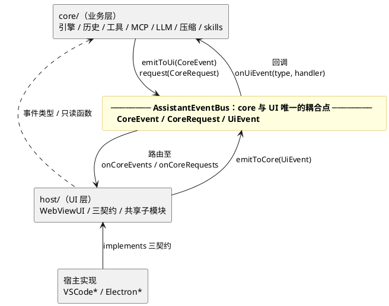
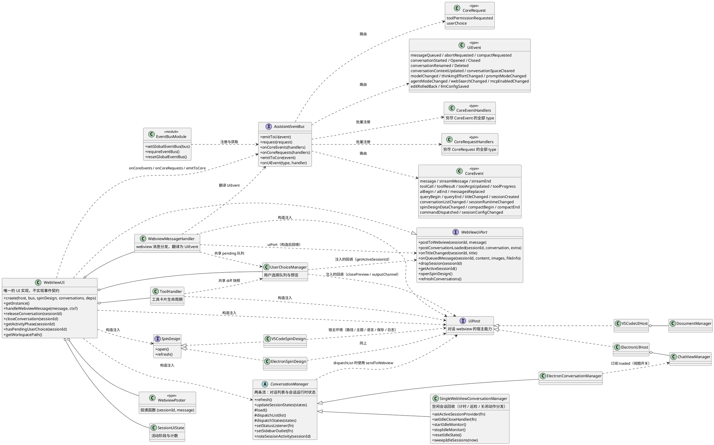
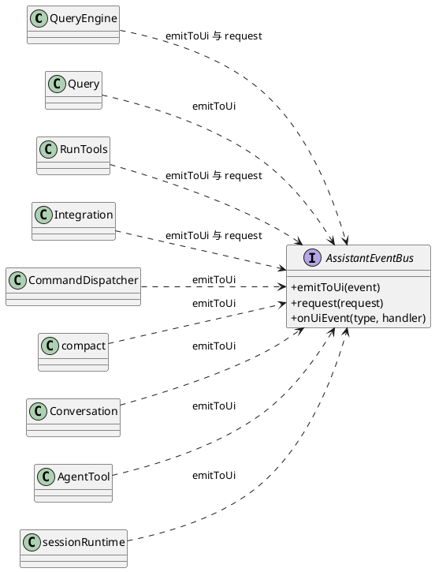
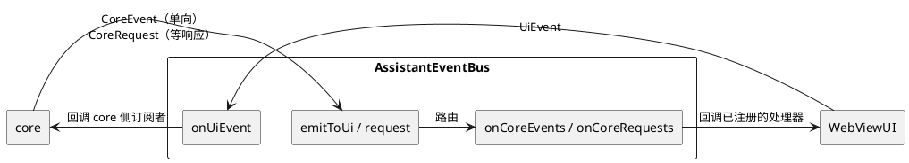

# TuxedoCat 开发文档

> 本文描述当前代码的架构实现（as-built），而非演进计划。
> 文档内容以代码为准；文档与代码不一致时，应先修正其中一方，使二者保持一致。
>
> 文档按章节逐步补齐。当前版本包含第 1–13 章。

---

## 目录

| 章 | 标题 | 状态 |
| --- | --- | --- |
| 1 | [架构总览](#1-架构总览) | 已完成 |
| 2 | [分层与依赖规则](#2-分层与依赖规则) | 已完成 |
| 3 | [核心契约：AssistantEventBus](#3-核心契约assistanteventbus) | 已完成 |
| 4 | [事件列表](#4-事件列表) | 已完成 |
| 5 | [契约：UIHost / SpinDesign / MCPHost / ConversationManager](#5-契约uihost--spindesign--mcphost--conversationmanager) | 已完成 |
| 6 | [实现：WebViewUI](#6-实现webviewui) | 已完成 |
| 7 | [共享子模块端口](#7-共享子模块端口) | 已完成 |
| 8 | [宿主实现对照表](#8-宿主实现对照表) | 已完成 |
| 9 | [webview 侧契约：HostInfo](#9-webview-侧契约hostinfo) | 已完成 |
| 10 | [会话级 UI 状态：SessionUiState](#10-会话级-ui-状态sessionuistate) | 已完成 |
| 11 | [宿主分叉清单](#11-宿主分叉清单) | 已完成 |
| 12 | [架构原则](#12-架构原则) | 已完成 |
| 13 | [待定事项](#13-待定事项) | 已完成 |

> 章节编号与代码注释中的 `DEVELOPMENT.md 第 N 节` 引用一一对应；调整章节编号时必须同步修改注释。

---

## 1. 架构总览

### 1.1 架构概述

core 与 UI 之间不存在直接引用，二者仅通过 `AssistantEventBus` 上的事件耦合。

`WebViewUI` 是唯一的 UI 实现，它不实现任何事件契约，只订阅总线并发送事件。
所有宿主差异收敛在三个契约上：

| 契约 | 职责范围 |
| --- | --- |
| `UIHost` | 对话 webview 的宿主能力 |
| `SpinDesign` | Spin 设计器（独立面板 / 窗口） |
| `ConversationManager` | 对话列表与会话运行时状态（空闲会话回收在 VS Code 实现里） |

### 1.2 分层结构

以模块为单位组织：三个分层模块（core / host / 宿主实现）加一个横跨 core 与 UI 的事件契约。
依赖方向单向：`宿主实现 → host/ → core/`，core 与 UI 之间唯一的边是 `AssistantEventBus`。



#### 模块一览

| 模块 | 位置 | 职责 | 依赖 | 被依赖 |
| --- | --- | --- | --- | --- |
| core（业务层） | `src/core/` | 引擎（`QueryEngine` / `Query` / `RunTools`）、历史（`history/`）、工具（`tools/`）、MCP（`mcp/`）、LLM 配置（`llm/`）、压缩（`compact/`）、skills、prompt、spin、会话运行时（`sessionRuntime.ts`）、命令分发（`CommandDispatcher.ts`） | `AssistantEventBus` 的事件类型与 `requireEventBus()` | host/、宿主实现（只读函数与类型） |
| AssistantEventBus（事件契约） | 类型在 `src/core/AssistantEventBus.ts`，实现在 `src/host/EventBus.ts` | core 与 UI 之间唯一的耦合点；事件词汇表 `CoreEvent` / `CoreRequest` / `UiEvent`；全局注册（`setGlobalEventBus` / `requireEventBus` / `resetGlobalEventBus`） | 无（纯接口 + 纯数据类型） | core、host、宿主实现 |
| host（UI 层） | `src/host/`，禁止 import `vscode` / `electron` | `WebViewUI`（唯一 UI 实现）；三契约 `UIHost` / `SpinDesign` / `ConversationManager`；总线实现；共享子模块（`ui/toolHandler.ts` / `ui/userChoice.ts` / `ui/webviewMessageHandler.ts`）；`SessionUiState` | core 的事件类型与只读函数 | 宿主实现（implements 三契约） |
| 宿主实现 | `src/VSCode*.ts`、`electron/*.ts` | 三契约的 VS Code / Electron 双端实现（`VSCodeUIHost` / `ElectronUIHost`、`VSCodeSpinDesign` / `ElectronSpinDesign`、`SingleWebViewConversationManager` / `ElectronConversationManager`）；bootstrap 接线（`extension.ts` / `main.ts`） | host/（三契约与 WebViewUI）、core 只读函数、宿主 API | —（顶层） |

#### 模块要点

- **core**：不依赖 UI、宿主与渲染。对外只做两件事——通过 `requireEventBus().emitToUi(...)`
  发单向事件、通过 `request(...)` 发请求-响应；对 `UiEvent` 是分散订阅
  （`bus.onUiEvent(type, handler)`，唯一注册入口为 `initializeCoreEvents.ts`）。
- **host/WebViewUI**：唯一的 UI 实现，不实现任何事件契约。构造时通过
  `onCoreEvents` / `onCoreRequests` 一次性注册处理器（映射类型强制穷尽检查），
  需要通知 core 时调用 `emitToCore(UiEvent)`；持有
  `SessionUiState` / `ToolHandler` / `UserChoiceManager` / `WebviewMessageHandler`，
  构造注入 `host` / `spinDesign` / `conversations` 三个契约。
- **三契约**：按 UI surface 划分——`UIHost` 服务对话 webview、`SpinDesign` 服务
  Spin 设计器、`ConversationManager` 服务对话列表与会话运行时状态；
  全部由宿主实现层提供，`WebViewUI` 只认契约不认实现。
- **宿主实现**：唯一允许 import `vscode` / `electron` 的层；同时负责 bootstrap 接线：
  `createEventBus` → `setGlobalEventBus` → `initializeCoreEvents` → `WebViewUI.create`。

### 1.3 目录布局

| 路径 | 职责 |
| --- | --- |
| `src/core/AssistantEventBus.ts` | 事件类型（`CoreEvent` / `CoreRequest` / `UiEvent`）、处理器映射类型、总线接口、全局注册（`setGlobalEventBus` / `requireEventBus` / `resetGlobalEventBus`） |
| `src/host/EventBus.ts` | 总线实现 `createEventBus()`，纯内存发布订阅，无宿主依赖 |
| `src/core/initializeCoreEvents.ts` | core 侧 `UiEvent` 订阅的唯一注册入口，由 bootstrap 在 `setGlobalEventBus` 之后调用一次 |
| `src/core/sessionRuntime.ts` | 会话运行时状态（`idle` / `waiting`）的唯一 owner，`sessionRuntimeChanged` 的生产者 |
| `src/core/tools/PermissionPolicy.ts` | 权限规则加工（agentMode → `resolveToolPermission`）与会话级 agentMode 存储 |
| `src/core/mcp/MCPHost.ts` | MCP 会话引用生命周期的唯一入口。它不是宿主契约，仅有一个 core 侧单例 |
| `src/host/WebViewUI.ts` | 唯一的 UI 实现；订阅总线、处理事件、发送 `UiEvent`；实现 `WebViewUiPort` |
| `src/host/UIHost.ts` | 契约 1：对话 webview 的宿主能力（interface，成员全部必选） |
| `src/host/SpinDesign.ts` | 契约 2：Spin 设计器（interface，`open` / `refresh`） |
| `src/host/settingsFile.ts` | 全局 `settings.json` 的宿主侧写入口（串行读-改-写；core 只读不写） |
| `src/host/ConversationManager.ts` | 契约 3：对话列表、会话运行时状态两条流（abstract class，模板方法），以及空闲会话回收的钩子（实现只在 VS Code 侧；core 不参与计时） |
| `src/host/ui/ports.ts` | `WebViewUiPort`、`WebviewPoster`、`ConversationLoadedExtra` |
| `src/host/ui/toolHandler.ts` | 工具卡片生命周期 |
| `src/host/ui/userChoice.ts` | 用户选择队列与预览 |
| `src/host/ui/webviewMessageHandler.ts` | webview 协议消息分发，并翻译为 `UiEvent` |
| `src/host/ui/types.ts` | 共享子模块的接口定义（`ShowVirtualDocumentEvent` / `ShowDiffInVirtualDocumentEvent` 等） |
| `src/host/ui/spinDesignHtml.ts` | Spin 设计器 HTML 生成 |
| `src/host/SessionUiState.ts` | 会话级 UI 运行时状态（活动阶段 / 工具计数 / 查询计数） |
| `src/host/queryActivity.ts`、`conversationPayload.ts`、`mermaidHtml.ts`、`imageFiles.ts`、`spinDesignExport.ts`、`types.ts` | 共享辅助：活动查询判定、`conversationLoaded` 组装、Mermaid HTML、图片判定、Spin 导出、`HostInfo` |
| `src/VSCodeUIHost.ts` + `src/VSCodeUIHost/` | `UIHost` 的 VS Code 实现（含 `documentManager.ts` / `diffUris.ts`） |
| `electron/ElectronUIHost.ts` | `UIHost` 的 Electron 实现 |
| `src/VSCodeSpinDesign.ts` / `electron/ElectronSpinDesign.ts` | `SpinDesign` 的两个实现（构造注入 `UIHost`） |
| `src/VSCodeConversationManager.ts` / `electron/ElectronConversationManager.ts` | `ConversationManager` 的两个实现；空闲会话回收（计时 / 巡检 / 关闭动作）只在 VS Code 侧 |
| `electron/shortcutDialogHtml.ts` + `electron/shortcutPreload.ts` | Electron 专属：唤醒快捷键设置对话框（File - Shortcut...，见第 5.5 节） |
| `src/extension.ts` / `electron/main.ts` | bootstrap 接线：`createEventBus` → `setGlobalEventBus` → `initializeCoreEvents` → `WebViewUI.create` |

**硬约束**：`VSCodeUIHost.ts` / `VSCodeSpinDesign.ts` / `VSCodeConversationManager.ts`
不得放入 `src/host/`。`electron/tsconfig.json` 的 `include` 包含 `../src/host/**/*.ts`，
上述文件若放入该目录会被 electron 侧编译，而它们 `import * as vscode`，将直接编译失败。
因此这三个文件在 `electron/tsconfig.json` 中被逐个显式列出。

### 1.4 类图



core 侧与总线的交互：



### 1.5 图注说明

1. **core 与 UI 之间不存在直接引用。** core 仅 import `AssistantEventBus` 与事件类型；
   `WebViewUI` 不实现任何事件契约，在构造时通过 `onCoreEvents` / `onCoreRequests`
   一次性注册处理器，需要通知 core 时调用 `emitToCore`。
2. `CoreEvent` / `CoreRequest` / `UiEvent` 是纯数据类型，不包含行为，
   因此 core 与 UI 对它们的依赖不构成耦合。
3. 架构中不设 `WebViewEventBus` / `WebViewNotifier` / `AssistantNotifier` / `AssistantController`。
   总线本身即路由，`WebViewUI` 直接订阅；渲染与控制均在 `WebViewUI` 内实现，
   「需要处理哪些事件」由 `CoreEventHandlers` 映射类型在编译期强制穷尽。
4. `SessionUiState` / `ToolHandler` / `UserChoiceManager` / `WebviewMessageHandler` /
   `WebviewPoster` 均由 `WebViewUI` 创建并持有。
5. 三个共享子模块（`ToolHandler` / `UserChoiceManager` / `WebviewMessageHandler`）
   只依赖 `UIHost`（宿主能力）与若干回推回调；`WebviewMessageHandler` 另有一个构造后回填的
   窄端口 `uiPort`（`WebViewUiPort` 的子集，见第 7 节）。
   其中 `WebviewMessageHandler` 还负责将 webview 协议消息翻译为 `UiEvent` 并发送至总线。
6. `WebViewUI ..> UIHost` 为构造注入（依赖关系），`VSCodeUIHost` / `ElectronUIHost` 为对应实现。
7. `SpinDesign` 是**第二个契约**，与 `UIHost` 平行。Spin 设计器是独立面板 / 窗口，
   具有独立的生命周期与消息协议，与对话 webview 不共享状态。
   其实现反向依赖 `UIHost` 以获取宿主环境（工作区路径 / 主题 / 语言 / 保存文件 / 日志）。
8. `ConversationManager` 是**第三个契约**，采用抽象类而非接口：`load()` 在两个宿主上一致，
   仅 `dispatch*()` 不同，因此由模板方法将共享部分固定在基类。
   它同样反向依赖 `UIHost`（分发时使用 `sendToWebview`）。
   它分发**两条独立的流**：对话列表（磁盘元数据）与会话运行时状态（`idle` / `waiting`）。
   两条流各自拥有独立的事件、分发方法与消费者，不合并为单一带标记列表。
   空闲会话回收（计时、巡检、关闭动作分发）只在 VS Code 的实现里（Electron 每个对话一个
   独立视图，自动关闭等于关掉用户的窗口），core 不参与计时。
9. `MCPHost` **不是第四个宿主契约**。它仅有一个 core 侧单例，负责
   「会话生命周期 → MCP 引用」的映射，驱动信号全部来自 core，而非宿主视图生命周期。

---

## 2. 分层与依赖规则

依赖方向（代码评审必须检查）：

```
core/  ←  host/  ←  宿主实现（VSCode* / Electron*）
         ↑
   AssistantEventBus 是 core 与 UI 之间唯一的边
```

规则清单：

1. `core/` 不得 import `host/` 的具体实现，只能 import `AssistantEventBus`、事件类型与宿主契约类型。
   core 内部模块之间通过 `requireEventBus()` 发送事件，不得直接调用 UI 的任何方法。
2. `core/` 不得定义「UI 侧处理器契约」类型。UI 需要处理哪些事件，由
   `core/AssistantEventBus.ts` 中的 `CoreEventHandlers` 映射类型表达。
3. `host/` 不得 import `vscode` / `electron`。当前 `src/host/**` 中无任何此类 import。
4. `host/ui/*` 不得 import 任何宿主 API；宿主差异通过 `UIHost` 与 `WebViewUiPort` 注入。
5. 共享代码中不得出现 `host.kind === '...'` 形式的宿主嗅探；宿主差异须以能力字段或独立方法表达。
6. `UIHost` / `SpinDesign` / `ConversationManager` 的成员全部必选，不出现 `?`；可选语义以 `null`
   或判别联合表达。必选性由**构造时序**保证（构造函数内先建立依赖、再注册处理器），
   不得使用 `!` 空断言。
7. 契约按 **UI surface** 划分：`UIHost` 服务对话 webview，`SpinDesign` 服务 Spin 设计器，
   `ConversationManager` 服务对话列表与会话状态。新增面板、窗口或列表类功能时，
   应先确定其所属 surface，而不是向 `UIHost` 追加成员。
8. **不同来源的数据走不同的流**，不得以附加标记的方式合并。磁盘元数据（低频）与运行时状态
   （高频）各自拥有独立的事件与分发方法；`loaded` 这类宿主界面状态由其 owner 单独推送。
   判据：若两个字段的变化频率相差一个数量级，或其 owner 不同，则不应出现在同一条流中。
9. `host/` 与宿主实现可以 **import core 的只读函数与类型**（如 `loadConversationList`、
   `readHighlightLanguagesSync`、`ConversationMetadata`），这属于「宿主消费 core 的事实」，
   与「core 不得 import host」共同构成单向依赖：`宿主实现 → host/ → core/`。
   但 host 侧**不得调用 core 的状态变更函数**；改状态的请求一律翻译为 `UiEvent` 走总线。
  全局配置文件 `~/<CONFIG_DIR_NAME>/settings.json` 是宿主资源：**写**由宿主经
  `UIHost.updateSettingsJson` 承担，core 只读不写（字段名 / 合并规则由 core 以纯函数给出，
  见第 5.1 节）。宿主写盘后调 core 的 `resetSettingsCache()` 清读缓存——它只清内存，不写盘。
  对话目录下的 `<conversations>/<project>/settings.json`（记录 workspacePath）同理：
  目录由 core 创建，清单文件的写由宿主经 `UIHost.ensureProjectSettings` 承担。

---

## 3. 核心契约：AssistantEventBus

位置：类型在 `src/core/AssistantEventBus.ts`，实现在 `src/host/EventBus.ts`。

core 与 UI **不互相引用**，只通过总线上的事件耦合。事件类型是两边唯一的公共词汇表。



**总线是 core 与 UI 之间唯一的边**：两边共享的只有**数据**（事件类型），不共享**行为**
（方法签名 + 调用时序）。core 不 import UI 的契约类型，也不需要知道「谁在处理」；
UI 可以被替换，也可以只订阅自己关心的事件。

`CoreEvent` 是一个判别联合，**不按「渲染 / 控制」分组**——事件是纯数据，分组只会多一层
没有语义的包装；「谁来处理」由订阅方（`WebViewUI`）在 `onCoreEvents` 里决定，
`WebViewUI` 不实现任何「处理器契约」接口（第 3.3 节）。

### 3.1 事件定义

三组词汇表，共 43 个事件：

| 词汇表 | 方向 | 语义 | 数量 |
| --- | --- | --- | --- |
| `CoreEvent` | core → UI | 单向事实通知 | 23 |
| `CoreRequest` | core → UI | 请求-响应（core 等 UI 返回结果） | 2 |
| `UiEvent` | UI → core | 单向，报告「用户做了什么」 | 18 |

逐事件的载荷 / 触发点 / 处理方见第 4 章。

**两条独立的流**（第 2 节规则 8）：

| | `conversationListChanged` | `sessionRuntimeChanged` |
| --- | --- | --- |
| 内容 | 磁盘元数据（title / messageCount / createdAt…） | idle / waiting |
| owner | 磁盘（`history`） | core 的 `sessionRuntime`（第 4.5 节） |
| 变化频率 | 低（落盘 / 改名 / 删除 / 新建） | 高（查询开始结束、等用户、用户响应） |
| 消费者 | webview 子对话树、Electron 原生侧栏 | VS Code webview 对话树流水灯、Electron 侧栏流水灯、系统托盘状态点、两端的 abort 按钮 |

两者**不合并为一条流**：把 `idle` / `waiting` 贴到磁盘列表上一起推送，会让列表接口失真
（磁盘元数据里混着运行时状态），且每次状态变化都要重读一遍盘。各自只在自己变化时推。

`sessionRuntimeChanged` 推**全量**（所有已知会话的状态）而不是增量：会话数量是几十的量级，
全量让消费者不必自己维护状态表，也不会因为丢一条增量而永久错位。

`CoreRequest` 的结果类型由 `CoreRequestResultMap` 约束（`toolPermissionRequested → PermissionResult`、
`userChoice → { index; reply? }`）；`request<T>()` 的泛型签名据此把请求类型与结果类型一一对应，
调用点不需要手动收窄。

`SessionRuntimeState` 只放 core 能提供的事实（`sessionId` / `idle` / `waiting`）；
宿主自己的界面状态（如 Electron 的「视图已打开」）由宿主自己维护，不混进来。

### 3.2 AssistantEventBus 接口

| 方法 | 调用方 | 语义 |
| --- | --- | --- |
| `emitToUi(event)` | core | 发布单向事件 |
| `request(request)` | core | 发起请求并等待响应（返回 Promise） |
| `onCoreEvents(handlers)` | UI | 一次性注册**全部** core 事件处理器（返回 `Unsubscribe`） |
| `onCoreRequests(handlers)` | UI | 一次性注册**全部** core 请求处理器 |
| `emitToCore(event)` | UI | 发布单向事件 |
| `onUiEvent(type, handler)` | core | 逐个订阅自己关心的 UI 事件（返回 `Unsubscribe`） |

发布（`emit*`）与订阅（`on*`）刻意分成两组，让「谁在发、谁在收」在类型层面可见。

**穷尽检查靠映射类型**：

```ts
export type CoreEventHandlers = {
  readonly [K in CoreEvent['type']]: (event: Extract<CoreEvent, { type: K }>) => void;
};
export type CoreRequestHandlers = {
  readonly [K in CoreRequest['type']]: (
    request: Extract<CoreRequest, { type: K }>,
  ) => Promise<CoreRequestResultMap[K]>;
};
```

新增一个 `CoreEvent` 却没在 `onCoreEvents` 的表里补 handler，会**编译报错**。UI 侧不设
处理器契约接口，`CoreEventHandlers` 映射类型就是「UI 不漏接事件」的保障。

**实现**：`src/host/EventBus.ts` 的 `createEventBus()`。纯内存路由（core 事件 / 请求各一份
处理器表，UiEvent 用 `Map<type, Set<handler>>` 支持多订阅者），无宿主依赖，不含任何
「事件 → 方法」的映射逻辑。它只做一件事：把事件交给注册过的处理器。

### 3.3 UI 侧订阅：WebViewUI

`WebViewUI` 不 `implements` 任何事件契约，构造时用两张映射表把处理器一次性注册到总线：

```ts
// src/host/WebViewUI.ts
bus.onCoreEvents(this.buildCoreEventHandlers());
bus.onCoreRequests(this.buildCoreRequestHandlers());
```

（两张表的内容见第 4.1 / 4.2 节。）

**为什么用映射表而不是逐个 `onCoreEvent('xxx', ...)`**

| | 映射表（`onCoreEvents`） | 逐个订阅 |
| --- | --- | --- |
| 漏订阅 | **编译报错**（映射类型要求穷尽 `CoreEvent['type']`） | 静默漏掉，运行期才发现 |
| 阅读 | 一张表看全 UI 处理哪些事件 | 散在构造函数里 |
| 新增事件 | 改 `CoreEvent` 联合后，这里立刻报错提醒补 handler | 无提醒 |

**架构中不设 `WebViewNotifier` / `WebViewController` / `AssistantNotifier` / `AssistantController`**：
这类接口的职责是给「事件 switch」提供明确的调用目标。总线本身即路由，处理器就是映射表里的
匿名函数，签名由映射类型保证；再加一层「接口 → 实现」只是多余的间接。渲染与控制都在
`WebViewUI` 内，按注释分区即可（第 1.5 节第 3 条）。

### 3.4 命名约定

事件 `type`、`WebViewUI` 的 handler 方法名，以及三个契约（`UIHost` / `SpinDesign` /
`ConversationManager`）的方法名，都按下面两类判断：

| 前缀 | 语义 | 判据 | 例子 |
| --- | --- | --- | --- |
| `on*` | **事实通知**：状态由别处拥有，UI 只是投影 | 值存在外部 source of truth（meta.json / 引擎状态 / 队列 / 磁盘数据） | `onMessage`、`onSessionCreated`、`onCompactBegin`、`onTitleChanged`、`onConversationListChanged`、`onSpinDesignDataChanged` |
| 动词开头 | **命令**：UI 自己拥有该状态，调用方要求它改变 | 状态只存在于 UI 内部 | `setThinkingAnimation`、`openFile`、`showDiff`、`open` / `refresh`（`SpinDesign`）、`refresh` / `updateSessionStates` / `dispatchList` / `dispatchStates`（`ConversationManager`） |

边界判定示例：

- `onTitleChanged`：标题持久化在 `meta.json`，UI 只负责显示 → 事实通知。
- `onConversationListChanged`：对话列表数据在磁盘上，「立即还是节流、推给哪些视图」是 UI 的
  表现策略，不该由 core 选择 → 事实通知。
- `setThinkingAnimation`：thinking 动画是否显示只存在于 webview 内部，调用方只是要求切换 → 命令。
- 三个契约上的 `refresh` 是命令式命名——那是 `WebViewUI` 要求宿主刷新自己持有的界面表示，
  属于宿主侧命令，与 `CoreEvent` 的事实通知不冲突。

**事件命名**（`type` 字段）：

- `CoreEvent` / `CoreRequest`：与 `WebViewUI` 的 handler 方法同名去 `on` 前缀
  （`onTitleChanged` ↔ `{ type: 'titleChanged' }`）。
- `UiEvent`：**过去式**，描述用户已经做完的动作（`modelChanged` = 用户改了模型），
  不是命令（不叫 `setModel`）。
- 全小写驼峰，不带 `on` 前缀。
- **wire protocol 命名不受此约定约束**：协议消息名描述「接收方要做什么」，因此
  `titleChanged` 事件最终仍发 `{ type: 'setTitle' }`；`thinkingEffort` 事件落盘字段仍是
  `thinkingMode`。改协议名要同时动 `webviewTypes.ts` / handler / webview，收益为零，不做。

### 3.5 全局注册与 bootstrap 顺序

```ts
setGlobalEventBus(bus);   // 注册全局总线；重复注册抛错（接线错误在启动期暴露）
requireEventBus();        // 取全局总线；未注册时抛错，不用 ?. 静默跳过
resetGlobalEventBus();    // 测试用：清空全局总线
```

bootstrap 顺序（`extension.ts` 与 `electron/main.ts` 一致）：

```
createEventBus() → setGlobalEventBus(bus) → initializeCoreEvents(bus) → WebViewUI.create(...)
```

- `initializeCoreEvents` 必须在 core 第一次被使用之前完成，否则第一批 `UiEvent` 会落空
  （见第 3.7 节）。
- `WebViewUI.create` 在构造里注册 core 事件处理器；在它之前 `emitToUi` 会抛错（第 3.7 节）。
- core 模块随 bundle 加载，**模块顶层不能订阅**（加载时总线还不存在）；订阅统一收敛到
  `initializeCoreEvents`（第 3.6 节）。

### 3.6 core 侧 UiEvent 订阅：initializeCoreEvents

core 侧**没有处理器契约**，与 UI 侧同理：消费方是分散的模块（`Integration` / `history` /
`sessionResources` / `mcp`），各自用 `onUiEvent(type, handler)` 订阅自己关心的少数几个事件。

唯一注册入口是 `src/core/initializeCoreEvents.ts`，按 core 模块分注册函数：

```ts
export function initializeCoreEvents(bus: AssistantEventBus): void {
  void registerIntegrationUiEvents(bus);       // 消息 / 压缩 / 配置 / 会话生命周期
  void registerHistoryUiEvents(bus);           // 重命名 / 删除 / 上下文 / 空间
  void registerSessionResourcesUiEvents(bus);  // conversationClosed → releaseSessionResources
  void registerMcpUiEvents(bus);               // mcpEnabledChanged
}
```

要点：

- 事件 handler 内部**不直接持有跨模块状态**：只调用对应模块自己的导出函数
  （`abortCurrentQuery` / `updateConversationContext` / `releaseSessionResources` …），
  保持与直接函数调用相同的内聚度。
- **不做成映射表穷尽检查**：UI 侧漏订阅会直接功能断链（必须穷尽），core 侧漏订阅是允许的
  ——某个动作可以没有 core 消费方（如 `conversationOpened`）。各事件的实际消费方以第 4.3 节
  的「core 侧消费方」列为准。

### 3.7 总线边界语义：启动窗口 / 无订阅者 / 请求丢失

「接线缺失即暴露」在几个边界场景的口径：

| 场景 | 语义 | 说明 |
| --- | --- | --- |
| `emitToUi` 时 `onCoreEvents` 尚未注册 | **抛错** | bootstrap 顺序错误（`WebViewUI.create` 未在 core 首次发事件前完成），启动期暴露 |
| `emitToCore` / `onUiEvent` 对某 type 尚无 core 订阅者 | **静默丢弃** | core 侧是分散订阅，允许某动作暂无消费方；这类操作不产生需要补的历史（会话内容都在磁盘上） |
| `request()` 时 `onCoreRequests` 尚未注册，或该 type 无 handler | **立即 reject** | 与 `emitToUi` 同类：接线缺失在启动期暴露 |
| `request()` 的 handler 已注册但响应丢失（UI reload、pending 未恢复） | **永久挂起** | 总线不内置计时器；调用点自行决定兜底（当前两个请求都不设超时，见下） |

**请求超时约定**：`request()` 本身不实现超时（总线保持纯路由），**当前两个请求都不设超时**：

- `toolPermissionRequested`：不设超时——权限确认的耗时取决于用户（可能正在看 diff），
  没有合理的上界；设短了会把「正在看 diff 的用户」误杀。只有请求本身失败
  （无订阅者 / 处理器异常）才按 `deny` 兜底——那是调用链坏了，不是用户还在犹豫。
- `userChoice`：靠 `UserChoiceQueue` 的 pending 补偿（webview 重建后重新弹出），不额外加超时；
  会话关闭时由 `releaseSessionResources` 调 `userChoiceQueue.rejectPending` 拒绝，避免等待方永久挂起。

---

## 4. 事件列表

本章是第 3.1 节事件定义的**完整清单**：每个事件的载荷、触发点、处理方，以及最终转成的
wire message（若该事件会产生 webview 协议消息）。

| 组 | 方向 | 数量 | 处理方 |
| --- | --- | --- | --- |
| `CoreEvent` | core → UI | 23 | `WebViewUI`（`onCoreEvents` 映射表） |
| `CoreRequest` | core → UI | 2 | `WebViewUI`（`onCoreRequests` 映射表） |
| `UiEvent` | UI → core | 18 | core 侧订阅者（`initializeCoreEvents`） |

命名规则见第 3.4 节。

### 4.1 CoreEvent（core → UI，单向）

`CoreEvent` 是单一判别联合，不按渲染 / 控制再分组；「处理方」列是该事件在 `WebViewUI` 里
对应的 handler（第 3.3 节的两张映射表之一）。

| # | `type` | 载荷 | core 侧触发点 | 处理方 | 转成的 wire message |
| --- | --- | --- | --- | --- | --- |
| 1 | `message` | `sessionId`, `data: MessageData` | `Integration`（用户消息 / 命令）、`Query`、`QueryEngine`、`history/rollback`、`spin/Loop`、`initializeCoreEvents`（清空对话空间的系统消息回显）、`utils/replayMessages` | `onMessage` | `addMessage` |
| 2 | `streamMessage` | `sessionId`, `data: StreamMessageData` | `Query` | `onStreamMessage` | `streamMessage` |
| 3 | `streamEnd` | `sessionId`, `data: StreamEndData` | `Query` | `onStreamEnd` | `streamEnd` |
| 4 | `toolCall` | `sessionId`, `toolUseId`, `toolName` | `tools/RunTools` | `onToolCall` | `updateToolStatus`（`running`） |
| 5 | `toolResult` | `sessionId`, `toolUseId`, `toolName`, `output`, `status` | `tools/RunTools`、`Query` | `onToolResult` | `updateToolStatus`（Edit 失败时追加 `updateToolArgs`） |
| 6 | `toolArgsUpdated` | `sessionId`, `toolUseId`, `args` | `Query`（流式 tool input 累积） | `onToolArgsUpdated` | `updateToolArgs` |
| 7 | `toolProgress` | `sessionId`, `toolUseId`, `progress: ToolProgressData` | `tools/RunTools` | `onToolProgress` | `toolProgress` |
| 8 | `aiBegin` | `sessionId` | `Query`（每轮 LLM 调用开始） | `onAIBegin` | `aiBegin` + `showThinkingAnimation` |
| 9 | `aiEnd` | `sessionId` | `Query`（每轮 LLM 调用结束） | `onAIEnd` | `aiEnd` + `showThinkingAnimation` + `balanceUpdate` |
| 10 | `messagesReplaced` | `sessionId`, `messages: readonly MessageData[]` | `utils/replayMessages`（压缩后重建） | `onMessagesReplaced` | `messagesReplaced`（整批替换消息列表；宿主 `expandCompact` 也投递同一条 wire message） |
| 11 | `queryBegin` | `sessionId` | `Integration`、`QueryEngine`、`spin/Runner`、`tools/agent/AgentTool` | `onQueryBegin` | `queryBegin` + `showThinkingAnimation` |
| 12 | `queryEnd` | `sessionId` | 同上 | `onQueryEnd` | `queryEnd` + `showThinkingAnimation` |
| 13 | `titleChanged` | `sessionId`, `title` | `Integration`（新会话初始标题）、`skills/bundled/spin`、`initializeCoreEvents`（重命名） | `onTitleChanged` | `setTitle` |
| 14 | `sessionCreated` | `sessionId`, `parentSessionId: string \| null` | `QueryEngine`（新会话与子代理会话创建都会走到这里） | `onSessionCreated` | `initSessionState` |
| 15 | `conversationListChanged` | 无 | `history/Conversation`（消息落盘）、`tools/agent/AgentTool`（子代理创建 / 结束）、`initializeCoreEvents`（改名 / 删除） | `onConversationListChanged` → `ConversationManager.refresh()` | `conversationsData`（VS Code）；Electron 另推原生侧栏 |
| 16 | `sessionRuntimeChanged` | `states: readonly SessionRuntimeState[]` | core 的 `sessionRuntime`（第 4.5 节） | `onSessionRuntimeChanged` → `ConversationManager.updateSessionStates()` | VS Code：webview 对话树流水灯（`sessionRuntimeStates`）；Electron：侧栏流水灯 + 托盘状态点 |
| 17 | `spinDesignDataChanged` | 无 | `skills/bundled/spin`、`spin/Loop` | `onSpinDesignDataChanged` | `SpinDesign.refresh()` |
| 18 | `compactBegin` | `sessionId` | `compact/compact` | `onCompactBegin` | `compressProgress`（`status: 'start'`） |
| 19 | `compactEnd` | `sessionId`, `result` | `compact/compact`（`complete`）、`Integration` / `QueryEngine`（`error`） | `onCompactEnd` | `compressProgress`（`status: 'complete'` / `'error'`） |
| 20 | `commandDispatched` | `sessionId`, `commandName`, `args` | `CommandDispatcher` | `onCommandSend` | `/spin`：打开设计器 |
| 21 | `sessionConfigChanged` | `sessionId`, `change` | `initializeCoreEvents`（六个配置 UiEvent 处理完后，已写完 meta.json；`change.key` 用 `thinkingEffort`，落盘字段仍是 `thinkingMode`） | `onSessionConfigChanged` | `setModel` / `setThinkingMode` / `setPromptMode` / `setAgentMode` / `setWebSearch` / `setMcpServers` |
| 22 | `highlightLanguagesUsed` | `languages: readonly string[]` | `history/Conversation`（消息落盘时扫描围栏代码块语言，只报未记录过的） | `onHighlightLanguagesUsed` | 写 settings.json 的 `highlightLanguages` 字段（经 `UIHost.updateSettingsJson`，见第 5.1 节） |
| 23 | `projectConversationDirReady` | `projectDir`, `workspacePath` | `history/Config.ensureProjectConversationDir`（目录由 core 创建后上报一次） | `onProjectConversationDirReady` | 写 `<projectDir>/settings.json` 的 `workspacePath`（经 `UIHost.ensureProjectSettings`） |

> 第 1–10 项是渲染类 handler，第 11–23 项是控制面与事实通知 handler——这条界线只是 `WebViewUI` 内部的
> 分区，不是事件类型的分组。
>
> `sessionCreated.parentSessionId` 表达「这是一个子代理会话」这个事实，UI 据此做展示
> （返回主对话按钮、树形结构等）。

### 4.2 CoreRequest（core → UI，请求-响应）

处理方：`WebViewUI`。响应通过 `request()` 返回的 Promise 回传，**不占用 `UiEvent`**
（所以没有 `userChoiceResponded`）。

| # | `type` | 载荷 | core 侧触发点 | 处理方 | 结果类型 |
| --- | --- | --- | --- | --- | --- |
| 22 | `toolPermissionRequested` | `sessionId`, `toolUseId`, `toolName`, `permResult`, `displayArgs`, `agentMode` | `tools/RunTools`（工具执行前，权限规则已按 agentMode 加工完） | `requestToolPermission` | `PermissionResult`（Edit / Write 的 `beforeContent` / `afterContent` 等展示字段在 auto / risk 自动放行后仍保留；`agentMode` 供 UI 判断是否打开宿主侧 diff，见第 7.2 节） |
| 23 | `userChoice` | `sessionId`, `options: UserChoiceOptions` | `Integration`（权限确认需要用户选择时） | `requestUserChoice` | `{ index: number; reply?: string }` |

结果类型的映射写在 `CoreRequestResultMap`（第 3.1 节），保证 handler 返回类型与请求一一对应。
超时口径见第 3.7 节。

**没有 `uiDynamicInfo` 这类请求**：工作目录走**注入**而不是事件——
`UIHost.getWorkspacePath()` → `setProjectRootProvider` → core 的 `getProjectRoot()`。
core 里任何一个需要工作目录的地方（history / mcp / tools / spin / prompt）读的都是这一份，
不需要总线参与。

### 4.3 UiEvent（UI → core，单向）

「UI 侧触发点」列是发起该事件的位置：多数是 webview 协议消息名（由 `WebviewMessageHandler`
解析后翻译成事件），少数由宿主代码直接发起（`WebViewUI` / `extension.ts` / `electron/main.ts`）。

| # | `type` | 载荷 | UI 侧触发点 | core 侧消费方 |
| --- | --- | --- | --- | --- |
| 24 | `messageQueued` | `sessionId`, `content`, `images`, `fileInfo` | **无发送方**：`handleQueueMessage` 直接调 `Integration.sendMessage` / `engine.submitMessage` | `Integration.sendMessage`（订阅已就位） |
| 25 | `abortRequested` | `sessionId` | `abort` 消息（webview 的 abort 按钮由 `sessionRuntimeStates` 的 `idle` 推导，见第 10.4 节） | `Integration.abortCurrentQuery`（整棵工作树：该会话引擎 `interrupt()` + 该会话后台 Bash + 递归子代理，三条路径都走，幂等） |
| 26 | `compactRequested` | `sessionId` | `requestCompress` | `Integration.requestCompact` |
| 27 | `conversationStarted` | `sessionId` | `startNewConversation` | `Integration.createEngine`（预创建引擎 + MCP 引用） |
| 28 | `conversationOpened` | `sessionId` | **无发送方**：`loadConversation` 直接调 `restoreConversationEngine` | **无订阅者** |
| 29 | `conversationClosed` | `sessionId` | `WebViewUI.releaseConversation`（关闭按钮 / 侧栏关闭 / VS Code 空闲回收 / Electron 视图销毁序列 `ChatViewManager.closeConversation`） | `sessionResources.releaseSessionResources`（卸内存 + 拒绝该会话挂起的 user choice；磁盘不动） |
| 30 | `conversationRenamed` | `sessionId`, `title` | `renameConversation`、智能命名、Electron 侧栏 | `history.updateConversationMetadataTitle` → `titleChanged` + `conversationListChanged` |
| 31 | `conversationDeleted` | `sessionId` | `deleteConversation`、Electron 侧栏 | `history.deleteConversation`（**递归删除整棵子树**：自身 + 所有层级的子孙对话）→ `conversationListChanged` |
| 32 | `conversationContextUpdated` | `sessionId`, `changes` | `updateConversationContext` 消息、`extension.ts`（编辑器上下文） | `history.updateConversationContext`（合并语义） |
| 33 | `conversationSpaceCleared` | `sessionId` | `clearConversationSpace` | `history/ConversationSpace.clearConversationSpace` → `message` + `conversationListChanged` |
| 34 | `modelChanged` | `sessionId`, `model` | `setModel` | `setSessionModel` + 写 meta.json → `sessionConfigChanged` |
| 35 | `thinkingEffortChanged` | `sessionId`, `mode` | `setThinkingMode` | `setSessionThinkingMode` + 写 meta.json（字段名仍是 `thinkingMode`）→ `sessionConfigChanged` |
| 36 | `promptModeChanged` | `sessionId`, `mode` | `setPromptMode` | `setSessionPromptPreset` + 写 meta.json → `sessionConfigChanged` |
| 37 | `agentModeChanged` | `sessionId`, `mode` | `setAgentMode` | `setSessionAgentMode` + 写 meta.json → `sessionConfigChanged` |
| 38 | `webSearchChanged` | `sessionId`, `enabled` | `setWebSearch` | `engine.updateWebSearch` + 写 meta.json → `sessionConfigChanged` |
| 39 | `mcpEnabledChanged` | `sessionId`, `name`, `enabled` | `setMcpEnabled` | `mcp/Config.setSessionMcpEnabled` + `Manager.syncSession` |
| 40 | `editRolledBack` | `sessionId`, `toolUseId`, `direction` | `rollbackEdit` | `history/rollback.rollbackEdit` |
| 41 | `llmConfigSaved` | `config` | `saveLLMConfig` | `llm/config.clearConfigCache` |

**`changes` 数组而不是可选字段**：`history.updateConversationContext` 是**部分合并**语义
（未列出的字段保持原值），用数组而不是一组可选字段，是为了同时满足「一次可带多个字段」
（如 `currentFile` + `selectedLines`）和「不用 `?`」。

**`conversationStarted` 与 `conversationOpened` 的区别**

| | `conversationStarted` | `conversationOpened` |
| --- | --- | --- |
| 时机 | 用户点「新建对话」，会话还没有任何内容 | 用户点开一个已有会话 |
| 磁盘状态 | meta.json / .jsonl 都不存在（第一条消息时才由 `appendMessage` 创建） | 已存在，需要从磁盘加载 |
| core 侧动作 | 预创建引擎（MCP 引用由 `createEngine` 建立） | 加载会话、恢复引擎（`restoreConversationEngine`）、建立 MCP 引用 |
| UI 侧动作 | 设空标题、查余额、下发 settings.json 默认配置、必要时弹 LLM 配置引导 | 渲染消息、恢复输入草稿与 session 状态 |

`conversationStarted` 已经走总线：`handleStartNewConversation` → `emitUiEvent`，由 core 的
订阅调 `Integration.createEngine`（表格 #27）。`conversationOpened` 当前仍无发送方：
`handleLoadConversation` 直接调 `restoreConversationEngine` 完成加载与恢复，总线上的订阅已就位。

**仍然留在 `WebviewMessageHandler`（不是 UiEvent）的消息**

| 类别 | 消息 | 为什么不是 UiEvent |
| --- | --- | --- |
| 纯宿主操作 | `openFile` / `openMermaidPreview` / `openSpinDesign` / `openUrl` / `showVirtualDocument` / `requestToolMeta` / `debugLog` | 只操作宿主，不涉及 core 业务 |
| 无副作用查询 | `requestModels` / `fetchProviderModels` / `detectProviderModelApiTypes` / `requestLLMConfig` / `requestSettingsDefaults` / `requestMcpServers` / `requestSkills` / `requestConversationSpaces` / `requestSmartNaming` | 只读，不改变 core 状态；直接调 core 的查询函数即可 |
| 环境查询 | `requestTheme` / `requestContextLimit` | 只读宿主环境并回包，不涉及 core 状态；按 `ctx.sender` 定向投递（`sender` 为 `null` 走默认路由，见第 7.3 节） |
| 列表查询 | `getConversations` | 走 `WebViewUiPort.refreshConversations()` → `ConversationManager.refresh()`（唯一产出 `conversationsData` 的地方，见第 5.4 节） |
| 请求响应 | `respondUserChoice` | 走 `CoreRequest.userChoice` 的 Promise 回传 |
| 纯显示操作 | `expandCompact` | 只读归档文件 + 重放消息到 webview，不改任何 core 状态（LLM 仍只看压缩后的消息） |

### 4.4 新增事件时的检查清单

1. **定方向**：core 要通知 UI（`CoreEvent`）还是要结果（`CoreRequest`）？还是 UI 要驱动 core（`UiEvent`）？
2. **定名字**：`CoreEvent` / `CoreRequest` 用 handler 方法名去掉 `on`；`UiEvent` 用过去式（第 3.4 节）。
3. **定载荷**：字段必填，可选语义用 `null` 或判别联合（如 `compactEnd.result`、`sessionConfigChanged.change`），不用 `?`。
4. **改代码**：
   - `src/core/AssistantEventBus.ts` 的三组联合类型；
   - `WebViewUI` 的 `onCoreEvents` / `onCoreRequests` 映射表（**漏写会编译报错**）；
   - `UiEvent` 还要两步：core 侧订阅（`initializeCoreEvents` 对应模块的注册函数，第 3.6 节）
     + `WebviewMessageHandler` 里「协议消息 → 事件」的翻译。
5. **更新本章表格**（含「core 侧触发点」列——它是依赖评审的依据）。

### 4.5 `sessionRuntimeChanged` 的生产者：sessionRuntime

`CoreEvent.sessionRuntimeChanged` 是跨层最常用的一条流（Electron 侧栏流水灯、系统托盘状态点、
webview 对话树的运行标记、两端 abort 按钮），生产者是 `src/core/sessionRuntime.ts`——会话运行时
状态（`idle` / `waiting`）的**唯一 owner**。

各 core 模块在自己的事实变化点调用（幂等，内部 diff 后才发事件，无变化不发）：

内部按来源分列，对外合并成 `idle`（多个来源会重叠，共用一个布尔位会互相清掉）：

| 函数 | 来源 | 事实 | 调用点 |
| --- | --- | --- | --- |
| `markQueryRunning(sessionId, running)` | `query` | 会话自身有活跃查询 / 引擎在消费 | `Integration` / `QueryEngine`（queryBegin / queryEnd、beginConsumer） |
| `markSessionCompacting(sessionId, compacting)` | `compacting` | 正在压缩上下文（会整体替换消息数组） | `compact/compact.ts`（`compactConversation` 的进出） |
| `markSessionBackground(sessionId, background)` | `background` | 有运行中的后台 Bash 任务 | `tools/bash/LocalShellTask`（注册 / 结束 / 中止后按剩余任务数同步） |
| `markSessionSubAgent(sessionId, subagent)` | `subagent` | 该会话已注册子代理（idle 递归看子代理当前是否非 idle，本标志只作变更信号） | `tools/agent/SubAgentRegistry`（register / unregister） |
| `markSessionWaiting(sessionId, waiting)` | `waiting` | 正在等待用户操作 | `host/ui/userChoice`（进出 ask user / 权限确认） |
| `dropSessionRuntime(sessionId)` | — | 会话关闭 / 删除时清理该会话的状态 | `sessionResources.releaseSessionResources`、`history.deleteConversation` |

**`idle` 的取值**

`idle === false`（会话非空闲）当且仅当下列任一为真：

- 该会话自身有 `query` / `waiting` / `compacting` / `background` 事实；
- 该会话的某个已注册子代理非空闲（递归判定；子代理自身也可能有后台 Bash 或更下层子代理）。

对外快照里每个会话都递归计算该值，因此子代理的 `query` / `waiting` / `compacting` / `background`
变化会连带刷新其创建者的 `idle`。`waiting` 字段单独保留，供流水灯显示黄色。

- `waiting` 的取值由 `markSessionWaiting` 直接驱动；`setSessionRuntimeWaitingProvider`
  （「该会话是否有 pending user choice」读取器）是它的补充来源——当前仅单测注册，生产未注入。
- 读全量：`getSessionRuntimeStates()`。
- **「是否空闲」的唯一判定入口是 `sessionResources.isSessionIdle(sessionId)`**（异步只读查询，
  覆盖上表全部来源 + 子代理递归）。宿主空闲回收与「手动压缩是否延后」都调它。

**与 `SessionUiState` 的分工（避免双记账漂移）**

- core 的 `sessionRuntime` 是**唯一事实 owner**，`SessionRuntimeState` 进 `CoreEvent`，
  是跨层的公共词汇。
- `SessionUiState`（host 侧）是**渲染投影**：webview 每会话的 thinking / text / tool
  渲染阶段（`getActivityPhase`）只有 UI 能算（它看到消息流）。**对话树流水灯与 abort 按钮
  都不属于它**——那是 `sessionRuntime` 的事实，webview 只读宿主推来的
  `sessionRuntimeStates`（第 5.4 节）。
- **禁止从 `SessionUiState` 反推 `SessionRuntimeState`**：两者数据源不同
  （一个看 wire 消息，一个看 core 内部状态），互为对账可以，互相写值不行。
  `WebViewUI.onSessionRuntimeChanged` 只读（转发给 `ConversationManager.updateSessionStates`），
  不写回。

---

## 5. 契约：UIHost / SpinDesign / MCPHost / ConversationManager

宿主差异全部收敛在三个契约上，外加一个 core 侧的 MCP 生命周期入口：

| 名称 | 形态 | 服务的 surface | 实现 |
| --- | --- | --- | --- |
| `UIHost` | interface | 对话 webview 的宿主能力 | `VSCodeUIHost` / `ElectronUIHost` |
| `SpinDesign` | interface | Spin 设计器（独立面板 / 窗口） | `VSCodeSpinDesign` / `ElectronSpinDesign` |
| `MCPHost` | core 单例 | MCP 的会话级生命周期（**不是宿主契约**） | 唯一实现，无宿主分支 |
| `ConversationManager` | abstract class | 对话列表 / 会话运行时状态（空闲会话回收在 VS Code 实现里） | `SingleWebViewConversationManager` / `ElectronConversationManager` |

契约按 **UI surface** 划分（第 2 节规则 7）：新增面板、窗口或列表类功能时，先确定其所属
surface，而不是向 `UIHost` 追加成员。

### 5.1 UIHost：对话 webview 的宿主能力

位置：`src/host/UIHost.ts`（interface）。

设计约束：

| 约束 | 理由 |
| --- | --- |
| 成员全部必选，不出现 `?` | 调用方不必用 `host.foo?.()` 静默降级；可选语义用 `null` 或判别联合表达 |
| 能力命名表达语义，不暴露宿主类型 | 共享代码里不出现 `host.kind === '...'` 形式的宿主嗅探（第 2 节规则 5） |
| 入参显式 | 可选语义用 `null`，而不是省略参数 |
| 返回值统一 `Promise<void>` | 不用 `void \| Promise<void>` 联合 |

成员清单（全部必选，共 18 个）：

| 分组 | 成员 | 语义 |
| --- | --- | --- |
| 传输 | `sendToWebview(message: WebviewMessage): void` | 有 `message.sessionId` 时定向该会话视图，否则发活动视图 |
| | `broadcastToWebviews(message: WebviewMessage): void` | 所有对话视图 |
| | `sendToWebviewView(view: WebviewViewHandle, message: WebviewMessage): void` | 某个具体视图；`view` 由宿主产出 |
| | `onThemeChanged(view: WebviewViewHandle \| null): void` | 下发当前主题；`view` 为 `null` 广播，指定句柄直发；值取自 `isDarkTheme()` |
| 环境 | `log(...args: unknown[]): void` | 日志输出（VS Code：`OutputChannel`；Electron：`console`） |
| | `getWorkspacePath(): string \| undefined` | 当前工作区路径；未打开工作区返回 `undefined`（不退回 `process.cwd()`） |
| | `isDarkTheme(): boolean` | 当前是否深色主题 |
| | `getLocale(): string` | UI 语言（如 `zh` / `en`） |
| 面板 / 窗口 | `openFile(filePath: string, target: LineSelection \| null): Promise<void>` | 打开文件并定位到行；不需要定位时传 `null` |
| | `showVirtualDocument(content: string, title: string): Promise<void>` | 显示虚拟文档（内容预览） |
| | `showDiff(options: ShowDiffOptions): Promise<void>` | 显示一次改动的 before / after（仅 manual 模式，见下） |
| | `openMermaidPreview(code: string): Promise<void>` | 打开 Mermaid 预览 |
| | `closePreview(): void` | 关闭当前预览（diff / 虚拟文档 / 预览窗口）；句柄由宿主自己持有 |
| | `openExternalUrl(url: string): Promise<void>` | 用系统默认浏览器打开外部链接 |
| | `saveTextFile(content: string, options: SaveFileOptions): Promise<SaveFileResult>` | 弹出「另存为」对话框并写入文本文件 |
| 会话 / 状态 | `closeConversationView(sessionId: string): Promise<void>` | 只销毁该会话的 UI 视图（不删磁盘数据、不释放运行时内存） |
| 配置文件 | `updateSettingsJson(mutator: (cfg: Record<string, any>) => void \| Record<string, any>): Promise<void>` | 串行化「读-改-写」全局 `settings.json` |
| | `ensureProjectSettings(projectDir: string, workspacePath: string): Promise<void>` | 写项目对话目录清单的 `workspacePath` |

`WebviewViewHandle` 是名义类型（必须是该类实例，任意对象无法冒充）：多视图宿主用它包裹自己的
视图对象，单视图宿主的 `sendToWebviewView` 等价于 `sendToWebview`（句柄不参与路由）。句柄的产出
方式见第 8.6 节。

`showDiff` 由工具权限流程调用（`ToolHandler.requestToolPermission`，见第 7.2 节）：VS Code 打开
before/after 两个虚拟文档组成的 diff 标签，Electron 空实现（diff 只在 webview 里渲染）。
**仅 manual 模式调用**——auto / risk 下改动自动放行，不弹原生 diff
（webview 工具卡片里的 diff 仍然展示）。

两个方法覆盖 core 会读的两份 settings.json，写都归宿主（core 只读不写，第 2 节规则 9）：

| 文件 | 内容 | 写入口 |
| --- | --- | --- |
| `~/<CONFIG_DIR_NAME>/settings.json` | 全局配置（llm / mcp / uiLanguage / highlightLanguages / shortcut…） | `updateSettingsJson` |
| `<conversations>/<project>/settings.json` | 该目录对应的 `workspacePath`（反查用） | `ensureProjectSettings` |

两个宿主共用 `src/host/settingsFile.ts`：`updateSettingsJson` 串行化「读-改-写」（避免并发写坏
文件或丢字段），写盘后调 core 的 `resetSettingsCache()` 让读缓存失效。

字段名与合并规则仍归 core，但以**纯函数**给出（不写盘），例如
`history/Config.highlightLanguagesMutator`（去重 + 上限 60）、`mcp/Config.mcpDefaultsMutator`。
调用方把 mutator 交给宿主执行：`WebviewMessageHandler.handleSaveLLMConfig`（LLM 配置）、
`WebViewUI.onHighlightLanguagesUsed`（高亮语言）、`electron/main.ts` 的快捷键对话框；
项目目录清单则由 `WebViewUI.onProjectConversationDirReady` 交给 `ensureProjectSettings`。

`closeConversationView` **只销毁视图**：不删磁盘数据，也不释放运行时内存。两件事归属不同——
关视图归宿主（本方法），卸内存归 core（`UiEvent.conversationClosed` →
`sessionResources.releaseSessionResources`）。

两个实现：`src/VSCodeUIHost.ts`（+ `src/VSCodeUIHost/`）与 `electron/ElectronUIHost.ts`；
逐成员对照见第 8.3 节。

### 5.2 Spin 设计器契约：SpinDesign

位置：`src/host/SpinDesign.ts`（interface）。

Spin 设计器是**独立于对话 webview 的第二个 UI surface**：VS Code 里是 `WebviewPanel`，
Electron 里是 `BrowserWindow`。它有自己的生命周期（打开 → 复用 → 刷新）、自己的消息协议、
自己的数据源（`spin.json` + Skill 列表），与对话 webview 零共享状态。

与 `UIHost` 分开的理由：

1. 独立面板 / 窗口，生命周期与消息协议都与对话 webview 无关；
2. `UIHost` 已承载 15 个成员，再混进 Spin 专属成员会让「宿主能力」失真；
3. 拆出后 Spin 的整块（HTML 生成 + 导出 + 面板管理）可整体替换或搬走。

接口只有两个成员：

| 成员 | 语义 |
| --- | --- |
| `open()` | 打开设计器；已打开则聚焦复用，不重复创建 |
| `refresh()` | 从磁盘重读 `spin.json` + Skill 列表推给已打开的设计器；未打开时 no-op |

`refresh` 的必要性：SpinLoop 执行过程中会直接更新磁盘 meta，若设计器仍持有旧缓存，
用户后续保存会覆盖执行结果，因此执行完成后必须刷新。

**构造依赖**：`constructor(host: UIHost)`。实现只用其中 5 个成员——`getWorkspacePath()`
（定位 `spin.json`）、`isDarkTheme()` / `getLocale()`（生成 HTML）、`saveTextFile()`（导出）、
`log()`。**不反向要求 `UIHost` 知道 Spin 的存在。**

**设计器消息协议**（设计器 ↔ 宿主，不走 `AssistantEventBus`）：

| 方向 | 消息 |
| --- | --- |
| 设计器 → 宿主 | `refreshSpinDesign` / `saveSpinDesign` / `exportSpinDesign` |
| 宿主 → 设计器 | `spinDesignData` / `spinSaveResult` / `spinExportResult` |

core 与它只有一条连接：`CoreEvent.spinDesignDataChanged` → `WebViewUI.onSpinDesignDataChanged()`
→ `SpinDesign.refresh()`。

**共享物**（宿主无关）：

| 位置 | 内容 |
| --- | --- |
| `src/host/ui/spinDesignHtml.ts` | 设计器 HTML 生成器 |
| `src/host/spinDesignExport.ts` | `exportSpinDesignJson(host, data, title)`：序列化 + 默认文件名 / 文件过滤器 |

`WebviewMessageHandler` 不直接持有 `SpinDesign`：它走 `WebViewUiPort.openSpinDesign()`
（`WebViewUI` 转发到 `spinDesign.open()`），维持「子模块只认窄端口」的约定（第 7 节）。

### 5.3 MCP 宿主：MCPHost

位置：`src/core/mcp/MCPHost.ts`。

它**不是宿主契约**：没有 VSCode / Electron 两个实现，只有一个 core 侧单例。放在本章，是因为
它**不挂在 `UIHost` 上**：**MCP 的生命周期由 core 的会话事实决定，不由 UI 的视图生命周期
决定**，所以「会话打开」不能是宿主能力。

职责：把「会话生命周期 → MCP 引用」的映射收口到一处，驱动信号全部来自 core：

| 成员 | 触发 | 语义 |
| --- | --- | --- |
| `onSessionOpened(sessionId)` | `Integration.createEngine` / `restoreConversationEngine` | 按该会话的启用列表建立引用（幂等；可能耗时，后台执行不阻塞） |
| `onSessionClosed(sessionId)` | `sessionResources.releaseSessionResources` / `history.deleteConversation` | 释放该会话的全部引用（归零的 server 进入延迟回收） |
| `onSessionEnabledChanged(sessionId)` | 启用列表变化 | 差量同步 |
| `prune()` | bootstrap | 清理没有任何会话引用的残留进程 |
| `shutdown()` | 宿主退出 | 结束全部 MCP 子进程，避免留下孤儿进程 |

另提供三个只读转发：`getTools()` / `getServerStatus()` / `readServers(sessionId)`；工具聚合
与面板读取的实际路径是 `mcp/Manager` 与 `mcp/Config`。

**与 `McpManager` 的分工**：`MCPHost` 管「什么时候」，`McpManager`（`mcp/Manager.ts`）管
「怎么做」。

| | `MCPHost` | `McpManager` |
| --- | --- | --- |
| 知道 | 「会话打开 / 关闭 / 启用列表变化」意味着什么 | 只认 `sessionId` 集合 |
| 职责 | 会话生命周期 → 引用计数调用；`prune` / `shutdown` 的时机 | 引用计数、子进程启动与延迟回收、配置签名、工具列表重建 |
| 调用方 | core（`Integration` / `sessionResources` / `history` / `initializeCoreEvents`）、宿主侧 MCP 面板的默认值变更路径、bootstrap | 写路径只有 `MCPHost`；UI 面板的只读状态读取直接调 `mcp/Manager` 的 `getServerStatus()` |

所有操作经内部串行链（`opChain`）排队，避免并发造成进程重复启动或状态错乱。

**留在 UI 侧的 MCP 代码**（只读展示，与生命周期无关）：

| 位置 | 内容 |
| --- | --- |
| `webviewMessageHandler.handleRequestMcpServers` / `pushMcpServers` | 读 `mcp.json` + 会话启用列表 + 运行时状态，推给面板 |
| `webviewMessageHandler` 的 `setMcpEnabled` 翻译 | 发 `UiEvent.mcpEnabledChanged`；写盘与差量同步由 core 侧处理 |
| webview 侧 MCP 面板 | 纯展示 |

### 5.4 对话相关数据：ConversationManager

位置：`src/host/ConversationManager.ts`（abstract class）。

它分发**两条互相独立的流**（第 2 节规则 8）：

| | 流 1：对话列表 | 流 2：会话运行时状态 |
| --- | --- | --- |
| 内容 | 磁盘元数据：`title` / `createdAt` / `messageCount` / `parentSessionId` / `role` | `idle` / `waiting`（`SessionRuntimeState`，第 3.1 节） |
| source of truth | 磁盘（core 的 `loadConversationList()`） | core 的 `sessionRuntime`（第 4.5 节） |
| 变化频率 | 低（落盘 / 改名 / 删除 / 新建） | 高（查询开始结束、等用户、用户响应） |
| 触发 | `CoreEvent.conversationListChanged` | `CoreEvent.sessionRuntimeChanged` |
| 消费者 | webview 子对话树、Electron 原生侧栏 | VS Code webview 对话树流水灯、Electron 侧栏流水灯、系统托盘状态点 |

两条流**不合并**：把 `idle` / `waiting` 贴到磁盘列表上一起推送，会让列表接口失真
（磁盘元数据里混进运行时状态），且每次状态变化都要重读一遍盘；托盘也只能从对话列表反推
会话状态。拆开之后各自只在自己变化时推，托盘直接吃状态流。

**用抽象类而不是接口**：`load()` 在两个宿主上一致，只有 `dispatch*()` 不同，由模板方法把
共享部分固定在基类。

| 成员 | 语义 |
| --- | --- |
| `refresh()` | 重新读取对话列表并分发给该宿主所有需要它的界面（顺带把列表存成快照） |
| `load()`（protected） | 读磁盘对话列表（source of truth，两端一致） |
| `dispatchList(list)`（abstract） | 把纯磁盘列表分发给该宿主的界面 |
| `getCachedList()` | 最近一次分发的列表快照（未分发过时为 `null`）。Electron 的 `sidebar:get-conversations` 读它，避免重复读盘 |
| `invalidateCachedList()` | 丢弃列表快照（工作区切换等场景），下次拉取重新读盘 |
| `updateSessionStates(states)` | 把最新的会话状态分发出去（VS Code 实现还在这里刷新空闲计时，见下） |
| `dispatchStates(states)`（abstract） | 把会话状态分发给该宿主的界面 |
| `setStatusListener(fn)` | 注册会话状态回调（Electron 托盘用；VS Code 不注册） |
| `setSidebarOutlet(fn)` | 设置「推侧栏」的出口（Electron 专用） |
| `noteSessionActivity(sessionId)` | 记录会话活动（重置空闲计时）。基类默认无操作，只有 VS Code 实现覆盖 |

两个实现：

| | `SingleWebViewConversationManager`（`src/VSCodeConversationManager.ts`） | `ElectronConversationManager`（`electron/ElectronConversationManager.ts`） |
| --- | --- | --- |
| `dispatchList` | `host.sendToWebview({ type: 'conversationsData', conversations })` | ① `sendToSidebar('sidebar:conversations-updated', list)`<br>② `host.sendToWebview({ type: 'conversationsData', ... })` |
| `dispatchStates` | `host.sendToWebview({ type: 'sessionRuntimeStates', states })`——对话树流水灯 + abort 按钮的唯一数据源 | ① `sendToSidebar('sidebar:session-states-updated', states)`<br>② `statusListener(states)`（托盘）<br>③ 广播给所有聊天视图（abort 按钮） |
| 空闲会话回收 | 承担（见下） | 不承担 |

**空闲会话回收只在 VS Code 生效**（计时 owner 在宿主层，core 不参与计时）：

| | VS Code | Electron |
| --- | --- | --- |
| 是否回收 | 是 | 否 |
| 理由 | 只有一份 webview，关闭空闲对话只是卸内存 | 每个对话一个独立视图，自动关闭等于关掉用户的窗口 |
| 实现位置 | `SingleWebViewConversationManager` | —（基类的 `noteSessionActivity` 是空实现） |

VS Code 实现里的成员：

| 成员 | 语义 |
| --- | --- |
| `noteSessionActivity(sessionId)`（覆盖） | 记录会话活动，重置该会话的空闲计时 |
| `setActiveSessionProvider(fn)` | 注入「当前激活会话」读取器（前台会话永不关闭，且持续刷新计时） |
| `setIdleCloseHandler(fn)` | 注入「关闭对话」回调（bootstrap 指向 `WebViewUI.closeConversation`） |
| `startIdleMonitor()` / `stopIdleMonitor()` | 启动 / 停止巡检（间隔 `SESSION_IDLE_CHECK_INTERVAL_MS` = 1 分钟） |
| `resetIdleState()` | 清空全部计时状态（工作区切换 / 退出） |
| `sweepIdleSessions(now)` | 巡检一次：关闭所有满足条件的空闲会话，返回被关闭的 sessionId 列表 |
| `updateSessionStates(states)`（覆盖） | 先刷新空闲计时再调 `super`（会话进入工作、或从工作回到空闲时都算一次活动） |

规则：非激活会话在最后一次活动后空闲超过 `SESSION_IDLE_CLOSE_MS`（2 小时）即关闭；「是否
空闲」由 core 的只读查询 `sessionResources.isSessionIdle` 判定（压缩中 / 等待用户 /
后台 Bash / 非 idle 子代理（递归）/ 引擎消费中任一为真即非空闲），判定失败时保守视为
「非空闲」；未注入关闭回调时不关闭任何会话。
关闭动作走 `idleCloseHandler`（`WebViewUI.closeConversation` = 发 `conversationClosed` +
宿主销毁视图）。

活动来源：宿主侧上报（打开 / 新建 / 用户发消息，经 `WebViewUiPort.noteSessionActivity`）
与 `updateSessionStates` 的状态跃迁。

`isSessionIdle` 的「等待用户」事实由 bootstrap 注入：VS Code 在 `extension.ts` 里
`setSessionWaitingForUserProvider(sid => ui.hasPendingUserChoice(sid))`。

**调用方**：

| 流 | 触发 | 路径 |
| --- | --- | --- |
| 列表 | core 侧数据变化 | `CoreEvent.conversationListChanged` → `WebViewUI.onConversationListChanged()` → `conversations.refresh()` |
| 列表 | UI 主动查询 | webview 的 `getConversations` 消息 → `WebViewUiPort.refreshConversations()` → `conversations.refresh()` |
| 状态 | core 侧状态变化 | `CoreEvent.sessionRuntimeChanged` → `WebViewUI.onSessionRuntimeChanged()` → `conversations.updateSessionStates(states)` |
| 视图（仅 Electron） | 视图 open / close / LRU 淘汰 | `ChatViewManager.onLoadedChanged(ids)` → `sidebar:session-loaded-changed` → 侧栏绿点 |
| 空闲回收（仅 VS Code） | 定时巡检 | `sweepIdleSessions()` → `idleCloseHandler` |

**`loaded`（视图已打开）不进这两条流**：它是 Electron 视图层的状态（`ChatViewManager` 知道
哪些会话的视图开着），不是 core 的事实，也不属于磁盘列表；`ChatViewManager` 是这份状态的
owner，由它**单独推送**给侧栏（`sidebar:session-loaded-changed`），与列表流、状态流并列。
侧栏渲染时把三条流合并：列表提供行、状态流提供流水灯、loaded 流提供绿点。

### 5.5 宿主侧入口：动作翻译为 UiEvent

宿主（webview 协议消息、Electron 原生侧栏 IPC、Electron 菜单、VS Code 编辑器事件、VS Code
空闲回收）**改 core 状态的请求一律翻译为 `UiEvent`**，不直接调 core 的状态变更函数；宿主可以
import core 的只读函数与类型（第 2 节规则 9）。

| 入口 | 位置 | 翻译为 |
| --- | --- | --- |
| webview 协议消息 | `webviewMessageHandler` 的 `messageHandlers` 表 | 多数映射为 `UiEvent`（第 4.3 节） |
| 关闭会话 / 空闲回收（仅 VS Code） | `WebViewUI.closeConversation` → `releaseConversation` | `conversationClosed` |
| 编辑器上下文 | `extension.ts` 的 `persistCurrentFileContext` | `conversationContextUpdated` |
| Electron 侧栏：关闭 | `sidebar:close-conversation` | `WebViewUI.closeConversation(sid)`（= `conversationClosed` + 关视图） |
| Electron 侧栏：删除 | `sidebar:delete-conversation` | 先用 core 的 `collectConversationClosure` 求受影响闭包（自身 + 所有层级子孙，与 `deleteConversation` 同一条规则），逐个 `closeConversation`，再对 root 发 `conversationDeleted`（core 递归删盘） |
| Electron 侧栏：重命名 | `sidebar:rename-conversation` | `conversationRenamed` |
| Electron 侧栏：智能命名 | `sidebar:smart-name-conversation` | LLM 起名后发 `conversationRenamed` |
| Electron 菜单：唤醒快捷键 | File - Shortcut... 对话框（`electron/main.ts`） | 直接调 `UIHost.updateSettingsJson`（写 settings.json 是宿主能力，不是 `UiEvent`） |

**留在宿主 / 共享子模块内、不翻译为事件的**：

| 类别 | 内容 |
| --- | --- |
| 纯宿主操作 | `openFile` / `openMermaidPreview` / `openSpinDesign` / `openUrl` / `showVirtualDocument` / `requestToolMeta` / `debugLog` |
| 无副作用查询 | `requestModels` / `fetchProviderModels` / `detectProviderModelApiTypes` / `requestLLMConfig` / `requestSettingsDefaults` / `requestMcpServers` / `requestSkills` / `requestConversationSpaces` / `requestSmartNaming` |
| 纯显示操作 | `expandCompact`（只读归档 + 重放消息到 webview，不改 core 状态） |
| 配置文件写入 | `UIHost.updateSettingsJson`（LLM 配置 / MCP 默认值 / 高亮语言 / 唤醒快捷键）与 `UIHost.ensureProjectSettings`（项目目录清单）——写 `settings.json` 是宿主能力，core 只读不写 |
| 载体 / 视图层动作 | Electron 的 `sidebar:new-conversation` / `sidebar:open-conversation` / `sidebar:get-active-session` / `sidebar:active-session-changed`（开视图与视图层状态，随后由新视图自己发 `loadConversation`）；webview 的 `closeWebview` / `openConversation` / `prewarmViewReady` 由 `electron/main.ts` 的消息入口直接消化，不经 `WebviewMessageHandler`、不走总线 |
| 环境查询（按来源回包） | webview 的 `requestTheme` / `requestContextLimit` 在 `WebviewMessageHandler` 内处理（按 `ctx.sender` 回包），但不走总线——它们只读 core 的配置函数与宿主环境，不改 core 状态。宿主在视图加载时也推同一对消息（`UIHost.onThemeChanged` / `WebViewUI.pushContextLimit`），但那次推送受时序约束（VS Code `resolveWebviewView` 后延时、Electron `did-finish-load`），由 webview 主动拉取才能尽早解除首屏 Loading，也让多视图宿主下的后台预热视图拿到回包 |

**唤醒快捷键对话框**（Electron 专属，File - Shortcut...）

唤醒快捷键是宿主能力，不能放进 webview：页面收不到被系统抢占的组合键，也无法注销已注册的
全局快捷键。因此它是 Electron 的一个独立对话框（`electron/main.ts` 的 `openShortcutDialog` +
`electron/shortcutPreload.ts` + `electron/shortcutDialogHtml.ts`）：

| 环节 | 做法 |
| --- | --- |
| 打开 | `suspendWakeShortcut(win.webContents)` 注销当前全局快捷键（与窗口销毁时的兜底恢复配对），避免用户按下的组合键先触发唤醒 |
| 按键捕获 | 主进程 `before-input-event` → `core/utils/shortcut.acceleratorFromKeyboardEvent`（页面只负责显示） |
| 保存 | 调 `UIHost.updateSettingsJson` 写 settings.json（core 只读不写），写盘完成后关闭窗口；关闭回调按最新 settings.json 重新注册 |
| 取消 / Esc | 直接关闭；关闭后按最新 settings.json 恢复注册 |
| 注册入口 | `registerWakeShortcutValue(shortcut)`：先注销旧值再注册新值，失败静默忽略 |

---

## 6. 实现：WebViewUI

位置：`src/host/WebViewUI.ts`。

`WebViewUI` 是唯一的 UI 实现，宿主无关（不 import `vscode` / `electron`）。它**不 implements
任何事件契约**：构造时把 `CoreEventHandlers` / `CoreRequestHandlers` 两张映射表一次性注册到
总线（穷尽性由映射类型保证），需要通知 core 时 `bus.emitToCore(...)`。

渲染与控制 handler 同处一个类，按注释分区（不拆 `WebViewNotifier` / `WebViewController`）；
事件路由由总线承担，两者之间不需要「事件 → 方法」的适配层（不设 `WebViewEventBus`）。
理由见第 3.3 节。

### 6.1 类定义与接线

**单例**：`static create(...)` 创建全局唯一实例，重复调用抛错；`static getInstance()` 未创建时
抛错。两者都把接线错误暴露在启动期，不用 `undefined` 静默降级。

**构造依赖**：

| 参数 | 类型 | 说明 |
| --- | --- | --- |
| `host` | `UIHost` | 宿主能力（第 5.1 节）；`public readonly`，子模块直接引用 |
| `bus` | `AssistantEventBus` | 只用于注册两张映射表；向 core 发消息走 `emitToCore` |
| `spinDesign` | `SpinDesign` | Spin 设计器（第 5.2 节） |
| `conversations` | `ConversationManager` | 对话列表 / 会话状态（空闲回收是 VS Code 实现的事，第 5.4 节） |
| `deps.createUserChoiceManager` | 工厂 | 宿主专属：VS Code 传 `OutputChannel`，Electron 传 `console` 包装的日志出口（不传 `onChoiceShown`；waiting 由 core 的 `sessionRuntimeChanged` 推给侧栏与托盘） |
| `deps.log` | `(...args: unknown[]) => void` | 日志出口（VS Code 写 `OutputChannel`，Electron 写 `console`） |

`createUserChoiceManager` 是唯一用工厂而非实例注入的依赖：`UserChoiceManager` 需要
`WebviewPoster` 与 `WebViewUiPort`（即 `this`），这两者在构造期间才存在。

**bootstrap 调用**（两个宿主各一次，`bus` 已先 `setGlobalEventBus(bus)`）：

```ts
// src/extension.ts
WebViewUI.create(host, bus, new VSCodeSpinDesign(host), conversations, { ... });
// electron/main.ts
WebViewUI.create(host, bus, spinDesign, conversations, { ... });
```

`host` / `spinDesign` / `conversations` 三者平行注入（契约按 UI surface 划分，第 2 节规则 7）。

**类内分区**（同一个类内按注释分区，不拆类）：

| 区 | 内容 |
| --- | --- |
| `WebViewUiPort` 实现 | 子模块回推 webview 的窄端口（第 7 节） |
| 渲染 handler | 消息 / 流式 / 工具 / AI 阶段的投影与推送 |
| 控制面 handler | 查询生命周期 / 工具权限 / 用户选择 / 压缩 / 命令 |
| 事实通知 handler | `onConversationListChanged` / `onSessionRuntimeChanged` / `onSpinDesignDataChanged` |
| 公开方法 | 供宿主接线调用（第 6.4 节） |

**持有物**：

| 成员 | 用途 |
| --- | --- |
| `sessionUi: SessionUiState`（`public readonly`） | 渲染 handler 记活动阶段；控制面 handler 记查询计数（第 10 节） |
| `toolHandler: ToolHandler` | 工具卡片状态 + 权限弹框（第 7 节） |
| `userChoiceManager: UserChoiceManager` | ask user / 权限确认队列（第 7 节） |
| `webviewMessageHandler: WebviewMessageHandler` | webview 协议消息入口（第 7 节） |
| `post: WebviewPoster` | `(sessionId, 消息体) => void`：补 `sessionId` 后交宿主，全类统一用它投递 |

子模块的接线：`UserChoiceManager` 由宿主工厂创建（收 `WebviewPoster` + `closePreview` +
`WebViewUiPort`）；`ToolHandler` 收 `{ host, postToWebview, userChoiceManager }`；
`WebviewMessageHandler` 收 `{ host, postToWebview, postConversationLoaded, setTitle,
userChoiceManager }`，构造完成后回填 `uiPort = this`。

**会话关闭 / 内存释放**：拆成两个方法（`closeConversation` = `releaseConversation` + 销毁宿主视图）：

```ts
/** 只卸内存，不销毁宿主视图 */
releaseConversation(sessionId: string): void {
  requireEventBus().emitToCore({ type: 'conversationClosed', sessionId }); // core 卸内存
  this.dropSession(sessionId);                                            // UI 侧 per-session 状态 fan-out
}

/** 会话的 UI 侧状态已释放：fan-out 给所有持有 per-session 状态的子模块 */
dropSession(sessionId: string): void {
  this.sessionUi.dropSession(sessionId);                    // 阶段 / 工具计数 / 查询计数
  this.userChoiceManager.dropSession(sessionId);            // 挂起的选择回调 + diff 快照
  this.webviewMessageHandler.dropTrackedSession(sessionId); // tracked active session
}

/** 卸内存 + 销毁宿主视图；两件事归属不同，这里只做分发 */
closeConversation(sessionId: string): void {
  this.releaseConversation(sessionId);
  void this.host.closeConversationView(sessionId);                         // VS Code 为空实现
}
```

拆开的原因：Electron 的视图销毁序列（`ChatViewManager.closeView` / LRU trim / `disposeAll`）
只需要「卸内存」，若它回调 `closeConversation`，就会再触发 `host.closeConversationView` →
`ChatViewManager.destroyViewEntry` → 视图销毁 → 又回到卸内存，形成环。

| 调用方 | 用哪个 |
| --- | --- |
| Electron 视图销毁序列（`ChatViewManager.closeConversation`） | `releaseConversation` |
| Electron 关闭按钮 / 侧栏「关闭」、删除对话流程、VS Code 空闲回收 | `closeConversation` |

### 6.2 内部流程约定

**渲染 handler**：

| 方法 | 行为 |
| --- | --- |
| `onMessage` | `postToWebview(addMessage)`；`role === 'user'` 时额外调 `onConversationListChanged()`（消息已进入持久化流程，刷新 `messageCount`） |
| `onStreamMessage` | `role === 'assistant'` 且 `accumulated` 全为空白时直接丢弃；否则 `sessionUi.markText` / `markThinking` → 投递 `streamMessage` |
| `onStreamEnd` | 投递 `streamEnd`（含 `usage` / `streamId`） |
| `onToolCall` | `sessionUi.markToolPhase` → `toolHandler.onToolCall` |
| `onToolResult` | `sessionUi.endToolPhase` → `toolHandler.onToolResult` |
| `onToolArgsUpdated` | 投递 `updateToolArgs` |
| `onToolProgress` | `pushToolProgress`（`queryActivity`；单次发送上限 `STREAM_CAP_CHARS` = 100k 字符，超出只保留尾部） |
| `onAIBegin` | `markThinking` + `setThinkingAnimation(true)` → 投递 `aiBegin` |
| `onAIEnd` | `markIdle` + `setThinkingAnimation(false)` → 投递 `aiEnd` → `fetchAndSendBalance`（每轮 LLM 调用后刷新余额） |
| `onMessagesReplaced` | 投递 `messagesReplaced`（整批替换 webview 消息区）；触发方是 `compact` 的归档重放（`replayMessagesToUI`），宿主侧的 `expandCompact` 直接投递同一条 wire message、不经过本 handler |

**控制面 handler**：

| 方法 | 行为 |
| --- | --- |
| `requestToolPermission` | `sessionUi.beginToolPhase`（thinking 让位于工具卡片）→ `toolHandler.requestToolPermission`（上架工具卡片；Edit / Write 带 diff 且 `agentMode === 'manual'` 时调 `host.showDiff` 打开宿主侧 diff，见第 7.2 节） |
| `requestUserChoice` | `userChoiceManager.requestUserChoice` |
| `onQueryBegin` | `sessionUi.beginQuery()` 计数去重（嵌套调用直接忽略）→ `markThinking` → `setThinkingAnimation(true)` → 投递 `queryBegin` |
| `onQueryEnd` | `sessionUi.endQuery()` 去重 → `markIdle` → **显式 `setThinkingAnimation(false)`**（中断路径可能没有 `onAIEnd`，只发 `queryEnd` 会让 thinking 动画残留）→ 投递 `queryEnd` → `onConversationListChanged()` |
| `onTitleChanged` | 投递 `setTitle` |
| `onSessionCreated` | 投递 `initSessionState` |
| `onCompactBegin` / `onCompactEnd` | 投递 `compressProgress`（`start` / `complete` / `error`，含 `postCompactTokenCount`） |
| `onCommandSend` | 只处理 `spin`：`/spin:design` 直接开设计器；`/spin:` 在 `shouldOpenSpinDesign(ws)` 为真时开（core 只读函数，动态 import） |
| `onSessionConfigChanged` | 按 `change.key` 投递对应 wire message（多端同步）；`mcpEnabled` 只投 `setMcpServers` 让面板重读，不改 core |

**事实通知 handler**：

| 方法 | 行为 |
| --- | --- |
| `onConversationListChanged` | `conversations.refresh()`；「立即还是节流、推给哪些界面」由 `ConversationManager` 决定，core 不参与 |
| `onSessionRuntimeChanged` | `conversations.updateSessionStates(states)`；**只读**，不写回 `sessionUi`（第 4.5 节） |
| `onSpinDesignDataChanged` | `spinDesign.refresh()`（设计器不在 `UIHost` 上） |
| `onHighlightLanguagesUsed` | `host.updateSettingsJson(highlightLanguagesMutator(languages))`——core 只报告事实，字段名 / 去重 / 上限在 core，写盘在宿主 |
| `onProjectConversationDirReady` | `host.ensureProjectSettings(projectDir, workspacePath)`——目录由 core 建，清单文件由宿主写 |

**投递路径**：所有出站消息都经 `postToWebview(sessionId, message)` 补 `sessionId` 后交
`host.sendToWebview`。`postConversationLoaded` 例外——它经 `buildConversationLoadedPayload`
组装，并注入 `activityPhase: this.getActivityPhase(sessionId)`（webview 靠它恢复
thinking / text / tool 动画）。

### 6.3 总线注册

构造期间一次性注册两张映射表，键与事件 `type` 一一对应：

| 表 | 数量 | 内容 |
| --- | --- | --- |
| `onCoreEvents` | 23 | 10 个渲染（`message` / `streamMessage` / `streamEnd` / `toolCall` / `toolResult` / `toolArgsUpdated` / `toolProgress` / `aiBegin` / `aiEnd` / `messagesReplaced`）+ 13 个控制面与事实通知（`queryBegin` / `queryEnd` / `titleChanged` / `sessionCreated` / `conversationListChanged` / `sessionRuntimeChanged` / `spinDesignDataChanged` / `highlightLanguagesUsed` / `projectConversationDirReady` / `compactBegin` / `compactEnd` / `commandDispatched` / `sessionConfigChanged`） |
| `onCoreRequests` | 2 | `toolPermissionRequested` → `requestToolPermission`；`userChoice` → `requestUserChoice` |

映射表把 `CoreEvent` 的 `e` 拆成位置参数后转调同名 handler，handler 自身保持
「一个方法一组参数」的形式（便于单测与复用），签名细节见第 4.1 / 4.2 节。

### 6.4 对外方法

`WebViewUI` 除了实现 `WebViewUiPort`（第 7 节）外，还向宿主暴露以下入口：

| 方法 | 消费者 |
| --- | --- |
| `handleWebviewMessage(message, ctx?)` | 宿主 webview 的 `onDidReceiveMessage`（`extension.ts` / `electron/main.ts`）。`ctx.sender` 为来源视图句柄：Electron 用 `webviewHandleFor(sender)` 传入；单视图宿主 / 宿主主动推送省略（见第 7.3 节） |
| `getActiveSessionId()` | `host.getActiveSessionId` 接线（VS Code 空闲巡检的 `activeSessionProvider`、MCP 面板取当前会话）、`extension.ts` 的 `persistCurrentFileContext` |
| `hasPendingUserChoice(sessionId)` | VS Code 的 `setSessionWaitingForUserProvider`（空闲巡检的「忙」判定）；Electron 侧栏的等待标记改由 core 的 `sessionRuntimeChanged` 状态流提供 |
| `getActivityPhase(sessionId)` | `postConversationLoaded` 内部；`conversationLoaded` 的 `activityPhase` 字段来源 |
| `getWorkspacePath()` | `initializeHistory(ui)`（结构类型 `{ getWorkspacePath() }`） |
| `closeConversation(sessionId)` | VS Code 空闲回收的 `idleCloseHandler`；Electron 关闭按钮 / 侧栏「关闭」、删除对话流程 |
| `releaseConversation(sessionId)` | `ChatViewManager.closeConversation`（视图销毁序列） |
| `onTitleChanged(sessionId, title)` | 子模块注入的 `setTitle` 回调 |
| `showLLMConfigPanel(trigger, sessionId)` | `extension.ts` / `electron/main.ts` 的视图加载补弹（`startup`）；`WebviewMessageHandler` 的新对话引导（`new-conversation`）与 `requestLLMConfig` 回包（`request`） |
| `pushContextLimit(sender)` | `extension.ts` / `electron/main.ts` 的视图加载初始化推送（`sender` 为 `null` 走默认路由）；与 webview 的 `requestContextLimit` 共用 `WebviewMessageHandler` 的同一份实现 |

---

## 7. 共享子模块端口

位置：`src/host/ui/*`。

三个**宿主共享**子模块承载与宿主无关的三块 UI 逻辑：

| 模块 | 文件 | 职责 |
| --- | --- | --- |
| `UserChoiceManager` | `src/host/ui/userChoice.ts` | 全局 FIFO 用户选择队列的展示与恢复、`waiting` 标记、diff 快照暂存 |
| `ToolHandler` | `src/host/ui/toolHandler.ts` | 工具卡片的展示与状态更新（**不含权限规则**） |
| `WebviewMessageHandler` | `src/host/ui/webviewMessageHandler.ts` | webview 协议消息的解析与分发（解析 + 翻译） |

**隔离规则**：子模块拿不到 `WebViewUI` 的事件处理方法（`onMessage` / `onQueryBegin` / …），
只能通过两类依赖访问外界：

| 依赖 | 内容 |
| --- | --- |
| `host: UIHost` | 宿主能力（投递消息、日志、打开文件…）；子模块不 import `vscode` / `electron`（第 2 节规则 3、4） |
| 回调 | 回推 webview 或通知 `WebViewUI`：`postToWebview` / `postConversationLoaded` / `setTitle` / `closePreview` … |

`WebviewMessageHandler` 另有一个**构造后回填**的窄端口 `uiPort`（只声明自己用到的 4 个成员）。
回填是因为 `WebViewUI` 只能在构造期间把自己交出去；端口内容是 `WebViewUiPort`（第 7.4 节）的子集。

子模块之间只有一条依赖：`ToolHandler` 与 `WebviewMessageHandler` 都持有**同一个**
`UserChoiceManager` 实例（共享 diff 快照与 pending 队列）。该实例由宿主工厂
（`WebViewUI.create` 的 `deps.createUserChoiceManager`）创建——它是唯一需要宿主差异的模块
（VS Code 注入 `OutputChannel`，Electron 注入 `console` 包装的日志出口）。

### 7.1 UserChoiceManager

共享模块本身不依赖任何宿主 API；需要宿主能力时用注入的回调。**diff 预览不在本模块内**：
权限确认的 diff 由 core 展开进 `displayArgs.diffHunks`，随工具卡片在 webview 里渲染
（第 7.2 节）；宿主侧的 diff 预览归 `UIHost.showDiff`。

构造依赖：

| 依赖 | 用途 |
| --- | --- |
| `outputChannel` | 日志（`LogChannel` 形状） |
| `postToWebview(sessionId, message)` | 回推 `requestUserChoice` / `switchToSession` / `showThinkingAnimation` |
| `closePreview()` | 用户响应后关闭宿主预览（`UIHost.closePreview`） |
| `getActiveSessionIdInternal()` | 回答 core `UserChoiceQueue` 的「当前前台会话」查询 |
| `onChoiceShown?(sessionId)` | 选择框弹出后的可选回调（当前无人传入；waiting 由 core 的 `sessionRuntimeChanged` 推给侧栏与托盘） |

成员：

| 成员 | 语义 |
| --- | --- |
| `initUserChoiceQueue()` | 把 core `UserChoiceQueue` 的 4 个回调接到本类：`onShowUserChoice` / `onSessionLoaded` → 恢复该会话的待答选择；`onSwitchSession` → 投递 `switchToSession`；`onGetActiveSessionId` → 上面注入的读取器 |
| `requestUserChoice(sessionId, options)` | ① 保存 diff 快照（`beforeContent` / `afterContent` / 上下文 / 起止行）② 投递 `requestUserChoice` ③ `markSessionWaiting(sessionId, true)`（`idle` / `waiting` 归 core，见第 4.5 节）④ 返回 Promise，`resolve` 时 `closePreview()` + `markSessionWaiting(false)` |
| `hasPendingChoice(sessionId)` | 该会话是否有待答选择（宿主用它显示「等待用户」） |
| `saveDiffSnapshot(sessionId, snapshot)` | 写入 diff 快照（`beforeContent` / `afterContent` / 上下文 / 起止行）并登记归属会话。`ToolHandler.requestToolPermission` 调用（`requestUserChoice` 也直接写同一份快照） |
| `dropSession(sessionId)` | 会话 UI 侧状态释放：清掉该会话的 `pendingUserChoices` 回调，并在 diff 快照归属该会话时清空快照。由 `WebViewUI.dropSession` fan-out 调用（第 10.5 节） |
| `pendingUserChoices: Map<choiceId, {sessionId, resolve}>` | 待答选择表；`WebviewMessageHandler.handleRespondUserChoice` 按 `choiceId` 取出并 resolve |
| `currentBeforeContent` / `currentAfterContent` / `currentContextBefore` / `currentContextAfter` / `currentStartLine` / `currentEndLine` | 当前 diff 快照，**与 `ToolHandler` 共享**（`ToolHandler` 经 `saveDiffSnapshot` 写入，两边都读）；`diffSnapshotSessionId` 记录归属会话，供 `dropSession` 精确清理 |

调用方：`WebViewUI.requestUserChoice`（`CoreRequest.userChoice` 的处理方）与
`WebviewMessageHandler.handleRespondUserChoice`（响应回填）。

### 7.2 ToolHandler

构造依赖：`{ host, postToWebview, userChoiceManager }`。`userChoiceManager` 只用于共享
diff 快照——**确认框不在这里弹**（见下）。

| 成员 | 语义 |
| --- | --- |
| `requestToolPermission(sessionId, toolUseId, toolName, permResult, displayArgs, agentMode)` | `CoreRequest.toolPermissionRequested` 的处理方。① 仅当 `permResult` 真的带 `beforeContent`（Edit / Write）时经 `userChoiceManager.saveDiffSnapshot` 写入 diff 快照（同时登记归属会话）——否则会把上一次 Edit 的 diff 挂到本次失败卡片上 ② 投递工具卡片（`addMessage`，`status: 'normal'`）③ 带 diff 且 `agentMode === 'manual'` 时调 `host.showDiff`（见下）④ 追加写 `_meta`（`updateToolUseMeta`，append-only）⑤ 原样返回 `permResult` |
| `onToolCall(sessionId, toolUseId, toolName)` | 投递 `updateToolStatus: 'running'` |
| `onToolResult(sessionId, toolUseId, toolName, output, status)` | Edit 失败时清空卡片上的 diff；成功时补 `contextBefore` / `contextAfter` / 起止行；最后投递 `updateToolStatus`（`success` / `fail` + `output`） |

**不做权限判断**：`permResult` 已由 core 按 agentMode 规则加工完（`allow` / `deny` / `ask`，
见第 4.2 节）。`ask` 的确认框由 core 的 `RunTools` → `Integration.requestUserChoice`
（全局 `UserChoiceQueue`，支持多会话排队与自动跳转）触发，UI 侧提前弹框会造成双重确认。

**diff 的显示规则**（Edit / Write 的改动）

| 时机 | webview | VS Code |
| --- | --- | --- |
| 权限确认前 | 工具卡片（`addMessage` + `toolArgs.diffHunks`）已上架 | 仅 manual 模式：`host.showDiff` 打开 before/after 的 diff 标签 |
| 权限确认中 | 确认框替换底部输入区（`UserChoiceOverlay`），**不遮挡**消息区，diff 仍可见 | diff 标签保持打开（仅 manual） |
| 权限确认后 | 卡片保留 diff 渲染（失败时清空，见 `onToolResult`） | 标签保持打开（仅 manual） |
| 无授权流程（`allow`，即 auto / risk 自动放行） | 同上，只是没有等待 | 不打开宿主 diff（`agentMode !== 'manual'`） |

两个渲染的数据源是同一份：core 的 `PermissionPolicy` 把改动展开进
`CoreRequest.toolPermissionRequested.displayArgs`（`diffHunks` 供卡片）与 `permResult`
（`beforeContent` / `afterContent` 供宿主 diff），`ToolHandler` 一次读取后分别投给两处。

**改动内容与权限决策解耦**：`PermissionPolicy` 先从工具自己的 `checkPermissions` 结果里取出
改动内容（`PermissionDiffPayload`），再按 agentMode 加工决策；auto / risk 把 `ask` 自动放行为
`allow` 时会把这份内容一并带过去（`{ behavior: 'allow', ...diffPayload }`）。否则「无授权流程」
就会退化成「没有 diff」——用户看不到自动应用了什么改动。Electron 的 `host.showDiff` 是空实现
（没有原生 diff 界面），因此桌面端只有卡片这一处渲染。

### 7.3 WebviewMessageHandler

构造依赖：`{ host, postToWebview, postConversationLoaded, setTitle, userChoiceManager }`
（外加可选的 `onUserChoiceResponded`），构造完成后由 `WebViewUI` 回填 `uiPort`。

| 成员 | 语义 |
| --- | --- |
| `handleWebviewMessage(message, ctx?)` | 唯一入口（宿主 webview 的 `onDidReceiveMessage`）；按 `message.type` 查表分发，未知类型只记日志；异常兜底成一条日志，不冒泡成未处理的 rejection。`ctx.sender` 标识消息来源视图（`WebviewRequestContext`）：多视图宿主传入句柄，单视图宿主 / 宿主主动推送省略（缺省 `{ sender: null }`）；需要按来源回包的消息依赖它定向投递 |
| `getActiveSessionId()` | UI 自己维护的「当前前台会话」（core 不感知） |
| `dropTrackedSession(sessionId)` | 会话关闭 / 删除时清掉 `trackedActiveSessionId`（若指向该会话） |
| `emitUiEvent(event)` | `requireEventBus().emitToCore(event)`——**改 core 状态的唯一出口** |
| `buildMessageHandlers()` | 39 个消息类型 → 处理器（见下）；其中 `queueMessage` 没有发送方，它只是 `handleSendMessage` 的内部委托目标 |

**消息分发表**（`buildMessageHandlers`，按代码注释分区）：

| 分区 | 内容 |
| --- | --- |
| 纯宿主操作 | `openFile` / `requestToolMeta` / `showVirtualDocument` / `openMermaidPreview` / `openSpinDesign` / `openUrl` / `debugLog` |
| 无副作用查询 | `requestModels` / `fetchProviderModels` / `detectProviderModelApiTypes` / `requestLLMConfig` / `requestSettingsDefaults` / `requestSkills` / `requestConversationSpaces` / `requestMcpServers` / `getConversations` |
| 环境查询 | `requestTheme`（→ `host.onThemeChanged(ctx.sender)`）/ `requestContextLimit`（→ `pushContextLimit(ctx.sender, msg.model)`：读 active provider 的模型上下文配置，经 `sendToWebviewView` / `sendToWebview` 回包 `contextLimitUpdated`）；`pushContextLimit` 也是 `WebViewUI` 的对外方法，供宿主在视图加载时主动推同一份内容 |
| 请求响应 / 显示 | `respondUserChoice` / `expandCompact` / `rollbackEdit`（→ `UiEvent`） |
| 消息 / 压缩 / 中止 | `queueMessage` / `sendMessage` / `abort` / `requestCompress`（后两者 → `UiEvent`） |
| 会话生命周期 | `loadConversation` / `startNewConversation` / `deleteConversation` / `renameConversation` / `updateConversationContext` / `clearConversationSpace`（`deleteConversation` / `renameConversation` / `updateConversationContext` / `clearConversationSpace` → `UiEvent`） |
| 会话配置 | `setModel` / `setThinkingMode` / `setPromptMode` / `setAgentMode` / `setWebSearch` / `setMcpEnabled`（全部 → `UiEvent`，core 处理后广播 `sessionConfigChanged` 回推多端） |
| 其它 | `saveLLMConfig` / `requestSmartNaming` |

前两个分区留在本模块内（只操作宿主或只读 core）；其余要么发 `UiEvent`，要么是**显示类**动作。
完整映射见第 4.3 节的「UI 侧触发点」列。

**LLM 配置面板**：`requestLLMConfig`（用户点设置按钮）与 `startNewConversation` 的配置引导都委托
`WebViewUI.showLLMConfigPanel(trigger, sessionId)`；视图加载补弹由两个 bootstrap 用同一方法触发
（`trigger='startup'`）。core 只提供配置事实（`getLLMConfigPanelPayload` /
`hasActiveProviderSetting` / `readMcpServersForDefaults`），wire message 的组装与投递在 UI 层
（第 12.6 节）。三条触发路径共用同一份面板载荷（含 MCP 默认启用列表），差异只在守卫。

**留在模块内的两处例外**：

- `handleExpandCompact`：只读归档文件并把消息重放给 webview，不改 core 状态（纯显示）。
- `handleSaveLLMConfig`：`settings.json` 的写经 `host.updateSettingsJson`（core 只读不写，
  见第 5.1 节），其余仍是「组装 mutator + 回推协议消息」。

**并发防护**：`loadConversationSeq` 单调递增，`loadConversation` 的每个 `await` 之后都校验
序号，丢弃过期结果（用户快速连点两个对话时，后发的请求可能先完成）。

### 7.4 端口：WebViewUiPort

位置：`src/host/ui/ports.ts`。由 `WebViewUI` 实现，子模块用它回推 webview 或读取 UI 侧状态，
**拿不到事件处理方法**。

| 成员 | 语义 |
| --- | --- |
| `postToWebview(sessionId, message)` | 补 `sessionId` 后投递到宿主 webview |
| `postConversationLoaded(sessionId, conversation, extra)` | 推送 `conversationLoaded`（含 `activityPhase`，见第 6.2 节） |
| `onTitleChanged(sessionId, title)` | 会话标题变化（`WebviewMessageHandler` 的 `setTitle` 回调走它） |
| `dropSession(sessionId)` | 该会话的 UI 侧状态已释放 |
| `onQueuedMessage(sessionId, content, images?, fileInfo?)` | 显示 / 清除排队消息状态（`content` 为 `null` 表示清除） |
| `getActiveSessionId()` | 当前前台会话 |
| `openSpinDesign()` | 打开 Spin 设计器（子模块不直接持有 `SpinDesign`，见第 5.2 节） |
| `refreshConversations()` | 重新读取并分发对话列表 |
| `noteSessionActivity(sessionId)` | 记录会话活动（重置空闲计时；空闲回收只在 VS Code 生效，见第 5.4 节） |
| `showLLMConfigPanel(trigger, sessionId)` | 打开 LLM 配置面板：core 给配置事实，`WebViewUI` 组装 `showLLMConfig` 并投递（`trigger` 见下） |

配套类型：

| 类型 | 语义 |
| --- | --- |
| `LLMConfigPanelTrigger` | `'startup'` / `'new-conversation'` / `'request'`：决定是否弹（补弹 / 引导 / 无条件） |
| `WebviewPoster` | `(sessionId, 消息体) => void`：补全后投递的投递器，`WebViewUI` 内部统一用它 |
| `ConversationLoadedExtra` | `conversationLoaded` 的附加信息（`pendingToolUseIds` / `savedContext` / `parentSessionId` / `agentMode` / `hasActiveQuery` / `hasCompactArchive` / `model`），由 `WebviewMessageHandler` 提供，`WebViewUI` 再补 `activityPhase` |

---

## 8. 宿主实现对照表

三个契约各自的实现对照。8.1 / 8.2 只列两个宿主类的骨架（含 bootstrap 专用接线），逐成员实现见
8.3（`UIHost`）、8.4（`SpinDesign`）、8.5（`ConversationManager`）；8.6 是 bootstrap 的接线顺序。

### 8.1 VSCodeUIHost

位置：`src/VSCodeUIHost.ts`（+ `src/VSCodeUIHost/documentManager.ts`、`diffUris.ts`）。

```ts
export class VSCodeUIHost implements UIHost {
  constructor(outputChannel: vscode.OutputChannel);   // 内部创建 DocumentManager

  // ===== bootstrap 专用接线（不属于 UIHost）=====
  setExtensionUri(uri: vscode.Uri): void;
  setWebviewView(webviewView: vscode.WebviewView): void;
  registerWindowStateListener(context: vscode.ExtensionContext): void;   // 幂等；当前不注册监听器
  setShowContentInVirtualDocumentCallback(cb: (e: ShowContentInVirtualDocumentEvent) => void | Promise<void>): void;
  setShowDiffInVirtualDocumentCallback(cb: (e: ShowDiffInVirtualDocumentEvent) => void | Promise<void>): void;

  // ===== bootstrap 注入的读取器（属性，不是构造参数）=====
  getActiveSessionId: () => string | undefined;           // 默认 () => undefined

  // ===== UIHost 实现 =====
  // 逐成员见第 8.3 节
}
```

要点：

- `webviewView` 未就绪时 `sendToWebview` 静默 no-op——webview 还没解析出来是合法瞬时状态。
- `getActiveSessionId` 用**属性注入**而不是构造参数：它的实现要读 `WebViewUI` 的状态，只能在
  `WebViewUI.create` 之后赋值（见 8.6）。
- 虚拟文档（预览 / diff）由 `DocumentManager` 持有，内容来自 bootstrap 注册的三个
  `TextDocumentContentProvider`：`PREVIEW_SCHEME` / `DIFF_BEFORE_SCHEME` / `DIFF_AFTER_SCHEME`。

### 8.2 ElectronUIHost

位置：`electron/ElectronUIHost.ts`。

```ts
export class ElectronUIHost implements UIHost {
  // ===== bootstrap 专用接线（不属于 UIHost）=====
  setMainWindow(win: BrowserWindow): void;
  setSidebarView(view: WebContentsView): void;
  setChatViewManager(m: ChatViewManager): void;    // 记录视图管理器，并注入 activatePrewarmedView 出口
  setWorkspacePath(p: string | undefined): void;   // 记录工作区
  webviewHandleFor(source: WebContents): WebviewViewHandle;   // 来源视图包成句柄

  // ===== UIHost 实现 =====
  // 逐成员见第 8.3 节
}
```

要点：

- 没有构造依赖：所有外部句柄都由 bootstrap 用 `set*` 注入。
- `setChatViewManager` 同时给 `ChatViewManager` 注入 `onActivatePrewarmedView` 出口：预热视图
  被切到前台时由宿主组装并直发 `activatePrewarmedView`，视图管理器不直连 `webContents.send`。
- `webviewHandleFor(source)` 把来源 `WebContents` 包成 `WebviewViewHandle`，供
  `sendToWebviewView` / `onThemeChanged` 定向投递，并作为 `ctx.sender` 传给
  `WebViewUI.handleWebviewMessage`（第 7.3 节）。
- `setWorkspacePath` 只记录工作区；侧栏的 `sidebar:workspace-changed` 由 `main.ts` 的
  `broadcastWorkspace()` 单独推送。
- 私有辅助：`sendToRenderer`（按 `sessionId` 定向，未命中回退活动视图）、`openImagePreview`、
  `openMonacoWindow`、`openMermaidWindow`。

### 8.3 UIHost 实现对照表

| `UIHost` 成员 | VSCodeUIHost | ElectronUIHost |
| --- | --- | --- |
| `sendToWebview(message)` | `webviewView?.webview.postMessage(message)`（失败只记日志；视图未就绪时 no-op） | `sendToRenderer`：有 `sessionId` 且 `chatViews.sendTo` 命中 → 定向；否则 `sendToActive` |
| `broadcastToWebviews(message)` | `sendToWebview(message)`（单 webview） | `chatViews.broadcast(message)`（含隐藏对话视图与后台预热视图） |
| `sendToWebviewView(view, message)` | `sendToWebview(message)`（句柄不参与路由） | 句柄解包为 `WebContents` 后 `webContents.send('webview-message', message)` |
| `onThemeChanged(view)` | `sendToWebview(message)`（句柄不参与路由；值取 `isDarkTheme()`） | `view` 为 `null` → `chatViews.broadcast`；指定句柄 → 解包直发（值取 `isDarkTheme()`） |
| `log(...args)` | `outputChannel.appendLine(...)` | `console.log('[ElectronUIHost] ...')` |
| `getWorkspacePath()` | `vscode.workspace.workspaceFolders?.[0]?.uri.fsPath` | `this.workspacePath`（由菜单设置） |
| `isDarkTheme()` | `vscode.window.activeColorTheme.kind`（Dark / HighContrast） | `nativeTheme.shouldUseDarkColors` |
| `getLocale()` | `vscode.env.language` | `app.getLocale()`（原始 BCP-47，不做归一化；消费方按 `startsWith('zh')` 判断） |
| `openFile(filePath, target)` | 图片 → `vscode.open`；文本 → `openTextDocument` + `showTextDocument` + 选区定位；`openTextDocument` 抛错（二进制）→ 回退 `vscode.open` | 图片 → `openImagePreview`；其余 → `openMonacoWindow({ mode: 'view' })` 并定位到行 |
| `showVirtualDocument(content, title)` | 走 bootstrap 注入的 `onShowContentInVirtualDocumentCallback`（`DocumentManager`） | `openMonacoWindow({ mode: 'content' })` |
| `showDiff(options)` | `DocumentManager.showDiff` 打开 before/after 虚拟文档的 diff 标签（按内容哈希去重，先关上一个预览） | **空实现**——没有原生 diff 界面，diff 只在 webview 工具卡片里渲染（第 7.2 节） |
| `openMermaidPreview(code)` | `vscode.window.createWebviewPanel`（复用 `MERMAID_PANEL_ID`） | `openMermaidWindow`（`data:` URL + 本地 mermaid.min.js） |
| `closePreview()` | `DocumentManager.closePreview()`（关掉记录的预览标签） | **空实现**——Monaco / Mermaid 是独立窗口，不属于宿主侧预览 |
| `openExternalUrl(url)` | `vscode.env.openExternal(vscode.Uri.parse(url))` | `shell.openExternal(url)` |
| `saveTextFile(content, options)` | `vscode.window.showSaveDialog` + `fs.promises.writeFile` | `dialog.showSaveDialog` + `fs.promises.writeFile` |
| `closeConversationView(sessionId)` | **空实现**——单视图只有一个 webview，没有「关闭会话视图」这个动作（webview 侧 `canCloseConversation` 为 `false`，不渲染关闭按钮） | `chatViews.closeView(sessionId)`——只销毁视图；abort 与 MCP 释放归 core（`conversationClosed` / `MCPHost`） |
| `updateSettingsJson(mutator)` | 共用 `src/host/settingsFile.ts` | 同左 |
| `ensureProjectSettings(projectDir, workspacePath)` | 共用 `src/host/settingsFile.ts` | 同左 |

**能力归属**（避免再往 `UIHost` 里加错东西）：

| 能力 | 归属 | 原因 |
| --- | --- | --- |
| Spin 设计器（打开 / 刷新） | `SpinDesign`（8.4） | 独立 surface：独立面板 / 窗口、独立消息协议 |
| 对话列表 / 会话状态 / 空闲回收 | `ConversationManager`（8.5） | 独立 surface：两条流 + VS Code 专属的计时 |
| MCP 会话引用生命周期 | core 的 `MCPHost`（5.3） | 驱动信号来自 core 的会话事实，不是宿主视图 |
| 全局配置 / 项目清单写入 | `UIHost.updateSettingsJson` / `ensureProjectSettings` | 配置文件是宿主资源，core 只读不写（5.1） |

### 8.4 SpinDesign 实现对照表

| `SpinDesign` 成员 | VSCodeSpinDesign（`src/VSCodeSpinDesign.ts`） | ElectronSpinDesign（`electron/ElectronSpinDesign.ts`） |
| --- | --- | --- |
| `open()` | 扫 `vscode.window.tabGroups.all` 找 `viewType === SPIN_DESIGN_PANEL_ID`：已打开则 `panel.reveal()` 复用；否则 `createWebviewPanel` 并灌入 `getSpinDesignHtml` | 自持 `spinDesignWindow`：已打开则 `restore()`（若最小化）+ `focus()` 复用；否则 `new BrowserWindow` + `spinPreload.cjs`（注入 `acquireVsCodeApi` shim，让 `spinDesignHtml` 原样复用） |
| `refresh()` | 找到面板 → 重读 `spin.json` + Skill 列表 → `panel.webview.postMessage({ type: 'spinDesignData' })`；未打开时 no-op | 找到窗口 → 同上 → `win.webContents.send('spin-design-message', { type: 'spinDesignData', ... })` |

实现要点：

| | VSCodeSpinDesign | ElectronSpinDesign |
| --- | --- | --- |
| 已打开的设计器 | 从 `tabGroups` 反查（VS Code 没有「面板句柄」的持久引用） | 自持字段，窗口 `closed` 时置空 |
| 读取 `spin.json` | 3 次重试（避免瞬时占用导致回退成空画布） | 单次读取：`open` 失败即用空画布，`refresh` 记日志后放弃 |
| 保存 | `writeSpinJsonQueued`（core 的串行写队列）→ `spinSaveResult` | 同左 |
| 另存为 | `host.saveTextFile`（`showSaveDialog`） | `host.saveTextFile`（`dialog.showSaveDialog`） |
| 设计器消息 | `panel.webview.onDidReceiveMessage` | `ipcMain.on('spin-design-message')`（preload 转发） |
| 主题 / 语言 | `host.isDarkTheme()` / `host.getLocale()`（不直连宿主 API） | 同左 |
| 初始 HTML 入参 | `existingData` / 主题 / 语言 / `getSystemLocale()` / `readUiLanguageSync()` / Skill 列表（打开时扫描，无工作区则跳过） | 同左 |
| 刷新时的数据 | `getAllSkills` + 重读 `spin.json` → `spinDesignData`（含 `skills`） | 同左 |
| 构造依赖 | `host: UIHost`（`getWorkspacePath` / `isDarkTheme` / `getLocale` / `saveTextFile` / `log`） | `host: UIHost`（同上） |

### 8.5 ConversationManager 实现对照表

两条流的逐项对照见第 5.4 节，这里只列两个实现之间的差异：

| | SingleWebViewConversationManager（`src/VSCodeConversationManager.ts`） | ElectronConversationManager（`electron/ElectronConversationManager.ts`） |
| --- | --- | --- |
| 构造依赖 | `host: UIHost` | `host: UIHost` + `sendToSidebar(channel, payload)`（侧栏出口，由 `main.ts` 注入）+ `sendToChatViews(message)`（广播给所有聊天视图，abort 按钮数据源） |
| `dispatchList` | `host.sendToWebview({ type: 'conversationsData', conversations })` | ① `sendToSidebar('sidebar:conversations-updated', list)` ② `host.sendToWebview({ type: 'conversationsData', ... })` |
| `dispatchStates` | `host.sendToWebview({ type: 'sessionRuntimeStates', states })`（对话树流水灯 + abort 按钮） | ① `sendToSidebar('sidebar:session-states-updated', states)` ② `statusListener(states)`（托盘）③ 广播给所有聊天视图（abort 按钮） |
| `setStatusListener` | 不注册 | `main.ts` 注入 `updateTrayStatusFromStates`：托盘状态点 + 「任务结束」闪烁 |
| 空闲会话回收 | **承担**（计时 / 巡检 / 关闭动作分发，见第 5.4 节） | 不承担 |
| 额外通道 | 无 | `sidebar:session-loaded-changed`（`loaded` 由 `ChatViewManager.onLoadedChanged` 单独推，不进两条流）；`dispatchStates` 的 `sidebar:session-states-updated` 由侧栏消费（流水灯）、`statusListener` 走托盘、广播给聊天视图的 `sessionRuntimeStates` 供 abort 按钮 |

### 8.6 宿主接线

两个 bootstrap 的顺序一致：**先建总线并注册 core 侧订阅 → 再建 UI（其构造函数注册 CoreEvent
处理器）**（第 3.3 节的启动期约定）。差异只在宿主句柄的注入方式。

```ts
// src/extension.ts
const outputChannel = vscode.window.createOutputChannel(OUTPUT_CHANNEL_NAME);
setLogCallback((message) => outputChannel.appendLine(message));

const host = new VSCodeUIHost(outputChannel);
const bus = createEventBus();
setGlobalEventBus(bus);              // core 侧随时可用
initializeCoreEvents(bus);           // 注册全部 UiEvent 订阅

const conversations = new SingleWebViewConversationManager(host);
const ui = WebViewUI.create(host, bus, new VSCodeSpinDesign(host), conversations, {
  log, createUserChoiceManager,
});

// WebViewUI 之后才能注入的读取器（读 ui 的状态）
host.getActiveSessionId = () => ui.getActiveSessionId();

initializeHistory(ui);               // 注入 getWorkspacePath，History 才知道工作区
setSessionWaitingForUserProvider((sid) => ui.hasPendingUserChoice(sid));  // 空闲巡检的「忙」判定
conversations.setActiveSessionProvider(() => ui.getActiveSessionId() ?? null);
conversations.setIdleCloseHandler((sid) => ui.closeConversation(sid));
conversations.startIdleMonitor();    // VS Code 专属：空闲回收

// 虚拟文档 provider（预览 / diff）与 webview provider
context.subscriptions.push(
  vscode.workspace.registerTextDocumentContentProvider(PREVIEW_SCHEME, virtualDocumentProvider),
  vscode.workspace.registerTextDocumentContentProvider(DIFF_BEFORE_SCHEME, virtualDocumentProvider),
  vscode.workspace.registerTextDocumentContentProvider(DIFF_AFTER_SCHEME, virtualDocumentProvider),
  vscode.window.registerWebviewViewProvider(VIEW_ID, provider, { webviewOptions: { retainContextWhenHidden: true } }),
);
```

```ts
// electron/main.ts（initCore）
setCoreLocale(app.getLocale().startsWith('zh') ? 'zh' : 'en');

const bus = createEventBus();
setGlobalEventBus(bus);
initializeCoreEvents(bus);

const host = new ElectronUIHost();
const spinDesign = new ElectronSpinDesign(host);
const conversations = new ElectronConversationManager(host, (channel, payload) => {
  if (sidebarView && !sidebarView.webContents.isDestroyed()) sidebarView.webContents.send(channel, payload);
}, (message) => chatViews?.broadcast(message));
conversations.setStatusListener((states) => updateTrayStatusFromStates(states));  // 托盘只吃状态流

const ui = WebViewUI.create(host, bus, spinDesign, conversations, { log, createUserChoiceManager });

host.setMainWindow(mainWindow);      // 宿主句柄在 create 之后注入
host.setSidebarView(sidebarView);
host.setChatViewManager(chatViews);
host.setWorkspacePath(workspacePath);

chatViews.closeConversation = (sid) => ui.releaseConversation(sid);   // 视图销毁序列只卸内存
// chatViews 的 onLoadedChanged → sidebar:session-loaded-changed（视图层状态，独立成流）
initializeHistory(ui);
```

**向对话 webview 下发消息**：宿主侧（bootstrap 或 `WebViewUI` / `WebviewMessageHandler`）组装 wire
消息后经 `UIHost` 的传输成员投递，不直接操作 webview / webContents（第 5.1 节）。

| 目标 | 成员 | VS Code | Electron |
| --- | --- | --- | --- |
| 指定会话视图 / 活动视图 | `sendToWebview(message)` | `contextLimitUpdated`（`sender` 为 `null`） / `setCurrentFile` / `showLLMConfig`（无 target） | 同左 |
| 所有对话视图 | `broadcastToWebviews(message)` | `sessionRuntimeStates` 等全局变更 | 同左（含隐藏对话视图与后台预热视图） |
| 某个具体视图 | `sendToWebviewView(view, message)` | 单 webview，句柄不参与路由 | `contextLimitUpdated`（按 `ctx.sender`，含预热视图） / `focusInput` / `activatePrewarmedView` |
| 当前主题 | `onThemeChanged(view)` | `setTheme`（句柄不参与路由） | `setTheme`（`null` 广播，指定句柄直发） |

Electron 的视图句柄：`ElectronUIHost.webviewHandleFor(source)` 把来源 `WebContents` 包成
`WebviewViewHandle`（bootstrap 接线方法，不属于 `UIHost` 契约），`sendToWebviewView` 与
`onThemeChanged` 解包后直发，也作为消息入口的 `ctx.sender`（第 7.3 节）。
主题值统一取自 `UIHost.isDarkTheme()`（第 5.1 节）。

`ChatViewManager` 只负责视图集合与路由，消息的组装与投递在宿主：预热视图的
`activatePrewarmedView` 出口由 `ElectronUIHost.setChatViewManager` 注入
（`onActivatePrewarmedView`），视图管理器不直连 `webContents.send`。

两个 bootstrap 的差异：

| | VS Code（`extension.ts`） | Electron（`main.ts`） |
| --- | --- | --- |
| 宿主句柄注入 | 构造时给 `outputChannel`；`webviewView` 在 `resolveWebviewView` 时 `setWebviewView` | 全部用 `set*` 在 `WebViewUI.create` 之后注入 |
| 向聊天视图下发消息 | 经 `UIHost` 传输成员（单 webview） | 经 `UIHost` 传输成员（`ChatViewManager` 路由 / 广播 / 句柄直发） |
| 工作区来源 | `vscode.workspace.workspaceFolders` | 菜单 / 命令行 `--workspace=` / 上次记录（`setWorkspacePath`） |
| 空闲回收 | 启用（`startIdleMonitor`） | 不启用 |
| 托盘 | 无 | `setStatusListener` → 状态点 + 闪烁提醒 |
| 侧栏 | 无（webview 内下拉） | 原生 `WebContentsView` + 三条流：`sidebar:conversations-updated` / `sidebar:session-states-updated` / `sidebar:session-loaded-changed` |
| 虚拟文档 | 注册三个 `TextDocumentContentProvider` | 无（用 Monaco 辅助窗口） |
| 退出清理 | `deactivate()`：`stopIdleMonitor` + `MCPHost.shutdown` | `will-quit`：注销全局快捷键、停托盘闪烁并销毁托盘、`McpManager.shutdown` |

---

## 9. webview 侧契约：HostInfo

位置：`src/host/types.ts`（接口与两个常量）、`src/webview/webviewEnv.ts`（读取与校验）。

`HostInfo` 是**宿主能力声明**：宿主在 webview 启动前把自己「是什么、哪些 UI 由谁渲染」写进
`window.__hostInfo`，webview 据此渲染。它是 webview 感知**宿主能力差异**的唯一入口——
「对话列表归谁渲染 / 新建对话由谁触发 / 打开会话用哪种方式」都只读这张表，不做宿主嗅探
（嗅探只能回答「有没有 Electron preload」，无法表达这类能力差异）。

```ts
// src/host/types.ts
export interface HostInfo {
  /**
   * 对话视图模式。它是一整组宿主行为的根，其余差异都由它推导：
   * - single：单视图。没有原生侧栏，对话列表由 webview 顶栏渲染；切换会话在当前
   *   webview 内重新加载（loadConversation）；没有独立视图可关，因而不提供关闭按钮。
   * - multi：多视图。每个会话一个独立 webview，对话列表由宿主原生侧栏渲染；
   *   切换会话由宿主另开视图（openConversation），并提供关闭按钮销毁当前视图。
   */
  conversationList: 'single' | 'multi';
  /** 新建对话由谁触发：host（Electron 原生侧栏按钮）或 webview（VS Code 顶部按钮） */
  newConversation: 'host' | 'webview';
}
```

接口只保留 `conversationList` 与 `newConversation` 两个字段；**其余差异由 `conversationList` 推导**，
收敛成 `src/host/types.ts` 里的三个纯函数，避免各处重复写 `=== 'multi'`：

| 派生函数 | 语义 |
| --- | --- |
| `rendersConversationListInWebview(info)` | `single` 时列表内嵌在 webview 顶栏；`multi` 时由宿主原生侧栏渲染 |
| `openConversationModeOf(info)` | `multi` → `openConversation`（另开视图）；`single` → `loadConversation`（原地重载） |
| `canCloseConversation(info)` | 仅 `multi` 为 `true`：只有多视图有可销毁的独立视图 |

两个常量是同一接口的两份取值：

| 常量 | 使用方 | `conversationList` | `newConversation` | 派生：列表渲染 | 派生：打开方式 | 派生：关闭按钮 |
| --- | --- | --- | --- | --- | --- | --- |
| `VSCODE_HOST_INFO` | VS Code 扩展 | `single` | `webview` | webview 顶栏 | `loadConversation` | 无 |
| `ELECTRON_HOST_INFO` | Electron 桌面窗口（`preload.ts`） | `multi` | `host` | 原生侧栏 | `openConversation` | 有 |

### 9.1 注入

| 宿主 | 注入位置 | 方式 |
| --- | --- | --- |
| VS Code | `src/extension.ts` 的 `getWebviewContent()` | 在 `index.html` 的 `<script type="module">` 之前插一段内联脚本：`window.__hostInfo = ${JSON.stringify(VSCODE_HOST_INFO)}` |
| Electron 桌面 | `electron/preload.ts` | `contextBridge.exposeInMainWorld('__hostInfo', ELECTRON_HOST_INFO)` |

两处注入都在 webview 的 module 脚本执行之前完成，`getHostInfo()` 首次调用时一定已就绪。

### 9.2 读取与校验

位置：`src/webview/webviewEnv.ts`。

```ts
export function getHostInfo(): HostInfo;
```

- 首次调用读 `window.__hostInfo`，**逐字段校验**（`conversationList` / `newConversation` 的取值），
  任一缺失或非法直接抛错；不做默认值兜底——「新宿主忘记声明能力」在启动期暴露。
- 校验通过后缓存到模块级 `_hostInfo`，后续调用直接返回。
- 全局类型声明在 `src/webview/declarations.d.ts`（`Window.__hostInfo?: HostInfo`）。
- **消息通道不在这里**：`resolveHostMessageApi()` 另外按「有没有 `window.electronAPI` / `window.vscode`」
  解析（Electron preload vs VS Code），那是传输层的存在性判断，不是能力声明（见 9.4）。

### 9.3 消费点

webview 只按能力渲染，不判断宿主类型：

| 消费点 | 读取 | 行为 |
| --- | --- | --- |
| `App.tsx` 顶栏 | `rendersConversationListInWebview(hostInfo)` | `true` 时渲染对话历史下拉（`Dropdown`）；`false` 时由 Electron 原生侧栏接管，webview 不渲染 |
| `App.tsx` 顶栏 | `newConversation === 'webview'` | 渲染「新建对话」按钮；`'host'` 时由侧栏按钮触发 |
| `App.tsx` 顶栏 | `canCloseConversation(hostInfo)` | `true` 时渲染关闭按钮，发 `{ type: 'closeWebview' }`（销毁 webview，释放渲染进程） |
| `webviewEnv.navigateToConversation()`、`App.tsx.navigateToSession()` | `openConversationModeOf(hostInfo)` | 子代理链接 / 返回父会话跳转时：`openConversation` 只发消息交给宿主另开视图；`loadConversation` 在当前视图内原地加载 |
| `Main.tsx` | `conversationList === 'multi'` | 多视图宿主（Electron / 浏览器端）给 `<html>` 加 `standalone-host` class（深色背景 CSS）；单视图（VS Code 扩展）不加 |

### 9.4 消息通道

能力声明之外的另一条契约：webview 往宿主发消息。位置：`src/webview/webviewEnv.ts`。

```ts
interface HostMessageApi {
  postMessage(message: unknown): void;
}
export function getHostMessageApi(): HostMessageApi;   // 取通道；缺失抛错
export function hasHostMessageApi(): boolean;          // 探测通道；不抛错
export function postMessage(msg: unknown): boolean;    // 有通道则发，返回是否发出
```

`getHostMessageApi()` 首次调用按固定顺序解析并缓存到模块级 `_hostMessageApi`：
`window.electronAPI.postMessage`（Electron preload）优先，其次 `window.vscode.postMessage`
（VS Code `acquireVsCodeApi()` / 浏览器 shim）；两者都没有直接抛错——宿主集成缺失，
不做静默降级（12.1）。`hasHostMessageApi()` 走同一套探测但不抛错、不写缓存，供可选发送路径先行判断。

| 宿主 | 注入方 | 通道 | 消息去向 |
| --- | --- | --- | --- |
| VS Code | `extension.ts` `getWebviewContent()` 内联脚本 | `window.vscode` | 扩展主进程 |
| Electron | `electron/preload.ts` `contextBridge` | `window.electronAPI` | `ipcRenderer.send('webview-message')` → 主进程 |

Electron 下 `getHostMessageApi()` 返回 `electronAPI` 的包装对象，`window.vscode` 在该宿主不存在；
VS Code 下返回 `acquireVsCodeApi()` 实例本身。

反向通道（宿主 → webview）两宿主统一成 `window` 的 message 事件：preload 把 `webview-message`
的 `ipcRenderer` 事件转发为 `window.postMessage(msg, '*')`，webview 只写一份
`addEventListener('message')`（`electron/preload.ts` 文件头注释）。

这条通道只回答「怎么发」，不表达宿主能力差异；UI 行为差异一律读 `__hostInfo`（9.2 / 9.3）。

---

## 10. 会话级 UI 状态：SessionUiState

位置：`src/host/SessionUiState.ts`（host 层，宿主无关，两端共用）。
持有者：`WebViewUI` 的 `public readonly sessionUi`（第 6 节）。

`SessionUiState` 是 host 侧「按会话」的 UI 运行时状态容器：只保存三张 `Map` 与纯逻辑，
不触碰任何宿主 API（推送通道与视图生命周期由宿主负责，见类头注释）。它回答一个 UI 问题：

**该会话现在该显示什么动画**（`getActivityPhase`）——webview 重新打开会话时据此恢复
thinking / text / tool 动画（`conversationLoaded.activityPhase`，第 6.2 节）。

abort 按钮的可用性**不在这里**：它是「会话非空闲」，读 core 的 `sessionRuntime`
（`sessionRuntimeStates`），webview 自己推导。

```ts
export type SessionActivityPhase = 'idle' | 'thinking' | 'text' | 'tool';

export class SessionUiState {
  // ===== 活动阶段 =====
  getActivityPhase(sessionId: string): SessionActivityPhase;
  markThinking(sessionId: string): void;
  markText(sessionId: string): void;
  markIdle(sessionId: string): void;

  /** 工具开始：递增并发计数并进入 tool 阶段 */
  beginToolPhase(sessionId: string): void;
  /** 工具阶段中（不改变并发计数） */
  markToolPhase(sessionId: string): void;
  /** 工具结束：递减并发计数，全部结束后回到 idle */
  endToolPhase(sessionId: string): void;

  // ===== 查询计数 =====
  /** 返回 true 表示这是该会话本轮的第一次 begin */
  beginQuery(sessionId: string): boolean;
  /** 返回 true 表示这是该会话本轮的最后一个 end */
  endQuery(sessionId: string): boolean;

  // ===== 生命周期 =====
  /** 会话关闭 / 删除：移除该会话的全部 per-session 状态（防长期运行累积） */
  dropSession(sessionId: string): void;
}
```

### 10.1 三张表

| 表 | 键 → 值 | 写入方 | 读取方 | 作用 |
| --- | --- | --- | --- | --- |
| `activityPhases` | sessionId → `SessionActivityPhase` | `markThinking` / `markText` / `markIdle` / `beginToolPhase` / `markToolPhase` / `endToolPhase` | `getActivityPhase` | 渲染阶段，跨会话切换恢复动画 |
| `activeToolCounts` | sessionId → number | `beginToolPhase` / `endToolPhase` | `endToolPhase`（判定归零） | 工具并发计数 |
| `queryActiveCounts` | sessionId → number | `beginQuery` / `endQuery` | `endQuery`（去重） | 查询计数（`queryBegin` / `queryEnd` 只发一次） |

三张表都不做「会话是否存在」的兜底：未记录即视为 `idle` / 计数 0。写入方是
`WebViewUI` 的渲染 handler 与控制面 handler（第 6.2 节），`SessionUiState` 自己不订阅事件。

### 10.2 活动阶段：谁在什么时候写

| 阶段写入 | 调用点（`WebViewUI`） | 说明 |
| --- | --- | --- |
| `markThinking` | `onQueryBegin` | 查询开始立即显示 thinking，覆盖前置耗时 |
| `markThinking` | `onAIBegin` | 每轮 LLM 调用开始 |
| `markThinking` | `onStreamMessage`（`role !== 'assistant'`） | 流式非 assistant 内容 |
| `markText` | `onStreamMessage`（`role === 'assistant'`） | assistant 文本流式输出 |
| `beginToolPhase` | `requestToolPermission` | 进入工具阶段**并递增**并发计数（含等待用户授权 / 权限检查） |
| `markToolPhase` | `onToolCall` | 工具调用确认后保持 tool 阶段，不改计数 |
| `endToolPhase` | `onToolResult` | 递减计数，归零才回 `idle` |
| `markIdle` | `onAIEnd` / `onQueryEnd` | 每轮 LLM 结束 / 整轮查询结束 |

`beginToolPhase` 与 `endToolPhase` 严格 1:1（同一会话可并发多个工具），所以用**计数**而不是
布尔：只要还有一个工具没结束，阶段就停在 `tool`。`endToolPhase` 在计数已为 0 时直接返回
（重复结束不破坏状态）。`markToolPhase` 只改阶段不改计数，因此 `onToolCall` 不会让计数失衡。

### 10.3 查询计数：`queryBegin` / `queryEnd` 去重

`beginQuery` / `endQuery` 是**引用计数**，返回值表达「是不是第一个 / 最后一个」：

- `beginQuery` 返回 `true` 仅当该会话本轮第一次 begin。`WebViewUI.onQueryBegin` 只在 `true`
  时 `markThinking` + `setThinkingAnimation(true)` + 投递 `queryBegin`；
  嵌套 begin 打日志后忽略——保证一次查询只发一次 `queryBegin`。
- `endQuery` 返回 `true` 仅当最后一个 end。`WebViewUI.onQueryEnd` 只在 `true` 时 `markIdle` +
  显式 `setThinkingAnimation(false)` + 投递 `queryEnd` +
  `onConversationListChanged()`；没有对应 begin 的 end 打日志后忽略。
- 它**不**参与 abort 判定（那是 core `sessionRuntime` 的事实，见 10.4）。

同一 session 的 begin / end 可能来自多个调用方（前台查询、子代理、后台任务），计数把它们
收敛成「一次查询」。这也是「查询」与「活动阶段」分开两张表的原因：阶段是最后一次写入的
快照，计数才是可嵌套的事实。

### 10.4 abort 按钮：读 core 的 `sessionRuntime`，不由这里判定

abort 按钮的可用性是**「会话非空闲」**，事实 owner 是 core 的 `sessionRuntime`
（第 4.5 节）——所以它不属于 `SessionUiState`，`queryActiveCounts` 只用于 `queryBegin` /
`queryEnd` 的去重。

链路（没有宿主推送，全是状态）：

| 环节 | 行为 |
| --- | --- |
| core | `sessionRuntime` 合并 `query` / `waiting` / `compacting` / `background`，并递归子代理 → `sessionRuntimeChanged`（每会话的 `idle` / `waiting`） |
| 宿主 | `ConversationManager.dispatchStates` 把状态快照推给 webview（VS Code 推单视图；Electron 广播给所有聊天视图） |
| webview | `App.tsx` 从 `sessionRuntimeStates` 里取当前会话的 `idle` → `abortEnabled = !idle`（`InputArea` 的按钮 disabled / 颜色） |

好处：引擎没在跑、但后台 Bash 或非 idle 子代理还在时，按钮同样是亮的——那是「非空闲」的真实含义。
点下按钮后 core 侧 `Integration.abortCurrentQuery` 会中止**整棵工作树**：该会话的引擎（在池里则
`interrupt()`）、该会话的后台 Bash 任务、以及递归子代理，三条路径都走一遍（幂等）。

### 10.5 生命周期：dropSession

三张表是长期存活的 `Map`，不清理会随会话数无限增长。`dropSession(sessionId)` 一次性删除该
会话的全部 per-session 状态。实际调用路径是 `WebViewUI.releaseConversation`
（会话关闭 / 删除 / 空闲回收都会走到它，第 6.1 节）：

```ts
releaseConversation(sessionId: string): void {
  requireEventBus().emitToCore({ type: 'conversationClosed', sessionId }); // core 卸内存
  this.dropSession(sessionId);                                            // UI 侧 fan-out
}

/** fan-out 给所有持有 per-session 状态的子模块 */
dropSession(sessionId: string): void {
  this.sessionUi.dropSession(sessionId);                    // 阶段 / 工具计数 / 查询计数
  this.userChoiceManager.dropSession(sessionId);            // 挂起的选择回调 + diff 快照
  this.webviewMessageHandler.dropTrackedSession(sessionId); // tracked active session
}
```

**fan-out 覆盖的 per-session 状态**：

| 持有者 | 清理内容 |
| --- | --- |
| `SessionUiState` | `activityPhases` / `activeToolCounts` / `queryActiveCounts` |
| `UserChoiceManager` | `pendingUserChoices` 中属于该会话的回调；diff 快照（仅当归属于该会话） |
| `WebviewMessageHandler` | `trackedActiveSessionId` |

`UserChoiceManager` 的 diff 快照是「当前请求」的全局暂存位（不带会话键），
所以用 `diffSnapshotSessionId` 记录最后写入方，`dropSession` 只在归属该会话时清空，
避免误伤其它会话正在进行的 Edit / Write。

**core 侧配套**：`releaseConversation` 发的 `conversationClosed` 由
`sessionResources.releaseSessionResources` 处理，其中调 `userChoiceQueue.rejectPending(sessionId)`
拒绝该会话挂起的用户选择，并调 `dropSessionRuntime(sessionId)` 丢弃 core 侧该会话的
`idle` / `waiting` 状态（第 4.5 节），避免侧栏黄灯 / 托盘状态点残留——否则等待方
（`RunTools` / `AskUserQuestion`）会永久挂起，且队列在会话关闭后仍会尝试弹出该会话的选择框。拒绝以异常形式传播：
`RunTools.authorizeOne` 捕获后按 **deny** 处理（与 `toolPermissionRequested` 的失败兜底同一口径），
`AskUserQuestion` 由工具执行层（`RunTools.executeSingleItem`）统一捕获转成工具错误。

### 10.6 与 core 的 `SessionRuntimeState` 的边界

`SessionUiState` 是**渲染投影**，不是运行时事实的 owner（第 4.5 节）：

| | `SessionUiState`（host） | `SessionRuntimeState`（core） |
| --- | --- | --- |
| 数据源 | wire 消息（`streamMessage` / `queryBegin` / 工具回调） | core 内部状态（引擎池 / 后台任务 / 子代理 / 压缩 / 待用户输入） |
| 用途 | 每会话动画阶段（`getActivityPhase`） | `idle` / `waiting` 聚合，进 `CoreEvent`（abort 按钮读它） |
| 谁写 | 只有 UI handler | 只有 core |
| 角色 | 渲染投影 | 唯一事实 owner |

**禁止互相写值**：`WebViewUI.onSessionRuntimeChanged` 只读转发给
`ConversationManager.updateSessionStates`，不写回；也不能从 `SessionUiState` 反推
`SessionRuntimeState`。互为对账可以，互相写值不行（两者数据源不同：一个看 wire 消息，
一个看 core 内部状态）。

---

## 11. 宿主分叉清单

合并后共享层只有一份 `WebViewUI`；宿主差异集中在四处：

1. **webview 能力声明**：`HostInfo` 决定列表 / 新建 / 关闭 / 打开方式由谁负责（第 9 节）；
2. **三个契约实现**：`UIHost` / `SpinDesign` / `ConversationManager`（第 5 节）；
3. **两个 bootstrap**：`src/extension.ts`（VS Code）与 `electron/main.ts`（Electron）；
4. **webview 内的能力分支**：只读 `HostInfo`，不嗅探宿主（第 9.3 节）。

本章只列**当前仍存在**的分叉：11.1 是有意保留的宿主固有差异，11.2 是尚未收敛的分叉点。
文档只描述现状，不列已收敛 / 已消除的历史差异。

### 11.1 宿主固有差异（有意保留）

这些差异由契约实现承担，共享代码只调契约方法，不感知宿主。

**`UIHost`**（`src/VSCodeUIHost.ts` / `electron/ElectronUIHost.ts`）

| 方法 | VS Code | Electron |
| --- | --- | --- |
| `sendToWebview` | `webviewView.webview.postMessage`（单 webview） | 按 `sessionId` 路由到 `ChatViewManager` 的对应视图，否则发当前活动视图 |
| `broadcastToWebviews` | `sendToWebview`（单 webview） | `chatViews.broadcast`（含隐藏对话视图与后台预热视图） |
| `sendToWebviewView` | `sendToWebview`（句柄不参与路由） | 句柄解包为 `WebContents` 后直发 |
| `onThemeChanged` | `sendToWebview`（单 webview；值取 `isDarkTheme()`） | `null` → `chatViews.broadcast`；指定句柄 → 直发（值取 `isDarkTheme()`） |
| `log` | `OutputChannel.appendLine` | `console.log`（`[ElectronUIHost]` 前缀） |
| `getWorkspacePath` | `workspaceFolders[0].uri.fsPath` | 主进程持有的 `workspacePath`（用户经菜单选择） |
| `isDarkTheme` | `activeColorTheme` 为 Dark 或 HighContrast | `nativeTheme.shouldUseDarkColors` |
| `getLocale` | `vscode.env.language`（BCP-47，如 `zh-cn`） | `app.getLocale()`（BCP-47，如 `zh-CN`）——与 VS Code 同一值域，不做归一化 |
| `openFile` | 编辑器打开并选中行；图片 / 二进制退到 `vscode.open` | 图片开内置预览窗口；其余开 Monaco 窗口（`mode: 'view'`） |
| `showVirtualDocument` | `DocumentManager` → 虚拟文档预览标签 | Monaco 窗口（`mode: 'content'`） |
| `showDiff` | `DocumentManager.showDiff` → 原生 diff 标签 | 空实现（diff 归 webview） |
| `openMermaidPreview` | 复用单个 `WebviewPanel` | 复用单个 `BrowserWindow`（语义一致） |
| `closePreview` | 关掉虚拟文档预览标签 | 空实现：Electron 的 Monaco / Mermaid 是独立窗口，不属于「宿主侧预览」 |
| `openExternalUrl` | `vscode.env.openExternal` | `shell.openExternal` |
| `saveTextFile` | `vscode.window.showSaveDialog` + `fs.writeFile` | `dialog.showSaveDialog` + `fs.writeFile` |
| `closeConversationView` | 空实现（单视图没有可关的视图） | `chatViews.closeView(sessionId)` |
| `updateSettingsJson` / `ensureProjectSettings` | 共用 `src/host/settingsFile.ts`（无差异） | 同左 |

> `showDiff` / `showVirtualDocument` / `openMermaidPreview` 这几个预览入口体现一条一般分工：
> **预览类操作归 webview，宿主只在没有页内渲染能力时才开原生窗口**（diff 在 Electron 侧就是空实现）。

**`SpinDesign`**（`src/VSCodeSpinDesign.ts` / `electron/ElectronSpinDesign.ts`）

| 方法 | VS Code | Electron |
| --- | --- | --- |
| `open` | 复用 `WebviewPanel`（`retainContextWhenHidden`） | 复用 `BrowserWindow`（注入 `acquireVsCodeApi` shim，复用同一份 `spinDesignHtml`） |
| `refresh` | 重读 spin.json + Skill 列表推给面板 | 同左（推给窗口） |

**`ConversationManager`**（`src/VSCodeConversationManager.ts` / `electron/ElectronConversationManager.ts`）

| 成员 | VS Code | Electron |
| --- | --- | --- |
| `dispatchList` | 只推 webview `conversationsData`（子对话树） | 推原生侧栏 `sidebar:conversations-updated` + webview `conversationsData` |
| `dispatchStates` | 推 webview `sessionRuntimeStates`（对话树流水灯 + abort 按钮） | 推侧栏 `sidebar:session-states-updated` + `statusListener`（托盘）+ 广播聊天视图（abort 按钮） |
| 空闲会话回收 | `SingleWebViewConversationManager` 独有（2 小时 / 1 分钟巡检，`isSessionIdle` 判定） | 不做（每个对话一个独立视图，自动关闭等于关掉用户窗口） |
| `setStatusListener` | 不注册 | 注册（驱动托盘状态点与「任务结束」闪烁） |

两条流的数据源相同（core 的 `conversationListChanged` / `sessionRuntimeChanged`），
只是分发出口不同。**对话树流水灯与侧栏流水灯都只读 `sessionRuntimeChanged`**：
VS Code 推给 webview（`sessionRuntimeStates`），Electron 推给侧栏，webview 的流水灯只读这份状态，不从
`queryBegin` / `queryEnd` 自行推导 idle。

列表流也有一份快照：基类 `refresh()` 把最近一次列表存进 `getCachedList()`，
Electron 的 `sidebar:get-conversations` 直接读它，不重复读盘；工作区切换时
`invalidateCachedList()` 丢弃快照，下次拉取重新读。

**bootstrap / 传输层**（`src/extension.ts` / `electron/main.ts` + `electron/preload.ts`）

| 项 | VS Code | Electron |
| --- | --- | --- |
| 消息通道 | HTML 内联脚本注入 `window.vscode`（`acquireVsCodeApi`） | `contextBridge` 注入 `window.electronAPI` |
| 能力声明注入 | `getWebviewContent()` 内联 `window.__hostInfo` | `preload.ts` `exposeInMainWorld('__hostInfo')` |
| webview 消息入口 | `handleWebviewMessage(message)`（单 webview，`sender` 为 `null`） | `handleWebviewMessage(message, { sender: webviewHandleFor(sender) })`（按来源视图回包） |
| 视图加载时的环境推送 | `resolveWebviewView` 后延时推 `requestTheme` / `requestContextLimit`（走同一 handler） | `did-finish-load` 时 `onThemeChanged(handle)` + 推 `requestContextLimit`（走同一 handler） |
| 编辑器上下文 | 有：`persistCurrentFileContext` → `conversationContextUpdated`（`activeTextEditor` + 选中行） | **刻意没有**：桌面端没有 `activeTextEditor` 等价物，打开 Monaco 只是查看，不改变发消息时附带的文件上下文 |
| 工作区来源 | `workspaceFolders` | 菜单选择的 `workspacePath` |
| 原生侧栏 / 托盘 / Monaco 窗口 / 快捷键对话框 / 菜单 | 无 | 有 |
| 空闲回收 / 状态栏项 / 虚拟文档 provider / 命令注册 | 有 | 无 |

**托盘状态点与「任务结束」闪烁提醒**属于 `statusListener` 这条流：它吃的是**会话状态流**
（`deriveTrayStatusFromStates(states)`：`waiting` > `running`（`idle === false`）> `idle`），
挂在 `ElectronConversationManager.setStatusListener` 上（`electron/main.ts`）。

**不要为它加 `onQueryEnd` 之类的事件**——托盘是**聚合**状态，单会话事件驱动不了它：

| 状态迁移 | 原因 | 单会话事件能覆盖吗 |
| --- | --- | --- |
| `idle=false → idle=true` | 查询结束 | 能 |
| `idle=false → waiting=true` | 查询没结束，但要用户确认（ask user / 权限确认） | **不能** |
| `idle=false → idle=false` | 主查询结束了，但后台 Bash / 非 idle 子代理还在跑 | 发了但不该熄灯 |

core 侧对应 `sessionRuntime`（引擎池 + pending user choice）：它维护每个会话的
`idle` / `waiting`，变化时推**全量** `sessionRuntimeChanged`；托盘只是这份全量状态的一个消费者。
MCP **不在**这个列表里：生命周期归 core（`MCPHost`），留在 UI 侧的只有「把状态读出来给面板看」。

### 11.2 尚未收敛的分叉点

暂无。新发现的分叉按同样方式记在这里（现状 + 影响 / 备注）。

---

## 12. 架构原则

前面各章是「现状描述」，这一章把反复出现的判断标准集中写出来。每条都给出代码里的
落点——**原则不是口号，是能指出「违反了哪一行」的那种**。

### 12.1 不过度 fallback

**没有明确的合法中间态时，宁可抛错，也不静默降级。** 静默 fallback 会把
「配置漏了 / 顺序错了」推迟到运行期才暴露，而且往往被后面的代码当成正常路径吃下去。

| 场景 | 做法 | 落点 |
| --- | --- | --- |
| core 取总线 | `requireEventBus()` 未注册直接抛错 | `src/core/AssistantEventBus.ts` |
| core 发事件时 UI 未注册处理器 | `emitToUi` 抛错（bootstrap 顺序错误，启动期暴露） | `src/host/EventBus.ts` |
| core 发事件时某 type 暂无 core 订阅者 | 静默丢弃（**合法中间态**） | 同上 |
| 宿主请求无处理器 | `request()` reject；总线不内置超时，**当前两个请求都不设超时**（第 3.7 节） | `src/host/EventBus.ts`；`RunTools.emitToolPermissionRequest` 请求失败 → deny |
| webview 读宿主能力 | `getHostInfo()` 逐字段校验，缺失或非法直接抛错 | `src/webview/webviewEnv.ts` |
| 取 UI 单例 | `WebViewUI.getInstance()` 未创建直接抛错（替代静默 `undefined`） | `src/host/WebViewUI.ts` |
| 宿主契约成员 | 全部必选，禁止 `host.foo?.()` 静默降级（见 12.2） | `src/host/UIHost.ts` |

允许 no-op 的只有**合法瞬时状态**，且必须注释说明理由：

- `SpinDesign.refresh()`：设计器没打开时 no-op——没人在看，不是错误。
- `ConversationManager` 的侧栏出口：侧栏尚未就绪时是 no-op 占位，就绪后由宿主替换。

判据：**这个「没有」是设计允许的状态，还是配置 / 顺序错了？** 后者必须抛。

### 12.2 不让接口 / 参数可选

可选参数把「两种调用形态」藏进一个签名，调用点读不出差异，实现里到处 `?.`。
本项目的做法是：**可选语义用 `null` 或判别联合显式表达**。

- `UIHost` 与 `WebViewUiPort` 没有一个可选成员。
- 需要表达「没有」时传 `null`：`openFile(filePath, target: LineSelection | null)`。
- 需要表达「多种互斥结果」时用判别联合（`src/host/UIHost.ts`）：

  ```ts
  type SaveFileResult =
    | { success: true; filePath: string }
    | { success: false; canceled: true }
    | { success: false; canceled: false; error: string };
  ```

- 返回值统一 `Promise<void>`，不用 `void | Promise<void>` 联合。

### 12.3 高内聚、低耦合

- **core 不认识 UI**：core 只持有总线，不 import 任何 UI / 宿主对象
  （`src/core/` 里没有 `WebViewUI` / `UIHost` 的 import，只有注释里提到）。
- **`src/host/` 不认识宿主**：不 import `vscode` / `electron`。宿主差异全部收在
  `UIHost` 接口上，新增宿主 = 实现这个接口（第 5.1、8 节）。
- **只有一份 UI 实现**：`WebViewUI` 同时服务 VS Code 与 Electron，只有一份拷贝。
- **窄接口**：`SessionUiState` / `UserChoiceManager` / `WebviewMessageHandler` 之间
  只通过 `WebViewUiPort` 通信，拿不到 UI 契约的全量方法（第 7 节）。
- **事件是唯一耦合点**：core 与 UI 之间没有直接引用，只通过 `AssistantEventBus`
  上的 `CoreEvent` / `UiEvent` / `CoreRequest` 按 `type` 分发（第 3 节）。
- **事件只说「发生了什么」**：不表达「UI 该怎么表现」（第 3.4 节命名约定）。

### 12.4 core 的资源跟 core 的事实走

**core 自己拥有生命周期的东西，触发点必须也在 core。** 反过来，只该由 UI 决定
「什么时候做」的事情，core 不替它决定。

判据：**这个资源（或状态）的 owner 是 core，还是 UI？**

| 资源 / 状态 | owner | 触发点 |
| --- | --- | --- |
| MCP 引用 | core（`MCPHost` 引用计数） | core：`releaseSessionResources` / `deleteConversation`（第 5.3 节） |
| 引擎 / 消息缓存 | core | 释放动作在 core（`releaseSessionResources`）；**时机**由宿主决定（`isSessionIdle` 只读事实，第 5.4 节） |
| 会话运行状态 `idle` / `waiting` | core（`sessionRuntime`） | core 的各事实变化点，推 `sessionRuntimeChanged`（第 4.5 节） |
| 对话列表刷新 | UI（磁盘是 source of truth，「刷新哪些视图、节流多久」是表现策略） | UI：`onConversationListChanged` → `ConversationManager.refresh()`（第 5.4 节） |
| Spin 设计器内容 | 磁盘 `spin.json` + 面板缓存 | core 发 `spinDesignDataChanged`，UI 决定要不要重读（第 5.2 节） |
| 空闲回收 | 宿主 | `SingleWebViewConversationManager`（第 5.4 节） |

MCP 这条踩过坑：acquire 挂在「webview 打开」上时，引用生命周期就被绑到了 UI 视图上，
多视图宿主为了不泄漏，只能在视图管理器里重建一套引用管理。

### 12.5 预览只有一份渲染实现，不做重复

同一份内容不做两套渲染：每种预览只落在**一个**渲染方，另一侧只负责取内容 / 发消息。

| 内容 | 渲染方 | 另一侧 |
| --- | --- | --- |
| Edit / Write 改动（diff） | webview 工具卡片（core 展开进 `displayArgs.diffHunks`，第 7.2 节） | `ElectronUIHost.showDiff` 留空——它能开 Monaco diff 窗口，但那是**重复实现**，不做 |
| mermaid 代码块 | 宿主原生窗口（webview 只发 `openMermaidPreview`）：VS Code 复用单个 `WebviewPanel`，Electron 复用单个 `BrowserWindow` | webview 不做页内渲染浮层 |
| 图片 | 宿主：VS Code `vscode.open` 内置图片预览，Electron `openImagePreview` | — |
| 完整文本 / 虚拟文档 | 宿主：VS Code `DocumentManager` 虚拟文档标签，Electron Monaco 窗口（`mode: 'content'`） | — |

VS Code 在 manual 模式下额外用 `host.showDiff` 开原生 before/after diff 标签（第 7.2 节），
作为工具卡片之外的完整视图；Electron 不跟进（`showDiff` 空实现）。

### 12.6 core 描述事实，UI 决定表现

core 一旦把「表现策略」（防抖、节流、刷新哪些视图、没打开时怎么办）编码进业务调用点，
UI 就再也改不动自己的表现。所以 core 侧只发**事实事件**：

| 事实 | 曾经的 core 侧表达 | 现在的表达 |
| --- | --- | --- |
| 对话列表数据变了 | `scheduleConversationListRefresh()`（防抖）/ `refreshConversationList()`（立即） | `emitToUi({ type: 'conversationListChanged' })` |
| spin.json 被改了 | `refreshSpinDesign()` | `emitToUi({ type: 'spinDesignDataChanged' })` |
| 会话标题变了 | `setTitle()` | `emitToUi({ type: 'titleChanged' })` |
| 工具卡片参数变了 | `updateToolArgs()` | `emitToUi({ type: 'toolArgsUpdated' })` |

节流与否、刷新哪些视图、未打开设计器时怎么办，全部由 `WebViewUI` / `UIHost` 决定。

同一条分工也适用于**读函数**：core 只返回配置数据（如 `getLLMConfigPanelPayload` 返回面板载荷），
`showLLMConfig` 这条 wire message 的组装与投递由 `WebViewUI.showLLMConfigPanel` 完成（第 7.3 节）。

### 12.7 一份事实只有一个写入点

同一份状态被两处写，就会出现「谁是真值」的漂移。做法是**指定唯一 owner，其他都是
只读投影**——投影可以拿来对账，但不许反推。

| 事实 | 唯一 owner | 只读消费方 |
| --- | --- | --- |
| 会话 `idle` / `waiting` | core `sessionRuntime`（第 4.5 节） | 对话树流水灯、侧栏流水灯、托盘状态点、abort 按钮（都读 `sessionRuntimeChanged`） |
| webview 渲染阶段（thinking / text / tool） | `SessionUiState`（宿主侧渲染投影，第 10 节） | 渲染与 abort 按钮（不参与 abort 判定） |
| 对话列表 | 磁盘（`loadConversationList`） | `ConversationManager.refresh()` 分发并留快照，`sidebar:get-conversations` 读快照（第 5.4 节） |
| 对话树删除闭包 | 纯函数 `collectConversationClosure`（`src/core/history/Conversation.ts`） | core `deleteConversation` 与 Electron 宿主都调它，不各写一份（第 11.1 节） |
| 「哪个会话在前台」 | UI（VS Code：`SingleWebViewConversationManager` 的 `activeSessionProvider`；Electron：`ChatViewManager.getActiveSessionId`） | 空闲回收的「前台会话不关」、MCP 面板取数、`UserChoiceManager` 自动跳转。core **不保存**这份状态（曾经在 `Config` 里缓存过一份） |
| 视图 ↔ 会话 ID 的绑定 | Electron `ChatViewManager`（`registerSession`） | 由 webview 上报的 `startNewConversation` / `loadConversation` 驱动（这两条消息才表达「这个视图当前属于哪个会话」） |

**禁止从投影反推事实**：`WebViewUI.onSessionRuntimeChanged` 只把 core 的状态转给
`ConversationManager.updateSessionStates`，不参与计算；`SessionUiState` 不产出
`SessionRuntimeState`（第 4.5 节）。

### 12.8 契约只写现状，派生字段从根字段推导

契约里冗余的字段迟早会和根字段对不上（漏改一处就长期不一致）。所以：

- **只留根字段**：`HostInfo` 只有 `conversationList: 'single' | 'multi'` 与
  `newConversation`，其余能力（`rendersConversationListInWebview` /
  `openConversationModeOf` / `canCloseConversation`）由纯函数从根字段推导（第 9 节）。
- **校验只校验根字段**：`getHostInfo()` 只检查这两个字段的取值合法性；推导出来的
  能力没有「单独填错」的可能。
- **派生逻辑只有一份**：推导写在 `src/host/types.ts` 的纯函数里，宿主与 webview
  都调它，不在各自代码里各写一遍 `if`。

这条同样适用于本文档：**只写现状**。已收敛的历史差异不列（第 11 章），
还没定的事进第 13 章，不写「计划会怎样」。

---

## 13. 待定事项

**只列当前仍未定的。** 已经落地的（不论落在哪一章）不保留；定了方向但还没动手的，
写清「现状」与「待定」。

暂无。新发现的待定项按同样方式记在这里（现状 + 待定）。
