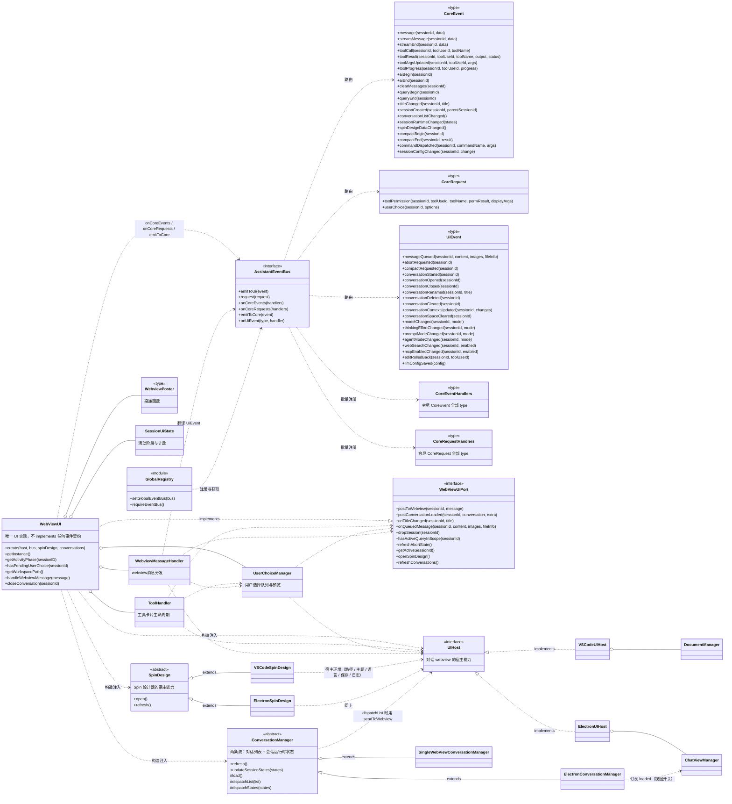
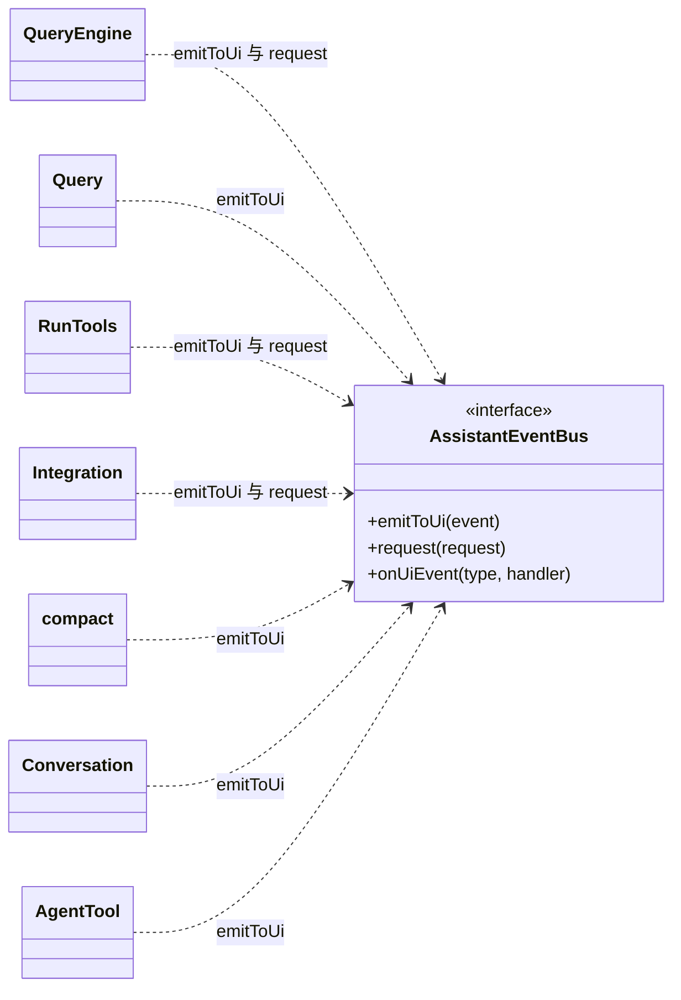
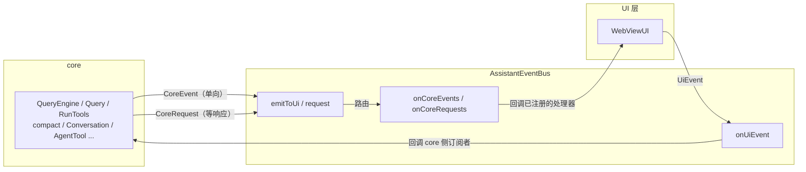

# TuxedoCat 开发文档

> 本文描述 **目标架构**。标注 `[已实现]` 的为当前代码状态，标注 `[待落地]` 的为本次重构计划。
> 接口定义以本文为准，实现代码必须与本文一致；两者不一致时先改文档再改代码。

---

## 目录

1. [架构总览](#1-架构总览)
2. [分层与依赖规则](#2-分层与依赖规则)
3. [核心契约：AssistantEventBus](#3-核心契约assistanteventbus)
4. [事件列表](#4-事件列表)
5. [契约：UIHost / SpinDesign / MCPHost / ConversationManager](#5-契约uihost--spindesign--mcphost--conversationmanager)
6. [实现：WebViewUI](#6-实现webviewui)
7. [共享子模块端口](#7-共享子模块端口)
8. [宿主实现对照表](#8-宿主实现对照表)
9. [webview 侧契约：HostInfo](#9-webview-侧契约hostinfo)
10. [会话级 UI 状态：SessionUiState](#10-会话级-ui-状态sessionuistate)
11. [已知分叉与统一决策](#11-已知分叉与统一决策)
12. [迁移计划](#12-迁移计划)
13. [验证方式](#13-验证方式)
14. [架构原则](#14-架构原则)
15. [待定事项](#15-待定事项)

---

## 1. 架构总览

### 1.1 现状 `[已实现]`

```
core ──> AssistantUI ──┬── VSCodeUI    (src/VSCodeUI.ts)      ~1049 行
                       └── ElectronUI  (electron/ElectronUI.ts) ~1024 行
```

两个类各自完整实现 `AssistantUI`，其中约 350 行方法体逐字重复，并已出现多处行为漂移
（详见第 11 节）。两者本质是同一件事：**把 core 的事件翻译成 webview 消息**。

### 1.2 目标 `[待落地]`

```
        core（只认识事件，不认识 UI）
          │  emitToUi(CoreEvent) / request(CoreRequest)
          │  onUiEvent(UiEvent)                ← 分散订阅
          ▼
   AssistantEventBus (接口)          ← core 与 UI 的唯一耦合点
          ▲
          │ onCoreEvents / onCoreRequests     ← 一次性注册全部处理器（穷尽检查）
          │ emitToCore(UiEvent)
   WebViewUI                        ← 宿主无关（不 import vscode / electron）
          │ 不 implements 任何事件契约；只与总线交互
          │ 持有 SessionUiState / ToolHandler / UserChoiceManager / WebviewMessageHandler
          │ 构造注入 host + spinDesign + conversations
          ▼
   UIHost (接口)                    ← 对话 webview 的宿主能力
        ├── VSCodeUIHost     (src/VSCodeUIHost.ts)
        └── ElectronUIHost   (electron/ElectronUIHost.ts)
               └── 同时服务 kind: 'electron' 与 kind: 'server'
                   （浏览器端复用 ChatViewManager.registerExternalClient）

   SpinDesign (抽象类)              ← Spin 设计器面板/窗口（第二个 UI surface）
        ├── VSCodeSpinDesign     (src/VSCodeSpinDesign.ts)
        └── ElectronSpinDesign   (electron/ElectronSpinDesign.ts)

   ConversationManager (抽象类)     ← 两条独立的流
        │  流 1 对话列表（磁盘元数据）  ← CoreEvent.conversationListChanged
        │  流 2 会话运行时状态          ← CoreEvent.sessionRuntimeChanged
        ├── SingleWebViewConversationManager  (src/VSCodeConversationManager.ts)
        └── ElectronConversationManager       (electron/ElectronConversationManager.ts)
               └── 流 1 → 侧栏列表 + webview 子对话树
                   流 2 → 侧栏流水灯 + 系统托盘状态点（组合点在侧栏渲染层）
```

一句话：**core 与 UI 之间没有直接引用，只通过总线上的事件耦合；
`WebViewUI` 不实现任何事件契约，订阅总线、发事件；宿主差异全部落在三个契约上
（`UIHost` 服务对话 webview，`SpinDesign` 服务 Spin 设计器，
`ConversationManager` 服务对话列表）。**

类图见第 1.4 节。

### 1.3 文件布局 `[待落地]`

| 文件 | 动作 | 说明 |
| --- | --- | --- |
| `src/core/AssistantEventBus.ts` | 新增 | 事件类型定义（`CoreEvent` / `CoreRequest` / `UiEvent`）+ `CoreEventHandlers` / `CoreRequestHandlers` 映射类型 + 总线接口 + 全局注册 |
| `src/host/EventBus.ts` | 新增 | `createEventBus(): AssistantEventBus`，纯内存发布订阅实现（无宿主依赖） |
| `src/core/initializeCoreEvents.ts` | 新增 | core 侧 UiEvent 订阅的注册入口（见第 3.7 节）；bootstrap 在 `setGlobalEventBus` 后调用 |
| `src/core/sessionRuntime.ts` | 新增 | 会话运行时状态（running / waiting）的唯一 owner，`sessionRuntimeChanged` 的生产者（见第 4.5 节） |
| `src/core/tools/PermissionPolicy.ts` | 新增 | 权限规则加工（agentMode → `resolveToolPermission`，见第 7.2 节） |
| `src/core/mcp/MCPHost.ts` | 新增 | MCP 会话引用生命周期的唯一入口（见第 5.3 节） |
| `src/host/WebViewUI.ts` | 新增 | 唯一 UI 实现；订阅总线、处理事件、发 UiEvent |
| `src/host/UIHost.ts` | 扩展 | 对话 webview 的宿主能力接口（文件名不变） |
| `src/host/SpinDesign.ts` | 新增 | Spin 设计器契约（见第 5.2 节） |
| `src/host/ConversationManager.ts` | 新增 | 对话列表 + 会话运行时状态两条流，抽象基类（见第 5.4 节） |
| `src/VSCodeConversationManager.ts` | 新增 | `SingleWebViewConversationManager` |
| `electron/ElectronConversationManager.ts` | 新增 | `ElectronConversationManager` |
| `src/VSCodeSpinDesign.ts` | 新增 | 原 `src/VSCodeUI.ts` 的 Spin 设计面板部分 |
| `electron/ElectronSpinDesign.ts` | 新增 | 原 `electron/ElectronUI.ts` 的 Spin 设计窗口部分 |
| `src/host/ui/*` | 保留 | `toolHandler` / `userChoice` / `webviewMessageHandler` / `types` / `spinDesignHtml` |
| `src/VSCodeUIHost.ts` | 新增 | 原 `src/VSCodeUI.ts` 的宿主部分 |
| `src/VSCodeUIHost/documentManager.ts` | 移动 | 原 `src/VSCodeUI/documentManager.ts` |
| `src/VSCodeUIHost/diffUris.ts` | 移动 | 原 `src/VSCodeUI/diffUris.ts` |
| `electron/ElectronUIHost.ts` | 新增 | 原 `electron/ElectronUI.ts` 的宿主部分 |
| `src/core/types.ts` | 扩展 | `AgentMode` 新增；`MessageData` 等从 `AssistantUI.ts` 搬入（见第 7.4 节） |
| `src/VSCodeUI.ts` | 删除 | |
| `electron/ElectronUI.ts` | 删除 | |

**硬约束**：`VSCodeUIHost.ts` / `VSCodeSpinDesign.ts` / `VSCodeConversationManager.ts`
不能放进 `src/host/`。
`electron/tsconfig.json` 的 `include` 含 `../src/host/**/*.ts`，放进去会被 electron 侧编译，
而它们 `import * as vscode`，会直接编译失败。

### 1.4 类图



**core 与总线的交互**



**读图要点**

1. **core 与 UI 之间没有直接引用**。core 只 import `AssistantEventBus` 与事件类型；
   `WebViewUI` 不实现任何事件契约，构造时用 `onCoreEvents` / `onCoreRequests`
   一次性注册处理器，需要通知 core 时 `emitToCore`。
2. `CoreEvent` / `CoreRequest` / `UiEvent` 是纯数据类型，没有行为，
   因此 core 与 UI 都依赖它们不会形成耦合。
3. **没有 `WebViewEventBus`**：不需要「事件词汇表 ↔ 处理器方法」的适配层，
   总线本身就是路由，`WebViewUI` 直接订阅。
   **没有 `WebViewNotifier`**：渲染与控制都在 `WebViewUI` 内，不再拆类。
   **没有 `AssistantNotifier` / `AssistantController`**：UI 侧不再有需要实现的契约接口，
   「要处理哪些事件」由 `CoreEventHandlers` 映射类型在编译期强制穷尽。
4. `SessionUiState` / `ToolHandler` / `UserChoiceManager` / `WebviewMessageHandler` /
   `WebviewPoster` 都由 `WebViewUI` 创建并持有。
5. 三个共享子模块（`ToolHandler` / `UserChoiceManager` / `WebviewMessageHandler`）
   只依赖两个窄接口：`UIHost`（宿主能力）与 `WebViewUiPort`（回推 webview 的端口）。
   其中 `WebviewMessageHandler` 还负责把 webview 协议消息翻译成 `UiEvent` 发到总线。
6. `WebViewUI ..> UIHost` 是构造注入（依赖），`VSCodeUIHost` / `ElectronUIHost` 是实现。
7. `SpinDesign` 是**第二个契约**，与 `UIHost` 平行：Spin 设计器是独立面板/窗口，
   有自己的生命周期与消息协议，与对话 webview 零共享状态（见第 5.2 节）。
   它的实现反向依赖 `UIHost` 拿宿主环境（工作区路径 / 主题 / 语言 / 保存文件 / 日志）。
8. `ConversationManager` 是**第三个契约**，用抽象类而不是接口：`load()` 两端一致、
   只有 `dispatch*()` 不同，模板方法把共享部分固定在基类（见第 5.4 节）。
   它同样反向依赖 `UIHost`（分发时用 `sendToWebview`）。
   它分发**两条独立的流**：对话列表（磁盘元数据）与会话运行时状态（`running` / `waiting`）。
   两条流各有自己的事件、自己的分发方法、自己的消费者——不合并成一份「带标记的列表」。

---
## 2. 分层与依赖规则

```
┌──────────────────────────────────────────────────────────────┐
│ core/           引擎、历史、工具、MCP、LLM 配置              │
│                 只依赖 AssistantEventBus 与事件类型，        │
│                 不知道 UI、宿主、渲染的存在                  │
└──────────────────────────────────────────────────────────────┘
        ▲ AssistantEventBus（emitToUi / request / onUiEvent）   │ UIHost
        │                                                      ▼
┌──────────────────────────────────────────────────────────────┐
│ host/           WebViewUI、EventBus、UIHost、SpinDesign、    │
│                 ConversationManager、共享子模块              │
│                 不 import vscode / electron                  │
└──────────────────────────────────────────────────────────────┘
        ▲ UIHost / SpinDesign / ConversationManager
        │
┌──────────────────────────────────────────────────────────────┐
│ 宿主实现        VSCodeUIHost / ElectronUIHost                │
│                 VSCodeSpinDesign / ElectronSpinDesign        │
│                 SingleWebViewConversationManager /           │
│                 ElectronConversationManager                  │
│                 唯一允许 import vscode / electron 的地方     │
└──────────────────────────────────────────────────────────────┘
```

依赖规则（代码评审必须检查）：

1. `core/` 不得 import `host/` 的具体实现，只能 import `AssistantEventBus`、事件类型与宿主契约类型。
   core 内部模块之间通过 `requireEventBus()` 发事件，不直接调用 UI 的任何方法。
2. `core/` 不得 import `host/` 的 UI 实现，也不得有「UI 侧的处理器契约」这种类型——
   UI 要处理哪些事件由 `CoreEventHandlers` 映射类型在 `core/AssistantEventBus.ts` 里表达。
3. `host/` 不得 import `vscode` / `electron`。
4. `host/ui/*` 不得 import 任何宿主 API；宿主差异通过 `UIHost` + `WebViewUiPort` 注入。
5. 共享代码里不得出现 `host.kind === '...'` 之类的宿主嗅探；宿主差异用能力字段或独立方法表达。
6. `UIHost` / `SpinDesign` / `ConversationManager` 的成员全部必选，不出现 `?`；可选语义用 `null` 或判别联合表达。
   必选靠**构造时序**保证（构造函数内先建好依赖、再注册处理器），不靠 `!` 空断言——
   `!` 会把「运行时可能为空」压进编译期，与 14.1「不过度 fallback」的立场冲突（集成缺失应暴露，不是被断言掩盖）。
7. 契约按 **UI surface** 划分：`UIHost` 服务对话 webview，`SpinDesign` 服务 Spin 设计器，
   `ConversationManager` 服务对话列表与会话状态。新增面板/窗口/列表类功能时先问
   「它属于哪个 surface」，而不是往 `UIHost` 上加成员。
8. **不同来源的数据走不同的流**，不要「贴标记」合并。磁盘元数据（低频）与运行时状态
   （高频）各有自己的事件与分发方法；`loaded` 这类宿主界面状态由它的 owner 单独推。
   判据：如果两个字段的变化频率差一个数量级，或者它们的 owner 不是同一个，
   它们就不该出现在同一条流里。
9. `host/` 与宿主实现可以 **import core 的只读函数与类型**（如 `loadConversationList`、
   `readHighlightLanguagesSync`、`ConversationMetadata`）——这是「宿主消费 core 的事实」，
   与「core 不得 import host」一起构成单向依赖：`宿主实现 → host/ → core/`。
   但 host 侧**不得调用 core 的状态变更函数**（写 meta.json、增删会话、发事件除外）——
   改状态的请求一律翻译成 `UiEvent` 走总线；过渡期例外见第 5.5 节（侧栏 IPC 在阶段 6 收编前仍直调）。
7. 契约按 **UI surface** 划分：`UIHost` 服务对话 webview，`SpinDesign` 服务 Spin 设计器，
   `ConversationManager` 服务对话列表与会话状态。新增面板/窗口/列表类功能时先问
   「它属于哪个 surface」，而不是往 `UIHost` 上加成员。
8. **不同来源的数据走不同的流**，不要「贴标记」合并。磁盘元数据（低频）与运行时状态
   （高频）各有自己的事件与分发方法；`loaded` 这类宿主界面状态由它的 owner 单独推。
   判据：如果两个字段的变化频率差一个数量级，或者它们的 owner 不是同一个，
   它们就不该出现在同一条流里。

---

## 3. 核心契约：AssistantEventBus

位置：`src/core/AssistantEventBus.ts`

core 与 UI **不互相引用**，只通过总线上的事件耦合。事件类型是两边唯一的公共词汇表。



**为什么要总线**：接口直连时，core 必须 import UI 的契约类型，UI 也必须知道
core 会按什么顺序调用自己——两边共享的是**行为**（方法签名 + 调用时序）。
改成总线后，两边共享的只剩**数据**（事件类型），UI 可以被替换、
可以只订阅自己关心的事件，core 也不需要知道「谁在处理」。

**事件不再细分**：`CoreEvent` 是一个判别联合，不再拆成「渲染组 / 控制组」。
事件是纯数据，分组只会多一层没有语义的包装。UI 侧也不再有「处理器契约」接口——
`WebViewUI` 直接订阅总线（第 3.3 节）。

### 3.1 事件定义

```ts
import type { MessageData, StreamMessageData, StreamEndData } from './types.js';
import type { UserChoiceOptions } from './tools/Tool.js';
import type { PermissionResult, ToolProgressData } from './tools/Tool.js';

// ==================== core → UI：单向事件 ====================

/**
 * core 发给 UI 的单向事件。
 *
 * **不按「渲染 / 控制」再分组**：事件是纯数据，分组只会多一层没有语义的包装；
 * 「谁来处理」由订阅方（WebViewUI）在 `onCoreEvents` 里决定，
 * 逐事件的触发点与处理见第 4 章。
 */
export type CoreEvent =
  | { type: 'message'; sessionId: string; data: MessageData }
  | { type: 'streamMessage'; sessionId: string; data: StreamMessageData }
  | { type: 'streamEnd'; sessionId: string; data: StreamEndData }
  | { type: 'toolCall'; sessionId: string; toolUseId: string; toolName: string }
  | {
      type: 'toolResult';
      sessionId: string;
      toolUseId: string;
      toolName: string;
      output: string;
      status: 'success' | 'error';
    }
  | {
      type: 'toolArgsUpdated';
      sessionId: string;
      toolUseId: string;
      args: Record<string, unknown>;
    }
  | {
      type: 'toolProgress';
      sessionId: string;
      toolUseId: string;
      progress: ToolProgressData;
    }
  | { type: 'aiBegin'; sessionId: string }
  | { type: 'aiEnd'; sessionId: string }
  | { type: 'clearMessages'; sessionId: string }
  | { type: 'queryBegin'; sessionId: string }
  | { type: 'queryEnd'; sessionId: string }
  | { type: 'titleChanged'; sessionId: string; title: string }
  | {
      type: 'sessionCreated';
      sessionId: string;
      /** 子代理会话的父会话；普通新会话为 null */
      parentSessionId: string | null;
    }
  /** 对话列表（磁盘元数据）发生变化：落盘 / 改名 / 删除 / 新建 */
  | { type: 'conversationListChanged' }
  /**
   * 会话运行时状态变化（有活跃查询 / 正在等待用户操作）。
   *
   * 推**全量**（所有已知会话的状态）而不是增量：会话数量是几十的量级，
   * 全量让消费者不必自己维护状态表，也不会因为丢一条增量而永久错位。
   *
   * 与 `conversationListChanged` 的分工——**这是两条独立的流**：
   * - `conversationListChanged`：**磁盘列表**变了（落盘 / 改名 / 删除 / 新建）
   * - `sessionRuntimeChanged`：**运行时状态**变了（查询开始结束 / 等用户 / 用户响应）
   *
   * 以前这两者混在一起：宿主把 `running` / `waitingForUser` / `loaded`
   * 「贴」到磁盘列表上再一起推出去。结果是列表接口失真（磁盘元数据里混着
   * 运行时状态），且每次状态变化都要重读一遍盘。
   */
  | {
      type: 'sessionRuntimeChanged';
      states: readonly SessionRuntimeState[];
    }
  | { type: 'spinDesignDataChanged' }
  | { type: 'compactBegin'; sessionId: string }
  | {
      type: 'compactEnd';
      sessionId: string;
      /** 压缩结果：成功带压缩后 token 数，失败不带（错误详情走 message 事件） */
      result:
        | { status: 'complete'; postCompactTokenCount: number | null }
        | { status: 'error' };
    }
  | {
      type: 'commandDispatched';
      sessionId: string;
      commandName: string;
      args: string;
    }
  | {
      type: 'sessionConfigChanged';
      sessionId: string;
      /** 只带被改动的字段（判别联合，避免可选字段） */
      change:
        | { key: 'model'; value: string }
        | { key: 'thinkingEffort'; value: 'off' | 'low' | 'high' | 'max' }
        | { key: 'promptMode'; value: 'normal' | 'minimal' | 'mixed' }
        | { key: 'agentMode'; value: 'manual' | 'risk' | 'auto' }
        | { key: 'webSearch'; value: boolean }
        | { key: 'mcpEnabled'; value: string[] };
    };

// ==================== core → UI：请求-响应 ====================

/**
 * 需要 UI 返回结果的请求。
 * 对应 `WebViewUI` 的三个带返回值的方法。
 */
export type CoreRequest =
  | {
      type: 'toolPermission';
      sessionId: string;
      toolUseId: string;
      toolName: string;
      /**
       * core 已按 agentMode 规则加工过的权限结果：
       * `allow` 直接放行、`deny` 直接拒绝、`ask` 需要 UI 弹确认框。
       * Edit / Write 的 diff 预览字段也在里面。
       */
      permResult: PermissionResult;
      /** 展示用参数（路径已展开） */
      displayArgs: Record<string, unknown>;
    }
  | { type: 'userChoice'; sessionId: string; options: UserChoiceOptions };

/** 请求 → 结果的类型映射（判别联合，字段完整） */
export type CoreRequestResultMap = {
  toolPermission: PermissionResult;
  userChoice: { index: number; reply?: string };
};

/** 请求 → 结果的类型映射（判别联合，字段完整） */
export type CoreRequestResultMap = {
  toolPermission: PermissionResult;
  userChoice: { index: number; reply?: string };
};

/**
 * 发送侧取单个结果类型用 `request<T>` 的泛型签名（第 3.2 节），不需要这个联合。
 * 保留它只作为「所有可能结果」的枚举（如实现内部中转时用）。
 */
export type CoreRequestResult = CoreRequestResultMap[keyof CoreRequestResultMap];

/**
 * 会话上下文的一次字段更新。
 * 与 `CoreEvent.sessionConfigChanged.change` 同构（判别联合 + 显式 value）。
 */
export type ConversationContextChange =
  /** 用户当前在编辑器里看什么（写入 meta.json 的 currentFile / selectedLines） */
  | {
      key: 'editorContext';
      value: {
        currentFile: string | null;
        selectedLines: { start: number; end: number } | null;
      };
    }
  /** 当前请求的 context token 数 */
  | { key: 'totalContextTokens'; value: number };

// ==================== UI → core：单向事件 ====================

/**
 * UI 层报告「用户做了什么」。
 *
 * core 订阅这些事件并执行对应的业务动作；执行结果再通过 `CoreEvent` 广播回 UI
 * （多端同步用）。
 *
 * 注意：
 * - `CoreRequest` 的响应通过 `request()` 返回的 Promise 回传，不占用本组事件
 *   （所以没有 `userChoiceResponded`）。
 * - **没有 `activeSessionChanged`**：「哪个会话在前台」是 UI 自己的状态，
 *   core 不感知（见第 15.6 节）。core 需要时通过注入的 provider 查询。
 * - webview 协议消息由 `WebviewMessageHandler` 解析后翻译成本组事件，
 *   它自己不再直接调用 core 的业务函数。
 */
export type UiEvent =
  // ===== 消息 =====
  /**
   * 用户提交了一条消息。
   * **没有 `messageSubmitted`**：所有消息都走同一个入队入口
   * （`webviewMessageHandler.ts:594` 的 `handleSendMessage` 直接委托给 `handleQueueMessage`），
   * 「新消息」与「排队消息」在 core 侧是同一条路径，不需要两个事件。
   */
  | {
      type: 'messageQueued';
      sessionId: string;
      content: string;
      images: Array<{ dataUrl: string; mediaType?: string; width?: number; height?: number }> | null;
      fileInfo: {
        filePath: string;
        selectedLines: { start: number; end: number } | null;
        fileHidden: boolean;
      } | null;
    }
  | { type: 'abortRequested'; sessionId: string }

  // ===== 压缩 =====
  /** 用户触发压缩（会改写会话数据，属 core 业务） */
  | { type: 'compactRequested'; sessionId: string }

  // ===== 会话生命周期 =====
  | { type: 'conversationStarted'; sessionId: string }
  | { type: 'conversationOpened'; sessionId: string }
  /**
   * 会话被关闭：释放该会话的**运行时内存**，磁盘数据不动。
   *
   * core 收到后调 `sessionIdle.releaseSessionResources(sessionId)`：
   * 中止查询 → 落盘 → 移出引擎池 → 丢弃待压缩标记 → 移除消息缓存 →
   * 释放 MCP 引用（`MCPHost.onSessionClosed`）→ 清空闲计时。
   * 再次打开该会话时会从磁盘重新加载。
   *
   * 与相邻事件的分工：
   * - `conversationOpened` / `conversationStarted`：把会话装进内存（引擎 + MCP 引用）
   * - `conversationClosed`：把会话从内存卸下（本事件）
   * - `conversationCleared`：清空磁盘上的消息内容，保留会话本身
   * - `conversationDeleted`：删除磁盘上的会话文件
   */
  | { type: 'conversationClosed'; sessionId: string }
  | { type: 'conversationRenamed'; sessionId: string; title: string }
  | { type: 'conversationDeleted'; sessionId: string }
  | { type: 'conversationCleared'; sessionId: string }
  /**
   * 会话上下文（meta.json 的 `context` 字段）部分更新。
   * 用 `changes` 数组而不是可选字段：一次可带多个字段，未列出的字段保持原值
   * （core 侧 `updateConversationContext` 本来就是合并语义）。
   */
  | {
      type: 'conversationContextUpdated';
      sessionId: string;
      changes: ConversationContextChange[];
    }
  | { type: 'conversationSpaceCleared'; sessionId: string }

  // ===== 会话配置（用户列举的那批）=====
  | { type: 'modelChanged'; sessionId: string; model: string }
  | { type: 'thinkingEffortChanged'; sessionId: string; mode: 'off' | 'low' | 'high' | 'max' }
  | { type: 'promptModeChanged'; sessionId: string; mode: 'normal' | 'minimal' | 'mixed' }
  | { type: 'agentModeChanged'; sessionId: string; mode: 'manual' | 'risk' | 'auto' }
  | { type: 'webSearchChanged'; sessionId: string; enabled: boolean }
  | { type: 'mcpEnabledChanged'; sessionId: string; enabled: string[] }

  // ===== 其它 =====
  | { type: 'editRolledBack'; sessionId: string; toolUseId: string }
  | { type: 'llmConfigSaved'; config: unknown };

// ==================== 通用 ====================

/** 取消订阅 */
export type Unsubscribe = () => void;

// ==================== 会话运行时状态 ====================

/**
 * 单个会话的运行时状态。消费者：Electron 侧栏流水灯、系统托盘状态点、
 * webview 对话树的运行标记。
 *
 * 只有 core 能提供的事实进这里；宿主自己的界面状态（如 Electron 的
 * 「视图已打开」）由宿主自己维护，不混进来。
 */
export interface SessionRuntimeState {
  sessionId: string;
  /** 有活跃查询：引擎在消费消息 / 后台 Bash 任务 / 递归子代理 */
  running: boolean;
  /** 正在等待用户操作（ask user / 权限确认） */
  waiting: boolean;
}
```

### 3.2 AssistantEventBus 接口

```ts
/**
 * 事件总线：core 与 UI 的唯一耦合点。
 *
 * 发布（emit*）与订阅（on*）刻意分成两组，让「谁在发、谁在收」在类型层面可见：
 * - `emitToUi` / `request`：core 侧调用
 * - `onCoreEvents` / `onCoreRequests`：UI 侧调用（**批量注册，穷尽检查**）
 * - `emitToCore` / `onUiEvent`：反方向
 */
export interface AssistantEventBus {
  // ===================== core → UI =====================

  /** 发布单向事件 */
  emitToUi(event: CoreEvent): void;

  /**
   * 发起请求并等待响应。
   * 泛型约束请求类型与结果类型一一对应，调用点无需手动收窄：
   *
   * ```ts
   * const permission = await bus.request({
   *   type: 'toolPermission', sessionId, toolUseId, toolName, permResult, displayArgs,
   * });  // permission: PermissionResult
   * ```
   */
  request<T extends CoreRequest['type']>(
    request: Extract<CoreRequest, { type: T }>,
  ): Promise<CoreRequestResultMap[T]>;

  /**
   * UI 侧：一次性注册**全部** core 事件处理器。
   * `CoreEventHandlers` 是映射类型，少写任何一个 `CoreEvent['type']` 都会编译报错。
   */
  onCoreEvents(handlers: CoreEventHandlers): Unsubscribe;

  /** UI 侧：一次性注册**全部** core 请求处理器（同上，穷尽检查） */
  onCoreRequests(handlers: CoreRequestHandlers): void;

  // ===================== UI → core =====================

  /** UI → core：发布单向事件 */
  emitToCore(event: UiEvent): void;

  /** core 侧：订阅自己关心的 UI 事件（core 是分散消费者，逐个订阅） */
  onUiEvent<T extends UiEvent['type']>(
    type: T,
    handler: (event: Extract<UiEvent, { type: T }>) => void,
  ): Unsubscribe;
}

/**
 * core 事件的处理器表。
 * 映射类型天然穷尽：漏掉任何一个 `CoreEvent['type']` 都会编译报错——
 * 这是「没有处理器契约接口」之后，保住「不漏接事件」的唯一手段。
 */
export type CoreEventHandlers = {
  readonly [K in CoreEvent['type']]: (event: Extract<CoreEvent, { type: K }>) => void;
};

/** core 请求的处理器表（返回值类型由 `CoreRequestResultMap` 约束） */
export type CoreRequestHandlers = {
  readonly [K in CoreRequest['type']]: (
    request: Extract<CoreRequest, { type: K }>,
  ) => Promise<CoreRequestResultMap[K]>;
};

// ===================== 全局注册 =====================

/** 未注册时直接抛错，不用 `?.` 静默跳过 */
export function setGlobalEventBus(bus: AssistantEventBus): void;
export function requireEventBus(): AssistantEventBus;
```

**总线实现**：`src/host/EventBus.ts` 的 `createEventBus(): AssistantEventBus`，
纯内存发布订阅（`Map<type, handler>` + `Set<type, handler>`），无宿主依赖。
它只做路由，不含任何「事件 → 方法」的映射逻辑。

**发送方（core）用法**

```ts
// 单向通知
requireEventBus().emitToUi({ type: 'message', sessionId, data: { role: 'assistant', content } });

// 请求-响应
const permission = await requireEventBus().request({
  type: 'toolPermission', sessionId, toolUseId, toolName, permResult, displayArgs,
});

// 订阅 UI 事件（core 侧按需订阅）
const off = requireEventBus().onUiEvent('abortRequested', ({ sessionId }) => abortCurrentQuery(sessionId));
```

**接收方（UI）用法**：见第 3.3 节。

### 3.3 UI 侧订阅：WebViewUI

**没有处理器契约接口**。`WebViewUI` 不 `implements` 任何东西，
构造时用两个映射表把处理器一次性注册到总线：

```ts
// src/host/WebViewUI.ts
export class WebViewUI implements WebViewUiPort {
  constructor(private readonly host: UIHost, bus: AssistantEventBus) {
    // ... 构造 SessionUiState / ToolHandler / UserChoiceManager / WebviewMessageHandler

    bus.onCoreEvents({
      // ===== 渲染 =====
      message: (e) => this.onMessage(e.sessionId, e.data),
      streamMessage: (e) => this.onStreamMessage(e.sessionId, e.data),
      streamEnd: (e) => this.onStreamEnd(e.sessionId, e.data),
      toolCall: (e) => this.onToolCall(e.sessionId, e.toolUseId, e.toolName),
      toolResult: (e) => this.onToolResult(e.sessionId, e.toolUseId, e.toolName, e.output, e.status),
      toolArgsUpdated: (e) => this.onToolArgsUpdated(e.sessionId, e.toolUseId, e.args),
      toolProgress: (e) => this.onToolProgress(e.sessionId, e.toolUseId, e.progress),
      aiBegin: (e) => this.onAIBegin(e.sessionId),
      aiEnd: (e) => this.onAIEnd(e.sessionId),
      clearMessages: (e) => this.clearMessages(e.sessionId),

      // ===== 控制面 =====
      queryBegin: (e) => this.onQueryBegin(e.sessionId),
      queryEnd: (e) => this.onQueryEnd(e.sessionId),
      titleChanged: (e) => this.onTitleChanged(e.sessionId, e.title),
      sessionCreated: (e) => this.onSessionCreated(e.sessionId, e.parentSessionId),
      conversationListChanged: () => this.onConversationListChanged(),
      spinDesignDataChanged: () => this.onSpinDesignDataChanged(),
      compactBegin: (e) => this.onCompactBegin(e.sessionId),
      compactEnd: (e) => this.onCompactEnd(e.sessionId, e.result),
      commandDispatched: (e) => this.onCommandSend(e.commandName, e.args, e.sessionId),
      sessionConfigChanged: (e) => this.onSessionConfigChanged(e.sessionId, e.change),
    });

    bus.onCoreRequests({
      toolPermission: (r) =>
        this.onPreToolCall(r.sessionId, r.toolUseId, r.toolName, r.permResult, r.displayArgs),
      userChoice: (r) => this.requestUserChoice(r.sessionId, r.options),
    });
  }
}
```

**为什么用映射表而不是逐个 `onCoreEvent('xxx', ...)`**

| | 映射表（`onCoreEvents`） | 逐个订阅 |
| --- | --- | --- |
| 漏订阅 | **编译报错**（映射类型要求穷尽 `CoreEvent['type']`） | 静默漏掉，运行期才发现 |
| 阅读 | 一张表看全 UI 处理哪些事件 | 散在构造函数里 |
| 新增事件 | 改 `CoreEvent` 联合后，这里立刻报错提醒补 handler | 无提醒 |

**为什么删掉了 `AssistantNotifier` / `AssistantController`**

这两个接口的唯一作用是「让 `WebViewEventBus` 的 switch 有明确的调用目标」。
总线改成直接订阅后，UI 侧不再需要一个被调用的契约——处理器就是
`CoreEventHandlers` 里的匿名函数，签名由映射类型保证。
保留接口只会多一层「接口 → 实现」的间接。

**为什么删掉了 `WebViewNotifier`**

原本按「渲染 / 控制」把 `WebViewUI` 拆成两个类，是为了让 `WebViewEventBus`
能分别持有 `handlers.notifier` / `handlers.controller`。总线不再分发后，
这个拆分失去依据；渲染与控制都在 `WebViewUI` 内，按注释分区即可。

> 代价：`WebViewUI` 会比拆开时大（约 600–700 行，21 个事件 handler + 2 个请求 handler
> + 19 个 UiEvent 发送点 + 子模块管理）。如果以后又需要拆，依据应该是**职责边界**
> （如把「会话配置」独立出去），而不是「事件方向」。

### 3.4 命名约定

事件类型、`WebViewUI` 的 handler 方法名，以及三个契约（`UIHost` / `SpinDesign` / `ConversationManager`）的方法名，都按下面两类判断：

| 前缀 | 语义 | 判据 | 例子 |
| --- | --- | --- | --- |
| `on*` | **事实通知**：状态由别处拥有，UI 只是投影 | 值存在外部 source of truth（meta.json / 引擎状态 / 队列 / 磁盘数据） | `onMessage`、`onSessionCreated`、`onCompactBegin`、`onTitleChanged`、`onToolArgsUpdated`、`onConversationListChanged`、`onSpinDesignDataChanged` |
| 动词开头 | **命令**：UI 自己拥有该状态，调用方要求它改变 | 状态只存在于 UI 内部 | `clearMessages`、`setThinkingAnimation`、`openFile`、`showDiff`、`open` / `refresh`（`SpinDesign` 侧）、`refresh` / `updateSessionStates` / `dispatchList` / `dispatchStates`（`ConversationManager` 侧） |

边界判定示例：

- `onTitleChanged`（原 `setTitle`）：标题持久化在 `meta.json`，UI 只负责显示 → 事实通知。
- `onConversationListChanged`（原 `refreshConversationList` + `scheduleConversationListRefresh`）：
  对话列表数据在磁盘上，**「立即还是节流、更哪些视图」是 UI 的表现策略**，
  不该由 core 选择 → 事实通知。
- `setThinkingAnimation`：thinking 动画是否显示只存在于 webview 内部，调用方只是要求切换 → 命令，保留动词命名。
- `clearMessages`：清空的是 UI 自己的消息列表，磁盘 JSONL 不受影响 → 命令。但它的调用方只有一个
  （`replayMessagesToUI`），收敛方向见第 3.5 节。

注意三个契约上的 `refresh`（`SpinDesign` 的刷新设计器、`ConversationManager` 的重新读列表并分发）
仍是命令式命名——那是 `WebViewUI` 要求宿主刷新自己持有的界面表示，属于宿主侧命令，
与 `CoreEvent` 的事实通知不冲突。同一个词在不同契约上承担不同角色是允许的。

**事件命名**（`CoreEvent` / `CoreRequest` / `UiEvent` 的 `type` 字段）：

- `CoreEvent` / `CoreRequest`：与 `WebViewUI` 的 handler 方法同名去 `on` 前缀
  （`onTitleChanged` ↔ `{ type: 'titleChanged' }`）
- `UiEvent`：**过去式**，描述用户已经做完的动作（`modelChanged` = 用户改了模型），
  不是命令（不叫 `setModel`）
- 全小写驼峰，不用 `on` 前缀（`type` 字段本身就是名词短语）
- **wire protocol 命名不受此约定约束**。协议消息名描述「接收方要做什么」，
  因此 `titleChanged` 事件最终仍然发送 `{ type: 'setTitle' }`（webview 收到后就是
  `setConversationTitle`）。改协议名要同时动 `webviewTypes.ts` / handler / webview，
  收益为零，不做。

### 3.5 `clearMessages` 的现状与收敛方向

**当前职责**：`AssistantUI.clearMessages(sessionID)` 在两个宿主的实现都只有一行——
`postToWebview(sessionID, { type: 'clearMessages' })`。webview 侧清空
`messages` / `contextLength` / `stats`（`useMessageHandler.ts:1684`）。

**实际只有一个调用方**：`replayMessagesToUI`（`src/core/utils/replayMessages.ts:29`），
它是「清空 + 逐条重推」这个复合操作的第一步。`replayMessagesToUI` 的活调用方又只有一个：
`compact.ts:329`（压缩完成后重建 UI）。

**问题**：同一条 wire message 有三个发送方，走三条不同路径：

| 场景 | 发送路径 |
| --- | --- |
| 压缩后重建（`compact.ts`） | `ui.clearMessages()` → `postToWebview` |
| 展开归档（`webviewMessageHandler.handleExpandCompact`） | `host.sendToWebview()` 直接发 |
| `/clear` 命令（`onCommandSend`） | `postToWebview()` 直接发 |

只有第一条经过 `clearMessages`。它之所以在契约上，只是因为
`replayMessagesToUI` 需要这个原语，而不是因为 core 有「单独清空 UI 消息」的业务场景。

**收敛方向**（改动较大，暂缓）：把「清空 + 重推」合成一个原子事件

```ts
/** 用给定消息集合替换 UI 上该会话的消息列表（压缩后重建 / 展开归档共用） */
| { type: 'messagesReplaced'; sessionId: string; messages: readonly Message[] }
```

`clearMessages` 随之从 `CoreEvent` 消失；`Message[] → MessageData` 的转换
（`replayMessagesToUI` 现有逻辑，含 `_meta` 裁剪、Edit `diffHunks` 构建）
与 `buildConversationLoadedPayload` 一样属表现层，应一并迁到 `src/host/`。
在此之前 `clearMessages` 保持现状。

### 3.6 契约变化清单（相对当前代码）

**结构变化**

| 当前 | 目标 |
| --- | --- |
| `core` 直接持有 `AssistantUI` 单例并调用其方法 | `core` 只依赖 `AssistantEventBus`，通过 `emitToUi` / `request` / `onUiEvent` 通信 |
| `setGlobalUI(ui)` / `requireGlobalUI()` | `setGlobalEventBus(bus)` / `requireEventBus()` |
| `AssistantUI`（26 个方法混在一起，两个类各实现一遍） | `CoreEvent`（21）+ `CoreRequest`（2）+ `UiEvent`（19）；`WebViewUI` 一个类订阅总线，不再有处理器契约接口 |
| `UiEvent` 不存在：webview 消息由 `WebviewMessageHandler` 直接调 core 函数 | `UiEvent`（19）+ `WebviewMessageHandler` 只做「协议消息 → 事件」的翻译 |
| core 的 `history/Config.activeSessionId` 保存 UI 状态 | **删除**；core 通过注入的 provider 查询活跃会话（见第 15.6 节） |

**事件归属**（原方法 → 事件 / 请求；全部由 `WebViewUI` 处理）

| 原方法 | 事件 |
| --- | --- |
| `onMessage` / `onStreamMessage` / `onStreamEnd` | `message` / `streamMessage` / `streamEnd` |
| `onToolCall` / `onToolResult` / `onToolArgsUpdated` / `onToolProgress` | `toolCall` / `toolResult` / `toolArgsUpdated` / `toolProgress` |
| `onAIBegin` / `onAIEnd` | `aiBegin` / `aiEnd` |
| `clearMessages` | `clearMessages` |
| `onQueryBegin` / `onQueryEnd` | `queryBegin` / `queryEnd` |
| `onTitleChanged` / `onSessionCreated` | `titleChanged` / `sessionCreated` |
| `onConversationListChanged` / `onSpinDesignDataChanged` | `conversationListChanged` / `spinDesignDataChanged` |
| `onCompactBegin` / `onCompactEnd` | `compactBegin` / `compactEnd` |
| `onCommandSend` | `commandDispatched` |
| `onPreToolCall` | `toolPermission`（请求） |
| `requestUserChoice` | `userChoice`（请求） |
| `onAbort` | **删除** | 零调用方 |
| `onExpandCompact` | **删除** | 零调用方；活路径是 `webviewMessageHandler.handleExpandCompact` |
| `onQueuedMessage` | **移到 `WebViewUiPort`** | 唯一调用方是共享子模块，不是 core |

**重命名**

| 当前 | 目标 | 依据 |
| --- | --- |
| `setTitle(sessionID, title)` | `onTitleChanged` / `titleChanged` | 标题 source of truth 在 meta.json |
| `updateToolArgs(sessionID, toolUseId, args)` | `onToolArgsUpdated` / `toolArgsUpdated` | 参数由流式输入决定 |
| `refreshConversationList()` | `onConversationListChanged` / `conversationListChanged`，再由 `ConversationManager.refresh()` 分发 | 节流与「推给哪些界面」都是 UI 表现策略 |
| `scheduleConversationListRefresh()` | 合并进 `conversationListChanged` | 同上 |
| `refreshSpinDesign()` | `onSpinDesignDataChanged` / `spinDesignDataChanged` | 未打开设计器时的行为由 UI 决定；方法本身从 `UIHost` 移到 `SpinDesign.refresh()` |
| `onCommandSend(...): Promise<boolean>` | `commandDispatched` | 唯一调用方丢弃返回值 |

**新增 `UiEvent` 的映射**（webview 协议消息 → 事件）

完整清单见第 4.3 节。原则：

| 消息类别 | 处理方式 |
| --- | --- |
| 会改变 core 状态或启动 core 动作（`sendMessage` / `setModel` / `clearConversation` / `requestCompress` …） | 翻译成 `UiEvent`，由 core 订阅处理 |
| 纯宿主操作（`openFile` / `openMermaidPreview` / `openUrl` / `showDiffInVirtualDocument` …） | 留在 `WebviewMessageHandler` 内直接调 `UIHost` |
| 无副作用查询（`requestModels` / `requestLLMConfig` / `requestSkills` …） | 留在 `WebviewMessageHandler` 内直接调 core 的查询函数 |
| `respondUserChoice` | 走 `CoreRequest.userChoice` 的 Promise 回传 |
| `setActiveSessionId` | **删除**（见第 15.6 节） |

**两个判据存疑的点**（需要在评审时确认）

1. `aiBegin` / `aiEnd` 属渲染类，`queryBegin` / `queryEnd` 属控制面——两者都在
   `WebViewUI` 内，但 handler 命名与分区按此区分。
   两者都驱动 thinking 动画，但前者是「这一轮 LLM 在思考/输出完了」（渲染层），
   后者是「这个会话有没有活跃查询」（状态机 → abort 按钮、流水灯、列表）。
2. `toolPermission` 归 `CoreRequest`（返回权限决策），但它同时会显示工具卡片（渲染）。
   这也是 `RunTools` 必须同时发 `toolCall` 事件与 `toolPermission` 请求的原因。

**接口隔离的代价**（见第 15.4 节）

改总线后，依赖收窄从「接口收窄」变成「只发自己需要的事件」——`requireEventBus()`
拿到的是全量总线，**类型层面不再阻止** `Conversation.ts` 发 `message` 事件。
每个模块实际发哪些事件，记录在第 4.1 节的「core 侧触发点」列，评审时对照检查。

### 3.7 core 侧 UiEvent 订阅：接线方案

**没有「core 侧处理器契约」**，与 UI 侧同理：core 的消费方是分散的模块
（`Integration` / `history` / `sessionIdle` / `compact` …），各自用 `onUiEvent(type, handler)`
订阅自己关心的少数几个事件（见第 4.3 节「core 侧消费方」列）。
不需要也不应该有一个「core 事件中心」把 19 个事件收在一起再内部分发——
那只是把 `WebviewMessageHandler` 的直调换了个地方。

但**订阅时机**需要一个明确的锚点，且有两个约束：

1. `setGlobalEventBus` 发生在 bootstrap（`extension.ts` / `electron/main.ts`），
   而 core 模块随 bundle 加载——**模块顶层不能订阅**（加载时总线还不存在）。
2. 订阅必须在 core 第一次被使用之前完成（否则第一批 `UiEvent` 落空）。

**方案**：新增 `src/core/initializeCoreEvents.ts`，与 `initializeHistory` 同属 bootstrap
序列，在 `setGlobalEventBus(bus)` 之后、`WebViewUI.create` 之前调用：

```ts
// src/core/initializeCoreEvents.ts
/**
 * 注册 core 侧全部 UiEvent 订阅。由 bootstrap 在 setGlobalEventBus 之后调用一次。
 * 重复调用抛错（幂等交给启动期暴露，见 14.1）。
 */
export function initializeCoreEvents(bus: AssistantEventBus): void {
  registerIntegrationUiEvents(bus);   // Integration.ts：messageQueued / abortRequested / compactRequested / 配置类 / 会话生命周期类
  registerHistoryUiEvents(bus);       // history：rename / delete / clear / context / space
  registerSessionIdleUiEvents(bus);   // sessionIdle：conversationClosed → releaseSessionResources
  registerMcpUiEvents(bus);           // mcp：mcpEnabledChanged → MCPHost.onSessionEnabledChanged
  // …
}
```

要点：

- **按 core 模块分文件**（`integrationUiEvents.ts` / `historyUiEvents.ts` …），
  每个文件导出一个 `register*(bus)`；「每个模块订阅哪些事件」与第 4.3 节
  「core 侧消费方」列一一对应，评审时对照。
- `initializeHistory` 顺带把签名改为 `(bus: AssistantEventBus)`——它现在接收的
  `ui: { getWorkspacePath() }` 恰好可以被「bootstrap 先 `setProjectRootProvider`
  再调 `initializeCoreEvents(bus)`」替代，两个初始化函数合并时序见阶段 1.8。
- 事件 handler 内部**不直接持有跨模块状态**：只调用对应模块自己的导出函数
  （`abortCurrentQuery` / `updateSessionModel` …），保持与现状直接函数调用相同的内聚度。

**为什么不做成映射表穷尽检查**：`UiEvent` 的 19 个事件分布给 5+ 个 core 模块，
单一映射表必须集中一处，而这恰恰把「分散订阅」的灵活性（第 3.2 节）收窄回了
「一个上帝对象」。代价与 `CoreEvent` 相反——UI 侧漏订阅会直接功能断链（必须穷尽），
core 侧漏订阅是「这个动作暂时没有 core 消费方」的合法中间态（阶段 2.4 逐条搬运会
经历这种状态）。靠第 4.3 节消费方列 + 阶段 2 完成后的对照检查兜底。

### 3.8 总线边界语义：启动窗口 / 无订阅者 / 请求丢失

「未注册即抛错」（14.1）在三个边界场景需要明确口径：

| 场景 | 语义 | 说明 |
| --- | --- | --- |
| `emitToUi` 时 `onCoreEvents` 尚未注册 | **抛错** | 这是 bootstrap 顺序错误（`WebViewUI.create` 未在 core 首次发事件前完成），启动期暴露 |
| `emitToCore` / `onUiEvent` 对某 type 尚无 core 订阅者 | **静默丢弃** | 合法中间态：阶段 2 逐条迁移时部分事件先于消费者存在；用户在订阅建立前做的操作本就不存在「丢历史」的问题（下次打开的会话从磁盘读） |
| `request()` 的响应方（WebViewUI）不存在或响应丢失 | **永久挂起**，core 侧调用点必须带超时 | 见下 |

**请求超时约定**：`request()` 本身不实现超时（总线保持纯路由），由**调用方**决定：

```ts
// RunTools 的权限请求：UI 可能 reload / 正在重建，无限等待会让查询永久挂起
const permission = await withTimeout(
  requireEventBus().request({ type: 'toolPermission', ... }),
  TOOL_PERMISSION_TIMEOUT_MS,
  () => denyResult('timeout'),   // 超时兜底策略由调用点定：deny / 重试 / 抛错
);
```

- `toolPermission`：超时 → 按 `deny` 处理（fail-safe：不弹框就不执行）。
- `userChoice`：现状 `UserChoiceQueue` 已有 pending 补偿（webview 重建后重新弹出），
  保持现状；若补偿不可用则同 toolPermission。
- 阶段 1 落地 `request()` 时至少给这两个调用点包上超时；总线实现不内置计时器。


---

## 4. 事件列表

本章是第 3.1 节事件定义的**完整清单**：每个事件的载荷、触发点、处理方，
以及最终转成的 wire message（若该事件会产生 webview 协议消息）。

共 3 组、42 个事件：

| 组 | 方向 | 数量 | 处理方 | 说明 |
| --- | --- | --- | --- | --- |
| `CoreEvent` | core → UI | 21 | `WebViewUI` | 单向；由 `WebViewUI` 在 `onCoreEvents` 里处理 |
| `CoreRequest` | core → UI | 2 | `WebViewUI` | 请求-响应；core 等 UI 返回结果 |
| `UiEvent` | UI → core | 19 | core 侧订阅者 | 单向；UI 报告「用户做了什么」 |

命名规则：

- `CoreEvent` / `CoreRequest` 的 `type` = 处理器方法名去掉 `on` 前缀（`onTitleChanged` ↔ `titleChanged`）。
- `UiEvent` 的 `type` 是**过去式**：描述用户已经做完的动作（`modelChanged` = 用户改了模型），
  不是命令（不叫 `setModel`）。

### 4.1 CoreEvent（core → UI，单向）

`CoreEvent` 是单一判别联合，不按渲染/控制再分组；
「处理方」列是该事件在 `WebViewUI` 里对应的 handler。

| # | `type` | 载荷 | core 侧触发点 | 处理方 | 转成的 wire message |
| --- | --- | --- | --- | --- | --- |
| 1 | `message` | `sessionId`, `data: MessageData` | `Integration.ts`（用户消息）、`Query.ts`、`QueryEngine.ts`、`CommandDispatcher.ts`、`spin/Loop.ts`、`utils/replayMessages.ts` | `WebViewUI.onMessage` | `addMessage` |
| 2 | `streamMessage` | `sessionId`, `data: StreamMessageData` | `Query.ts` | `WebViewUI.onStreamMessage` | `streamMessage` |
| 3 | `streamEnd` | `sessionId`, `data: StreamEndData` | `Query.ts` | `WebViewUI.onStreamEnd` | `streamEnd` |
| 4 | `toolCall` | `sessionId`, `toolUseId`, `toolName` | `tools/RunTools.ts` | `WebViewUI.onToolCall` | `updateToolStatus`（`status: 'running'`） |
| 5 | `toolResult` | `sessionId`, `toolUseId`, `toolName`, `output`, `status` | `tools/RunTools.ts` | `WebViewUI.onToolResult` | `updateToolStatus`（Edit 失败时追加 `updateToolArgs`） |
| 6 | `toolArgsUpdated` | `sessionId`, `toolUseId`, `args` | `Query.ts`（流式 tool input 累积） | `WebViewUI.onToolArgsUpdated` | `updateToolArgs` |
| 7 | `toolProgress` | `sessionId`, `toolUseId`, `progress: ToolProgressData` | `tools/RunTools.ts` | `WebViewUI.onToolProgress` | `toolProgress` |
| 8 | `aiBegin` | `sessionId` | `Query.ts`（每轮 LLM 调用开始） | `WebViewUI.onAIBegin` | `aiBegin` + `showThinkingAnimation` |
| 9 | `aiEnd` | `sessionId` | `Query.ts`（每轮 LLM 调用结束） | `WebViewUI.onAIEnd` | `aiEnd` + `showThinkingAnimation` + `balanceUpdate` |
| 10 | `clearMessages` | `sessionId` | `utils/replayMessages.ts` | `WebViewUI.clearMessages` | `clearMessages` |
| 11 | `queryBegin` | `sessionId` | `Integration.ts`、`QueryEngine.ts`、`spin/Runner.ts`、`tools/agent/AgentTool.ts` | `WebViewUI.onQueryBegin` | `queryBegin` + `showThinkingAnimation` + `setEnableAbort` |
| 12 | `queryEnd` | `sessionId` | 同上 | `WebViewUI.onQueryEnd` | `queryEnd` + `showThinkingAnimation` + `setEnableAbort` |
| 13 | `titleChanged` | `sessionId`, `title` | `Integration.ts:613`（新会话初始标题）、`skills/bundled/spin.ts:121`、core 侧重命名 / 智能命名 | `WebViewUI.onTitleChanged` | `setTitle` |
| 14 | `sessionCreated` | `sessionId`, `parentSessionId: string \| null` | `QueryEngine.ts:844`（新会话与子代理会话创建都会走到这里） | `WebViewUI.onSessionCreated` | `initSessionState` |
| 15 | `conversationListChanged` | 无 | `history/Conversation.ts:564,1130`（消息落盘）、`tools/agent/AgentTool.ts:500,510`（子代理创建/结束）、`UiEvent.conversationDeleted` 等 | `WebViewUI.onConversationListChanged`（500ms 防抖）→ `ConversationManager.refresh()` | `conversationsData`（VSCode）；Electron 另推原生侧栏 + 托盘状态回调 |
| 16 | `sessionRuntimeChanged` | `states: readonly SessionRuntimeState[]` | core 的 `sessionRuntime`（引擎池 + pending user choice）—— 查询开始/结束、等用户、用户响应 | `WebViewUI.onSessionRuntimeChanged` | Electron：侧栏流水灯 + 托盘状态点；VS Code：不用（webview 从 `queryBegin`/`queryEnd` 自己维护对话树） |
| 17 | `spinDesignDataChanged` | 无 | `skills/bundled/spin.ts`、`spin/Loop.ts`（执行完成，磁盘 meta 被改） | `WebViewUI.onSpinDesignDataChanged` | `spinDesignData`（VSCode 面板）/ `spin-design-message`（Electron 窗口） |
| 18 | `compactBegin` | `sessionId` | `compact/compact.ts:87` | `WebViewUI.onCompactBegin` | `compressProgress`（`status: 'start'`） |
| 19 | `compactEnd` | `sessionId`, `result` | `compact/compact.ts:155`（`complete`）、`Integration.ts:774` 与 `QueryEngine.ts:565`（`error`） | `WebViewUI.onCompactEnd` | `compressProgress`（`status: 'complete'` 或 `'error'`） |
| 20 | `commandDispatched` | `sessionId`, `commandName`, `args` | `CommandDispatcher.ts:83` | `WebViewUI.onCommandSend` | `/clear` 时 `clearMessages`；`/spin` 时打开设计器 |
| 21 | `sessionConfigChanged` | `sessionId`, `change` | core 处理完 `UiEvent` 的六个配置事件后（写完 meta.json；`change.key` 用 `thinkingEffort`，落盘字段仍是 `thinkingMode`） | `WebViewUI.onSessionConfigChanged` | `setModel` / `setThinkingMode` / `setPromptMode` / `setAgentMode` / `setWebSearch` / `setMcpServers` |

> 第 10 项待收敛为 `messagesReplaced`，见第 3.5 节。
>
> 第 1–10 项是渲染类 handler，第 11–20 项是控制面 handler——
> 这条界线只是 `WebViewUI` 内部的分区，不是事件类型的分组。
>
> 原 `agentModeInherited` 已删除：它描述的不是「发生了什么」，而是
> 「请把子会话的 agent mode 设成继承父会话的值」。
> **agentMode 归 core**（会话配置，持久化在 meta.json）：
> - 用户切换 → `UiEvent.agentModeChanged` → core 写入并广播 `sessionConfigChanged`
> - 子代理会话创建 → core 在 `sessionCreated` 之前直接完成继承
>   （父会话的 mode 由 core 自己持有，不需要绕一圈问 UI）
> - 权限决策时，core 把 mode 放进 `CoreRequest.toolPermission` 的载荷
>
> `sessionCreated.parentSessionId` 仍然保留——它表达「这是一个子代理会话」这个事实，
> UI 据此做展示（返回主对话按钮、树形结构等）。

### 4.2 CoreRequest（core → UI，请求-响应）

处理方：`WebViewUI`。
响应通过 `request()` 返回的 Promise 回传，**不占用 `UiEvent`**。

| # | `type` | 载荷 | core 侧触发点 | 处理方方法 | 结果类型 |
| --- | --- | --- | --- | --- | --- |
| 22 | `toolPermission` | `sessionId`, `toolUseId`, `toolName`, `permResult`, `displayArgs` | `tools/RunTools.ts`（工具执行前，权限规则已按 agentMode 加工完） | `onPreToolCall` | `PermissionResult` |
| 23 | `userChoice` | `sessionId`, `options: UserChoiceOptions` | `Integration.ts`（权限确认需要用户选择时） | `requestUserChoice` | `{ index: number; reply?: string }` |

结果类型的映射写在 `CoreRequestResultMap`（第 3.1 节），保证 `onCoreRequest` 的
handler 返回类型与请求一一对应。

**为什么没有 `uiDynamicInfo`**

原设计的第 3 个请求是 `uiDynamicInfo(sessionId) → { cwd }`，用于 `QueryEngine`
组装 system prompt 时向 UI 回查工作目录。三个理由删掉它：

| 理由 | 说明 |
| --- | --- |
| 只有一个字段 | `UIDynamicInfo = { cwd: string }`；`platform` / `shell` / `availableCommands` / `availableSkills` / Git 信息全部由 core 自己在 `getSystemDynamicInfo(cwd)` 里算 |
| `sessionId` 被忽略 | 两个宿主实现都是 `getUIDynamicInfo(_sessionID)`，它不是 per-session 查询，是宿主属性查询 |
| 值 core 已经有了 | `initializeHistory()` 里 `setProjectRootProvider(() => ui.getWorkspacePath())`；`QueryEngine` 的 `config.cwd` 就是建引擎时的 `getProjectRoot()` |

所以 `cwd` 走**注入**而不是事件：宿主 `UIHost.getWorkspacePath()` → `setProjectRootProvider`
→ core 的 `getProjectRoot()` / 引擎的 `config.cwd`。core 里任何一个需要工作目录的
地方（history / mcp / tools / spin / prompt）读的都是这一份，不需要总线参与。

> 如果以后 system prompt 真的需要只有宿主才知道的信息（当前打开的文件、可见编辑器
> 内容等），再引入请求，但要给它一个描述具体内容的形状，而不是叫 `uiDynamicInfo`。

### 4.3 UiEvent（UI → core，单向）

「UI 侧触发点」列是 webview 协议消息名（由 `WebviewMessageHandler` 解析后翻译成事件）。

| # | `type` | 载荷 | UI 侧触发点 | core 侧消费方 |
| --- | --- | --- | --- | --- |
| 24 | `messageQueued` | `sessionId`, `content`, `images`, `fileInfo` | `queueMessage` | `UserChoiceQueue` / `Integration` |
| 25 | `abortRequested` | `sessionId` | `abort` | `Integration.abortCurrentQuery` |
| 26 | `compactRequested` | `sessionId` | `requestCompress` | `Integration` / `QueryEngine`（pending compact） |
| 27 | `conversationStarted` | `sessionId` | `startNewConversation` | `Integration.createEngine` |
| 28 | `conversationOpened` | `sessionId` | `loadConversation` | `history.loadConversation` |
| 29 | `conversationClosed` | `sessionId` | `closeConversation` | `sessionIdle.releaseSessionResources`（内存释放；磁盘不动） |
| 30 | `conversationRenamed` | `sessionId`, `title` | `renameConversation` | `history/Conversation.renameConversation` |
| 31 | `conversationDeleted` | `sessionId` | `deleteConversation` | `history.deleteConversation` |
| 32 | `conversationCleared` | `sessionId` | `clearConversation` | `history/ops.clearConversationData` |
| 33 | `conversationContextUpdated` | `sessionId`, `changes: ConversationContextChange[]` | `updateConversationContext` | `history.updateConversationContext`（合并语义） |
| 34 | `conversationSpaceCleared` | `sessionId` | `clearConversationSpace` | `history/ConversationSpace` |
| 35 | `modelChanged` | `sessionId`, `model` | `setModel` | `Integration.setSessionModel` + 写 meta.json |
| 36 | `thinkingEffortChanged` | `sessionId`, `mode` | `setThinkingMode` | `Integration.setSessionThinkingMode` + 写 meta.json（字段名仍是 `thinkingMode`） |
| 37 | `promptModeChanged` | `sessionId`, `mode` | `setPromptMode` | `Integration.setSessionPromptPreset` + 写 meta.json |
| 38 | `agentModeChanged` | `sessionId`, `mode` | `setAgentMode` | 会话配置 + 写 meta.json（原 UI 层 `sessionAgentModes` Map） |
| 39 | `webSearchChanged` | `sessionId`, `enabled` | `setWebSearch` | `QueryEngine.updateWebSearch` + 写 meta.json |
| 40 | `mcpEnabledChanged` | `sessionId`, `enabled` | `setMcpEnabled` | `core/mcp/Config` + 写 meta.json |
| 41 | `editRolledBack` | `sessionId`, `toolUseId` | `rollbackEdit` | 历史回滚 |
| 42 | `llmConfigSaved` | `config` | `saveLLMConfig` | `core/llm/config` |

**`changes` 数组而不是可选字段**

`core/history.updateConversationContext` 本来就是**部分合并**语义
（`Conversation.ts:1236` 起用 `Object.entries` 逐字段合并，显式 `undefined`
不参与，`totalContextTokens` 单独处理以支持清零）。用数组而不是一组可选字段，
是为了同时满足「一次可带多个字段」（`App.tsx:479` 一次发 `currentFile` +
`selectedLines` + `totalContextTokens`）和「不用 `?`」。

**删掉的 `conversationStatsSaved` / `timeStatsResult` / `requestTimeStats`**

原设计里有一条「耗时分布统计」（`ConversationStats`：`toolExecution` /
`aiThinking` / `humanFeedback` + 三个计数）从 webview 上报到 meta.json 的链路。
落地时整条删掉，因为它已经是死的：

| 环节 | 原位置 | 实际状态 |
| --- | --- | --- |
| 计算 | `webviewMessageHandler.handleRequestTimeStats` | 空壳 stub（注释：`TimeStats module removed`），永远返回全 0 |
| 请求 | `requestTimeStats` | **没有任何发送方**，且不在 `webviewTypes.ts` 的消息联合里 |
| 回推 | `timeStatsResult` | 只有那个 stub 会发 |
| 装载 | `conversationLoaded.timeStats` | `buildConversationLoadedPayload` 从不设置 |
| 兜底装载 | `savedContext.stats` | 来自 meta.json，而 meta.json 的值就是上次从这里存回去的 |
| 渲染 | — | 没有任何组件读它 |

即 `meta.json → webview state → meta.json` 的自我循环，值恒为 `null`。

还有一条架构理由支持删除：**耗时分布 core 自己就能算**——
`handleRequestTimeStats` 读的是 `engine.getMessages()`，这份数据在 core 手里。
如果这个功能要恢复，它应该是 core 的内部计算、在 `conversationLoaded` 里带出去，
根本不该是 `UiEvent`。

**`conversationStarted` 与 `conversationOpened` 的区别**

| | `conversationStarted`（`startNewConversation`） | `conversationOpened`（`loadConversation`） |
| --- | --- | --- |
| 时机 | 用户点「新建对话」，会话还没有任何内容 | 用户点开一个已有会话 |
| 磁盘状态 | meta.json / .jsonl **都不存在**（只在第一条消息时由 `appendMessage` 创建） | 已存在，需要从磁盘加载 |
| core 侧动作 | 开始空闲计时（引擎在第一轮查询时才建）；MCP 引用由 `createEngine` 建立（见第 5.3 节） | 加载会话、恢复引擎（`restoreConversationEngine`）、建立 MCP 引用 |
| UI 侧动作 | 设空标题、查余额、下发 settings.json 默认配置、必要时弹 LLM 配置引导 | 渲染消息、恢复输入草稿与 session 状态 |

所以 `conversationStarted` 虽然大部分工作是 UI 初始化，但**确实需要 core 参与**
（引擎与 MCP 引用必须在新对话开始输入前就位，否则 MCP 面板一直显示「连接中」），
保留为 `UiEvent`。

**死协议扫描结果**（以 `createEngine` 为线索做的一次全量比对）

比对三份数据：`WebviewMessageHandler` 的 handler 注册表、`webviewTypes.ts` 的协议联合、
webview 侧实际的 `postMessage({ type: ... })` 调用。

| 类别 | 数量 | 说明 |
| --- | --- | --- |
| handler 注册 | 42 | 删掉 `requestTimeStats` / `saveConversationStats` 之后 |
| `webviewTypes.ts` 声明的 type | 71 | 删掉 `timeStatsResult` 之后 |
| **UI → core 方向：有 handler 但协议未声明** | **23** | 见下「根因」 |
| core → UI 方向：已声明但无 handler | 52 | 正常（这些是发给 webview 的消息） |
| **有 handler 但 webview 从不发送** | **4** | 见下表（另加 1 个无 handler 但被宿主拦截的 `openWorkspace`） |

**候选死协议（5 个）**

| 消息 | `webviewTypes` 声明 | 判断 |
| --- | --- | --- |
| `createEngine` | ✗ | **确认死协议**：handler 只调 `Integration.createEngine`，而该函数除它之外无调用方；注释也说明它已不再写 meta.json |
| `openWorkspace` | ✗ | **确认死协议**：`electron/main.ts:1261` 的拦截器在，但 webview 从不发这条消息。同一功能的两条活路径都走 IPC——侧栏按钮（`sidebar:open-workspace`）与菜单项，都直接调 `openWorkspaceDialog()` |
| `clearConversation` | ✓ | **候选**：handler 完整（清消息 + 清 token + 清引擎 + 刷列表），但 webview 从不发送。功能可能已被 `/clear` 内置命令（`commandDispatched` → `onCommandSend('clear')`）取代 |
| `showDiffInVirtualDocument` | ✗ | 候选：无发送方 |
| `queueMessage` | ✗ | **不是死代码**：`handleSendMessage` 直接委托给它（`webviewMessageHandler.ts:596`），只是「消息类型」这个入口没有发送方 |

**已删除**：`requestTimeStats` / `saveConversationStats` / `timeStatsResult` ——
连同整条「耗时分布统计」链路一起删掉，理由见第 4.3 节。

**处理**：

- `createEngine` / `openWorkspace` —— **直接删除**（确认死协议）
- `clearConversation` / `showDiffInVirtualDocument` ——
  **`[待修复]`** 标记保留，暂不处理。两者都需先确认是否已被新路径取代
  （`clearConversation` 疑似被 `/clear` 内置命令取代），确认后再删；
  阶段 7 的清理项 7 已登记
- `queueMessage` —— **保留**（作为内部函数，不再作为协议入口）

**根因：UI → core 方向没有类型契约**

`webviewTypes.ts` 的 71 个 type 里，**只有 52 个是 core → UI 方向**；
webview → host 方向的 23 个消息**完全没有类型声明**，只靠 handler 注册表隐含约定。
所以 `createEngine` 这种「handler 在、协议类型不在、发送方也不在」的孤儿能长期藏住。

这正是第 3 节引入 `UiEvent` 要解决的问题之一：**把 UI → core 方向也变成显式类型契约**。
阶段 2 落地后，UI → core 的词汇表就是 `UiEvent`（19 个），不再依赖 handler 注册表。

**另一类「handler 之外的协议入口」**

扫描还发现 6 个 webview 消息在 `WebviewMessageHandler` 之前就被宿主拦截：

| 消息 | 拦截位置 | 说明 |
| --- | --- | --- |
| `openConversation` | `electron/main.ts:1233` | 宿主层的「开载体」动作：新建/切换该会话的 `WebContentsView`。载体开好后由**新视图自己**发 `loadConversation` 加载（`App.tsx:651` 从 URL 的 `?session=` 读到 sessionId）。见第 9 节 |
| `requestTheme` / `requestContextLimit` | `extension.ts:224,228`、`electron/main.ts:1267,1271` | 纯宿主环境信息 |
| `closeWebview` / `resumeWakeShortcut` / `suspendWakeShortcut` | `electron/main.ts:1248,1276,1280` | 纯宿主窗口/快捷键操作 |

它们不是孤儿，但说明**协议入口不止 handler 注册表一处**——后续做同类扫描时要把
宿主 bootstrap 里的 `if (message.type === ...)` 一并纳入。

> `openConversation` 故意不进 `UIHost`、也不进 `UiEvent`：它只做「把载体开出来」，
> 开完之后一切走标准 `loadConversation` 流程。收进 `UIHost` 会引入「core 加载完
> 推给哪个视图」的时序问题（新视图是宿主刚建的，`WebViewUI` 还不知道它）。

**没有 `activeSessionChanged`**：webview 会上报 `setActiveSessionId`，但「哪个会话在前台」
是 UI 自己的状态，core 不该持有。core 需要时通过注入的 provider 查询
（`sessionIdle.setSessionActiveProvider` 已经是这个模式）。详见第 15.6 节。

**仍然留在 `WebviewMessageHandler`（不是 UiEvent）的消息**

| 类别 | 消息 | 为什么不是 UiEvent |
| --- | --- | --- |
| 纯宿主操作 | `openFile` / `openMermaidPreview` / `openSpinDesign` / `openUrl` / `showVirtualDocument` / `showDiffInVirtualDocument` / `requestToolMeta` / `debugLog` | 只操作宿主，不涉及 core 业务 |
| 无副作用查询 | `requestModels` / `fetchProviderModels` / `detectProviderModelApiTypes` / `requestLLMConfig` / `requestSettingsDefaults` / `requestMcpServers` / `requestSkills` / `requestConversationSpaces` / `requestSmartNaming` | 只读，不改变 core 状态；直接调 core 的查询函数即可 |
| 列表查询 | `getConversations` | 走 `WebViewUiPort.refreshConversations()` → `ConversationManager.refresh()`（唯一产出 `conversationsData` 的地方，见第 5.4 节） |
| 请求响应 | `respondUserChoice` | 走 `CoreRequest.userChoice` 的 Promise 回传 |
| 纯显示操作 | `expandCompact` | 只读归档文件 + 重放消息到 webview，不改任何 core 状态（LLM 仍只看压缩后的消息） |
| 已删除 | `setActiveSessionId` | 见第 15.6 节 |
| 已删除 | `recordHighlightLanguage` | 改由 core 自己维护（见第 7.3 节），UI 只读 |
| 已删除 | `requestTimeStats` / `saveConversationStats` | 整条「耗时分布统计」链路是死的，见第 4.3 节 |

> 查询类如果以后也要统一，可以引入 `UiRequest`（UI → core 的请求-响应），
> 与 `CoreRequest` 对称。当前不引入，因为「读」不构成事件。

### 4.4 新增事件时的检查清单

1. **定方向**：core 要通知 UI（`CoreEvent`）还是要结果（`CoreRequest`）？还是 UI 要驱动 core（`UiEvent`）？
2. **定归属**：`CoreEvent` 是渲染还是控制面？两者都在 `WebViewUI` 里处理，
   但 handler 命名与分区按此区分。判据见第 3.4 节命名约定。
3. **定名字**：`CoreEvent` / `CoreRequest` 用处理器方法名去掉 `on`；`UiEvent` 用过去式。
4. **定载荷**：字段必填，可选语义用 `null` 或判别联合（如 `compactEnd.result`、`sessionConfigChanged.change`），不用 `?`。
5. **改三处**（映射表由编译期穷尽检查兜底，不会漏）：
   - `src/core/AssistantEventBus.ts` 的 `CoreEvent` / `CoreRequest` / `UiEvent` 联合类型
   - `WebViewUI` 的 `onCoreEvents` / `onCoreRequests` 映射表（**漏写会编译报错**）
   - `UiEvent` 还要两步：core 侧订阅（在 `initializeCoreEvents` 对应的模块注册文件里，
     见第 3.7 节）+ `WebviewMessageHandler` 里「协议消息 → 事件」的翻译
6. **更新本章表格**（含「core 侧触发点」列——它是第 15.4 节依赖评审的依据）。

### 4.5 `sessionRuntimeChanged` 的生产者：sessionRuntime 模块

`CoreEvent.sessionRuntimeChanged` 是新设计里**最重要的一条流**（Electron 侧栏流水灯、
系统托盘状态点、未来任何「聚合看会话状态」的消费者都靠它），但它描述的
`core 的 sessionRuntime` **在当前代码里不存在**——现状的 running/waiting 散在：

| 现状位置 | 事实 | 目标归属 |
| --- | --- | --- |
| `SessionUiState.beginQuery/endQuery`（host 侧计数） | 会话自身有活跃查询 | sessionRuntime |
| `ChatViewManager.getSidebarConversations()` 的 `running: !!engine?.isConsumerRunning` | 引擎在消费消息 | sessionRuntime |
| `sessionIdle.setSessionWaitingForUserProvider` + `UserChoiceQueue` 的 pending 状态 | 正在等用户（ask user / 权限确认） | sessionRuntime |
| `SessionUiState.hasActiveQueryInScope`（含后台 Bash 任务 / 递归子代理） | 广义活跃（abort 判定用） | **仍留 SessionUiState**（UI abort 按钮的判定口径，见下） |

**新增 `src/core/sessionRuntime.ts`**（与 `sessionIdle.ts` 同级，同属会话运行时事实）：

```ts
/**
 * 会话运行时状态（running / waiting）的唯一 owner。
 * 变化时推全量 `sessionRuntimeChanged`（消费者不维护状态表，见第 3.1 节）。
 */
export interface SessionRuntimeState { sessionId: string; running: boolean; waiting: boolean; }

/** 以下四个由各 core 模块在自己的事实变化点调用（幂等，内部 diff 后才发事件） */
export function markQueryRunning(sessionId: string, running: boolean): void;      // queryBegin / queryEnd
export function markSessionWaiting(sessionId: string, waiting: boolean): void;    // 进出 userChoice / 权限确认
export function markEngineRunning(sessionId: string, running: boolean): void;     // 引擎消费开始/结束（后台任务、递归子代理）
export function dropSessionRuntime(sessionId: string): void;                      // 会话关闭 / 删除

/** 读全量（MCPHost / 空闲回收 / 测试用） */
export function getSessionRuntimeStates(): readonly SessionRuntimeState[];
```

**数据源聚合**：`running = 引擎消费 || pending query 计数 > 0`；
`waiting = UserChoiceQueue 有该会话的 pending`（provider 模式，同现状
`setSessionWaitingForUserProvider`，只是改由 sessionRuntime 拉取并 diff）。

**与 `SessionUiState` 的分工（避免双记账漂移）**：

- **core 的 sessionRuntime 是唯一事实 owner**。`SessionRuntimeState` 进 `CoreEvent`，
  是跨层的公共词汇。
- `SessionUiState`（host 侧）保留，但角色收窄为**投影**：
  webview 每会话的 thinking/text/tool 渲染阶段（`getActivityPhase`）只有 UI 能算
  （它看到消息流），abort 判定（`hasActiveQueryInScope`）也从它的视角算。
  VS Code 的对话树流水灯继续从 `queryBegin`/`queryEnd` 自己维护——那是渲染投影。
- **禁止从 SessionUiState 反推 SessionRuntimeState**：两者数据源不同
  （一个看 wire 消息，一个看 core 内部状态），互为对账可以，互相写值不行。
  `WebViewUI.onSessionRuntimeChanged` 只读（刷新投影），不写回。

**发送点**：`QueryEngine` / `Query`（查询开始结束）、`RunTools`（权限请求前后）、
`Integration`（userChoice 进出）、`sessionIdle.releaseSessionResources`（会话关闭）。
全部走 `emitToUi({ type: 'sessionRuntimeChanged', states })`，模块内部 diff，
无变化不发。

落地在阶段 3（与 `ConversationManager` 一起接线）；在此之前 `ElectronConversationManager`
的托盘与流水灯沿用现状读盘路径，不做中间形态。


---

## 5. 契约：UIHost / SpinDesign / MCPHost / ConversationManager

位置：`src/host/UIHost.ts` `[待落地]`（当前为 `[已实现]` 的子集）

**设计约束**：

- 契约完整：不提供可选成员。宿主必须显式实现全部能力，避免调用方用 `host.foo?.()` 静默降级。
- 能力命名表达语义，不暴露宿主类型。
- 入参显式：可选语义用 `null` 表达，不用省略参数。
- 返回值统一 `Promise<void>`，不再用 `void | Promise<void>` 联合。

```ts
import type { WebviewMessage } from '../core/webviewTypes.js';

/** 极简日志通道（兼容 vscode.OutputChannel 形状） */
export interface LogChannel {
  appendLine(line: string): void;
}

/** 文件定位目标（选中行区间，1-based） */
export interface LineSelection {
  start: number;
  end: number;
}

/**
 * diff 预览参数。
 *
 * 两种调用来源：
 * - 工具 diff（webview 点文件链接）：filePath / newContent 有值
 * - 用户选择 diff（权限确认）：filePath / newContent 为 null，只有 before/after/title
 */
export interface ShowDiffOptions {
  /** 目标文件路径；无文件来源时传 null */
  filePath: string | null;
  /** 变更后的完整内容；无文件来源时传 null */
  newContent: string | null;
  title: string;
  beforeContent: string;
  afterContent: string;
}

/** 另存为对话框选项 */
export interface SaveFileOptions {
  /** 默认文件名（宿主拼接到默认目录） */
  defaultFileName: string;
  /** 对话框标题 */
  title: string;
  /** 文件过滤器 */
  filters: Array<{ name: string; extensions: string[] }>;
}

/** 另存为结果（判别联合：成功/取消/失败互斥且字段完整） */
export type SaveFileResult =
  | { success: true; filePath: string }
  | { success: false; canceled: true }
  | { success: false; canceled: false; error: string };

export interface UIHost {
  // ===================== 传输 =====================

  /**
   * 推送消息到 webview。
   * 消息体由调用方组装（含 sessionId 等字段）；多视图宿主据此按 sessionId 路由。
   */
  sendToWebview(message: WebviewMessage): void;

  // ===================== 环境 =====================

  /** 日志输出（VS Code: OutputChannel；Electron: console） */
  log(...args: unknown[]): void;

  /** 当前工作区路径；未打开工作区返回 undefined（绝不退回 process.cwd()） */
  getWorkspacePath(): string | undefined;

  /** 当前是否为深色主题 */
  isDarkTheme(): boolean;

  /** UI 语言（如 'zh' / 'en'） */
  getLocale(): string;

  // ===================== 面板 / 窗口 =====================

  /** 打开文件并定位到行；不需要定位时传 null */
  openFile(filePath: string, target: LineSelection | null): Promise<void>;

  /** 显示虚拟文档（内容预览） */
  showVirtualDocument(content: string, title: string): Promise<void>;

  /**
   * 显示 diff 预览。
   * 同一个 diff 重复打开时由宿主自行去重；打开新的 diff 前由宿主自行关闭上一个预览。
   * - VS Code：`DocumentManager.showDiff` 打开 diff 标签
   * - Electron：**空实现**（见第 11.1 节第 9 项）
   *
   * Electron 留空的理由：**预览能力已经在 webview 里了**。
   * `src/webview/PreviewOverlay.tsx` 是页内预览浮层，支持 text / image / diff / mermaid
   * 四种模式（`PreviewPayload.mode`），宿主把内容用 `openPreview` 消息回推给发起端即可。
   * Electron 再开一个 Monaco diff 窗口属于重复实现，因此不做。
   */
  showDiff(options: ShowDiffOptions): Promise<void>;

  /** 打开 Mermaid 预览 */
  openMermaidPreview(code: string): Promise<void>;

  /**
   * 关闭当前预览（diff / 虚拟文档 / 预览窗口）。
   * 预览句柄由宿主自己持有，共享模块不再保存任何宿主句柄。
   */
  closePreview(): void;

  /** 用系统默认浏览器打开外部链接 */
  openExternalUrl(url: string): Promise<void>;

  /**
   * 弹出「另存为」对话框并写入文本文件。
   * 当前唯一调用方是 Spin 设计器的导出（`SpinDesign` 通过注入的宿主调用），
   * 但它是通用文件能力，不属于 Spin 领域，因此留在 UIHost。
   */
  saveTextFile(content: string, options: SaveFileOptions): Promise<SaveFileResult>;

  // ===================== 会话 / 列表 / 状态 =====================

  /**
   * 同步 abort 按钮状态。
   *
   * `isActive` 由 WebViewUI 提供（判定「会话自身 + 后台任务 + 递归子代理」是否有活跃查询），
   * 宿主只负责决定「要对哪些会话下发」：
   * - VS Code：只处理当前活动会话；无活动会话时下发 disable
   * - Electron：遍历 ChatViewManager.getLoadedSessionIds() 逐会话下发
   */
  syncAbortState(isActive: (sessionId: string) => boolean): void;

  /**
   * 销毁该会话的 UI 视图。**只销毁视图**——不删磁盘数据，也不释放运行时内存。
   *
   * - Electron：销毁对应聊天视图（`ChatViewManager.closeView`）
   * - VS Code：**空实现**。只有一个 webview，没有「关闭会话」这个 UI 动作
   *   （`HostInfo.closeConversation === false`，webview 也不渲染关闭按钮）
   *
   * 「关视图」与「卸内存」是两件事，归属也不同：
   *
   * | 动作 | 归属 | 触发 |
   * | --- | --- | --- |
   * | 销毁视图 | 宿主（本方法） | 用户点关闭按钮 / 删除对话 |
   * | 释放运行时内存 | core（`sessionIdle.releaseSessionResources`） | `UiEvent.conversationClosed`（第 3.1 节） |
   *
   * VS Code 没有视图可关，但会话关闭时内存照样要卸——所以两者不能合并。
   *
   * 命名用 `closeConversationView` 而不是 `closeConversation`：
   * 后者是 `UiEvent.conversationClosed`（core 卸内存），两者职责不同，不能同名。
   */
  closeConversationView(sessionId: string): Promise<void>;
}
```

### 5.1 与当前 `UIHost` 的差异

| 成员 | 变化 |
| --- | --- |
| `sendToWebview` | 不变 |
| `log` / `isDarkTheme` / `getLocale` | 不变 |
| `openFile` / `showVirtualDocument` / `openMermaidPreview` / `openExternalUrl` / `saveTextFile` | 不变 |
| `showDiff(options)` | `ShowDiffOptions.filePath` / `newContent` 由 `string` 放宽为 `string \| null`，以支持「用户选择 diff」这条无文件来源的调用路径 |
| `refreshConversationList()` | **移到 `ConversationManager.refresh()`**（见第 5.4 节）：它是「读列表 + 分发给哪些界面」，与宿主能力无关 |
| `closeConversation` → `closeConversationView` | 语义收窄为**只销毁视图**（内存释放移到 `UiEvent.conversationClosed`，MCP 释放移到 `MCPHost`，abort 移到 core）；返回值由 `void \| Promise<void>` 收紧为 `Promise<void>`；VS Code 变为空实现 |
| `refreshAbortState()` | **删除**，改为 `syncAbortState(isActive)`（判定逻辑归 WebViewUI） |
| `onSessionOpened()` | **删除**：MCP 引用的建立时机跟 core 的会话生命周期走，不再由宿主触发（见第 5.3 节） |
| `onChoiceShown` / `onUserChoiceResponded`（原注入回调） | **不再合并为任何 `UIHost` 成员**（评审前一度计划合并成 `onUserOperationRequired`，已作废）：`waiting` 是 `SessionRuntimeState` 的事实，由 core 经 `sessionRuntimeChanged` → `ConversationManager.dispatchStates` 推给侧栏（见第 4.5 节）；两条通道对同一事实推两次是反模式 |
| `getWorkspacePath()` | **新增**（原在两个 UI 类上） |
| `closePreview()` | **新增**（原为 `UserChoiceManager` 的注入回调） |
| `syncAbortState(isActive)` | **新增** |
| `openSpinDesign()` / `refreshSpinDesign()` | **移到 `SpinDesign`**（见第 5.2 节）：Spin 设计器是独立面板/窗口，与对话 webview 无关 |

### 5.2 Spin 设计器契约：`SpinDesign`

位置：`src/host/SpinDesign.ts` `[待落地]`

Spin 设计器是**独立于对话 webview 的第二个 UI surface**：VS Code 里是一个
`WebviewPanel`，Electron 里是一个 `BrowserWindow`。它有自己的生命周期
（打开 → 复用 → 刷新）、自己的消息协议、自己的数据源（`spin.json` + Skill 列表），
与对话 webview 零共享状态。因此从 `UIHost` 整体拆出。

```ts
/**
 * Spin 设计器的宿主契约。
 *
 * 与 UIHost 分开的理由：
 * 1. 独立面板/窗口，生命周期与消息协议都与对话 webview 无关；
 * 2. UIHost 已经有 15 个成员，再混进 2 个 Spin 专属成员会让「宿主能力」失真；
 * 3. 拆出后 Spin 的整块（HTML 生成 + 导出 + 面板管理）可整体替换或搬走。
 */
export interface SpinDesign {
  /** 打开设计器；已打开则聚焦复用，不重复创建 */
  open(): Promise<void>;

  /**
   * 从磁盘重读 spin.json + Skill 列表推给已打开的设计器；未打开时 no-op。
   *
   * SpinLoop 执行过程中会直接更新磁盘 meta；若设计器仍持有旧缓存，
   * 用户后续保存会覆盖执行结果，因此执行完成后必须刷新。
   */
  refresh(): Promise<void>;
}
```

**两个实现**：`VSCodeSpinDesign`（`src/VSCodeSpinDesign.ts`）与
`ElectronSpinDesign`（`electron/ElectronSpinDesign.ts`）。
逐成员实现见第 8.4 节；面板/窗口的查找方式、另存为、消息接收各自不同，
共享的是 `spinDesignHtml` 与 `spinDesignExport` 两块（见下）。

**构造依赖**：`constructor(host: UIHost)`。实现只用其中 5 个成员——
`getWorkspacePath()`（定位 `spin.json`）、`isDarkTheme()` / `getLocale()`（生成 HTML）、
`saveTextFile()`（导出）、`log()`。**不反向要求 `UIHost` 知道 Spin 的存在。**

**共享物**（宿主无关，位置不变）

| 位置 | 内容 |
| --- | --- |
| `src/host/ui/spinDesignHtml.ts` | 2591 行 HTML 生成器：`getSpinDesignHtml(existingData, isDark, locale, systemLocale, uiLanguage, availableSkills)` |
| `src/host/spinDesignExport.ts` | `exportSpinDesignJson(host, data, title)`：序列化 + 默认文件名 / 文件过滤器 |

**设计器消息协议**（设计器 ↔ 宿主，不走 `AssistantEventBus`）

| 方向 | 消息 | 说明 |
| --- | --- | --- |
| 设计器 → 宿主 | `refreshSpinDesign` | 用户点刷新 |
| 设计器 → 宿主 | `saveSpinDesign` | 保存 `spin.json` |
| 设计器 → 宿主 | `exportSpinDesign` | 导出 `spin.json` |
| 宿主 → 设计器 | `spinDesignData` | 下发 `spin.json` 内容 + Skill 列表 |
| 宿主 → 设计器 | `spinSaveResult` / `spinExportResult` | 保存 / 导出的结果回执 |

这套协议只在设计器与宿主之间跑，core 看不到。core 只发一个事件：

| core 侧触发点 | 事件 | 宿主动作 |
| --- | --- | --- |
| `skills/bundled/spin.ts:140`、`spin/Loop.ts:244` | `CoreEvent.spinDesignDataChanged` | `SpinDesign.refresh()` |

**接线**

```ts
// src/extension.ts
const host = new VSCodeUIHost(outputChannel);
const spinDesign = new VSCodeSpinDesign(host);
const conversations = new SingleWebViewConversationManager(host);
const bus = createEventBus();
setGlobalEventBus(bus);
const ui = WebViewUI.create(host, bus, spinDesign, conversations);
```

`webviewMessageHandler` 不直接持有 `SpinDesign`：它走 `WebViewUiPort.openSpinDesign()`
（`WebViewUI` 转发到 `this.spinDesign.open()`），维持「子模块只认窄端口」的约定。

### 5.3 MCP 宿主：`MCPHost`

位置：`src/core/mcp/MCPHost.ts` `[待落地]`

**它不是宿主契约**——没有 VSCode / Electron 两个实现，只有一个 core 侧单例。
放在第 5 节，是因为它接替了原 `UIHost.onSessionOpened` 的位置：
**MCP 的生命周期不该由 UI 决定。**

**问题**：MCP 引用绑定的是「会话被打开过」（`Manager.ts` 的模型说明），
而「会话打开 / 关闭」是 core 自己的事实。但当前 acquire **全部由宿主**在
「webview 打开 / 聊天视图打开」时触发：

| 现状 acquire 触发点 | 位置 |
| --- | --- |
| VSCode：webview 发 `requestMcpServers`（打开 MCP 面板）→ `UIHost.onSessionOpened` → `acquireMcpOnSessionOpen` | `webviewMessageHandler.ts:301` |
| Electron：聊天视图打开 / 会话切换 / 新对话首次上报 | `ChatViewManager.ts:615`（该文件共 21 处 MCP 相关代码） |

后果：MCP 的生命周期被绑到 UI 的**视图**生命周期上。多视图宿主为了不泄漏，
不得不在 `ChatViewManager` 里维护一整套按视图的引用管理（`releaseMcpIfNoHolders` 等）。
这正是 `acquiresMcpOnSessionOpen` 这类能力字段想掩盖的问题——它把「视图数量」
当成了差异来源，而真正的差异来源是「谁拥有会话生命周期」。

**解法**：把「会话生命周期 → MCP 引用」的映射收口到 `MCPHost`，驱动信号全部来自 core。

```ts
/**
 * MCP 的会话级生命周期入口。
 *
 * 与 UI 无关：不接收任何 UI 类型、事件或宿主概念。
 * 驱动信号全部来自 core 自己的会话生命周期：
 * - 会话打开：Integration.createEngine / restoreConversationEngine
 * - 会话关闭：sessionIdle.releaseSessionResources / history.deleteConversation
 * - 启用列表变化：UiEvent.mcpEnabledChanged 的 core 侧处理
 * - 宿主退出：bootstrap
 */
export class MCPHost {
  /** 会话被打开 → 按该会话的启用列表建立引用（幂等） */
  onSessionOpened(sessionId: string): Promise<void>;

  /** 会话被关闭 → 释放该会话的全部引用（归零的 server 进入延迟回收） */
  onSessionClosed(sessionId: string): Promise<void>;

  /** 该会话的启用列表变化（勾选 / 取消 / 全局默认变更）→ 差量同步 */
  onSessionEnabledChanged(sessionId: string): Promise<void>;

  /**
   * 浏览器客户端（kind: 'server'）断开 → 该会话的浏览器侧持有者消失。
   * 仅当没有任何会话内存持有（引擎池为空）时才真正 release；
   * 空闲回收 / 会话关闭路径兜底。
   */
  onExternalClientDetached(sessionId: string): Promise<void>;

  /** 启动时清理没有任何会话引用的残留进程 */
  prune(): Promise<void>;

  /** 宿主退出：结束全部 MCP 子进程，避免留下孤儿进程 */
  shutdown(): void;

  /** 当前已连接 MCP 服务器的工具（同步，供 getAllTools 使用） */
  getTools(): Tool[];
}

export function getMCPHost(): MCPHost;
```

**与 `McpManager` 的分工**：`MCPHost` 管「什么时候」，`McpManager` 管「怎么做」。

| | `MCPHost`（新增） | `McpManager`（`Manager.ts`，保留） |
| --- | --- | --- |
| 知道 | 「会话打开 / 关闭 / 启用列表变化」意味着什么 | 什么都不问，只认 `sessionId` 集合 |
| 职责 | 会话生命周期 → 引用计数调用；`prune` / `shutdown` 的时机 | 引用计数、子进程启动与延迟回收、配置签名、工具列表重建 |
| 调用方 | core：`Integration` / `sessionIdle` / `history` | **只有 `MCPHost`**，不再被 UI / 宿主直接调用 |

> `McpManager.acquire()` 与 `syncSession()` 实现完全相同（都走 `syncSessionInternal`）。
> 这层重名在 `MCPHost` 里被消掉：对外只有 `onSessionOpened` / `onSessionEnabledChanged`。

**调用点迁移**

| 现状 | 目标 |
| --- | --- |
| `webviewMessageHandler.ts:289` `acquire(sid)`（VSCode 会话打开） | **删除**，改由 `createEngine` / `restoreConversationEngine` 调 `MCPHost.onSessionOpened` |
| `ChatViewManager.ts:615` `acquire(sid)`（Electron 视图打开 / 切换 / 新对话） | **删除**（连同该文件的 21 处 MCP 代码） |
| `core/sessionIdle.ts:205` `release(sid)` | 改调 `MCPHost.onSessionClosed(sid)` |
| `VSCodeUI.ts:224` `release(sid)`（删除对话） | **删除**；改由 `history.deleteConversation` 调 `MCPHost.onSessionClosed` |
| `webviewMessageHandler.ts:343` `syncSession(sid)`（用户改启用列表） | 改由 `UiEvent.mcpEnabledChanged` 的 core 侧处理调 `MCPHost.onSessionEnabledChanged` |
| `extension.ts:163` / `electron/main.ts:1595` `prune()` | `MCPHost.prune()` |
| `extension.ts:389` / `electron/main.ts:183` `shutdown()` | `MCPHost.shutdown()` |

**行为变化**（阶段 6 需人工冒烟）

| 场景 | 变化 |
| --- | --- |
| Electron 关闭聊天视图 | 不再释放该会话的 MCP 引用。引用跟会话走，由空闲回收 / 删除对话 / 宿主退出释放 |
| VSCode 打开 MCP 面板 | 不再触发 acquire（引用在 `createEngine` / `restoreConversationEngine` 时就建立了，面板只是读状态） |
| 新对话 | `createEngine` 时按全局默认建立引用（与现状一致） |
| 浏览器客户端断开（kind: 'server'） | 现状由 `ChatViewManager` 的 `releaseMcp: 'ifNoHolders'` 判断「还有没有其它持有者」；改为 `onExternalClientDetached`：只保留「无内存持有才 release」的判断。会话开着（引擎在池内）时断开浏览器**不再释放**——与「关闭聊天视图不释放」同一语义；引擎已被空闲回收时引用随之归零 |
| `ChatViewManager` 其余 close 路径（LRU trim / disposeAll / 窗口关闭） | trim 一个**正在运行**的会话视图：现状 `destroyViewEntry` 先 `abortSession`；目标形态 abort 归 core（`conversationClosed`），即 trim 变成「先发 `closeConversation` 事件（core：abort + 卸内存 + 释放 MCP）再销毁视图」。disposeAll（退出 / 换工作区）同理，逐会话走 `closeConversation`；换工作区时旧会话的 MCP 引用由该流程释放（MCP 配置是工作区作用域的）。**这条路径不再依赖 `chatViews.closeView` 内部的 abort/release**，`destroyViewEntry` 相应收窄 |

**留在 UI 侧的 MCP 代码**（只读展示，与生命周期无关）

| 位置 | 内容 |
| --- | --- |
| `webviewMessageHandler.handleRequestMcpServers` / `pushMcpServers` | 读 `mcp.json` + 会话启用列表 + 运行时状态，推给 webview 面板 |
| `webviewMessageHandler.handleSetMcpEnabled` | 发 `UiEvent.mcpEnabledChanged`；core 收到后写 meta.json + `MCPHost.onSessionEnabledChanged` |
| `webview` 侧 MCP 面板 | 纯展示 |

### 5.4 对话相关数据：`ConversationManager`

位置：`src/host/ConversationManager.ts` `[待落地]`

`ConversationManager` 分发**两条互相独立的流**。它们的产出者、变化频率、
消费者都不同，唯一共享的是「推给这个宿主的所有界面」这件事。

| | 流 1：对话列表 | 流 2：会话运行时状态 |
| --- | --- | --- |
| 内容 | 磁盘元数据：`title` / `createdAt` / `messageCount` / `parentSessionId` / `role` | `running` / `waiting`（见 `SessionRuntimeState`，第 3.1 节） |
| source of truth | 磁盘（core 的 `loadConversationList()`） | core 的 `sessionRuntime`（引擎池 + pending user choice） |
| 变化频率 | 低（落盘 / 改名 / 删除 / 新建） | 高（每次查询开始结束、每次等用户） |
| 触发 | `CoreEvent.conversationListChanged` | `CoreEvent.sessionRuntimeChanged` |
| 消费者 | webview 子对话树、Electron 原生侧栏 | Electron 侧栏流水灯、系统托盘状态点 |

**为什么必须分开**：这两份数据以前是**一条流**——宿主把 `running` /
`waitingForUser` 「贴」到磁盘列表上再一起推出去。后果有三个：

1. **列表接口失真**：`ConversationMetadata` 是磁盘元数据，却混进了运行时状态；
   侧栏的 TypeScript 类型里因此多出三个 `?` 字段
2. **每次状态变化都要重读一遍盘**：`queryBegin` / `queryEnd` 的频率远高于落盘，
   而刷新列表要 `loadConversationList()`
3. **托盘状态只能从对话列表推导**：`deriveTrayStatus(list)` 遍历对话列表去数
   `running` / `waitingForUser`——它需要的是「会话状态」，却借了「对话列表」这条流

拆开之后，各自只在自己变化时推，托盘直接吃状态流。

```ts
export abstract class ConversationManager {
  constructor(protected readonly host: UIHost) {}

  // ===================== 流 1：对话列表 =====================

  /** 重新读取对话列表并分发给该宿主所有需要它的界面 */
  async refresh(): Promise<void> {
    await this.dispatchList(await this.load());
  }

  /** 读磁盘对话列表（source of truth，两端一致） */
  protected async load(): Promise<ConversationMetadata[]> {
    const { loadConversationList } = await import('../core/history/index.js');
    return loadConversationList();
  }

  /** 把**纯磁盘列表**分发给该宿主的界面 */
  protected abstract dispatchList(list: readonly ConversationMetadata[]): Promise<void>;

  // ===================== 流 2：会话运行时状态 =====================

  /**
   * 把最新的会话状态分发给该宿主的界面。
   * `states` 由 core 的全量推送（`CoreEvent.sessionRuntimeChanged`）提供，不做增量合并。
   */
  updateSessionStates(states: readonly SessionRuntimeState[]): void {
    this.dispatchStates(states);
  }

  /** 把会话状态分发给该宿主的界面 */
  protected abstract dispatchStates(states: readonly SessionRuntimeState[]): void;

  /**
   * 注册会话状态回调，可选。
   * Electron 用它驱动系统托盘状态点与「任务结束」闪烁提醒；VS Code 不注册。
   */
  setStatusListener(fn: (states: readonly SessionRuntimeState[]) => void): void;
}
```

**两个实现**

| | `SingleWebViewConversationManager`（`src/VSCodeConversationManager.ts`） | `ElectronConversationManager`（`electron/ElectronConversationManager.ts`） |
| --- | --- | --- |
| `dispatchList` | `host.sendToWebview({ type: 'conversationsData', conversations })` | ① `sendToSidebar('sidebar:conversations-updated', list)`<br>② `host.sendToWebview({ type: 'conversationsData', conversations })`（子对话树） |
| `dispatchStates` | **空实现**——webview 的对话树流水灯从 `queryBegin` / `queryEnd` 自己维护（`App.tsx:959`），不需要宿主再推一遍 | ① `sendToSidebar('sidebar:session-states-updated', states)`<br>② `statusListener(states)`（托盘） |
| 构造依赖 | `UIHost` | `UIHost`（另需一个推侧栏的出口，见第 8.5 节） |

**组合点在渲染层**

Electron 侧栏（独立渲染进程）分别收到 `sidebar:conversations-updated` 与
`sidebar:session-states-updated`，自己按 `sessionId` 合并后渲染：

```ts
// electron/sidebar/main.ts
let conversations: ConversationMeta[] = [];
let states = new Map<string, SessionRuntimeState>();

function render(): void {
  // running / waiting 从 states 取，不再来自 conversations 的字段
}
```

**托盘只吃状态流**

```ts
// electron/main.ts
conversations.setStatusListener(updateTrayStatusFromConversations);

function updateTrayStatusFromConversations(states: readonly SessionRuntimeState[]): void {
  const status = deriveTrayStatus(states);   // waitingForUser → running → idle
  ...
}
```

**`loaded`（视图已打开）不进这两条流**

它是 Electron **视图层**的状态（`ChatViewManager` 知道哪些会话的视图开着），
不是 core 的事实，也不属于磁盘列表。由 `ChatViewManager` 自己推一条轻量 IPC
（`sidebar:session-loaded-changed`）——它就是这份状态的 owner。

> 这也解释了为什么以前 `ChatViewManager` 会去读盘：它要替侧栏把「磁盘列表 +
> 自己知道的 loaded + 别人知道的 running/waiting」拼成一份完整数据。拆成两条流后，
> `ChatViewManager` 回到纯粹的视图生命周期管理（create / show / close），**不再读盘**。

**调用方**

| 流 | 触发 | 路径 |
| --- | --- | --- |
| 列表 | core 侧数据变化 | `CoreEvent.conversationListChanged` → `WebViewUI.onConversationListChanged()` → 500ms trailing debounce → `conversations.refresh()` |
| 列表 | UI 主动查询 | webview 的 `getConversations` 消息 → `WebViewUiPort.refreshConversations()` → `conversations.refresh()` |
| 状态 | core 侧状态变化 | `CoreEvent.sessionRuntimeChanged` → `WebViewUI.onSessionRuntimeChanged()` → `conversations.updateSessionStates(states)`（**不防抖**，状态要即时） |

**`webviewMessageHandler` 里那 6 处 `conversationsData` 全部消失**

| 现状位置 | 现状触发 | 收敛到 |
| --- | --- | --- |
| `handleDeleteConversation` | 删除后回推 | `UiEvent.conversationDeleted` → core 发 `conversationListChanged` → `refresh()` |
| `handleClearConversation` | 清空后回推 | `UiEvent.conversationCleared` → 同上 |
| `handleRenameConversation` | 重命名后回推 | `UiEvent.conversationRenamed` → 同上 |
| 智能命名完成后 | 自动改名后回推 | core 内部发 `conversationListChanged` → `refresh()` |
| `handleClearConversationSpace` | 清空空间后回推 | `UiEvent.conversationSpaceCleared` → 同上 |
| `handleGetConversations` | webview 主动拉取 | `WebViewUiPort.refreshConversations()`（UI 查询，不经 core） |

**不进 `ConversationManager` 的**

- `HostInfo.conversationList`（第 9 节）：webview 侧「列表由谁渲染」的能力声明，
  与「怎么读、推给谁」无关，保留在 `HostInfo`
- `webview` 侧的 `conversationsData` 处理与渲染

### 5.5 Electron 原生侧栏动作：收编到 UiEvent

上一节的收编只覆盖了 **webview 入口**。Electron 的**原生侧栏**是另一条对等入口：
`electron/main.ts` 有一批 `sidebar:*` IPC handler 直接 import core 函数，
与 `WebviewMessageHandler` 平行。它们不走总线的话，「UI → core」就存在第二条绕过
`UiEvent` 的通道，第 4.3 节的词汇表对它们不生效。

| `sidebar:*` IPC（现状） | 现状行为 | 目标 |
| --- | --- | --- |
| `sidebar:close-conversation` | `chatViews.closeView` + 清缓存 + 清空闲计时 + `refreshSidebar` | 调 `WebViewUI.closeConversation(sid)`（发 `UiEvent.conversationClosed` + `host.closeConversationView`），列表刷新走 `conversationListChanged` 流 |
| `sidebar:delete-conversation` | **宿主编排**：读 `chatViews.getSidebarConversations()` 算「root + 全部后代」闭包 → 逐个 abort → close → `deleteConversation(root)` → 清空闲计时 | 改为发 `UiEvent.conversationDeleted(root)`，闭包计算与编排下沉 core：`history.deleteConversation` 本就递归删子会话（`Conversation.ts:1348`），编排顺序 abort → close 视图 → delete 由 core 的 deleteConversation 消费路径统一处理（详见下） |
| `sidebar:rename-conversation` | `updateConversationMetadataTitle` + `sendTo(setTitle)` + `refreshSidebar` | 发 `UiEvent.conversationRenamed`，后续广播走 `CoreEvent.titleChanged` / `conversationListChanged` |
| `sidebar:smart-name-conversation` | `loadConversation` → LLM 起名 → 写 meta → 刷新 | 发 `UiEvent`（建议 `conversationSmartNameRequested`，新增）或并入 `conversationRenamed` 流程；编排逻辑属 core（现状与 webview 版 `handleRequestSmartNaming` 本就重复） |
| `sidebar:get-conversations` | `chatViews.getSidebarConversations()`（含贴标记） | 侧栏自己缓存 `sidebar:conversations-updated` / `sidebar:session-states-updated` 两条流的最新值，不再 pull；初次连接时由宿主推一次 |
| `sidebar:get-active-session` / `sidebar:active-session-changed` | chatViews 持有 | 不变（视图层状态，不进总线） |

**`conversationDeleted` 的编排问题**：现状删除流程在**宿主**做了三步
（abort 受影响会话 → close 视图 → 删盘），目标里这三步分属三个 owner
（core abort / 宿主关视图 / core 删盘）。约定顺序：

1. webview / 侧栏发 `UiEvent.conversationDeleted(root)`（只带 root，
   闭包计算是 core 的职责，UI 不算）；
2. core 消费方（`UiEvent.conversationDeleted` 的订阅者，见第 3.7 节）：
   算受影响闭包（`parentSessionId` 遍历磁盘 meta）→ 逐会话
   `markSessionWaiting(false)` + 引擎 abort + `dropSessionRuntime` +
   `MCPHost.onSessionClosed` → 删盘 → `emitToUi(conversationListChanged)`；
3. 宿主视图销毁：**不靠事件反推**（宿主不去解析 `sessionRuntimeChanged` 的 diff）。
   宿主在 IPC handler 里、发事件之前先对每个受影响会话调
   `WebViewUI.closeConversation(sid)`（该入口本身 = `conversationClosed` 事件 +
   `host.closeConversationView`，见第 6.1 节），然后只对 root 发
   `conversationDeleted`。侧栏与 webview 两个入口行为一致。

> 由此推论：`conversationDeleted`（删盘）与 `conversationClosed`（卸内存 + 关视图）
> 是可组合的两件事，不做第四个「deleteConversation 编排事件」。

**向后兼容**：阶段 5 之前侧栏 IPC 维持现状直调（core 还没有对应消费方）；
阶段 6 把这 6 个 handler 逐个切到 UiEvent，切完删掉直接 import。


---

## 6. 实现：WebViewUI

位置：`src/host/WebViewUI.ts` `[待落地]`

`WebViewUI` 是唯一的 UI 实现，**不 implements 任何事件契约**：
构造时把处理器注册到总线（第 3.3 节的 `onCoreEvents` / `onCoreRequests` 映射表），
需要通知 core 时 `bus.emitToCore(...)`。

> 与早期设计的两处差别：不再有 `WebViewNotifier`（渲染与控制合回一个类）、
> 不再有 `WebViewEventBus`（总线本身负责路由，不需要「事件 → 方法」的适配层）。
> 理由见第 3.3 节。

### 6.1 类定义

```ts
export class WebViewUI implements WebViewUiPort {
  /**
   * 创建全局唯一实例。重复调用抛错（启动接线错误应在启动期暴露）。
   * 由各宿主 bootstrap 调用一次：
   * - src/extension.ts  → WebViewUI.create(new VSCodeUIHost(outputChannel), bus,
   *                          new VSCodeSpinDesign(host), new SingleWebViewConversationManager(host))
   * - electron/main.ts  → WebViewUI.create(new ElectronUIHost(), bus,
   *                          new ElectronSpinDesign(host), new ElectronConversationManager(host, chatViews))
   *
   * bus 由 bootstrap 先创建并注册：
   *   const bus = createEventBus();
   *   setGlobalEventBus(bus);
   *   WebViewUI.create(host, bus, spinDesign, conversations);
   */
  static create(
    host: UIHost,
    bus: AssistantEventBus,
    spinDesign: SpinDesign,
    conversations: ConversationManager,
  ): WebViewUI;

  /** 获取实例；未创建时抛错（替代静默 undefined） */
  static getInstance(): WebViewUI;

  constructor(
    host: UIHost,
    bus: AssistantEventBus,
    spinDesign: SpinDesign,
    conversations: ConversationManager,
  );

  // ===================== 总线注册（构造函数内）=====================
  // bus.onCoreEvents({ ... })    —— 21 个 CoreEvent 处理器，映射类型强制穷尽
  //                                其中 sessionRuntimeChanged → conversations.updateSessionStates
  // bus.onCoreRequests({ ... })  —— 2 个 CoreRequest 处理器，同上

  // ===================== 事件处理器（私有，命名与事件 type 对应）=====================

  // --- 渲染类（原 AssistantNotifier 的职责）---
  onMessage / onStreamMessage / onStreamEnd
  onToolCall / onToolResult / onToolArgsUpdated / onToolProgress
  onAIBegin / onAIEnd
  clearMessages

  // --- 控制面（原 AssistantController 的职责）---
  onPreToolCall / requestUserChoice
  onQueryBegin / onQueryEnd
  onTitleChanged / onSessionCreated
  onCompactBegin / onCompactEnd / onCommandSend
  onSessionConfigChanged

  // --- 事实通知 → 宿主命令（节流策略在 WebViewUI 内部）---
  /**
   * 对话列表数据变化（磁盘元数据）。
   * 内部 500ms trailing debounce 后调 conversations.refresh()，
   * core 不再选择「立即 / 节流」，也不再关心推给哪些界面。
   */
  onConversationListChanged(): void;

  /**
   * 会话运行时状态变化（`running` / `waiting`）。
   * **不防抖**——状态要即时，直接 conversations.updateSessionStates(states)。
   * 与 onConversationListChanged 是两条独立的流，互不影响。
   */
  onSessionRuntimeChanged(states: readonly SessionRuntimeState[]): void;

  /** Spin 设计器数据变化 → spinDesign.refresh()（设计器不在 UIHost 上，见第 5.2 节） */
  onSpinDesignDataChanged(): void;

  // ===================== 公开方法（供宿主接线 / 子模块 / core 调用）=====================

  /** 处理来自 webview 的消息（入口：宿主 webview 的 onDidReceiveMessage） */
  handleWebviewMessage(message: unknown): Promise<void>;

  /** 某会话当前活动阶段，供 conversationLoaded 恢复 thinking 动画 */
  getActivityPhase(sessionID: string): 'idle' | 'thinking' | 'text' | 'tool';

  /** 某会话（含后台任务与递归子代理）是否有活跃查询 */
  hasActiveQueryInScope(sessionId: string): boolean;

  /** 指定会话是否正在等待用户选择/确认（ask user / 权限确认） */
  hasPendingUserChoice(sessionId: string): boolean;

  /** 当前工作区路径（委托 host.getWorkspacePath()，供 initializeHistory 使用） */
  getWorkspacePath(): string | undefined;

  /**
   * 关闭会话：卸下运行时内存 + 销毁宿主视图。两件事归属不同，这里只做分发。
   *
   * ```ts
   * closeConversation(sessionId: string): void {
   *   this.bus.emitToCore({ type: 'conversationClosed', sessionId });  // core 卸内存
   *   void this.host.closeConversationView(sessionId);                 // 宿主销毁视图（VS Code 空）
   *   this.sessionUi.dropSession(sessionId);                           // 清 UI 侧 per-session 状态（阶段/计数/abort scope）
   *   this.toolHandler.dropSession(sessionId);                         // 清工具卡片暂存的 diff 快照
   * }
   * ```
   *
   * 调用方：Electron 的关闭按钮 / 侧栏「关闭」，以及删除对话流程（对每个受影响会话）。
   */
  closeConversation(sessionId: string): void;

  // 注意：不再有 getActiveSessionIdInternal / sessionAgentModes。
  // 「活跃会话」是 UI 自己的状态（第 15.6 节）；agentMode 归 core（第 4.1 节）。

  // ===================== 内部状态 =====================

  /** 按会话的 UI 运行时状态（活动阶段 / 工具计数 / 查询计数 / abort scope） */
  // private readonly sessionUi: SessionUiState;

  /** 对话列表刷新 debounce timer（500ms） */
  // private conversationListRefreshTimer: ReturnType<typeof setTimeout> | null;

  /** Spin 设计器契约（构造注入，与 UIHost 平行） */
  // private readonly spinDesign: SpinDesign;

  /** 对话列表的读取与分发（构造注入，与 UIHost 平行） */
  // private readonly conversations: ConversationManager;

  /** 共享子模块 */
  // private readonly userChoiceManager: UserChoiceManager;
  // private readonly toolHandler: ToolHandler;
  // private readonly webviewMessageHandler: WebviewMessageHandler;
  // private readonly postToWebview: WebviewPoster;
}
```

### 6.2 内部流程约定

| 方法 | 行为 |
| --- | --- |
| `onMessage` | `postToWebview(addMessage)` → 若 `role === 'user'` 调 `onConversationListChanged()` |
| `onStreamMessage` | `sessionUi.markText` / `markThinking` → `postToWebview(streamMessage)` |
| `onToolCall` / `onToolResult` | `sessionUi.markToolPhase` / `endToolPhase` → `toolHandler` |
| `onAIBegin` / `onAIEnd` | `sessionUi` 阶段 + `setThinkingAnimation` + 推送；`onAIEnd` 追加 `fetchAndSendBalance` |
| `onQueryBegin` | `sessionUi.beginQuery()` 去重 → `markThinking` → `setThinkingAnimation(true)` → `syncAbortState()` → 推送 `queryBegin` |
| `onQueryEnd` | `sessionUi.endQuery()` 去重 → `markIdle` → **显式 `setThinkingAnimation(false)`** → `syncAbortState()` → 推送 `queryEnd` → `onConversationListChanged()`。**MCP 补写不在这里**：`flushSessionMcpToMeta` 是 core 业务（写 meta.json），随阶段 2 挪进 `UiEvent.mcpEnabledChanged` 的 core 处理（新建会话时 core 已把内存选择先记下，queryEnd 不再是写入时机） |
| `onConversationListChanged` | 500ms trailing debounce → `conversations.refresh()`（原 `scheduleConversationListRefresh`，两个旧方法合并于此） |
| `onSessionRuntimeChanged` | 不防抖 → `conversations.updateSessionStates(states)`（推侧栏/托盘）。**只读**：`sessionUi` 的活跃计数由 `queryBegin` / `queryEnd` 自维护，本 handler 不写回（sessionRuntime 是事实 owner，sessionUi 是渲染投影，见第 4.5 节） |
| `onSpinDesignDataChanged` | `spinDesign.refresh()` |
| `onSessionConfigChanged` | 按 `change.key` 发对应 wire message（多端同步） |
| `onPreToolCall` | 显示工具卡片；`permResult.behavior === 'ask'` 时弹确认框 |
| `syncAbortState` | `host.syncAbortState(sid => this.sessionUi.hasActiveQueryInScope(sid))` |
| `postConversationLoaded` | `buildConversationLoadedPayload(..., { activityPhase: this.getActivityPhase(sid) })` → `host.sendToWebview` → `syncAbortState()` |

**内部共享物**（同一个类内，直接成员访问即可）

| 共享物 | 用途 |
| --- | --- |
| `SessionUiState` | 渲染 handler 记阶段；控制面 handler 记查询计数与 abort scope |
| `ToolHandler` | `onPreToolCall`（权限弹框）/ `onToolCall`·`onToolResult`（卡片状态） |
| `WebviewPoster` | `postToWebview(sessionId, message)`，补 sessionId 后交给 `host.sendToWebview` |

---

## 7. 共享子模块端口

位置：`src/host/ui/*` `[待落地]`

三个共享子模块不再各接一堆回调，统一改为 `{ host, ui }` 两个依赖。
`ui` 是 `WebViewUI` 暴露给子模块的窄接口（端口隔离：子模块拿不到 `WebViewUI` 的
事件处理方法，只能通过这个端口回推 webview）。

```ts
/**
 * 投递器：把 (sessionId, 部分消息体) 补全后交给宿主。
 * 由 WebViewUI 内部统一使用，避免多处各写一份合并逻辑。
 */
export type WebviewPoster = (sessionId: string, message: Record<string, unknown>) => void;

/**
 * WebViewUI 暴露给共享子模块的端口。
 * 由 WebViewUI 实现；子模块只依赖这个窄接口。
 */
export interface WebViewUiPort {
  /** 补 sessionId 后投递到宿主 webview */
  postToWebview(sessionId: string, message: Record<string, unknown>): void;

  /** 推送 conversationLoaded（含宿主注入的 activityPhase） */
  postConversationLoaded(
    sessionId: string,
    conversation: unknown,
    extra: ConversationLoadedExtra,
  ): void;

  /** 会话标题变化通知（转调 WebViewUI.onTitleChanged） */
  onTitleChanged(sessionId: string, title: string): void;

  /**
   * 该会话的 UI 侧状态已释放（视图关闭 / 会话删除）。
   * 子模块收到后清掉自己的 per-session 状态：
   * `ToolHandler` 清 diff 快照暂存；`UserChoiceManager` 清 pending 队列项。
   * 与 `closeConversation` 的清理对应（见第 6.1 节）。
   */
  dropSession(sessionId: string): void;

  /**
   * 通知 UI 显示或清除排队消息状态。
   * 从原 `AssistantUI` 移来（唯一调用者是 WebviewMessageHandler，不是 core）。
   */
  onQueuedMessage(
    sessionId: string,
    content: string | null,
    images?: Array<{ dataUrl: string; mediaType?: string; width?: number; height?: number }>,
    fileInfo?: {
      filePath?: string;
      selectedLines?: { start: number; end: number };
      fileHidden?: boolean;
    },
  ): void;

  /** 会话（含后台任务与递归子代理）是否有活跃查询 */
  hasActiveQueryInScope(sessionId: string): boolean;

  /** 重新计算并下发 abort 按钮状态（内部调 host.syncAbortState） */
  refreshAbortState(): void;

  /** 当前活跃 session ID（读 core/history/Config，与宿主无关） */
  getActiveSessionId(): string | undefined;

  /**
   * 打开 Spin 设计器（转调 SpinDesign.open）。
   * 子模块不直接持有 SpinDesign，保持「只认 UIHost + WebViewUiPort」的约定。
   */
  openSpinDesign(): Promise<void>;

  /** 重新读取并分发对话列表（转调 ConversationManager.refresh） */
  refreshConversations(): Promise<void>;
}

/** conversationLoaded 的附加信息（由 WebviewMessageHandler 提供） */
export interface ConversationLoadedExtra {
  pendingToolUseIds: string[];
  savedContext?: any;
  parentSessionId?: string;
  agentMode: string;
  hasActiveQuery: boolean;
  hasCompactArchive?: boolean;
  model?: string;
}
```

### 7.1 UserChoiceManager

```ts
export interface UserChoiceManagerDeps {
  host: UIHost;
  ui: WebViewUiPort;
}

export class UserChoiceManager {
  constructor(deps: UserChoiceManagerDeps);

  /** 初始化全局 UserChoiceQueue 回调 */
  initUserChoiceQueue(): void;

  /** 请求用户选择或确认 */
  requestUserChoice(
    sessionID: string,
    options: UserChoiceOptions,
  ): Promise<{ index: number; reply?: string }>;

  /** 指定会话是否正在等待用户选择/确认 */
  hasPendingChoice(sessionId: string): boolean;
}
```

相对现状的收敛：

- 删除泛型参数 `TUri` 与 `DiffUriPair` 类型（不再持有任何宿主句柄）
- 删除 `currentPreviewUris` / `currentDiffHash` / `resetPreviewState`
  （预览去重与关闭全部归宿主）
- 删除 `onChoiceShown?` / `onUserChoiceResponded`（`waiting` 事实改由 core 的
  `sessionRuntimeChanged` → `ConversationManager.dispatchStates` 推给侧栏，
  见第 4.5 节与 5.1 节）
- 删除 `outputChannel` / `closePreview` / `getActiveSessionIdInternal` 三个回调（走 `host`）
- 删除 `onShowDiffInVirtualDocumentCallback?`，改为
  `await host.showDiff({ filePath: null, newContent: null, beforeContent, afterContent, title })`。
  注意 `DocumentManager.showDiff` 需同步修正：当前实现在 `newContent` 为空时把
  `afterContent` 传成空串（`afterContent: newContent || ''`），必须改用已计算出的
  `afterContent` 变量，否则用户选择 diff 会显示为空

### 7.2 ToolHandler

```ts
export interface ToolHandlerDeps {
  host: UIHost;
  ui: WebViewUiPort;
  /**
   * 与 WebViewUI 共享同一个实例。
   * ToolHandler 读写 currentBeforeContent / currentAfterContent / currentContextBefore /
   * currentContextAfter / currentStartLine / currentEndLine（供工具卡片展示与回滚取用）。
   */
  userChoiceManager: UserChoiceManager;
}

export class ToolHandler {
  constructor(deps: ToolHandlerDeps);

  /**
   * 工具调用前的权限决策。
   * **不做策略判断**——`permResult` 已由 core 按 agentMode 规则加工完：
   * - `allow` → 直接返回
   * - `deny`  → 直接返回
   * - `ask`   → 弹确认框（`userChoiceManager.requestUserChoice`）并返回用户选择
   * 同时负责把工具卡片上架 / 更新（展示职责）。
   */
  onPreToolCall(
    sessionID: string,
    toolUseId: string,
    toolName: string,
    permResult: PermissionResult,
    displayArgs: Record<string, unknown>,
  ): Promise<PermissionResult>;

  onToolCall(sessionID: string, toolUseId: string, toolName: string): void;

  onToolResult(
    sessionID: string,
    toolUseId: string,
    toolName: string,
    output: string,
    status: 'success' | 'error',
  ): void;
}
```

**权限规则搬到 core**（先保架构，再保性能）

现在 `ToolHandler.onPreToolCall` 里混了三件事，拆分后只剩展示：

| 逻辑 | 现状位置 | 目标位置 |
| --- | --- | --- |
| 读 `sessionAgentModes` 得到 effective mode | `toolHandler.ts:83` | core（agentMode 已归 core） |
| 调 `tool.checkPermissions(args, context)` | `toolHandler.ts:100-113` | core |
| `auto` + `AskUserQuestion` → deny | `toolHandler.ts:139-147` | core |
| `auto` + `ask` → allow（跳过确认） | `toolHandler.ts:149-152` | core |
| `risk` + `ask` → `isOperationRisky` 判定后决定拦截/放行 | `toolHandler.ts:154-162` | core |
| `manual` → 保持 `ask` | 隐式 | core |
| Edit / Write 的 diff 快照暂存 | `toolHandler.ts:126-135` | UI（展示需要） |
| 路径展开 `displayArgs` | `toolHandler.ts:165-177` | **core**：展开需要 `getProjectRoot()`（core 已有），随 `CoreRequest.toolPermission.displayArgs` 下发，UI 不再自己展开（并入 `resolveToolPermission` 职责） |
| 工具卡片上架 / 更新 | 全流程 | UI |

core 侧新增一个模块（建议 `src/core/tools/PermissionPolicy.ts`）：

```ts
/** 按会话的 agentMode 规则加工权限结果（含 checkPermissions 调用与 displayArgs 展开） */
export async function resolveToolPermission(
  sessionId: string,
  toolName: string,
  args: Record<string, unknown>,
  tool: unknown,
): Promise<PermissionResult>;
```

`RunTools` 调它，然后把结果放进 `CoreRequest.toolPermission`。

**代价**：`checkPermissions` 现在发生在 core，UI 收到请求时结果已经算完，
原本「auto 模式下 Edit / Write 先上架 running 卡片避免空窗」的优化失去意义。
替代方案：core 在 `request(toolPermission)` 之前先发 `toolCall` 事件，
UI 收到后立即上架 running 卡片（对所有工具一致，比现在只对 auto+Edit/Write 更简单）。
**决策：采纳**——`toolCall` 在 `RunTools` 里本来就先于权限请求发出（现状顺序如此），
只需保证顺序不变；见阶段 2.5。

### 7.3 WebviewMessageHandler

```ts
export interface WebviewMessageHandlerDeps {
  host: UIHost;
  ui: WebViewUiPort;
  /** 事件总线：把 webview 消息翻译成 UiEvent 后从这里发出 */
  bus: AssistantEventBus;
  userChoiceManager: UserChoiceManager;
}

export class WebviewMessageHandler {
  constructor(deps: WebviewMessageHandlerDeps);

  /** 处理来自 webview 的消息（入口：WebViewUI.handleWebviewMessage） */
  handleWebviewMessage(message: unknown): Promise<void>;

}
```

**职责变化：从「解析 + 执行」变成「解析 + 翻译」**

| | 现状 | 目标 |
| --- | --- | --- |
| `setModel` | 直接写 meta.json + `Integration.setSessionModel` + 回推 webview | 发 `UiEvent.modelChanged`，由 core 处理并广播 `CoreEvent.sessionConfigChanged` |
| `sendMessage` / `queueMessage` | 直接调 `Integration.sendMessage` | 都发 `UiEvent.messageQueued`（`handleSendMessage` 本来就委托给 `handleQueueMessage`） |
| `clearConversation` | 直接调 `history/ops.clearConversationData` | 发 `UiEvent.conversationCleared` |
| … | 同上 | 见第 4.3 节的「UI 侧触发点」列 |

保留在 handler 内的只有两类（见第 4.3 节）：**纯宿主操作**（`openFile` / `openMermaidPreview` /
`openUrl` / `showDiffInVirtualDocument` …）与**无副作用查询**（`requestModels` /
`requestLLMConfig` / `requestSkills` …）。

`sessionAgentModes` 依赖删除：agentMode 成为 core 侧会话配置（`UiEvent.agentModeChanged`
→ `CoreEvent.sessionConfigChanged`），`ToolHandler` 不再自己维护这份 Map。

**`recordHighlightLanguage` 消息删除：由 core 自己维护**

现状：webview 的 `highlighter.ts:116` 在某个 Shiki 语言首次加载成功后
`postMessage({ type: 'recordHighlightLanguage' })`，handler 转发给
`core/history/Config.recordHighlightLanguage` 写入 settings.json 的 `highlightLanguages`，
供下次启动注入 `window.__highlightLanguages` 预热。

目标：

| 职责 | 归属 |
| --- | --- |
| 收集语言 | **core**：在消息落盘时（`appendMessage`）扫描内容里的围栏代码块语言，直接调 `recordHighlightLanguage`。不再需要 webview 上报 |
| 存储 | `core/history/Config.recordHighlightLanguage`（已有，保留） |
| 读取 | `core/history/Config.readHighlightLanguagesSync()`（已有，保留）——**这就是「给 UI 侧读取当前 language 的方法」** |
| 注入 | 宿主在创建 webview 时调 `readHighlightLanguagesSync()` 注入 `window.__highlightLanguages`（`extension.ts:361` 已有） |

好处：删掉一条 UI → core 的往返消息；预热集合变成「会话内容里出现过的语言」，
比「webview 实际加载过的语言」更早、更完整。

> 若以后 UI 需要在运行中重新读取，走 `CoreRequest`。

另外 `handleExpandCompact`（`webviewMessageHandler.ts:1977-2110`）**留在 handler 内**：
它只读归档文件并把消息重放给 webview，不改任何 core 状态，属纯显示操作。
但 `AssistantUI.onExpandCompact` 及其两个实现是死代码，随本次重构删除；
展开逻辑本身与 `replayMessagesToUI` 重复，应改为复用同一个转换函数
（可与第 15.1 节的 `messagesReplaced` 一并做）。

### 7.4 新增 / 搬家具名类型

```ts
// src/core/types.ts
/** 询问模式 */
export type AgentMode = 'manual' | 'risk' | 'auto';
```

现状 `'manual' | 'risk' | 'auto'` 在 10+ 处内联重复，统一替换为 `AgentMode`。

**`AssistantUI.ts` 删除时的类型搬家**（阶段 1.5 一并处理；事件定义不再 import UI 接口文件）：

| 类型 | 现状位置 | 去处 |
| --- | --- | --- |
| `MessageData` / `StreamMessageData` / `StreamEndData` | `AssistantUI.ts:220-278` | `src/core/types.ts`（`CoreEvent` 事件载荷，core→UI 公共词汇；`UserChoiceOptions` 随 `requestUserChoice` 的参数内联形状一并具名化，出处 `AssistantUI.ts:78-91`，落 `core/tools/Tool.ts` 旁或 `core/types.ts`） |
| `PermissionResult` / `ToolProgressData` | `core/tools/Tool.ts` | 不动（已在 core） |
| webview 协议类型（`webviewTypes.ts`） | `src/core/webviewTypes.ts` | 不动；`core/mcp/Config.ts` 等 import 它属遗留问题，`McpServerInfo` 这类 core 侧类型应留在 core，webview 侧定义 re-export，与本次重构无耦合，不处理 |

---

## 8. 宿主实现对照表

三个契约分别对照。§8.1 / §8.2 只列两个宿主类的骨架（含 bootstrap 专用接线），
逐成员实现见 §8.3（`UIHost`）、§8.4（`SpinDesign`）与 §8.5（`ConversationManager`）。

### 8.1 VSCodeUIHost

位置：`src/VSCodeUIHost.ts` `[待落地]`

```ts
export class VSCodeUIHost implements UIHost {
  constructor(outputChannel: vscode.OutputChannel);

  // ===== bootstrap 专用接线（不属于 UIHost） =====
  setExtensionUri(uri: vscode.Uri): void;
  setWebviewView(webviewView: vscode.WebviewView): void;
  registerWindowStateListener(context: vscode.ExtensionContext): void;
  setShowContentInVirtualDocumentCallback(
    callback: (event: ShowContentInVirtualDocumentEvent) => void | Promise<void>,
  ): void;
  setShowDiffInVirtualDocumentCallback(
    callback: (event: ShowDiffInVirtualDocumentEvent) => void | Promise<void>,
  ): void;

  // ===== UIHost 实现 =====
  // 逐成员实现见第 8.3 节
}
```

### 8.2 ElectronUIHost

位置：`electron/ElectronUIHost.ts` `[待落地]`

```ts
export class ElectronUIHost implements UIHost {
  // ===== bootstrap 专用接线（不属于 UIHost） =====
  setMainWindow(win: BrowserWindow): void;
  setSidebarView(view: WebContentsView): void;
  setChatViewManager(m: ChatViewManager): void;
  setWorkspacePath(p: string | undefined): void;

  // ===== UIHost 实现 =====
  // 逐成员实现见第 8.3 节
}
```

### 8.3 UIHost 实现对照表

| `UIHost` 成员 | VSCodeUIHost | ElectronUIHost |
| --- | --- | --- |
| `sendToWebview` | `webviewView?.webview.postMessage(message)`（视图未就绪时 no-op，属合法瞬时状态） | `sendToRenderer`：有 `sessionId` 且 `chatViews.sendTo` 命中则定向，否则 `sendToActive` |
| `log` | `outputChannel.appendLine(...)` | `console.log('[ElectronUIHost] ...')` |
| `getWorkspacePath` | `vscode.workspace.workspaceFolders?.[0]?.uri.fsPath` | `this.workspacePath`（由菜单设置） |
| `isDarkTheme` | `vscode.window.activeColorTheme.kind` | `nativeTheme.shouldUseDarkColors` |
| `getLocale` | `vscode.env.language` | `app.getLocale().startsWith('zh') ? 'zh' : 'en'` |
| `openFile` | 图片 → `vscode.open`；文本 → `openTextDocument` + `showTextDocument` + 选区定位；二进制 → 回退 `vscode.open` | 图片 → `openImagePreview`；文本 → `openMonacoWindow({ mode: 'view' })` |
| `showVirtualDocument` | `DocumentManager.onShowContentInVirtualDocumentCallback` | `openMonacoWindow({ mode: 'content' })` |
| `showDiff` | `DocumentManager.showDiff` 打开 diff 标签；预览句柄（`vscode.Uri`）与去重哈希由 `DocumentManager` 持有 | **空实现**——预览归 webview（`PreviewOverlay` 已支持 text / image / diff / mermaid），Electron 不再重复开 Monaco 窗口（见第 11.1 节第 9 项） |
| `openMermaidPreview` | `vscode.window.createWebviewPanel`（复用 `MERMAID_PANEL_ID`） | `openMermaidWindow`（`data:` URL + 本地 mermaid.min.js） |
| `closePreview` | `DocumentManager.closePreview()` + 清空自持的预览句柄 | 关闭全部辅助预览窗口（`previewWindows`） |
| `openExternalUrl` | `vscode.env.openExternal(vscode.Uri.parse(url))` | `shell.openExternal(url)` |
| `saveTextFile` | `vscode.window.showSaveDialog` + `fs.promises.writeFile` | `dialog.showSaveDialog` + `fs.promises.writeFile` |
| `syncAbortState` | 取活动会话；有则 `{ type: 'setEnableAbort', sessionId, enable }`，无则 `enable: false` | 遍历 `chatViews.getLoadedSessionIds()` 逐会话 `sendTo(sid, { type: 'setEnableAbort', sessionId, enable })` |
| `closeConversationView` | **空实现**（只有一个 webview，没有可关闭的会话视图） | `chatViews.closeView(sessionId)`——销毁视图并切走活动会话；abort 与 MCP 释放都不再在这里（见第 3.1 节 `conversationClosed` 与第 5.3 节 `MCPHost`） |

**已从 `UIHost` 移出**：

- `openSpinDesign` / `refreshSpinDesign` → `SpinDesign`（第 8.4 节）
- `refreshConversationList` → `ConversationManager.refresh()`（第 8.5 节）
- MCP 引用生命周期（原 `onSessionOpened` / `acquiresMcpOnSessionOpen`）→ `MCPHost`（第 5.3 节），
  不再有任何 UI 侧触发点

### 8.4 SpinDesign 实现对照表

| `SpinDesign` 成员 | VSCodeSpinDesign（`src/VSCodeSpinDesign.ts`） | ElectronSpinDesign（`electron/ElectronSpinDesign.ts`） |
| --- | --- | --- |
| `open` | `vscode.window.createWebviewPanel(SPIN_DESIGN_PANEL_ID)`；已打开则 `panel.reveal()` 复用 | `new BrowserWindow` + `spinPreload.cjs`（注入 `acquireVsCodeApi` shim，让 `spinDesignHtml` 原样复用） |
| `refresh` | 找到面板 → 重读 `spin.json` + Skill 列表 → `panel.webview.postMessage({ type: 'spinDesignData' })` | 找到窗口 → 同上 → `win.webContents.send('spin-design-message', ...)` |

实现要点：

| | VSCodeSpinDesign | ElectronSpinDesign |
| --- | --- | --- |
| 查找已打开的设计器 | 扫 `vscode.window.tabGroups.all`，找 `viewType === SPIN_DESIGN_PANEL_ID` | 自持 `spinDesignWindow` 字段，窗口 `closed` 时置空 |
| 另存为 | `vscode.window.showSaveDialog` + `fs.promises.writeFile` | `dialog.showSaveDialog` + `fs.promises.writeFile` |
| 设计器消息 | `panel.webview.onDidReceiveMessage` | `ipcMain.on`（`spinPreload.cjs` 转发） |

### 8.5 ConversationManager 实现对照表

| | SingleWebViewConversationManager（`src/VSCodeConversationManager.ts`） | ElectronConversationManager（`electron/ElectronConversationManager.ts`） |
| --- | --- | --- |
| `load`（流 1） | 继承基类：`loadConversationList()` | 同左 |
| `dispatchList`（流 1） | `host.sendToWebview({ type: 'conversationsData', conversations })` | ① `sendToSidebar('sidebar:conversations-updated', list)`<br>② `host.sendToWebview({ type: 'conversationsData', conversations })` |
| `dispatchStates`（流 2） | **空实现**——webview 的对话树从 `queryBegin` / `queryEnd` 自己维护 | ① `sendToSidebar('sidebar:session-states-updated', states)`<br>② `statusListener(states)`（托盘） |
| `setStatusListener` | 不用 | `updateTrayStatusFromConversations`（`main.ts:655`）——托盘状态点 + 「任务结束」闪烁提醒 |
| 构造依赖 | `host: UIHost` | `host: UIHost` + 一个推侧栏的出口（`sendToSidebar`，当前由 `ElectronUI` 持有） |
| 额外通道 | 无 | `ChatViewManager` → `sidebar:session-loaded-changed`（`loaded` 归视图层，不进两条流） |

### 8.6 宿主接线

```ts
// src/extension.ts
const outputChannel = vscode.window.createOutputChannel(PRODUCT_NAME);
const host = new VSCodeUIHost(outputChannel);
host.setExtensionUri(context.extensionUri);
host.setShowContentInVirtualDocumentCallback(...);
host.setShowDiffInVirtualDocumentCallback(...);
host.registerWindowStateListener(context);

const spinDesign = new VSCodeSpinDesign(host);
const conversations = new SingleWebViewConversationManager(host);
const bus = createEventBus();
setGlobalEventBus(bus);              // 先注册，core 侧随时可用
// 构造时把处理器注册到总线
const ui = WebViewUI.create(host, bus, spinDesign, conversations);
initializeHistory(ui);

// resolveWebviewView 时
host.setWebviewView(webviewView);
```

```ts
// electron/main.ts
const host = new ElectronUIHost();
host.setMainWindow(mainWindow);
host.setSidebarView(sidebarView);
host.setChatViewManager(chatViews);
host.setWorkspacePath(workspacePath);

const spinDesign = new ElectronSpinDesign(host);
const conversations = new ElectronConversationManager(host, chatViews);
// 托盘只吃状态流（不再从对话列表推导）：running / waiting 聚合出状态点
conversations.setStatusListener(updateTrayStatusFromConversations);
const bus = createEventBus();
setGlobalEventBus(bus);
const ui = WebViewUI.create(host, bus, spinDesign, conversations);
initializeHistory(ui);
```

---

## 9. webview 侧契约：HostInfo

位置：`src/host/types.ts` `[已实现]`

由各宿主在 webview 启动时注入 `window.__hostInfo`，webview 据此渲染，不做宿主嗅探。
**本重构不改动该接口**，只更新文件头注释（`VSCodeUI / ElectronUI` → `WebViewUI`）。

```ts
export interface HostInfo {
  kind: 'vscode' | 'electron' | 'server';
  /** 对话列表由谁渲染：host（Electron 原生侧栏）或 webview（VS Code 内置下拉） */
  conversationList: 'host' | 'webview';
  /** 新建对话由谁触发 */
  newConversation: 'host' | 'webview';
  /** 是否提供「关闭当前会话」按钮 */
  closeConversation: boolean;
  /** 打开会话的方式 */
  openConversationMode: 'openConversation' | 'loadConversation';
}

export const VSCODE_HOST_INFO: HostInfo;    // kind: 'vscode'
export const ELECTRON_HOST_INFO: HostInfo;  // kind: 'electron'
export const SERVER_HOST_INFO: HostInfo;    // kind: 'server'（复用 ElectronUIHost + ChatViewManager）
```

webview 侧读取（`src/webview/webviewEnv.ts` `[已实现]`）：

```ts
export function getHostInfo(): HostInfo;
```

逐字段校验 `window.__hostInfo`，缺失直接抛错，不做默认值兜底。

---

## 10. 会话级 UI 状态：SessionUiState

位置：`src/host/SessionUiState.ts` `[已实现]`（已由两端共享）

本重构只加一个方法：`dropSession(sessionId)`（会话关闭/删除时移除该会话的全部
per-session 状态——活动阶段、工具计数、查询计数、abort scope；由
`WebViewUI.closeConversation` 调用，见第 6.1 节）。其余不变。

```ts
export type SessionActivityPhase = 'idle' | 'thinking' | 'text' | 'tool';

export class SessionUiState {
  // ===== 活动阶段 =====
  getActivityPhase(sessionId: string): SessionActivityPhase;
  markThinking(sessionId: string): void;
  markText(sessionId: string): void;
  markIdle(sessionId: string): void;

  /** 工具开始：递增并发计数并进入 tool 阶段 */
  beginToolPhase(sessionId: string): void;
  /** 工具阶段中（不改变并发计数） */
  markToolPhase(sessionId: string): void;
  /** 工具结束：递减并发计数，全部结束后回到 idle */
  endToolPhase(sessionId: string): void;

  // ===== 查询计数 =====
  /** 返回 true 表示这是该会话本轮的第一次 begin */
  beginQuery(sessionId: string): boolean;
  /** 返回 true 表示这是该会话本轮的最后一个 end */
  endQuery(sessionId: string): boolean;

  // ===== abort scope =====
  /** 会话自身（含后台任务与递归子代理）是否有活跃查询 */
  hasActiveQueryInScope(sessionId: string): boolean;

  // ===== 生命周期 =====
  /** 会话关闭 / 删除：移除该会话的全部 per-session 状态（防长期运行累积） */
  dropSession(sessionId: string): void;
}
```

---

## 11. 已知分叉与统一决策

合并 `VSCodeUI` + `ElectronUI` 时已确认的差异，处理方式如下
（编号按确认顺序，不按方法聚类；#1–16 原有，#17–18 为评审补充）。

### 11.1 真实行为差异（必须统一）

| # | 方法 | 差异 | 决策 |
| --- | --- | --- | --- |
| 1 | `onExpandCompact` | VS Code 在 `summaryCount > 0` 时**不追加** `retainedMessages`；Electron 总是追加 | **已确认是死代码**：`AssistantUI.onExpandCompact` 零调用方，活路径在 `webviewMessageHandler.handleExpandCompact`（那里本来就是对的）。阶段 0 的修复随本次重构连同两个死实现一起删除 |
| 2 | `postConversationLoaded` | VS Code 传 `activityPhase`，Electron 不传 | **统一传**。webview 依赖该字段恢复 thinking/text/tool 动画 |
| 3 | `getActivityPhase` | 仅 VS Code 有 | 归 `WebViewUI`，Electron 自动获得 |
| 4 | `onQueryEnd` | VS Code 显式发 `showThinkingAnimation(false)`，Electron 靠 webview `queryEnd` 兜底 | **统一显式发**，不再依赖兜底 |
| 5 | `onPreToolCall` / `onToolCall` / `onToolResult` / `onStreamMessage` | Electron 缺 `SessionUiState` 阶段追踪 | 归 `WebViewUI`（第 4 项的前提） |
| 6 | `onMessage` / `onQueryBegin` / `onQueryEnd` / `onCommandSend` | 列表刷新通道不同（`scheduleConversationListRefresh` vs `refreshSidebarThrottled`） | 统一走 `onConversationListChanged()` → `ConversationManager.refresh()`；两个旧方法（含 Electron 的 `refreshSidebarThrottled`）都删除，分发范围的差异由 `ConversationManager` 的两个实现承担（见第 5.4 节） |
| 7 | `onQueryBegin` | 嵌套 begin 时 VS Code 静默 return，Electron 打日志 | 统一打日志 |
| 8 | `onCommandSend` | Electron 多一行入口日志；`clear` 的 `onSuccess` 刷新通道不同；`spin` 条件写法不同 | 入口日志统一；刷新统一；`spin` 条件统一为 `getWorkspacePath() && shouldOpenSpinDesign(ws)` |
| 9 | 用户选择 diff 预览 | VS Code 通过 `setShowDiffInVirtualDocumentCallback` 打开 diff 标签；Electron 从未注册该回调（`onShowDiffInVirtualDocumentCallback: undefined`），**权限确认时看不到 diff** | 统一走 `host.showDiff({ filePath: null, newContent: null, ... })`；**`ElectronUIHost.showDiff` 留空实现**，即权限确认时 Electron 侧仍不显示 diff（保持现状，不属功能补齐）。理由：**预览已经在 webview 里**（`PreviewOverlay` 支持 text / image / diff / mermaid，宿主用 `openPreview` 回推），Electron 不必再开一个 Monaco 窗口重复实现。`DocumentManager.showDiff` 的 `afterContent: newContent \|\| ''` 空串问题仍需修（第 12 阶段 7） |
| 14 | MCP 引用 acquire 时机 | VS Code 在「webview 打开 MCP 面板」时按活动会话 acquire；Electron 在「聊天视图打开 / 切换 / 新对话首次上报」时 acquire，并在视图关闭时 release | **都删除**。acquire 改由 core 的会话生命周期驱动（`createEngine` / `restoreConversationEngine` → `MCPHost.onSessionOpened`），release 由 `releaseSessionResources` / `deleteConversation` 驱动。见第 5.3 节 |
| 15 | `closeConversation` 的职责 | VS Code：`abortCurrentQuery` + `clearSessionMcpOverride` + `release`（只被删除流程调用）；Electron：`chatViews.closeView`（内部 abort + release MCP + 销毁视图） | **职责拆开**：内存释放归 core（`UiEvent.conversationClosed` → `releaseSessionResources`），视图销毁归宿主（`UIHost.closeConversationView`，VS Code **空实现**）。见第 3.1 节与第 5 节 |
| 16 | 侧栏列表的运行时字段 | VS Code 的列表本来就只有磁盘字段；Electron 的 `ChatViewManager.getSidebarConversations()` 额外贴了 `loaded` / `running` / `waitingForUser` 三个标记 | **拆成两条流**：磁盘列表走 `dispatchList`，`running` / `waiting` 走 `dispatchStates`（数据源是 core 的 `sessionRuntimeChanged`），`loaded` 由 `ChatViewManager` 单独推。`ChatViewManager` 不再读盘（见第 5.4 节） |
| 17 | 侧栏动作入口 | webview 的删除/重命名走 `WebviewMessageHandler`；Electron 原生侧栏的 `sidebar:delete-conversation` / `close` / `rename` / `smart-name` / `get-conversations` 直接在 `main.ts` import core 函数，与 webview 入口平行 | **收编到 UiEvent**（见第 5.5 节）：侧栏 IPC 只发事件，编排（受影响闭包、abort→close→delete 顺序）下沉 core；`sidebar:get-conversations` 改吃两条推送流的缓存 |
| 18 | `ChatViewManager` 非 closeConversation 的 close 路径 | `destroyViewEntry` 被 closeView / LRU trim / disposeAll（退出、换工作区）/ `closeViewByWebContents` 共用，内部统一 `abortSession` + release MCP | **目标形态统一走 `WebViewUI.closeConversation`**（先 core 卸内存再销毁视图）：trim 一个正在运行的会话 → abort（core）+ MCP 释放（core）+ 销毁视图（宿主），不再依赖 `chatViews.closeView` 内部的 abort/release。换工作区场景下 MCP 配置是工作区作用域的，引用由 `conversationClosed` 流程统一释放。属行为变更，冒烟补 LRU 淘汰与退出用例（第 13 节） |

> 由此引出一条更一般的分工（写进第 14 节）：**预览类操作归 webview，宿主只在没有页内渲染能力时才开原生窗口。**

### 11.2 等价差异（合并即消除）

| # | 方法 | 差异 | 说明 |
| --- | --- | --- | --- |
| 10 | `onToolArgsUpdated`（原 `updateToolArgs`） / `onToolProgress` / `setThinkingAnimation` | VS Code 多传 `silent` 参数 | `silent` 实现为 `void silent`，无效果，删除 |
| 11 | `onAbort` | `webviewView.postMessage` vs `sendToRenderer` | **两者都是死代码**（零调用方），随本次重构从 `AssistantUI` 删除；webview 的 abort 走 `webviewMessageHandler.handleAbort` |
| 12 | `onQueuedMessage` | 三元 vs if/else | 消息体相同；从 `AssistantUI` 移到 `WebViewUiPort`（唯一调用方是共享子模块） |
| 13 | `fetchAndSendBalance` | log 通道不同 | 统一走 `host.log` |

### 11.3 宿主固有差异（保留在宿主实现里）

`syncAbortState`、`sendToWebview`、`log`、`getWorkspacePath`（以上 `UIHost`），
`open` / `refresh`（`SpinDesign`），`dispatchList` / `dispatchStates` /
`setStatusListener`（`ConversationManager`），
以及面板/窗口（mermaid / spin / monaco / 图片预览 / 虚拟文档）。

托盘状态点与「任务结束」闪烁提醒也在这里：它吃的是**会话状态流**
（`deriveTrayStatus(states)`：`waiting` > `running` > `idle`），
挂在 `ElectronConversationManager.setStatusListener` 上。

**不要为它加 `onQueryEnd` 之类的事件**——托盘是**聚合**状态，单会话事件驱动不了它：

| 状态迁移 | 原因 | 单会话事件能覆盖吗 |
| --- | --- | --- |
| `running → idle` | 查询结束 | 能 |
| `running → waiting` | 查询没结束，但要用户确认（ask user / 权限确认） | **不能** |
| `running → running` | 主查询结束了，但后台 Bash 任务 / 子代理还在跑 | 发了但不该熄灯 |

core 侧对应的是 `sessionRuntime`（引擎池 + pending user choice）：
它维护每个会话的 `running` / `waiting`，变化时推**全量** `sessionRuntimeChanged`。
托盘只是这份全量状态的一个消费者。

MCP **不在**这个列表里：它的生命周期归 core（`MCPHost`），
留在 UI 侧的只有「把状态读出来给面板看」。

---

## 12. 迁移计划

每个阶段都能独立编译、独立提交、独立回滚。

### 阶段 0 — 修 `onExpandCompact` 的 retained 丢失 `[已完成]`（事后确认是死代码）

原计划是修 `VSCodeUI.onExpandCompact` 在 `summaryCount > 0` 时不追加 `retainedMessages`
的问题。改动本身已落地（语义对齐 `ElectronUI.onExpandCompact`，顺带清掉死代码
`!(m.subtype === 'compact_boundary')` 与内层 `try/catch`、4 处 `(m as any)`）。

**但事后查明该方法是死代码**：`AssistantUI.onExpandCompact` 零调用方，活路径是
`webviewMessageHandler.handleExpandCompact`，那里本来就是正确的。所以这次改动没有修到
线上行为，价值在于把两份死实现统一、为阶段 1 的删除做准备。

### 阶段 1 — 事件契约 + AssistantEventBus 落地（无行为变化）

**1.1 新增事件契约**：`src/core/AssistantEventBus.ts`

- 定义 `CoreEvent`（21）/ `CoreRequest`（2）/ `UiEvent`（19），见第 3.1 节与第 4 章
- 本阶段只落地 **core → UI** 方向（`emitToUi` / `request`）；
  `UiEvent` 只定义类型与 `emitToCore` / `onUiEvent`，转换工作见阶段 2
- 定义 `AssistantEventBus` 接口与 `setGlobalEventBus` / `requireEventBus`
- 本步纯新增，不改任何调用点

**1.2 契约收敛**（与 1.1 同一提交，纯改名）

| 现状 | 改为 |
| --- | --- |
| `setTitle` | `onTitleChanged` |
| `updateToolArgs` | `onToolArgsUpdated` |
| `refreshConversationList` + `scheduleConversationListRefresh` | 合并为 `onConversationListChanged`（core 侧事件），分发由 `ConversationManager` 承担 |
| `onCommandSend(...): Promise<boolean>` | `Promise<void>`（唯一调用方 `CommandDispatcher.ts:83` 丢弃返回值） |

**1.3 删除死代码**：`onAbort`、`onExpandCompact`
（含 `VSCodeUI` / `ElectronUI` 两个实现，以及阶段 0 改过的那份）

**1.4 位置纠正**：`onQueuedMessage` 从 `AssistantUI` 移到 `WebViewUiPort`
（唯一调用方是 `webviewMessageHandler`，不是 core）

**1.5 接口拆除**：删除 `AssistantUI` 组合接口。`VSCodeUI` / `ElectronUI` 在本阶段
先各自持有 `CoreEventHandlers` / `CoreRequestHandlers` 两张映射表并注册到总线
（阶段 5 合并成 `WebViewUI` 时原样搬过去）。
连带处理：

- `RunTools.ts` 的 6 个 `ui: AssistantUI | undefined` 参数改为
  `bus: AssistantEventBus`（必填）——接口删除后它们没有类型可指；顺带删掉 19 处
  `ui?.` 静默跳过（第 15.3 节的判定在本阶段即失效，故直接做掉，不拖到「待定」）
- `MessageData` / `StreamMessageData` / `StreamEndData` / `UserChoiceOptions`
  从 `AssistantUI.ts` 搬到 `src/core/types.ts` / `core/tools/Tool.ts`
  （见第 7.4 节），`AssistantUI.ts` 整文件删除
- `onSetAgentMode` **本阶段保留**（改为直接函数调用形态的临时适配）：
  「agentMode 归 core + 子代理继承」是阶段 2.1 的活，现在删掉继承链会丢行为。
  阶段 2 完成继承下沉后再删

**1.6 新增总线实现**：`src/host/EventBus.ts` 的 `createEventBus(): AssistantEventBus`

- 纯内存发布订阅（`Map<type, handler>`），无宿主依赖，不含任何「事件 → 方法」映射
- 注册接口是 `onCoreEvents(handlers)` / `onCoreRequests(handlers)`（映射表，穷尽检查）
- `VSCodeUI` / `ElectronUI` 在构造函数里把自己的两张映射表注册进去

**1.7 core 调用点改为发事件**（7 处 accessor + 全部方法调用）

| 文件 | 改动 |
| --- | --- |
| `src/core/history/Conversation.ts:564,1130` | `scheduleConversationListRefresh()` → `emitToUi({ type: 'conversationListChanged' })` |
| `src/core/tools/agent/AgentTool.ts:500,510` | `refreshConversationList()` → `emitToUi({ type: 'conversationListChanged' })` |
| `src/core/tools/agent/AgentTool.ts` | `onQueryBegin/onQueryEnd` → `emitToUi({ type: 'queryBegin'/'queryEnd' })`；`ui?.onSetAgentMode(...)` 改为直接调用宿主方法（阶段 1 过渡形态，2.1 下沉后删除，见 1.5） |
| `src/core/skills/bundled/spin.ts`、`src/core/spin/Loop.ts` | `refreshSpinDesign()` → `emitToUi({ type: 'spinDesignDataChanged' })` |
| `src/core/Query.ts` | `updateToolArgs` → `emitToUi({ type: 'toolArgsUpdated' })`；流式/消息事件同理 |
| `src/core/Integration.ts:613`、`src/core/skills/bundled/spin.ts:121` | `setTitle` → `emitToUi({ type: 'titleChanged' })` |
| `src/core/tools/RunTools.ts` | `onPreToolCall` → `await request({ type: 'toolPermission', ... })`（带超时兜底，见第 3.8 节）；`toolCall` / `toolResult` / `toolProgress` 同步改发事件 |
| `src/core/compact/compact.ts:84,327` | `requireGlobalUI()` → `requireEventBus()`；`onCompressProgress` → `compactBegin` / `compactEnd` |
| `src/core/spin/Runner.ts:28` | 同上 |
| `src/core/Integration.ts:250`、`AgentTool.ts:265` | 私有 `getUI()` 改为返回总线（或直接调用 `requireEventBus()`） |
| `src/host/ui/webviewMessageHandler.ts` | deps 字段 `setTitle` → `onTitleChanged`（4 个调用点）；`onQueuedMessage` 改走 `ui`；`host.refreshAbortState()` 保持；`handleAbort` 改发 `emitToCore({ type: 'abortRequested' })`，**core 侧订阅同步落地**（见下） |

**abortRequested 的 core 侧订阅随 1.7 同步落地**（不能等阶段 2，否则本阶段结束到
阶段 2 之间 webview 的「中止」按钮无效果——断链）：
`initializeCoreEvents` 的第一版只注册一条：
`Integration.abortCurrentQuery` 订阅 `abortRequested`。
`setGlobalEventBus` 与 `initializeCoreEvents(bus)` 的调用顺序写进两个 bootstrap。

**1.8 bootstrap 注册**

```ts
const bus = createEventBus();
setGlobalEventBus(bus);
initializeCoreEvents(bus);            // 阶段 1 第一版：仅 abortRequested → Integration.abortCurrentQuery
initializeHistory(ui);                // 不变（阶段 5 起签名按第 3.7 节收敛）
const ui = VSCodeUI.getInstance();    // 构造函数内 bus.onCoreEvents({ ... }) / onCoreRequests({ ... })
```

**1.9 宿主侧**：`onConversationListChanged()` = 内部 500ms trailing debounce →
各自的 `refreshConversationList()`（该方法暂时保留为类内部方法，阶段 3 迁到 `ConversationManager`）。

> 行为变化：`AgentTool` 原来调「立即刷新」，合并后变成 500ms 防抖。
> 其注释本就承认立即刷新可能拿不到尚未落盘的子会话，防抖反而更准；列表最迟 500ms 内出现。

**1.10 不动 wire protocol**：`{ type: 'setTitle' }` 等消息名保持不变（见第 3.4 节）。

**1.11 验证**：typecheck ×3、eslint、两个 esbuild、vite build + 冒烟
（中止按钮必须在此阶段验证——它是本阶段唯一的 UiEvent 消费者）

> 本阶段结束后的形态：core 已经完全不 import UI 契约（只 import 事件类型与总线），
> `emitToCore` 方向有第一条消费者（abortRequested）；
> 但 UI 侧仍是两个大类，`onSetAgentMode` 处于过渡形态；
> 阶段 2 落地 UiEvent 全量转换，阶段 3–5 继续拆宿主差异与渲染。
### 阶段 2 — UiEvent 落地：webview 消息 → 事件

本阶段把 `WebviewMessageHandler` 从「解析 + 执行」改成「解析 + 翻译」，
业务逻辑搬回 core（见第 7.3 节的职责对照表）。

**2.1 会话配置类（6 条）**

| webview 消息 | UiEvent | core 侧处理 |
| --- | --- | --- |
| `setModel` | `modelChanged` | `Integration.setSessionModel` + 写 meta.json → 广播 `sessionConfigChanged` |
| `setThinkingMode` | `thinkingEffortChanged` | `Integration.setSessionThinkingMode` + 写 meta.json |
| `setPromptMode` | `promptModeChanged` | `Integration.setSessionPromptPreset` + 写 meta.json |
| `setAgentMode` | `agentModeChanged` | 新增 core 侧存储（取代 UI 的 `sessionAgentModes` Map）+ 写 meta.json；子代理继承也在 core 完成；**继承下沉后删除 1.5 的过渡形态 `onSetAgentMode`** |
| `setWebSearch` | `webSearchChanged` | `QueryEngine.updateWebSearch` + 写 meta.json |
| `setMcpEnabled` | `mcpEnabledChanged` | `core/mcp/Config` + 写 meta.json + `MCPHost.onSessionEnabledChanged`；**`flushSessionMcpToMeta` 一并挪到这里**（原由两端 `onQueryEnd` 补写，属 core 业务漏在 UI；新对话期间内存里记的会话级 MCP 选择由 core 在 `createEngine` 时先记、在启用变化/查询结束时落 meta） |

这 6 条现在共用 `persistSessionContextAndEcho`（写 meta.json + 回推 webview）。
拆分后：core 写 meta.json → 广播 `CoreEvent.sessionConfigChanged` → `WebViewUI.onSessionConfigChanged`
回推 webview（多端同步）。

**2.2 会话生命周期类（8 条）**

`startNewConversation` / `loadConversation` / `renameConversation` / `deleteConversation` /
`clearConversation` / `updateConversationContext` / `clearConversationSpace` →
`conversationStarted` / `conversationOpened` / `conversationRenamed` /
`conversationDeleted` / `conversationCleared` / `conversationContextUpdated` /
`conversationSpaceCleared`。

`closeConversation` **不在这个映射表里**：它不是一个 webview 协议消息，而是
`WebViewUI.closeConversation()` 这个 UI 侧入口——同时发 `UiEvent.conversationClosed`
（core 卸内存）与调 `host.closeConversationView`（宿主销毁视图）。
Electron 的关闭按钮 / 侧栏「关闭」以及删除对话流程都走它。

**2.3 消息与压缩类（3 条）**

`sendMessage` / `queueMessage` → `messageQueued`（两者共用同一入队入口）；
`requestCompress` → `compactRequested`；`abort` → `abortRequested`（已在 1.7 完成）。

`expandCompact` **不在此列**：它只读归档文件并把消息重放给 webview，
不改 core 状态，留在 `WebviewMessageHandler` 内（见第 4.3 节）。

**2.4 其它（2 条）**

`rollbackEdit` / `saveLLMConfig` → `editRolledBack` / `llmConfigSaved`。

`recordHighlightLanguage` **不在此列**：见 2.6。
`createEngine` **不在此列**：它是死协议，直接删除（见第 4.3 节）。

**2.5 权限规则搬到 core**

- 新增 `src/core/tools/PermissionPolicy.ts`：`resolveToolPermission(...)`
  （读 agentMode → 调 `tool.checkPermissions` → 应用 auto / risk / manual 规则；
  `displayArgs` 的路径展开一并在此完成，随载荷下发，见第 7.2 节）
- `RunTools` 改调它，把加工后的 `permResult` 放进 `CoreRequest.toolPermission`
- `ToolHandler.onPreToolCall` 瘦身为「展示 + 弹框」
- **采纳「core 先发 `toolCall` 再发 `toolPermission`」**：替代原有的
  auto+Edit/Write 预上架优化（`RunTools` 现状顺序本就是先通知再请求，保持即可）；
  顺序写进第 4.1/4.2 节触发点列，评审对照
- `request()` 调用点带超时兜底（第 3.8 节）：`toolPermission` 超时 → deny

**2.6 `highlightLanguage` 改由 core 维护**

- core 在 `appendMessage` 里扫描围栏代码块语言 → `recordHighlightLanguage`
- 删除 webview 消息 `recordHighlightLanguage` 与 `WebviewMessageHandler.handleRecordHighlightLanguage`
- 读取入口保持 `core/history/Config.readHighlightLanguagesSync()`（宿主注入用）

**2.7 删除 `activeSessionId`**（见第 15.6 节）

- 删除 `history/Config.ts` 的 `setActiveSessionId` / `getActiveSessionId`
- 删除 webview 消息 `setActiveSessionId` 与 `WebviewMessageHandler.handleSetActiveSessionId`
- core 需要「当前活跃会话」时，走注入的 provider（`sessionIdle.setSessionActiveProvider` 已有）
- `VSCodeUI.syncAbortState` / `UserChoiceManager` 改为读 UI 自己的状态
- Electron 侧 `main.ts:1553` 的 provider 注入保持不变

**2.8 验证**：typecheck ×3、eslint、两个 esbuild、vite build + 人工冒烟
（配置项改动、会话增删改、压缩触发与展开、消息发送）

### 阶段 3 — UIHost 契约成型（纯结构，无行为变化）

1. 扩展 `src/host/UIHost.ts` 到第 5 节定义
2. `VSCodeUI` / `ElectronUI` 先各自 `implements UIHost`：把 `buildHost()` 的方法体提升为类方法，删除 `buildHost()` 间接层
3. 阶段 1 保留的 `refreshConversationList()` 内部方法迁到 `ConversationManager`（第 5.4 节）；
   `UIHost` 不再有列表相关成员
4. 新增 `SpinDesign`：把 `VSCodeUI` / `ElectronUI` 里的 Spin 设计面板/窗口代码
   整体搬到 `VSCodeSpinDesign` / `ElectronSpinDesign`（构造注入 `UIHost`），
   `UIHost` 删除 `openSpinDesign` / `refreshSpinDesign`
5. 新增 `MCPHost`（第 5.3 节）：把 MCP 引用的 acquire / release 从 UI 侧整体搬到 core，
   `UIHost` 删除 `onSessionOpened`（设计过程中一度打算改成 `acquiresMcpOnSessionOpen`
   能力字段，后确认这个差异的根源不是「视图数量」而是「谁拥有会话生命周期」，字段一并作废），
   `ChatViewManager` 删除 21 处 MCP 代码。**属行为变更**，需单独提交与冒烟
6. 新增 `src/core/sessionRuntime.ts`（第 4.5 节）并把 `sessionRuntimeChanged`
   接进 `WebViewUI → conversations.updateSessionStates`：查询开始/结束、等用户、
   用户响应、会话关闭各点埋 `markQueryRunning` / `markSessionWaiting` /
   `markEngineRunning` / `dropSessionRuntime`，diff 后推全量。
   `ElectronConversationManager.dispatchStates` / `setStatusListener` 在本步获得真实数据源
   （托盘与流水灯从「读盘推导」切到状态流）。**属行为变更**，冒烟见第 13 节
7. 更新 4 个 import 点（`spinDesignExport` / `toolHandler` / `userChoice` / `webviewMessageHandler`）
8. 验证：typecheck ×3、eslint、两个 esbuild、vite build

### 阶段 4 — 共享子模块 deps 收敛（纯结构）

1. 新增 `WebViewUiPort`（第 7 节）
2. `UserChoiceManager`：删 `TUri` 泛型 / `buildDiffUris` / `currentPreviewUris` / `currentDiffHash` / `resetPreviewState` / `onChoiceShown` / `closePreview` / `getActiveSessionIdInternal` / `outputChannel` / `onShowDiffInVirtualDocumentCallback`
3. `showDiff` 收敛：`ShowDiffOptions.filePath` / `newContent` 改为 `string | null`；修正 `DocumentManager.showDiff` 中 `afterContent: newContent || ''` 的空串问题
4. `ToolHandler`：删 `outputChannel` / `postToWebview` 两个依赖（`userChoiceManager` 保留）
5. `WebviewMessageHandler`：四个回调收敛为 `ui`
6. 此时两个 UI 类仍各自持有 `onCoreEvents` / `onCoreRequests` 映射表

### 阶段 5 — 合并出 WebViewUI（核心结构变更）

1. 新增 `src/host/WebViewUI.ts`：把两个旧类的事件处理实现合并搬入
   （渲染 handler + 控制面 handler 在一个类里按注释分区），
   `onCoreEvents` / `onCoreRequests` 映射表原样搬过去
2. `src/VSCodeUI.ts` → `src/VSCodeUIHost.ts`；`electron/ElectronUI.ts` → `electron/ElectronUIHost.ts`
3. 移动 `src/VSCodeUI/{documentManager,diffUris}.ts` → `src/VSCodeUIHost/`
4. 改 bootstrap（`src/extension.ts`、`electron/main.ts` 的 3 处懒加载）
5. 删除旧文件
6. 验证：typecheck ×3、eslint、两个 esbuild、vite build + 完整人工冒烟

### 阶段 6 — 行为统一

落地第 11.1 节第 2–9 项（MCP 的 acquire 时机若未在阶段 3 一起做，也在这里收口）。
单独提交，便于二分定位行为问题。此外：

1. **Electron 原生侧栏动作收编**（第 5.5 节）：`sidebar:close-conversation` /
   `sidebar:delete-conversation` / `sidebar:rename-conversation` /
   `sidebar:smart-name-conversation` / `sidebar:get-conversations` 逐个切到
   UiEvent / 两条推送流，切完删除 `main.ts` 里对 core 写函数的直接 import。
   闭包计算下沉 `history.deleteConversation` 消费路径。
   需要新增 `conversationSmartNameRequested`（UiEvent 第 20 个）并更新第 4.3 节表
2. **`ChatViewManager` 非 closeConversation 的 close 路径**（11.1 #18）：
   trim / disposeAll / `closeViewByWebContents` / 换工作区改走
   `WebViewUI.closeConversation`（core 卸内存 + MCP 释放），
   `destroyViewEntry` 收窄为纯视图销毁
3. **浏览器客户端断开**（第 5.3 节 `onExternalClientDetached`）：
   webServer 的客户端断连点接入 MCPHost

### 阶段 7 — 清理

1. 删除 `electron/tsconfig.json` 中已失效的 `../src/VSCodeUI/*.ts` include
2. 更新注释引用：`src/host/types.ts`、`electron/ChatViewManager.ts`、`electron/server/webServer.ts`、`src/test/memtest/preprocess.js`、`src/core/history/balancePush.ts`、`src/core/history/ops.ts`、`src/core/history/spinCommand.ts` 等
3. 统一日志前缀为 `[WebViewUI]`（宿主内部日志保留各自前缀）
4. 新增 `AgentMode` 具名类型，替换 10+ 处内联联合
5. `src/extension.ts` 中 `VSCodeUI['outputChannel']` 的私有静态访问改为显式传入 outputChannel
6. 删除 `webviewMessageHandler` 里 MCP 的 acquire 骨架（`acquireMcpOnSessionOpen` /
   `acquireMcpInBackground` 的 acquire 段），只留 `pushMcpServers` 的读取与回推
7. 删除死协议：`createEngine`（handler + `Integration.createEngine`）、
   `openWorkspace`（`main.ts:1261` 的拦截器；`openWorkspaceDialog` 保留，
   菜单与侧栏 IPC 仍在用）；
   确认并删除 `clearConversation` / `showDiffInVirtualDocument`（见第 4.3 节）
8. 把「协议入口比对」固化成检查步骤：`WebviewMessageHandler` 注册表 ×
   `webviewTypes.ts` 协议联合 × webview 的 `postMessage` 调用 × 宿主 bootstrap 里的
   `if (message.type === ...)` 四处交叉比对，新增协议消息时同步登记

---

## 13. 验证方式

每个阶段都必须全部通过：

```bash
npm run check-types                          # 主进程 + webview
npx tsc -p electron/tsconfig.json            # Electron 侧
npm run lint                                 # eslint src
node esbuild.js                              # 扩展 bundle
node electron/esbuild.js                     # Electron bundle
npm run build:webview                        # vite（webview / monaco / sidebar）
```

行为变更（阶段 1 / 阶段 2 / 阶段 3 / 阶段 6）额外人工冒烟清单：

| 场景 | 检查点 |
| --- | --- |
| 切换会话 | thinking 动画恢复正确；abort 按钮状态正确 |
| 子代理创建 | 新子会话在对话树中出现（阶段 1 由「立即刷新」改为 500ms 防抖，最迟 500ms 内出现即可）；**子代理询问模式继承自父会话**（阶段 2 下沉后验证，过渡期看 1.5 的直接调用形态不回退） |
| 对话列表分发（阶段 3） | VSCode 下拉列表刷新正常；Electron 原生侧栏 + webview 子对话树都刷新；Electron 单次刷新只读一遍盘 |
| 会话状态流（阶段 3） | Electron 侧栏流水灯随查询开始/结束实时变化（不跟列表刷新走）；`waiting` 状态（ask user / 权限确认）变黄；侧栏「已打开」小圆点仍正确（走 `loaded` 单独通道） |
| 托盘提醒（阶段 3） | 窗口在后台时任务结束 → 托盘图标闪烁（空闲绿点 / 等待黄点）；新任务开始 → 闪烁立即取消；`waiting` 状态（ask user / 权限确认）也能触发 |
| 会话配置 | 改模型 / thinkingMode / promptMode / agentMode / WebSearch / MCP 后立即生效；多端打开同一会话时同步（阶段 2） |
| MCP 生命周期（阶段 3 / 6） | 新对话与打开历史对话后 MCP 面板状态正确；Electron 关闭聊天视图后 MCP 引用**不**释放、进程仍在；空闲回收 / 删除对话 / 退出应用后引用归零、进程回收；无孤儿进程 |
| MCP + 浏览器端（阶段 6） | 浏览器客户端断开后：会话仍开着 → 引用保留；会话已空闲回收 → 引用归零 |
| LRU 淘汰 / 退出 / 换工作区（阶段 6） | trim 一个**正在运行**的会话：查询被中止（不再后台跑）、视图销毁、MCP 引用释放；退出/换工作区后无残留子进程 |
| 侧栏操作（阶段 6） | 侧栏删除含子会话的树：子会话一并删除、abort 生效、列表与托盘更新；侧栏重命名 / 智能命名后 webview 头部标题同步 |
| webview reload / 重启窗口（阶段 1） | 挂起的权限请求/用户选择不悬死：reload 后重新弹出或超时按 deny 处理，查询不永久挂起 |
| 压缩触发与展开 | `/compact` 手动触发、展开归档按钮只在压缩成功后出现（阶段 2） |
| 子代理跳转 | 父子会话 abort 状态互不覆盖 |
| 压缩后展开 | 归档消息 + 压缩摘要 + **最近保留消息**都在 |
| `/clear` | 消息清空；列表 messageCount 归零 |
| 关闭会话（阶段 2） | Electron 点关闭按钮：视图销毁、活动会话切走、该会话内存释放（引擎出池、MCP 引用释放）；VS Code 无此入口，删除对话时内存照样释放 |
| `/spin` 与 `/spin design` | 设计器打开/刷新正常 |
| 用户选择 | ask user 弹窗；Electron 侧栏黄色流水灯；响应后恢复 |
| 权限确认 diff | 两端都弹出 diff 预览；同一 diff 重复请求不重复打开；响应后预览关闭（**口径**：Electron 的「diff 预览」指用户选择框内嵌的 before/after 内容，原生 diff 窗口按 11.1 #9 保持不做） |
| 工具 diff | webview 点文件链接打开 diff，定位与关闭正常 |
| Electron Start Server | 浏览器端功能与原生端一致 |
| 后台任务中止 | abort 按钮及时恢复 |

**单测**（行为搬迁处，纯逻辑、无宿主依赖，随对应阶段提交）：

| 模块 | 用例 | 阶段 |
| --- | --- | --- |
| `src/core/tools/PermissionPolicy.ts` | auto+AskUserQuestion → deny；auto+ask → allow；risk+ask（risky / 非风险）→ ask / allow；manual → ask；`displayArgs` 展开 | 2.5 |
| `src/core/sessionRuntime.ts` | running/waiting 聚合与 diff（无变化不发事件）；多会话并发状态；`dropSessionRuntime` 清理 | 3.6 |
| `src/host/EventBus.ts` | 注册/分发/取消订阅；`onCoreEvents` 重复注册抛错；`request` 的类型对应 | 1.6 |
| `ConversationManager` 基类 | `refresh` 的 load→dispatch 序；`updateSessionStates` 直通（不防抖） | 3.3 |
| `sessionIdle` 空闲回收 | 活跃 provider / waiting provider 拦截回收（现有逻辑，迁移后回归） | 3 |

运行方式沿用现有测试基建：`npm run test:edit-diff` 同款
（`tsc -p tsconfig.test.json && node out/src/test/<name>.test.js`），不引 vitest 新依赖。

---

## 14. 架构原则

三条原则在本文中的具体落地：

### 14.1 不过度 fallback

- `requireEventBus()` 未注册直接抛错（替代 `requireGlobalUI()`）
- `emitToUi` 时处理器尚未注册 → 抛错（bootstrap 顺序错误，启动期暴露）；
  `emitToCore` 时某事件暂无 core 订阅者 → 静默丢弃（合法中间态，见第 3.8 节）
- `request()` 不内置超时，调用点必须带超时兜底（`toolPermission` 超时 → deny，见第 3.8 节）
- `getHostInfo()` 逐字段校验，缺失直接抛错（已实现）
- `WebViewUI.getInstance()` 未创建直接抛错（替代静默 `undefined`）
- `UIHost` 成员全部必选，禁止 `host.foo?.()` 静默降级；不用 `!` 空断言「实现」必选（见第 2 节规则 6）
- 只有「webview 视图尚未挂载」这类**合法瞬时状态**允许 no-op，且必须注释说明

### 14.2 不让接口/参数可选

- `UIHost` 无 `?` 成员；可选语义用 `null`（如 `openFile(filePath, target: LineSelection | null)`）
- `SaveFileResult` 用判别联合表达「成功 / 取消 / 失败」三种互斥结果
- 返回值统一 `Promise<void>`，不用 `void | Promise<void>` 联合
- `WebViewUiPort` 同样无可选成员

### 14.3 高内聚、低耦合

- 只有一个 UI 实现 `WebViewUI`，消除 ~350 行重复与持续漂移；
  core 拿到的只有总线，不持有任何 UI 对象
- core 与 UI 之间没有直接引用，只通过 `AssistantEventBus` 上的事件耦合；
  事件类型是单一 `CoreEvent` 判别联合，处理方按 `type` 分发（第 15.4 节）
- 宿主差异收敛到 `UIHost` 唯一落点，新增宿主只需实现该接口
- `SessionUiState` / `UserChoiceManager` / `ToolHandler` / `WebviewMessageHandler` 各自内聚，
  通过 `WebViewUiPort` 窄接口通信，拿不到 UI 契约的全量方法
- 共享模块不 import 任何宿主 API（`src/host/` 无 `vscode` / `electron` 依赖）
- 事件类型只表达「发生了什么」，不表达「UI 该怎么表现」（第 3.4 节命名约定）

### 14.4 core 的资源跟 core 的事实走

**core 自己拥有生命周期的东西，触发点必须也在 core。**

MCP 引用绑定的是「会话被打开过」——这是 core 的事实（引擎创建 / 销毁、会话删除）。
当 acquire 被放在「webview 打开」「聊天视图打开」上时，MCP 的生命周期就被绑到了
UI 的视图生命周期上；多视图宿主为了不泄漏，只能在视图管理器里重建一套引用管理。

判据：**这个资源的所有权在 core，还是在 UI？**

| 资源 | 所有权 | 触发点应该在哪 |
| --- | --- | --- |
| MCP 引用 | core（`McpManager` 的引用计数） | core（`createEngine` / `releaseSessionResources` / `deleteConversation`） |
| 引擎 / 消息缓存 | core | core（`sessionIdle`） |
| 对话列表刷新 | UI（磁盘数据是 source of truth，但「刷新哪个视图、节流多久」是表现策略） | UI（`onConversationListChanged` → `ConversationManager.refresh`） |
| Spin 设计器内容 | 磁盘 `spin.json` + 面板缓存 | core 发事件，UI 决定要不要重读（第 5.2 节） |

### 14.5 预览归 webview，宿主不重复实现

webview 里已经有页内预览浮层 `src/webview/PreviewOverlay.tsx`，支持四种模式
（`PreviewPayload.mode`：`text` / `image` / `diff` / `mermaid`）。宿主把内容用
`openPreview` 消息按 `sessionId` + `clientId` 回推给发起端即可。

因此**宿主契约里不该出现「怎么预览」的实现**：

| | 做法 |
| --- | --- |
| 预览内容 | webview 渲染（`PreviewOverlay`） |
| 宿主的角色 | 只负责把内容取出来、回推（`openPreview`） |
| 例外 | 当宿主没有等价的页内渲染能力、或用户明确需要原生窗口时，才开原生窗口（VS Code 的 diff 标签 / mermaid 面板、Electron 的 mermaid 窗口） |

`ElectronUIHost.showDiff` 留空就是这条原则的直接后果：它能开 Monaco diff 窗口，
但那是**重复实现**，不做。

### 14.6 core 描述事实，UI 决定表现

| 事实 | 曾经的 core 侧表达 | 现在的表达 |
| --- | --- | --- |
| 对话列表数据变了 | `scheduleConversationListRefresh()`（防抖）/ `refreshConversationList()`（立即） | `emitToUi({ type: 'conversationListChanged' })` |
| spin.json 被改了 | `refreshSpinDesign()` | `emitToUi({ type: 'spinDesignDataChanged' })` |
| 会话标题变了 | `setTitle()` | `emitToUi({ type: 'titleChanged' })` |
| 工具卡片参数变了 | `updateToolArgs()` | `emitToUi({ type: 'toolArgsUpdated' })` |

节流与否、刷新哪些视图、未打开设计器时怎么办，全部由 `WebViewUI` / `UIHost` 决定。
core 不再把「表现策略」编码进业务调用点。

---

## 15. 待定事项

以下问题已确认存在，但改动面较大或需要先定方向，暂不纳入阶段 1–7。

### 15.1 `clearMessages` → `messagesReplaced` 事件

见第 3.5 节。改动要点：把 `replayMessagesToUI` 的 `Message[] → MessageData` 转换
（含 `_meta` 裁剪、Edit `diffHunks` 构建）从 `src/core/utils/` 迁到 `src/host/`，
`clearMessages` 从 `CoreEvent` 消失，改为
`{ type: 'messagesReplaced' }`。涉及 `compact.ts:329` 与
`webviewMessageHandler.handleExpandCompact` 两处调用点。

### 15.2 `toolPermission` 请求名不符实

`onPreToolCall` / `request({ type: 'toolPermission' })` 同时做两件事：
显示工具卡片（渲染事件）+ 返回 `PermissionResult`（请求-响应）。
名字读起来像通知，返回值才是重点。两个选项：

- **只改名**（推荐）：处理器方法改为 `requestToolPermission(...)`，事件 `type` 改为
  `'toolPermissionRequested'`，不动逻辑
- 拆成「渲染事件 + 请求」两步——但 `AssistantUI.ts:39` 的注释写明合并是为了
  「避免重复计算」，拆分需要先把 `checkPermissions` 的计算结果缓存起来

### 15.3 `RunTools.ts` 的 `ui: AssistantUI | undefined`（已并入阶段 1.5）

~~`RunTools.ts` 有 6 个函数签名带 `ui: AssistantUI | undefined`（改总线后应为
`bus: AssistantEventBus`），产生 19 处 `ui?.` 静默跳过。~~

评审后并入阶段 1.5：`AssistantUI` 接口删除时这 6 个签名没有类型可指，
必须与 1.7 的 RunTools 改造一起收——签名改 `bus: AssistantEventBus`（必填），
删掉 19 处 `ui?.`。这本来就是第 14.1 节「不过度 fallback」的直接落地，
不再作为独立待定项保留。

### 15.4 core 模块的依赖收窄

改总线后，依赖收窄的形式变了：从「接口收窄」变成「只发自己需要的事件」。
`requireEventBus()` 返回的是全量总线，**类型层面不再阻止** `Conversation.ts` 发 `message` 事件。
（`CoreEvent` 是单一判别联合，也不再按渲染/控制分组，因此没有天然的端口可拆。）

按当前调用点统计，各消费方实际用到的事件：

| 消费方 | 实际需要的事件 | 处理方 |
| --- | --- | --- |
| `Query.ts` | `message` / `streamMessage` / `streamEnd` / `aiBegin` / `aiEnd` / `toolArgsUpdated` | Notifier |
| `replayMessages.ts` | `message` / `clearMessages`（15.1 落地后改为 `messagesReplaced`） | Notifier |
| `spin/Loop.ts` | `message` | Notifier |
| `Conversation.ts` | `conversationListChanged` | Controller |
| `compact.ts` | `compactBegin` / `compactEnd` | Controller |
| `AgentTool.ts` | `queryBegin` / `queryEnd` / `conversationListChanged` | Controller |
| `spin/Runner.ts` | `queryBegin` / `queryEnd` | Controller |
| `RunTools.ts` | `toolCall` / `toolResult` / `toolProgress` + `request(toolPermission)` | 两者 |
| `Integration.ts` | `queryBegin` / `queryEnd` / `titleChanged` / `compactBegin` / `compactEnd` / `request(userChoice)` + `message` | 两者 |
| `QueryEngine.ts` | `queryBegin` / `queryEnd` / `sessionCreated` / `compactEnd` + `message` | 两者 |
| `CommandDispatcher.ts` | `commandDispatched` + `message` | 两者 |

**当前方案：单一总线 + 评审约束**

不额外引入端口，靠两条约束保证「模块只发自己需要的事件」：

1. 第 4.1 节的「core 侧触发点」列就是**允许清单**——每个模块能发哪些事件写在那里，
   评审时对照检查（`grep "type: '<event>'"` 即可定位所有发送方）。
2. 需要结果时一律走 `request()`，不要用「先发事件再等另一个事件」的方式绕。

**如果以后确实需要类型强制**：可以按「允许清单」定义窄端口，例如

```ts
/** 只允许发这几个事件的端口（按模块裁剪） */
export interface EventPort<T extends CoreEvent['type']> {
  emit(event: Extract<CoreEvent, { type: T }>): void;
  onUiEvent<T2 extends UiEvent['type']>(
    type: T2,
    handler: (event: Extract<UiEvent, { type: T2 }>) => void,
  ): Unsubscribe;
}

type ConversationListPort = EventPort<'conversationListChanged'>;
```

`AssistantEventBus` 的实现天然满足这些窄端口，全局注册仍是同一份实例。
但这会让 accessor 数量随模块增长，属于「按需引入」，不作为默认方案。

**不建议的拆法**

- 按「渲染 / 控制」拆事件组：事件是纯数据，分组只多一层没有语义的包装；
  「谁来处理」由订阅方在 `onCoreEvents` 里决定即可（第 4.1 节）。
- 按「是否需要返回值」拆：`toolPermission` / `userChoice` 确实都要返回值，
  但 `CoreRequest` 已经把它们归成一组，与 `CoreEvent` 的界线就是「要不要结果」，
  无需再拆一层。

### 15.5 压缩失败时仍显示「展开压缩」按钮

`compressProgress` 拆成 `compactBegin` / `compactEnd` 时发现的既有 bug。

webview 的 `useMessageHandler.ts:1711-1750` 把 `complete` 与 `error` 放在同一个分支里：

```ts
} else if (msg.status === 'complete' || msg.status === 'error') {
  props.setShowThinkingAnimation(false);
  props.setAnimationMode('thinking');
  props.setHasActiveQuery(restoredActiveQuery ?? false);
  // 压缩完成后，设置 hasCompactArchive 以便显示展开按钮
  props.setHasCompactArchive(true);          // ← error 时也执行
  if (msg.postCompactTokenCount !== undefined) { props.setContextLength(msg.postCompactTokenCount); }
}
```

压缩失败（`Integration.ts:774`、`QueryEngine.ts:565`）时并不会写出归档文件，
但 `setHasCompactArchive(true)` 仍然执行，于是 UI 上出现「展开压缩」按钮，
点下去 `webviewMessageHandler.handleExpandCompact` 找不到归档，静默返回。

**修法**：把 `setHasCompactArchive(true)` 与 `setContextLength(...)` 移到
`status === 'complete'` 分支内。改动约 4 行，与本次事件拆分无耦合，可独立提交。

### 15.6 `activeSessionId`：core 不该持有 UI 状态

**现状**：`core/history/Config.ts` 有一个模块级可变量：

```ts
let activeSessionId: string = '';
export function setActiveSessionId(sessionId: string): void { activeSessionId = sessionId; }
export function getActiveSessionId(): string { return activeSessionId; }
```

由 UI 层写入（webview 消息 `setActiveSessionId` → `WebviewMessageHandler.handleSetActiveSessionId`），
读取方全是 UI 或「需要知道哪个会话在前台」的逻辑：

| 读取方 | 用途 |
| --- | --- |
| `sessionIdle.ts:110` | 判断哪个会话不该被空闲关闭 |
| `VSCodeUI.syncAbortState`（`VSCodeUI.ts:733`） | 决定 abort 按钮状态发给哪个会话 |
| `UserChoiceManager.onGetActiveSessionId` | 自动跳转到活跃会话 |
| `webviewMessageHandler` 多处 | 补全缺省的 sessionId |

**问题**：「哪个会话在前台」是 **UI 的事实**（哪个视图在显示），core 只是被迫保存了一份缓存。
Electron 侧已经证明了这一点——`main.ts:1553` 用 provider 覆盖了它：

```ts
// 当前激活的对话以 ChatViewManager 为准：切换到已加载的视图时不会再发 setActiveSessionId
setSessionActiveProvider(() => chatViews?.getActiveSessionId() ?? null);
```

**目标**：

1. 删除 `Config.setActiveSessionId` / `getActiveSessionId` 与 webview 消息 `setActiveSessionId`
2. core 需要时走注入的 provider（`sessionIdle.setSessionActiveProvider` 已是这个模式，
   把它提升为通用能力）
3. `VSCodeUI.syncAbortState` / `UserChoiceManager` 改为读 UI 自己的状态
   （VS Code 单 webview，当前显示的会话就是 UI 自己知道的那个）
4. 因此 `UiEvent` 里**没有 `activeSessionChanged`**——它不是 core 的事件

**代价**：core 的若干函数需要显式接收 `sessionId`（不能再用全局兜底）。
这符合「不用过度 fallback」：缺 sessionId 是调用方的 bug，应该暴露而不是猜。

### 15.7 `request()` 无响应方的挂起问题

第 3.8 节定了「调用点带超时兜底」的约定，但**超时值与兜底策略的取值**没有定论：

| 请求 | 兜底候选 | 未决问题 |
| --- | --- | --- |
| `toolPermission` | 超时 → `deny` | 超时值多少（建议 30s，覆盖用户看 diff 的时长；太短会把「正在看 diff 的用户」误杀）？超时后正在展示的卡片/确认框如何撤下？ |
| `userChoice` | 现状 `UserChoiceQueue` 的 pending 补偿（webview 重建后重新弹出） | 补偿机制在总线化后是否原样保留？跨宿主（Electron 双端）时 pending 状态挂谁？ |

定稿前阶段 1/2 先用 30s + deny 的保守值落地，后续可在使用中调整。

### 15.8 `SessionUiState` 与 `sessionRuntime` 的投影边界

第 4.5 节定了「core 是 owner，`SessionUiState` 是渲染投影，禁止互相写值」，
但两者的**判定口径差**没有量化验收手段：

- `SessionUiState.hasActiveQueryInScope`（abort 按钮）看 wire 消息计数；
- core `sessionRuntime.running` 看引擎状态。

两者在「后台 Bash 任务」「递归子代理」「abort 后未清的计数」这些边角上
可能短暂不一致（UI 还在 running、core 已 idle，或反之）。目前接受这种漂移，
因为两者的消费者不同（abort 按钮 vs 侧栏/托盘）。**若评审时认为必须一致**，
替代方案是：abort 判定也改读 core 的 `sessionRuntime`（经 `getActivityPhase`
之外的第二个查询接口），`SessionUiState` 只留渲染阶段。
留作使用中观察：若出现「abort 按钮亮着但侧栏已熄灯」的实际反馈，再切换方案。
