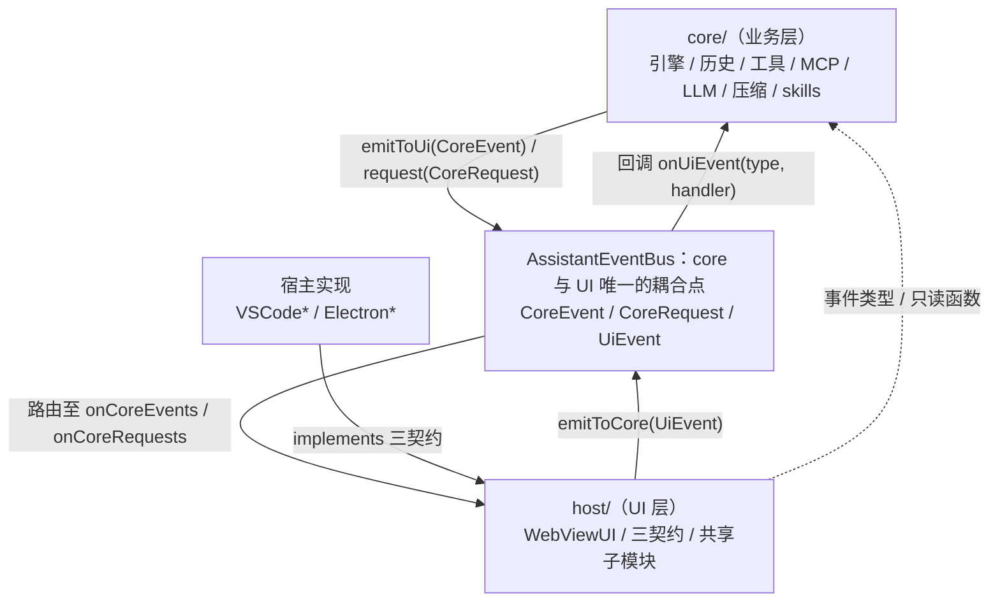
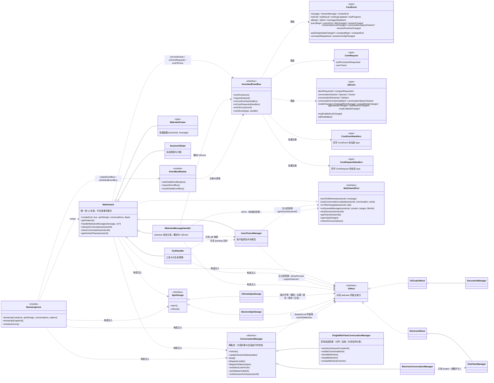
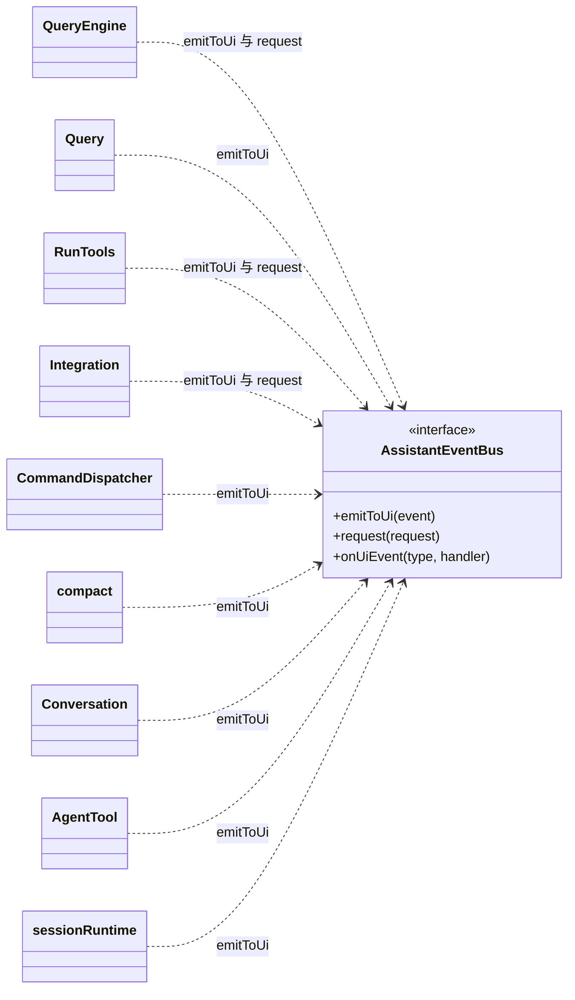
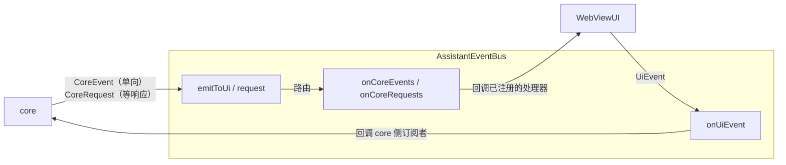

# <product-name> 开发文档

> 本文描述当前代码的架构实现（as-built），而非演进计划。
> 文档内容以代码为准；文档与代码不一致时，应先修正其中一方，使二者保持一致。
>
> 本文承载架构总览、事件词汇表、架构原则与待定事项；主题性规格（宿主契约、宿主对照、两套 Core 差异等）见 `docs/`，文档地图见 `docs/README.md`。

---

## 目录

| 章 | 标题 |
| --- | --- |
| 1 | [架构总览](#1-架构总览) |
| 2 | [分层与依赖规则](#2-分层与依赖规则) |
| 3 | [核心契约：AssistantEventBus](#3-核心契约assistanteventbus) |
| 4 | [事件列表](#4-事件列表) |
| 5 | [架构原则](#5-架构原则) |
| 6 | [待定事项](#6-待定事项) |

> 章节编号与代码注释中的 `DEVELOPMENT.md 第 N 节` 引用一一对应；调整章节编号时必须同步修改注释（`src/test/docsLint.test.ts` 校验引用有效性与事件表一致性）。

---

## 1. 架构总览

### 1.1 架构概述

core 与 UI 之间不存在直接引用，二者仅通过 `AssistantEventBus` 上的事件耦合。

`WebViewUI` 是唯一的 UI 实现，它不实现任何事件契约，只订阅总线并发送事件。
所有宿主差异收敛在三个契约上：

| 契约 | 职责范围 |
| --- | --- |
| `UIHost` | 对话 webview 的宿主能力 |
| `SpinDesign` | Spin 设计器（独立面板 / 窗口） |
| `ConversationManager` | 对话列表与会话运行时状态（空闲会话回收在 VS Code 实现里） |

### 1.2 分层结构

以模块为单位组织：三个分层模块（core / host / 宿主实现）加一个横跨 core 与 UI 的事件契约。
依赖方向单向：`宿主实现 → host/ → core/`，core 与 UI 之间唯一的边是 `AssistantEventBus`。



#### 模块一览

| 模块 | 位置 | 职责 | 依赖 | 被依赖 |
| --- | --- | --- | --- | --- |
| core（业务层） | `src/core/` | 引擎（`QueryEngine` / `Query` / `RunTools`）、历史（`history/`）、工具（`tools/`）、MCP（`mcp/`）、LLM 配置（`llm/`）、压缩（`compact/`）、skills、prompt、spin、会话运行时（`sessionRuntime.ts`）、命令分发（`CommandDispatcher.ts`） | `AssistantEventBus` 的事件类型与 `requireEventBus()` | host/、宿主实现（只读函数与类型） |
| AssistantEventBus（事件契约） | 类型在 `src/core/AssistantEventBus.ts`，实现在 `src/host/EventBus.ts` | core 与 UI 之间唯一的耦合点；事件词汇表 `CoreEvent` / `CoreRequest` / `UiEvent` / `UiRequest`；全局注册（`setGlobalEventBus` / `requireEventBus` / `resetGlobalEventBus`） | 无（纯接口 + 纯数据类型） | core、host、宿主实现 |
| host（UI 层） | `src/host/`，禁止 import `vscode` / `electron` | `WebViewUI`（唯一 UI 实现）；三契约 `UIHost` / `SpinDesign` / `ConversationManager`；连接模型 `Client` / `Connection` 与总线实现；共享子模块（`ui/toolHandler.ts` / `ui/userChoice.ts` / `ui/webviewMessageHandler.ts`）；`SessionUiState` | core 的事件类型与只读函数 | 宿主实现（implements 三契约） |
| 宿主实现 | `src/VSCode*.ts`、`electron/*.ts`、`tui-rs/` | 三契约的 VS Code / Electron 两端实现（`VSCodeUIHost` / `ElectronUIHost`、`VSCodeSpinDesign` / `ElectronSpinDesign`、`SingleWebViewConversationManager` / `ElectronConversationManager`），bootstrap 接线（`extension.ts` / `electron/main.ts` 调用共享骨架 `host/bootstrapCore.ts`）；TUI 是独立 Rust 宿主（`tui-rs/`），直连 Standalone Core 帧通道、不走 `host/`，core 帧 ↔ 渲染动作的翻译见 [docs/tui.md 第 5 节](docs/tui.md#5-译层映射hostrs--ts-宿主行为) | host/（三契约、WebViewUI 与 bootstrap 骨架）、core 只读函数、宿主 API（TUI 侧无宿主 API，直接面向帧协议） | —（顶层） |

#### 模块要点

- **core**：不依赖 UI、宿主与渲染。对外只做两件事——通过 `requireEventBus().emitToUi(...)`
  发单向事件、通过 `request(...)` 发请求-响应；对 `UiEvent` 是分散订阅
  （`bus.onUiEvent(type, handler)`，唯一注册入口为 `initializeCoreEvents.ts`）。
- **host/WebViewUI**：唯一的 UI 实现，不实现任何事件契约。构造时经 `Client` 一次性
  注册处理器（映射类型强制穷尽检查；每个 Connection 建立时把同一份表注册到自己的
  总线），需要通知 core 时调用 `emitToCore(UiEvent)`（Client 按 `sessionId` 路由）；
  持有 `SessionUiState` / `ToolHandler` / `UserChoiceManager` / `WebviewMessageHandler`，
  构造注入 `host` / `spinDesign` / `conversations` 三个契约。
- **host/Client / Connection**：连接模型（`docs/client-connection.md`）。Client 是宿主级
  唯一实例（工作区 / 会话路由、配置快照推送、就绪门禁）；Connection 是宿主与一个 Core
  的一对一连接（总线、就绪状态、会话集合）。`standalone` 下每个打开的工作区一个
  Connection、一个 Core 进程（经 daemon channel）；`embedded` 恒一个。
- **三契约**：按 UI surface 划分——`UIHost` 服务对话 webview、`SpinDesign` 服务
  Spin 设计器、`ConversationManager` 服务对话列表与会话运行时状态；
  全部由宿主实现层提供，`WebViewUI` 只认契约不认实现。
- **宿主实现**：唯一允许 import `vscode` / `electron` 的层；同时负责 bootstrap 接线：
  共享骨架 `host/bootstrapCore.ts`（Client 与全局总线 → `WebViewUI.create` →
  按工作区打开 Connection → 历史 / 会话队列 / 等待用户读取器）+
  各自的宿主专属接线（[docs/host-matrix.md 第 6 节](docs/host-matrix.md#6-宿主接线)）。

### 1.3 目录布局

| 路径 | 职责 |
| --- | --- |
| `src/config/project.json` | 产品身份与工程变量的定义处之一（另一处是 `package.json`）：产品名 / 扩展名 / 配置目录 / 环境变量前缀 / 命令与面板 id / Core 产物名与部署前缀；`src/test/brandLiteral.test.ts` 守卫「其余文件不出现产品字面量」与「两处定义一致」（`docs/product-identity.md`） |
| `src/config/project.ts` | 上述变量的 TS 只读入口（`PRODUCT_NAME` / `EXTENSION_NAME` / `CONFIG_DIR_NAME` / `ENV_PREFIX` / `CORE_ENV_VAR` / `CORE_BINARY_NAME` / `CORE_DEPLOY_PREFIX` …），源码与用例一律经它取值 |
| `src/core/AssistantEventBus.ts` | 事件类型（`CoreEvent` / `CoreRequest` / `UiEvent`）、处理器映射类型、总线接口、全局注册（`setGlobalEventBus` / `requireEventBus` / `resetGlobalEventBus`） |
| `src/host/webviewMessages.ts` | webview ↔ host 消息协议（wire 联合类型，按方向拆分：`HostToWebviewMessage` / `WebviewToHostMessage` / 双向成员），两端唯一的协议类型来源 |
| `src/core/webviewTypes.ts` | core 侧的展示事实类型（`McpServerInfo` / `ProviderModels` 等），core 产出、host 组装进消息载荷 |
| `src/host/EventBus.ts` | 总线实现 `createEventBus()`，纯内存发布订阅，无宿主依赖 |
| `src/core/initializeCoreEvents.ts` | core 侧 `UiEvent` 订阅的唯一注册入口，由 bootstrap 在 `setGlobalEventBus` 之后调用一次 |
| `src/host/bootstrapCore.ts` | 共享启动接线骨架：locale / 日志 / 扩展路径 / Client 与全局总线 / `WebViewUI.create` / 按工作区打开 Connection / 历史 / 会话队列 / 等待用户读取器 / 异步收尾；按 `CORE_KIND` 装配 embedded / standalone（[docs/standalone-core.md 第 3 节](docs/standalone-core.md#3-选择变量)）；导出 `bootstrapSnapshot()`（启动自检）与 `shutdownCore()`（退出清理） |
| `src/host/Client.ts` | 宿主级唯一实例：工作区 / 会话路由表、配置快照推送、就绪门禁；同时实现 `AssistantEventBus`，作为宿主侧的总线路由器（`emitToCore` / `requestCore` 按会话找归属） |
| `src/host/Connection.ts` | 宿主与一个 Core 的一对一连接：持有总线、就绪状态机（`connecting → ready → closed`）、该工作区的会话集合；未就绪时排队 `UiEvent` / 挂起 `requestCore` |
| `src/host/workspaceRef.ts` | 工作区引用 `{ scheme, path, endpoint }` 与去重键；本地 / 远程同构，Core 只见 `path` |
| `src/host/coreKind.ts` | Core 实现的选择变量：`CORE_KIND`（默认 `standalone`，打包时由 esbuild 按 `<envPrefix>_<core.envVarSuffix>` 注入构建期取值）与 `<envPrefix>_<core.envVarSuffix>` 运行期覆盖入口，`resolveCoreKind()` |
| `src/host/standalone/protocol.ts` | Standalone 帧协议：帧类型、编解码、换行分隔 JSON 解码器 |
| `src/host/standalone/coreBinary.ts` | Standalone Core 产物定位：平台 / 架构 → `resources/core/<arch>-<platform>/` |
| `src/host/standalone/CoreProcess.ts` | 单进程形态的 Core 进程管理：启动 / 握手 / 帧收发 / 背压 / 崩溃重启 / 关闭；实现 `CoreChannelTransport` |
| `src/host/standalone/CoreDaemon.ts` | Host 侧 daemon 客户端：一个 endpoint 一个 daemon，每个工作区一条 channel；Core 的重启与终止由 daemon 承担；把 `channelReset` 翻译成重新握手；链路就绪后定期发 `ping` 心跳（daemon 据此回收死连接，[docs/core-daemon.md 第 12.5 节](docs/core-daemon.md#125-连接与生命周期)） |
| `src/host/standalone/daemonProtocol.ts` | daemon 控制通道协议：帧类型、`ChannelDescriptor`、编解码与校验 |
| `src/host/standalone/StandaloneEventBus.ts` | `AssistantEventBus` 的帧通道实现（在 `CoreChannelTransport` 之上）：就绪前排队、连接态重放、`CoreRequest` 应答；传输层可以是单进程或 daemon channel |
| `core-rs/` | Standalone Core 的 Rust 包（帧协议、Core 侧总线、进程入口、daemon 模式） |
| `scripts/build-core.mjs` | Standalone Core 构建脚本：按目标三元组 `cargo build` 并落到 `resources/core/` |
| `src/core/sessionRuntime.ts` | 会话运行时状态（`idle` / `waiting` / 前台与后台来源）的唯一 owner，`sessionRuntimeChanged` 的生产者 |
| `src/core/tools/PermissionPolicy.ts` | 权限规则加工（agentMode → `resolveToolPermission`）与会话级 agentMode 存储 |
| `src/core/mcp/MCPHost.ts` | MCP 会话引用生命周期的唯一入口。它不是宿主契约，仅有一个 core 侧单例 |
| `src/host/WebViewUI.ts` | 唯一的 UI 实现；订阅总线、处理事件、发送 `UiEvent`；实现 `WebViewUiPort` |
| `src/host/UIHost.ts` | 契约 1：对话 webview 的宿主能力（interface，成员全部必选） |
| `src/host/SpinDesign.ts` | 契约 2：Spin 设计器（interface，`open` / `refresh`） |
| `src/host/settingsFile.ts` | 全局 `settings.json` 的宿主侧写入口（串行读-改-写；core 只读不写） |
| `src/host/ConversationManager.ts` | 契约 3：对话列表、会话运行时状态两条流（abstract class，模板方法），以及空闲会话回收的钩子（实现只在 VS Code 侧；core 不参与计时） |
| `src/host/ui/ports.ts` | `WebViewUiPort`、`WebviewPoster`、`ConversationLoadedExtra` |
| `src/host/ui/toolHandler.ts` | 工具卡片生命周期 |
| `src/host/ui/userChoice.ts` | 用户选择队列与预览 |
| `src/host/ui/webviewMessageHandler.ts` | webview 协议消息分发，并翻译为 `UiEvent` |
| `src/host/ui/types.ts` | 共享子模块的接口定义（`ShowVirtualDocumentEvent` / `ShowDiffInVirtualDocumentEvent` 等） |
| `src/host/ui/spinDesignHtml.ts` | Spin 设计器 HTML 生成 |
| `src/host/SessionUiState.ts` | 会话级 UI 运行时状态（活动阶段 / 工具计数 / 查询计数） |
| `src/host/queryActivity.ts`、`conversationPayload.ts`、`mermaidHtml.ts`、`imageFiles.ts`、`spinDesignExport.ts`、`types.ts`、`workspacePaths.ts` | 共享辅助：活动查询判定、`conversationLoaded` 组装、Mermaid HTML、图片判定、Spin 导出、`HostInfo`、工作目录路径归一与去重 |
| `src/VSCodeUIHost.ts` + `src/VSCodeUIHost/` | `UIHost` 的 VS Code 实现（含 `documentManager.ts` / `diffUris.ts`） |
| `electron/ElectronUIHost.ts` | `UIHost` 的 Electron 实现 |
| `src/VSCodeSpinDesign.ts` / `electron/ElectronSpinDesign.ts` | `SpinDesign` 的两个实现（构造注入 `UIHost`） |
| `src/VSCodeConversationManager.ts` / `electron/ElectronConversationManager.ts` | `ConversationManager` 的两个实现；空闲会话回收（计时 / 巡检 / 关闭动作）只在 VS Code 侧 |
| `electron/shortcut.ts` | Electron 专属：Electron accelerator 解析与规范化（唤醒快捷键）；core 不读不写 |
| `electron/shortcutDialogHtml.ts` + `electron/shortcutPreload.ts` | Electron 专属：唤醒快捷键设置对话框（File - Shortcut...，见[docs/contracts.md 第 5 节](docs/contracts.md#5-宿主侧入口动作翻译为-uievent)） |
| `electron/titlebar/` + `electron/titlebarPreload.ts` | Electron 专属：自绘标题栏（左侧品牌区 + 单一菜单图标 + 工作目录标签页区；右侧置顶钉 / 模式切换 / 最小化-最大化-关闭，两个图标按钮与窗口按钮同宽同高），替代系统默认标题栏与系统菜单栏 |
| `electron/titlebarMenuHtml.ts` + `electron/titlebarMenuPreload.ts` | Electron 专属：标题栏下拉菜单。菜单由独立 `WebContentsView` 承载（标题栏视图只有 38px 高，自身 bounds 会裁掉向下展开的菜单），首次打开测量尺寸后缓存，再次打开直接摆位显示；子菜单（「添加最近的工作目录」）渲染成右侧飞出面板，默认收起 |
| `electron/sidebar/` + `electron/sidebarPreload.ts` | Electron 专属：原生侧栏（头部搜索框 + 新对话按钮；对话列表；空态「添加工作目录」+ 最近工作目录；底部可折叠的文件浏览器分区，`electron/sidebarFiles.ts` 提供路径校验与目录读取） |
| `src/extension.ts` / `electron/main.ts` | 各自的 bootstrap：构造三契约与宿主句柄 → 调用共享骨架 `bootstrapCore` → 执行宿主专属接线（[docs/host-matrix.md 第 6 节](docs/host-matrix.md#6-宿主接线)） |
| `tui-rs/` | TUI 宿主实现（第三个宿主，纯 Rust，`docs/tui.md`）：直连 Standalone Core 的 stdio 帧通道；`host.rs` 译层（core 帧 ↔ 渲染动作，WebViewUI 行为的移植）；`store.rs` 纯 reducer（Action → 唯一渲染事实）；`settings.rs` 配置快照（`settings.json` / `mcp.json` 规范化 + 模型注册表）；`core_root.rs` Core 产物定位；`app.rs` ratatui 渲染与键盘路由；`composer.rs` / `markdown.rs` / `diffview.rs` 纯函数子集 |
| `installer-rs/` | TUI 版安装程序（`docs/tui-installer.md`）：纯 Rust 自解压安装器，构建期把 Core / ripgrep / TUI 二进制烧进单文件；`.cargo/config.toml` 配 musl 的 rust-lld |
| `scripts/build-tui-installer.mjs` | 安装程序构建：按目标确保 Core 产物与 TUI 二进制就位 → cargo 交叉构建 → 落位 `release/tui-installer/`（四目标：Windows x64/arm64、Linux x64/arm64 musl） |

**硬约束**：`VSCodeUIHost.ts` / `VSCodeSpinDesign.ts` / `VSCodeConversationManager.ts`
不得放入 `src/host/`。`electron/tsconfig.json` 的 `include` 包含 `../src/host/**/*.ts`，
上述文件若放入该目录会被 electron 侧编译，而它们 `import * as vscode`，将直接编译失败。
因此这三个文件在 `electron/tsconfig.json` 中被逐个显式列出。

### 1.4 类图



core 侧与总线的交互：



### 1.5 图注说明

1. **core 与 UI 之间不存在直接引用。** core 仅 import `AssistantEventBus` 与事件类型；
   `WebViewUI` 不实现任何事件契约，在构造时通过 `onCoreEvents` / `onCoreRequests`
   一次性注册处理器，需要通知 core 时调用 `emitToCore`。
2. `CoreEvent` / `CoreRequest` / `UiEvent` 是纯数据类型，不包含行为，
   因此 core 与 UI 对它们的依赖不构成耦合。
3. 架构中不设 `WebViewEventBus` / `WebViewNotifier` / `AssistantNotifier` / `AssistantController`。
   总线本身即路由，`WebViewUI` 直接订阅；渲染与控制均在 `WebViewUI` 内实现，
   「需要处理哪些事件」由 `CoreEventHandlers` 映射类型在编译期强制穷尽。
4. `SessionUiState` / `ToolHandler` / `UserChoiceManager` / `WebviewMessageHandler` /
   `WebviewPoster` 均由 `WebViewUI` 创建并持有。
5. 三个共享子模块（`ToolHandler` / `UserChoiceManager` / `WebviewMessageHandler`）
   只依赖 `UIHost`（宿主能力）与若干回推回调；`WebviewMessageHandler` 另有一个构造后回填的
   窄端口 `uiPort`（`WebViewUiPort` 的子集，见`docs/contracts.md`）。
   其中 `WebviewMessageHandler` 还负责将 webview 协议消息翻译为 `UiEvent` 并发送至总线。
6. `WebViewUI ..> UIHost` 为构造注入（依赖关系），`VSCodeUIHost` / `ElectronUIHost` 为对应实现。
7. `SpinDesign` 是**第二个契约**，与 `UIHost` 平行。Spin 设计器是独立面板 / 窗口，
   具有独立的生命周期与消息协议，与对话 webview 不共享状态。
   其实现反向依赖 `UIHost` 以获取宿主环境（工作区路径 / 主题 / 语言 / 保存文件 / 日志）。
8. `ConversationManager` 是**第三个契约**，采用抽象类而非接口：`load()` 在两个宿主上一致，
   仅 `dispatch*()` 不同，因此由模板方法将共享部分固定在基类。
   它同样反向依赖 `UIHost`（分发时使用 `sendToWebview`）。
   它分发**两条独立的流**：对话列表（磁盘元数据）与会话运行时状态（`idle` / `waiting`）。
   两条流各自拥有独立的事件、分发方法与消费者，不合并为单一带标记列表。
   空闲会话回收（计时、巡检、关闭动作分发）只在 VS Code 的实现里（Electron 每个对话一个
   独立视图，自动关闭等于关掉用户的窗口），core 不参与计时。
9. `MCPHost` **不是第四个宿主契约**。它仅有一个 core 侧单例，负责
   「会话生命周期 → MCP 引用」的映射，驱动信号全部来自 core，而非宿主视图生命周期。

---

## 2. 分层与依赖规则

依赖方向（代码评审必须检查）：

```
core/  ←  host/  ←  宿主实现（VSCode* / Electron*）
         ↑
   AssistantEventBus 是 core 与 UI 之间唯一的边
```

规则清单：

1. `core/` 不得 import `host/` 的具体实现，只能 import `AssistantEventBus`、事件类型与宿主契约类型。
   core 内部模块之间通过 `requireEventBus()` 发送事件，不得直接调用 UI 的任何方法。
2. `core/` 不得定义「UI 侧处理器契约」类型。UI 需要处理哪些事件，由
   `core/AssistantEventBus.ts` 中的 `CoreEventHandlers` 映射类型表达。
3. `host/` 不得 import `vscode` / `electron`。当前 `src/host/**` 中无任何此类 import。
4. `host/ui/*` 不得 import 任何宿主 API；宿主差异通过 `UIHost` 与 `WebViewUiPort` 注入。
5. 共享代码中不得出现 `host.kind === '...'` 形式的宿主嗅探；宿主差异须以能力字段或独立方法表达。
6. `UIHost` / `SpinDesign` / `ConversationManager` 的成员全部必选，不出现 `?`；可选语义以 `null`
   或判别联合表达。必选性由**构造时序**保证（构造函数内先建立依赖、再注册处理器），
   不得使用 `!` 空断言。
7. 契约按 **UI surface** 划分：`UIHost` 服务对话 webview，`SpinDesign` 服务 Spin 设计器，
   `ConversationManager` 服务对话列表与会话状态。新增面板、窗口或列表类功能时，
   应先确定其所属 surface，而不是向 `UIHost` 追加成员。
8. **不同来源的数据走不同的流**，不得以附加标记的方式合并。磁盘元数据（低频）与运行时状态
   （高频）各自拥有独立的事件与分发方法；`loaded` 这类宿主界面状态由其 owner 单独推送。
   判据：若两个字段的变化频率相差一个数量级，或其 owner 不同，则不应出现在同一条流中。
9. `host/` 与宿主实现可以 **import core 的只读函数与类型**（如 `loadConversationList`、
   `readHighlightLanguagesSync`、`ConversationMetadata`），这属于「宿主消费 core 的事实」，
   与「core 不得 import host」共同构成单向依赖：`宿主实现 → host/ → core/`。
   但 host 侧**不得调用 core 的状态变更函数**；改状态的请求一律翻译为 `UiEvent` 走总线。
  全局配置文件 `~/<CONFIG_DIR_NAME>/settings.json` 是宿主资源：**读与写都在宿主**，
  core 不感知它的路径，只消费经 `UiEvent.hostEnvironmentProvided` 下发的配置快照
  （[docs/core-ui-separation.md 第 4 节](docs/core-ui-separation.md#4-配置归-ui)）。写入口唯一：`SettingsStore.updateSettings`；
  写盘后由 `bootstrapCore` 里的一次订阅重新构造快照并推给 Connection，调用点不手工触发。
  对话目录下的 `<conversations>/<project>/workspace.meta.json`（记录 workspacePath）不同：
  它归 core（在 Core 数据目录内），目录创建与清单读写都在 core，宿主不参与写盘。
  宿主本地偏好（`theme` / `shortcut`）不在这两份文件里：它们只有 Electron 消费，落
  `userData/workspace-state.json`（`electron/workspaceStateStore.ts`，临时文件 + rename 原子落盘、内容未变不落盘），core 不读不写（[docs/host-matrix.md 第 12 节](docs/host-matrix.md#12-宿主固有差异有意保留)）。

  **规则 9 的审计结论**（对 `src/host/**` 与宿主实现层的 core import 逐项归类）：

  | 类别 | 判据 | 落点 |
  | --- | --- | --- |
  | 纯函数 / 类型 / 常量 | 无副作用、不读进程内状态 | `conversationPayload` / `llmConfigSave` / `settingsRead` / `webviewMessageHandler` 的解析与拼装函数、各模块的类型与常量 |
  | 受控事实入口 | 按 `CORE_KIND` 分派：Embedded 直读、Standalone 走 `UiRequest` | `src/host/coreFacts.ts`（对话列表 / 智能命名 / 余额 / 归档展开 / MCP 列表 / 对话空间 / 会话加载 / 技能列表 / 挂起持久化） |
  | Embedded-only 装配 | `CORE_KIND === 'embedded'` 分支内；Standalone 下 core 在进程外自行完成 | `bootstrapCore` 的 `initializeCoreEvents` / `ensureConfigDirs` / `getMCPHost().prune`；`webviewMessageHandler` 的 `restoreConversationEngine` |
  | UI 侧共享队列 | 状态归 UI，不属于 core 事实 | `src/core/UserChoiceQueue.ts`（宿主侧待答队列；Standalone 下同样由 UI 使用） |

  仍保留的直接读取（Standalone 下与本机 Core 共用同一份磁盘，远程工作区需要迁到
  `UiRequest`，见 [docs/standalone-core.md 第 10 节](docs/standalone-core.md#10-宿主侧的-core-事实读取)的例外表）：

  - 会话工作目录索引：宿主侧另存一份 `sessionId → workspacePath`
    （`history/Config.ts` 的 `getSessionWorkspace` / `setSessionWorkspace`）。Standalone 的
    权威表在 Core 进程内、由 `sessionWorkspaceAssigned` 同步；宿主侧这份只用于
    「发事件前取会话自己的目录」，不参与 core 的目录解析；
  - 工具 `_meta` 的 before/after：`ToolHandler` 在权限确认时经 `updateToolUseMeta`
    追加写入会话 JSONL（与 Core 的写入共用同一份磁盘，本机成立）。

---

## 3. 核心契约：AssistantEventBus

位置：类型在 `src/core/AssistantEventBus.ts`，实现在 `src/host/EventBus.ts`。

core 与 UI **不互相引用**，只通过总线上的事件耦合。事件类型是两边唯一的公共词汇表。



**总线是 core 与 UI 之间唯一的边**：两边共享的只有**数据**（事件类型），不共享**行为**
（方法签名 + 调用时序）。core 不 import UI 的契约类型，也不需要知道「谁在处理」；
UI 可以被替换，也可以只订阅自己关心的事件。

`CoreEvent` 是一个判别联合，**不按「渲染 / 控制」分组**——事件是纯数据，分组只会多一层
没有语义的包装；「谁来处理」由订阅方（`WebViewUI`）在 `onCoreEvents` 里决定，
`WebViewUI` 不实现任何「处理器契约」接口（第 3.3 节）。

### 3.1 事件定义

四组词汇表，共 60 个事件：

| 词汇表 | 方向 | 语义 | 数量 |
| --- | --- | --- | --- |
| `CoreEvent` | core → UI | 单向事实通知 | 26 |
| `CoreRequest` | core → UI | 请求-响应（core 等 UI 返回结果） | 2 |
| `UiEvent` | UI → core | 单向，报告用户动作与宿主环境 | 23 |
| `UiRequest` | UI → core | 请求-响应（UI 等 Core 返回结果；宿主索取 core 事实的通道） | 9 |

`CoreEvent` / `CoreRequest` / `UiEvent` 逐事件的载荷 / 触发点 / 处理方见第 4 章；
`UiRequest` 的成员、两侧应答与宿主侧统一入口（`coreFacts`）见 [docs/standalone-core.md 第 10 节](docs/standalone-core.md#10-宿主侧的-core-事实读取)。
汇总数量由 `src/test/docsLint.test.ts` 对照类型联合校验，不手写维护。

**两条独立的流**（第 2 章规则 8）：

| | `conversationListChanged` | `sessionRuntimeChanged` |
| --- | --- | --- |
| 内容 | 磁盘元数据（title / messageCount / createdAt…） | 运行时根事实（idle / waiting / queryRunning / compacting / backgroundRunning / subAgentRunning） |
| owner | 磁盘（`history`） | core 的 `sessionRuntime`（第 4.5 节） |
| 变化频率 | 低（落盘 / 改名 / 删除 / 新建） | 高（查询开始结束、等用户、用户响应） |
| 消费者 | webview 子对话树、Electron 原生侧栏 | VS Code webview 对话树流水灯、Electron 侧栏流水灯、系统托盘状态点、两端的 abort 按钮 |

两者**不合并为一条流**：把 `idle` / `waiting` 贴到磁盘列表上一起推送，会让列表接口失真
（磁盘元数据里混着运行时状态），且每次状态变化都要重读一遍盘。各自只在自己变化时推。

`sessionRuntimeChanged` 推**全量**（所有已知会话的状态）而不是增量：会话数量是几十的量级，
全量让消费者不必自己维护状态表，也不会因为丢一条增量而永久错位。

`CoreRequest` 的结果类型由 `CoreRequestResultMap` 约束（`toolPermissionRequested → PermissionResult`、
`userChoice → { index; reply? }`）；`request<T>()` 的泛型签名据此把请求类型与结果类型一一对应，
调用点不需要手动收窄。

`SessionRuntimeState` 只放 core 能提供的**根事实**（`sessionId` / `idle` / `waiting` /
`queryRunning` / `compacting` / `backgroundRunning` / `subAgentRunning`）；`idle` 是由其余
来源合并出的派生字段，颜色 / 可点性等表现由消费者推导（第 5.8 节）。宿主自己的界面
状态（如 Electron 的「视图已打开」）由宿主自己维护，不混进来。

### 3.2 AssistantEventBus 接口

| 方法 | 调用方 | 语义 |
| --- | --- | --- |
| `emitToUi(event)` | core | 发布单向事件 |
| `request(request)` | core | 发起请求并等待响应（返回 Promise） |
| `onCoreEvents(handlers)` | UI | 一次性注册**全部** core 事件处理器（返回 `Unsubscribe`） |
| `onCoreRequests(handlers)` | UI | 一次性注册**全部** core 请求处理器 |
| `emitToCore(event)` | UI | 发布单向事件 |
| `onUiEvent(type, handler)` | core | 逐个订阅自己关心的 UI 事件（返回 `Unsubscribe`） |
| `requestCore(request)` | UI | 向 core 发起 `UiRequest` 并等待应答（返回 Promise） |
| `onUiRequests(handlers)` | core | 一次性注册**全部** `UiRequest` 处理器 |

发布（`emit*`）与订阅（`on*`）刻意分成两组，让「谁在发、谁在收」在类型层面可见。

**穷尽检查靠映射类型**：

```ts
export type CoreEventHandlers = {
  readonly [K in CoreEvent['type']]: (event: Extract<CoreEvent, { type: K }>) => void;
};
export type CoreRequestHandlers = {
  readonly [K in CoreRequest['type']]: (
    request: Extract<CoreRequest, { type: K }>,
  ) => Promise<CoreRequestResultMap[K]>;
};
```

新增一个 `CoreEvent` 却没在 `onCoreEvents` 的表里补 handler，会**编译报错**。UI 侧不设
处理器契约接口，`CoreEventHandlers` 映射类型就是「UI 不漏接事件」的保障。

**实现**：`src/host/EventBus.ts` 的 `createEventBus()`。纯内存路由（core 事件 / 请求各一份
处理器表，UiEvent 用 `Map<type, Set<handler>>` 支持多订阅者），无宿主依赖，不含任何
「事件 → 方法」的映射逻辑。它只做一件事：把事件交给注册过的处理器。

### 3.3 UI 侧订阅：WebViewUI

`WebViewUI` 不 `implements` 任何事件契约，构造时用两张映射表把处理器一次性注册到总线：

```ts
// src/host/WebViewUI.ts
bus.onCoreEvents(this.buildCoreEventHandlers());
bus.onCoreRequests(this.buildCoreRequestHandlers());
```

（两张表的内容见第 4.1 / 4.2 节。）

**为什么用映射表而不是逐个 `onCoreEvent('xxx', ...)`**

| | 映射表（`onCoreEvents`） | 逐个订阅 |
| --- | --- | --- |
| 漏订阅 | **编译报错**（映射类型要求穷尽 `CoreEvent['type']`） | 静默漏掉，运行期才发现 |
| 阅读 | 一张表看全 UI 处理哪些事件 | 散在构造函数里 |
| 新增事件 | 改 `CoreEvent` 联合后，这里立刻报错提醒补 handler | 无提醒 |

**架构中不设 `WebViewNotifier` / `WebViewController` / `AssistantNotifier` / `AssistantController`**：
这类接口的职责是给「事件 switch」提供明确的调用目标。总线本身即路由，处理器就是映射表里的
匿名函数，签名由映射类型保证；再加一层「接口 → 实现」只是多余的间接。渲染与控制都在
`WebViewUI` 内，按注释分区即可（第 1.5 节第 3 条）。

### 3.4 命名约定

事件 `type`、`WebViewUI` 的 handler 方法名，以及三个契约（`UIHost` / `SpinDesign` /
`ConversationManager`）的方法名，都按下面两类判断：

| 前缀 | 语义 | 判据 | 例子 |
| --- | --- | --- | --- |
| `on*` | **事实通知**：状态由别处拥有，UI 只是投影 | 值存在外部 source of truth（meta.json / 引擎状态 / 队列 / 磁盘数据） | `onMessage`、`onSessionCreated`、`onCompactBegin`、`onTitleChanged`、`onConversationListChanged`、`onSpinDesignDataChanged` |
| 动词开头 | **命令**：UI 自己拥有该状态，调用方要求它改变 | 状态只存在于 UI 内部 | `setThinkingAnimation`、`openFile`、`showDiff`、`open` / `refresh`（`SpinDesign`）、`refresh` / `updateSessionStates` / `dispatchList` / `dispatchStates`（`ConversationManager`） |

边界判定示例：

- `onTitleChanged`：标题持久化在 `meta.json`，UI 只负责显示 → 事实通知。
- `onConversationListChanged`：对话列表数据在磁盘上，「立即还是节流、推给哪些视图」是 UI 的
  表现策略，不该由 core 选择 → 事实通知。
- `setThinkingAnimation`：thinking 动画是否显示只存在于 webview 内部，调用方只是要求切换 → 命令。
- 三个契约上的 `refresh` 是命令式命名——那是 `WebViewUI` 要求宿主刷新自己持有的界面表示，
  属于宿主侧命令，与 `CoreEvent` 的事实通知不冲突。

**事件命名**（`type` 字段）：

- `CoreEvent` / `CoreRequest`：与 `WebViewUI` 的 handler 方法同名去 `on` 前缀
  （`onTitleChanged` ↔ `{ type: 'titleChanged' }`）。
- `UiEvent`：**过去式**，描述用户已经做完的动作（`modelChanged` = 用户改了模型），
  不是命令（不叫 `setModel`）。
- 全小写驼峰，不带 `on` 前缀。
- **wire protocol 命名不受此约定约束**：协议消息名描述「接收方要做什么」，因此
  `titleChanged` 事件最终仍发 `{ type: 'setTitle' }`；`thinkingEffort` 事件落盘字段仍是
  `thinkingMode`。改协议名要同时动 `webviewMessages.ts` / handler / webview，收益为零，不做。

### 3.5 全局注册与 bootstrap 顺序

```ts
setGlobalEventBus(bus);   // 注册全局总线；重复注册抛错（接线错误在启动期暴露）
requireEventBus();        // 取全局总线；未注册时抛错，不用 ?. 静默跳过
resetGlobalEventBus();    // 测试用：清空全局总线
```

两个宿主的启动接线由**共享骨架**执行（`src/host/bootstrapCore.ts` 的 `bootstrapCore`），
宿主只提供自身差异（locale / 日志出口 / 资源根目录），因此顺序只有一份。宿主 locale 只
服务宿主进程内的原生 UI（`src/host/i18n.ts`），不进总线（[docs/core-ui-separation.md 第 4.8 节](docs/core-ui-separation.md#48-文本语言)）：

```
1.  SettingsStore.loadSync()：读宿主自己的 settings.json / mcp.json
2.  创建 Client：
    - embedded：createEventBus() → setGlobalEventBus(bus) → initializeCoreEvents(bus)
      （第 2 步必须同步注册「宿主环境」事件的处理器）
    - standalone：setGlobalEventBus(client)（Client 是宿主侧路由器）
3.  SettingsStore.subscribe(() => client.emitToCore(hostEnvironmentProvided))
    - 配置写盘后重推整份快照；Client 推给所有 Connection
4.  WebViewUI.create(host, client, spinDesign, conversations, { log, createUserChoiceManager })
    - 处理器注册在 Client 上；Connection 建立时把同一份表注册到自己的总线
5.  按 WorkspaceProvider 打开 Connection：client.openWorkspace(ref)
    - 连接建立即推送 hostEnvironmentProvided（扩展路径 / 日志出口开关 /
      configDirName / 配置快照 / MCP 服务器表）
    - core 收到后写配置快照并发 CoreEvent.coreReady；Connection 就绪并冲刷排队事件
6.  host.onWorkspaceChanged → client.openWorkspace / closeWorkspace / activateWorkspace
7.  ensureConfigDirs() / getMCPHost().prune()（embedded，异步，失败记日志）
```

顺序约束：

- 第 1–2 步在任何 core 模块被使用之前完成；Embedded 的 `initializeCoreEvents` 必须**同步**
  注册第 5 步要发的 `hostEnvironmentProvided`：异步注册会让事件在处理器就位前到达，
  被总线按「暂无订阅者」静默丢弃；
- 第 4 步必须在 core 第一次 `emitToUi` 之前完成，否则总线抛错（第 3.7 节）；Connection
  建立（第 5 步）时处理器表必须已登记；
- 第 5 步的就绪门禁在 Client 侧：未收到 `coreReady` 前不发出任何 `UiEvent`（`UiRequest`
  同样挂起），Core 侧对应地做硬断言（第 3.7 节）；
- 第 6 步的订阅在打开 Connection 之后注册：宿主在启动后新开 / 关闭工作区时同步建立 /
  销毁 Connection；
- 第 7–8 步是 Embedded 的收尾，不阻塞启动，失败只记日志。

宿主环境差异（扩展路径 / 日志出口开关 / 配置目录名 / 配置快照 / MCP 服务器表）经总线传递，
core 侧没有对应的直接注入入口；宿主 locale 只在宿主进程内使用，core 不感知语言。
会话的工作目录是对话的属性：宿主在会话首次被 core 解析目录之前经
`UiEvent.sessionWorkspaceAssigned` 登记（[docs/host-matrix.md 第 7 节](docs/host-matrix.md#7-启动期状态写入入口与读取器)），Client 同时据此建立
`sessionId → Connection` 路由。

core 模块随 bundle 加载，**模块顶层不能订阅**（加载时总线还不存在）；订阅统一收敛到
`initializeCoreEvents`（第 3.6 节）。接线项归属、注入点与读取器、启动自检与退出路径见
[docs/host-matrix.md 第 6–10 节](docs/host-matrix.md#6-宿主接线)。

### 3.6 core 侧 UiEvent 订阅：initializeCoreEvents

core 侧**没有处理器契约**，与 UI 侧同理：消费方是分散的模块（`Integration` / `history` /
`sessionResources` / `mcp`），各自用 `onUiEvent(type, handler)` 订阅自己关心的少数几个事件。

唯一注册入口是 `src/core/initializeCoreEvents.ts`，按 core 模块分注册函数：

```ts
export function initializeCoreEvents(bus: AssistantEventBus): void {
  registerHostEnvironmentUiEvents(bus);        // hostEnvironmentProvided（同步注册）
  registerUserChoiceUiEvents(bus);             // userChoicePendingChanged（同步注册）

  void registerIntegrationUiEvents(bus);       // 消息 / 压缩 / 配置 / 会话生命周期
  void registerHistoryUiEvents(bus);           // 重命名 / 删除 / 上下文 / 空间
  void registerSessionResourcesUiEvents(bus);  // conversationClosed → releaseSessionResources
  void registerMcpUiEvents(bus);               // mcpEnabledChanged / mcpEnabledListChanged
}
```

要点：

- **前两个注册函数同步执行**：`hostEnvironmentProvided` 由调用方在 `initializeCoreEvents`
  之后立刻发出，`userChoicePendingChanged` 由宿主在任意时刻发出；异步注册会让事件在处理器
  就位前到达，被总线按「暂无订阅者」静默丢弃。
- 事件 handler 内部**不直接持有跨模块状态**：只调用对应模块自己的导出函数
  （`abortCurrentQuery` / `updateConversationContext` / `releaseSessionResources` …），
  保持与直接函数调用相同的内聚度。
- **不做成映射表穷尽检查**：UI 侧漏订阅会直接功能断链（必须穷尽），core 侧漏订阅是允许的
  ——某个动作可以没有 core 消费方（如 `conversationOpened`）。各事件的实际消费方以第 4.3 节
  的「core 侧消费方」列为准。

### 3.7 总线边界语义：启动窗口 / 无订阅者 / 请求丢失

「接线缺失即暴露」在几个边界场景的口径：

| 场景 | 语义 | 说明 |
| --- | --- | --- |
| `emitToUi` 时 `onCoreEvents` 尚未注册 | **抛错** | bootstrap 顺序错误（`WebViewUI.create` 未在 core 首次发事件前完成），启动期暴露 |
| `emitToCore` / `onUiEvent` 对某 type 尚无 core 订阅者 | **静默丢弃** | core 侧是分散订阅，允许某动作暂无消费方；这类操作不产生需要补的历史（会话内容都在磁盘上） |
| `request()` 时 `onCoreRequests` 尚未注册，或该 type 无 handler | **立即 reject** | 与 `emitToUi` 同类：接线缺失在启动期暴露 |
| `request()` 的 handler 已注册但响应丢失（UI reload、pending 未恢复） | **永久挂起** | 总线不内置计时器；调用点自行决定兜底（当前两个请求都不设超时，见下） |

**请求超时约定**：`request()` 本身不实现超时（总线保持纯路由），**当前两个请求都不设超时**：

- `toolPermissionRequested`：不设超时——权限确认的耗时取决于用户（可能正在看 diff），
  没有合理的上界；设短了会把「正在看 diff 的用户」误杀。只有请求本身失败
  （无订阅者 / 处理器异常）才按 `deny` 兜底——那是调用链坏了，不是用户还在犹豫。
- `userChoice`：靠 `UserChoiceQueue` 的 pending 补偿（webview 重建后重新弹出），不额外加超时；
  会话关闭时拒绝该会话的 pending，避免等待方永久挂起——Embedded 由 `releaseSessionResources`
  调 `userChoiceQueue.rejectPending`，Standalone 的 Core 进程不持有宿主队列，由宿主
  `UserChoiceManager.dropSession` 补同一刀。

---

## 4. 事件列表

本章是第 3.1 节事件定义的**完整清单**：每个事件的载荷、触发点、处理方，以及最终转成的
wire message（若该事件会产生 webview 协议消息）。

| 组 | 方向 | 数量 | 处理方 |
| --- | --- | --- | --- |
| `CoreEvent` | core → UI | 26 | `WebViewUI`（`onCoreEvents` 映射表） |
| `CoreRequest` | core → UI | 2 | `WebViewUI`（`onCoreRequests` 映射表） |
| `UiEvent` | UI → core | 23 | core 侧订阅者（`initializeCoreEvents`） |

命名规则见第 3.4 节。

### 4.1 CoreEvent（core → UI，单向）

`CoreEvent` 是单一判别联合，不按渲染 / 控制再分组；「处理方」列是该事件在 `WebViewUI` 里
对应的 handler（第 3.3 节的两张映射表之一）。

| # | `type` | 载荷 | core 侧触发点 | 处理方 | 转成的 wire message |
| --- | --- | --- | --- | --- | --- |
| 0 | `coreReady` | 无 | `initializeCoreEvents` 的 `hostEnvironmentProvided` 处理器（应用完配置快照后；每次重推快照都再发一次） | `onCoreReady`（宿主侧闩锁，`host/coreReadiness.ts`） | 无（不投递到 webview） |
| 1 | `message` | `sessionId`, `data: MessageData` | `Integration`（用户消息 / 命令）、`Query`、`QueryEngine`、`history/rollback`、`spin/Loop`、`utils/replayMessages` | `onMessage` | `addMessage` |
| 2 | `streamMessage` | `sessionId`, `data: StreamMessageData` | `Query` | `onStreamMessage` | `streamMessage` |
| 3 | `streamEnd` | `sessionId`, `data: StreamEndData` | `Query` | `onStreamEnd` | `streamEnd` |
| 4 | `toolCall` | `sessionId`, `toolUseId`, `toolName` | `tools/RunTools` | `onToolCall` | `updateToolStatus`（`running`） |
| 5 | `toolResult` | `sessionId`, `toolUseId`, `toolName`, `output`, `status` | `tools/RunTools`、`Query` | `onToolResult` | `updateToolStatus`（Edit 失败时追加 `updateToolArgs`） |
| 6 | `toolArgsUpdated` | `sessionId`, `toolUseId`, `args` | `Query`（流式 tool input 累积） | `onToolArgsUpdated` | `updateToolArgs` |
| 7 | `toolProgress` | `sessionId`, `toolUseId`, `progress: ToolProgressData` | `tools/RunTools` | `onToolProgress` | `toolProgress` |
| 8 | `aiBegin` | `sessionId` | `Query`（每轮 LLM 调用开始） | `onAIBegin` | `aiBegin` + `showThinkingAnimation` |
| 9 | `aiEnd` | `sessionId` | `Query`（每轮 LLM 调用结束） | `onAIEnd` | `aiEnd` + `showThinkingAnimation` + `balanceUpdate` |
| 10 | `messagesReplaced` | `sessionId`, `messages: readonly MessageData[]` | `utils/replayMessages`（压缩后重建） | `onMessagesReplaced` | `messagesReplaced`（整批替换消息列表；宿主 `expandCompact` 也投递同一条 wire message） |
| 11 | `queryBegin` | `sessionId` | `Integration`、`QueryEngine`、`tools/agent/AgentTool` | `onQueryBegin` | `queryBegin` + `showThinkingAnimation` |
| 12 | `queryEnd` | `sessionId` | 同上 | `onQueryEnd` | `queryEnd` + `showThinkingAnimation` |
| 13 | `titleChanged` | `sessionId`, `title` | `Integration`（新会话初始标题）、`skills/bundled/spin`、`initializeCoreEvents`（重命名） | `onTitleChanged` | `setTitle` |
| 14 | `sessionCreated` | `sessionId`, `parentSessionId: string \| null` | `QueryEngine`（新会话与子代理会话创建都会走到这里） | `onSessionCreated` | `initSessionState` |
| 15 | `conversationListChanged` | 无 | `history/Conversation`（消息落盘）、`tools/agent/AgentTool`（子代理创建 / 结束）、`initializeCoreEvents`（改名 / 删除） | `onConversationListChanged` → `ConversationManager.refresh()` | `conversationsData`（VS Code）；Electron 另推原生侧栏 |
| 16 | `sessionRuntimeChanged` | `states: readonly SessionRuntimeState[]` | core 的 `sessionRuntime`（第 4.5 节） | `onSessionRuntimeChanged` → `ConversationManager.updateSessionStates()` | VS Code：webview 对话树流水灯（`sessionRuntimeStates`）；Electron：侧栏流水灯 + 托盘状态点 + 未读完成呼吸 + 系统睡眠阻断 |
| 17 | `spinDesignDataChanged` | 无 | `skills/bundled/spin`、`spin/Loop` | `onSpinDesignDataChanged` | `SpinDesign.refresh()` |
| 18 | `compactBegin` | `sessionId` | `compact/compact`（压缩流程见 `docs/compaction.md`） | `onCompactBegin` | `compressProgress`（`status: 'start'`） |
| 19 | `compactEnd` | `sessionId`, `result` | `compact/compact`（`complete`）、`Integration` / `QueryEngine`（`error`） | `onCompactEnd` | `compressProgress`（`status: 'complete'` / `'error'`） |
| 20 | `commandDispatched` | `sessionId`, `commandName`, `args` | `CommandDispatcher`（命令在引擎消费循环的轮次边界解析时就地执行） | `onCommandSend` | `/spin`：打开设计器；同时清除该会话的排队项（内置命令不进入上下文、不补发用户气泡） |
| 21 | `sessionConfigChanged` | `sessionId`, `change` | `initializeCoreEvents`（前五个配置 UiEvent 写完 meta.json 后广播；`change.key` 用 `thinkingEffort`，落盘字段仍是 `thinkingMode`）；`MCPHost`（`mcpEnabledChanged` 的差量同步、以及会话首次打开的 `acquire` 连接 / 断开完成后广播，让 UI 拿到最终运行时状态） | `onSessionConfigChanged` | `setModel` / `setThinkingMode` / `setPromptMode` / `setAgentMode` / `setWebSearch` / `setMcpServers` |
| 22 | `highlightLanguagesUsed` | `languages: readonly string[]` | `history/Conversation`（消息落盘时扫描围栏代码块语言，只报未记录过的） | `onHighlightLanguagesUsed` | 写 settings.json 的 `highlightLanguages` 字段（经 `UIHost.updateSettingsJson`，见[docs/contracts.md 第 1 节](docs/contracts.md#1-uihost对话-webview-的宿主能力)） |
| 23 | `log` | `message`（已格式化的整行） | `Logger`（每写一行日志） | `log` | 写 UI 自己的日志出口（VS Code 是 OutputChannel，Electron 是 console） |
| 24 | `notice` | `sessionId`, `key`, `params`, `level` | `skills/bundled/spin`、`spin/Loop`、`spin_host`、`commands`（瞬时状态提示：键 + 参数） | `onNotice` | `notice`（webview 用翻译表渲染成瞬时提示，不进消息流） |
| 25 | `conversationSpaceCleared` | `dirName`（对话空间目录名）, `result`（`complete` 带删除统计 / `error` 带原因） | `initializeCoreEvents`（`conversationSpaceCleared` UiEvent 清空完成 / 失败后的执行回执） | `onConversationSpaceCleared` | `conversationSpaceCleared`（`complete`）/ `conversationSpacesError`（`error`）——设置面板解除「删除中」的唯一信号 |

> 第 1–10 项是渲染类 handler，第 11–24 项是控制面与事实通知 handler——这条界线只是 `WebViewUI` 内部的
> 分区，不是事件类型的分组。
>
> `sessionCreated.parentSessionId` 表达「这是一个子代理会话」这个事实，UI 据此做展示
> （返回主对话按钮、树形结构等）。

### 4.2 CoreRequest（core → UI，请求-响应）

处理方：`WebViewUI`。响应通过 `request()` 返回的 Promise 回传，**不占用 `UiEvent`**
（所以没有 `userChoiceResponded`）。

| # | `type` | 载荷 | core 侧触发点 | 处理方 | 结果类型 |
| --- | --- | --- | --- | --- | --- |
| 22 | `toolPermissionRequested` | `sessionId`, `toolUseId`, `toolName`, `permResult`, `displayArgs`, `agentMode` | `tools/RunTools`（工具执行前，权限规则已按 agentMode 加工完） | `requestToolPermission` | `PermissionResult`（Edit / Write 的 `beforeContent` / `afterContent` 等展示字段在 auto / risk 自动放行后仍保留；`agentMode` 供 UI 判断是否打开宿主侧 diff，见[docs/contracts.md 第 7 节](docs/contracts.md#7-toolhandler)） |
| 23 | `userChoice` | `sessionId`, `options: UserChoiceOptions` | `Integration`（权限确认需要用户选择时） | `requestUserChoice` | `{ index: number; reply?: string }` |

结果类型的映射写在 `CoreRequestResultMap`（第 3.1 节），保证 handler 返回类型与请求一一对应。
超时口径见第 3.7 节。

**没有 `uiDynamicInfo` 这类请求**：宿主当前工作目录不经过总线——它是宿主侧的环境事实，
由 `WorkspaceProvider.getWorkspacePath()` 提供，消费方是宿主自己的界面（对话列表、
Spin 设计器）。core 不感知「当前工作目录是谁」，因此没有对应的事件，也没有对应的请求。

工作目录是**对话的属性**：core 持有一份会话工作目录表（`Config.setSessionWorkspace` /
`getSessionWorkspace`），登记时机为宿主在会话首次被 core 解析目录之前提供（新建 / 加载
对话，见[docs/host-matrix.md 第 7 节](docs/host-matrix.md#7-启动期状态写入入口与读取器)）、加载对话读到元数据 `project` 后校正、子对话继承父对话。
`getProjectRoot(sessionId)` 只按会话解析，未登记时抛错；`hasProjectRoot(sessionId)`
供「没有工作目录时降级」的调用点做前置守卫。core 里需要工作目录的地方
（history / mcp / tools / spin / prompt）都按会话解析，不读单一全局值；
工具侧一律以 `ToolUseContext.cwd`（引擎的 `config.cwd`）为基准展开相对路径，
不需要总线参与。

### 4.3 UiEvent（UI → core，单向）

「UI 侧触发点」列是发起该事件的位置：多数是 webview 协议消息名（由 `WebviewMessageHandler`
解析后翻译成事件），少数由宿主代码直接发起（`WebViewUI` / `extension.ts` / `electron/main.ts`）。

| # | `type` | 载荷 | UI 侧触发点 | core 侧消费方 |
| --- | --- | --- | --- | --- |
| 24 | `abortRequested` | `sessionId` | `abort` 消息（webview 的 abort 按钮由 `sessionRuntimeStates` 的根事实推导，见[docs/webview-ui.md 第 8 节](docs/webview-ui.md#8-abort-按钮读-core-的-sessionruntime不由这里判定)与 `docs/abort-button.md`） | `Integration.abortCurrentQuery`（按该会话运行时事实分两阶段：前台有工作只中止前台；前台空闲则中止后台 Bash + 递归子代理。两阶段都幂等） |
| 25 | `compactRequested` | `sessionId` | `requestCompress` | `Integration.requestCompact` |
| 26 | `conversationStarted` | `sessionId` | `startNewConversation`（handler 先登记会话工作目录，再发事件） | `Integration.createEngine`（预创建引擎 + MCP 引用 + 预热该会话工作目录的系统信息） |
| 27 | `conversationOpened` | `sessionId` | `loadConversation`（handler 先登记会话工作目录，再发事件；Standalone 下 Core 重启后重放） | Standalone：Core 的 `on_conversation_opened`（载入历史 + MCP 引用）；Embedded：无订阅者（宿主直接调 `restoreConversationEngine`） |
| 28 | `conversationClosed` | `sessionId` | `WebViewUI.releaseConversation`（关闭按钮 / 侧栏关闭 / VS Code 空闲回收 / Electron 视图销毁序列 `ChatViewManager.closeConversation`；临时 `new-` key 不发，[docs/webview-ui.md 第 1 节](docs/webview-ui.md#1-类定义与接线)） | `sessionResources.releaseSessionResources`（卸内存 + 拒绝该会话挂起的 user choice；磁盘不动） |
| 29 | `conversationRenamed` | `sessionId`, `title` | `renameConversation`、智能命名、Electron 侧栏 | `history.updateConversationMetadataTitle`（meta.json 缺失时建档）→ `titleChanged` + `conversationListChanged` |
| 30 | `conversationDeleted` | `sessionId` | `deleteConversation`、Electron 侧栏 | `history.deleteConversation`（**递归删除整棵子树**：自身 + 所有层级的子孙对话）→ `conversationListChanged` |
| 31 | `conversationContextUpdated` | `sessionId`, `changes` | `updateConversationContext` 消息、`extension.ts`（编辑器上下文） | `history.updateConversationContext`（合并语义） |
| 32 | `conversationSpaceCleared` | `dirName`（**对话空间目录名**，不是会话 id）, `mode`（`clear` 清内容保留空间目录 / `remove` 整目录删除——workspace 已不存在时用） | `clearConversationSpace`（单行「清除历史」= clear；「移除」与无效目录批量清理 = remove） | `history/ConversationSpace.clearConversationSpace` / `removeConversationSpace` → `conversationSpaceCleared`（回执，判别联合：`complete` / `error`）+ `conversationListChanged`；多连接宿主按**当前活动连接**路由（与空间统计同源），不走会话路由 |
| 33 | `modelChanged` | `sessionId`, `ref`（`ModelRef` = provider + model） | `setModel`（wire 是扁平的 `model` / `provider`，handler 入口组装成 `ModelRef`；provider 为空即非法，记录日志并忽略） | `setSessionModel` + 写 meta.json（**保持扁平字段** `model` / `provider`）→ `sessionConfigChanged` |
| 34 | `thinkingEffortChanged` | `sessionId`, `mode` | `setThinkingMode` | `setSessionThinkingMode` + 写 meta.json（字段名仍是 `thinkingMode`）→ `sessionConfigChanged` |
| 35 | `promptModeChanged` | `sessionId`, `mode` | `setPromptMode` | `setSessionPromptPreset` + 写 meta.json → `sessionConfigChanged` |
| 36 | `agentModeChanged` | `sessionId`, `mode` | `setAgentMode` | `setSessionAgentMode` + 写 meta.json → `sessionConfigChanged` |
| 37 | `webSearchChanged` | `sessionId`, `enabled` | `setWebSearch` | `engine.updateWebSearch` + 写 meta.json → `sessionConfigChanged` |
| 38 | `mcpEnabledChanged` | `sessionId`, `name`, `enabled` | `setMcpEnabled` | `mcp/Config.setSessionMcpEnabled` + `Manager.syncSession` → `sessionConfigChanged`（差量同步完成后） |
| 39 | `mcpEnabledListChanged` | `sessionId`, `names`（**完整启用列表**，去重、保留顺序） | `setMcpEnabledList`（设置面板「应用到当前对话」）；宿主保存默认配置时直接发（写盘前先把当前对话钉在它当前的列表上） | `mcp/Config.setSessionMcpEnabledList` + `Manager.syncSession` → `sessionConfigChanged`（差量同步完成后）；与 `mcpEnabledChanged` 是同一条事实的两个粒度 |
| 40 | `editRolledBack` | `sessionId`, `toolUseId`, `direction`, `filePath?` | `rollbackEdit` | `history/rollback.rollbackEdit`（`filePath` 作为 `input.file_path` 缺失时的兜底路径） |
| 41 | `hostEnvironmentProvided` | `extensionPath`, `logToConsole`, `configDirName`, `settings`, `mcpServers` | `bootstrapCore`（每个 Connection 建立时推送一次；此后每次配置写盘由 `SettingsStore` 订阅重推整份快照给所有 Connection） | `initializeCoreEvents` 的 `registerHostEnvironmentUiEvents` → `setExtensionPath` / `setLogToConsole` / `applySettingsSnapshot` → `CoreEvent.coreReady` |
| 42 | `userMessageSubmitted` | `sessionId`, `content`, `uuid`, `images?`, `filePath?`, `fileSelectedLines?`, `fileHidden?`, `agentMode?`, `thinkingMode?`, `model?`, `webSearch?`, `workspacePath?`, `deferEcho?` | `sendMessage`（handler 组装载荷：wire 的 `selectedLines` 翻译成 `fileSelectedLines`；`uuid` 由宿主生成并回带，完整链路见 `docs/user-message-pipeline.md`） | `Integration.submitMessage` → 入队 / 落盘 / 命令解析 / 轮次消费 |
| 43 | `userChoicePendingChanged` | `sessionId`, `pending: boolean` | `UserChoiceManager`（webview 弹出选择、用户应答、`dropSession` 释放视图时） | `initializeCoreEvents` 的 `registerUserChoiceUiEvents` → `markSessionWaiting`（`sessionRuntime` 的 `waiting` 来源，供 `isSessionIdle` 判定） |
| 44 | `sessionWorkspaceAssigned` | `sessionId`, `workspacePath: string \| null` | `WebviewMessageHandler.ensureSessionWorkspace`（会话首次被 core 解析目录之前）、`electron/main.ts` 的 `registerCoreSessionWorkspace`（多工作目录宿主按来源视图登记） | `initializeCoreEvents` 的 `registerSessionWorkspaceUiEvents` → `setSessionWorkspace` / `clearSessionWorkspace`（Standalone 下同一处理器在 Core 进程内） |
| 45 | `queuedMessageDiscarded` | `sessionId`, `uuid` | `discardQueuedMessage`（webview 排队项的「编辑 / 删除」，[docs/user-message-pipeline.md 第 5.2 节](docs/user-message-pipeline.md#52-清除)） | `QueryEngine.discardPendingUserMessage`（Standalone：`engine.rs` 的 `on_queued_message_discarded`）——按 `uuid` 丢弃引擎里尚未消费的同一消息，不置 abort 标记（不打断正在运行的查询） |
| 46 | `bashBackgroundRequested` | `sessionId`, `toolUseId` | `backgroundBashTool`（Bash 卡片「转后台」按钮，`docs/background-bash.md`） | `QueryEngine.requestBashBackground`（Standalone：`engine.rs` 的 `on_bash_background_requested`）——按 `toolUseId` 触发该次前台执行转入后台，结果照常进上下文但暂停下一轮 LLM 请求；没有匹配的前台执行时幂等忽略 |

**`changes` 数组而不是可选字段**：`history.updateConversationContext` 是**部分合并**语义
（未列出的字段保持原值），用数组而不是一组可选字段，是为了同时满足「一次可带多个字段」
（如 `currentFile` + `selectedLines`）和「不用 `?`」。

**`conversationStarted` 与 `conversationOpened` 的区别**

| | `conversationStarted` | `conversationOpened` |
| --- | --- | --- |
| 时机 | 用户点「新建对话」，会话还没有任何内容 | 用户点开一个已有会话 |
| 磁盘状态 | meta.json / .jsonl 都不存在（第一条消息时由 `appendMessage` 创建；显式改名 / spin 改名同样建档） | 已存在，需要从磁盘加载 |
| core 侧动作 | 预创建引擎（MCP 引用由 `createEngine` 建立） | 加载会话、恢复引擎（`restoreConversationEngine`）、建立 MCP 引用 |
| UI 侧动作 | 设空标题、查余额、下发 settings.json 默认配置、必要时弹 LLM 配置引导 | 渲染消息、恢复输入草稿与 session 状态 |

`conversationStarted` 已经走总线：`handleStartNewConversation` → `emitUiEvent`，由 core 的
订阅调 `Integration.createEngine`（表格 #26）。`conversationOpened` 由 `handleLoadConversation`
发出（表格 #27）：Standalone 下 Core 据此载入历史并建立 MCP 引用；Embedded 下宿主在发完事件后
直接调 `restoreConversationEngine`，core 侧没有对应订阅。

**仍然留在 `WebviewMessageHandler`（不是 UiEvent）的消息**

| 类别 | 消息 | 为什么不是 UiEvent |
| --- | --- | --- |
| 纯宿主操作 | `openFile` / `openMermaidPreview` / `openSpinDesign` / `openUrl` / `showVirtualDocument` / `requestToolMeta` / `debugLog` | 只操作宿主，不涉及 core 业务 |
| 无副作用查询 | `requestModels` / `fetchProviderModels` / `detectProviderModelApiTypes` / `requestLLMConfig` / `requestSettingsDefaults` / `requestMcpServers` / `requestSkills` / `requestConversationSpaces` / `requestSessionRuntimeStates` / `requestSmartNaming` | 只读，不改变 core 状态；经 `coreFacts` 取数（Embedded 直读 / Standalone 走 `UiRequest`）。其中 `requestMcpServers` / `requestSkills` 是**按会话**解析的（project skills / MCP 启用列表跟会话的工作目录走）：会话归属取 `trackedActiveSessionId`——多视图宿主必须由宿主在活动视图变化时同步（见 [docs/contracts.md 第 8 节](docs/contracts.md#8-webviewmessagehandler)的 `setActiveSessionId`），否则会取到别的标签页的工作目录；`requestSkills` / `requestSessionRuntimeStates` 的回包按 `ctx.sender` 定向投递 |
| 环境查询 | `requestTheme` / `requestContextLimit` | 只读宿主环境并回包，不涉及 core 状态；按 `ctx.sender` 定向投递（`sender` 为 `null` 走默认路由，见[docs/contracts.md 第 8 节](docs/contracts.md#8-webviewmessagehandler)） |
| 列表查询 | `getConversations` | 走 `WebViewUiPort.refreshConversations()` → `ConversationManager.refresh()`（唯一产出 `conversationsData` 的地方，见[docs/contracts.md 第 4 节](docs/contracts.md#4-对话相关数据conversationmanager)） |
| 请求响应 | `respondUserChoice` | 走 `CoreRequest.userChoice` 的 Promise 回传 |
| 纯显示操作 | `expandCompact` | 只读归档文件 + 重放消息到 webview，不改任何 core 状态（LLM 仍只看压缩后的消息） |

### 4.4 新增事件时的检查清单

1. **定方向**：core 要通知 UI（`CoreEvent`）还是要结果（`CoreRequest`）？还是 UI 要驱动 core（`UiEvent`）？
2. **定名字**：`CoreEvent` / `CoreRequest` 用 handler 方法名去掉 `on`；`UiEvent` 用过去式（第 3.4 节）。
3. **定载荷**：字段必填，可选语义用 `null` 或判别联合（如 `compactEnd.result`、`sessionConfigChanged.change`），不用 `?`。
4. **改代码**：
   - `src/core/AssistantEventBus.ts` 的三组联合类型；`UiRequest` 还要登记结果映射；
   - `WebViewUI` 的 `onCoreEvents` / `onCoreRequests` 映射表（**漏写会编译报错**）；
   - `UiEvent` 还要两步：core 侧订阅（`initializeCoreEvents` 对应模块的注册函数，第 3.6 节）
     + `WebviewMessageHandler` 里「协议消息 → 事件」的翻译；
   - `UiRequest` 还要两步：两套 Core 的应答（Embedded 的 `coreFacts` 分支 / Rust 的
     `dispatch_ui_request`）+ 宿主侧统一入口 `coreFacts`。
5. **更新本章表格**（含「core 侧触发点」列——它是依赖评审的依据）。

### 4.5 `sessionRuntimeChanged` 的生产者：sessionRuntime

`CoreEvent.sessionRuntimeChanged` 是跨层最常用的一条流（Electron 侧栏流水灯、系统托盘状态点、
webview 对话树的运行标记、两端 abort 按钮），生产者是 `src/core/sessionRuntime.ts`——会话运行时
状态的**唯一 owner**。

各 core 模块在自己的事实变化点调用（幂等，内部 diff 后才发事件，无变化不发）：

内部按来源分列（多个来源会重叠，共用一个布尔位会互相清掉），对外同时暴露根事实与由根事实
合并出的 `idle`：

| 函数 | 来源 | 事实 | 调用点 |
| --- | --- | --- | --- |
| `markQueryRunning(sessionId, running)` | `query` | 会话自身有活跃查询 / 引擎在消费 | `Integration` / `QueryEngine`（queryBegin / queryEnd、beginConsumer） |
| `markSessionCompacting(sessionId, compacting)` | `compacting` | 正在压缩上下文（会整体替换消息数组） | `compact/compact.ts`（`compactConversation` 的进出） |
| `markSessionBackground(sessionId, background)` | `background` | 有运行中的后台 Bash 任务 | `tools/bash/LocalShellTask`（注册 / 结束 / 中止后按剩余任务数同步） |
| `markSessionSubAgent(sessionId, subagent)` | `subagent` | 该会话已注册子代理（idle 递归看子代理当前是否非 idle，本标志只作变更信号） | `tools/agent/SubAgentRegistry`（register / unregister） |
| `markSessionWaiting(sessionId, waiting)` | `waiting` | 正在等待用户操作 | `Integration`（入队时标记）；`initializeCoreEvents` 的 `userChoicePendingChanged` 订阅（webview 弹出 / 应答时标记） |
| `dropSessionRuntime(sessionId)` | — | 会话关闭 / 删除时清理该会话的状态 | `sessionResources.releaseSessionResources`、`history.deleteConversation` |

**对外快照的字段**

| 字段 | 取值 |
| --- | --- |
| `sessionId` | 会话 ID |
| `idle` | 派生字段：自身 `query` / `waiting` / `compacting` / `background` 全为假，且所有已登记子代理都空闲 |
| `waiting` | `waiting` 来源（正在等待用户操作，流水灯显示黄色） |
| `queryRunning` | `query` 来源（前台查询 / 引擎在消费） |
| `compacting` | `compacting` 来源（正在压缩上下文） |
| `backgroundRunning` | `background` 来源（有运行中的后台 Bash 任务） |
| `subAgentRunning` | 派生字段：存在非 idle 的已登记子代理（递归到子代理自身的查询 / 压缩 / 后台任务 / 下层子代理） |
| `parentSessionId` | 父会话 ID（子代理会话才有；普通会话为 `null`）。登记于子代理创建时，随会话存续，不随注册表注销消失——消费者据此区分「子对话完成」与「主对话完成」（如托盘完成提醒只对后者闪烁） |

`idle === false`（会话非空闲）当且仅当 `queryRunning` / `waiting` / `compacting` /
`backgroundRunning` / `subAgentRunning` 任一为真；即 `idle` 是其余字段的合取，消费者
按需读根字段自行推导表现（abort 按钮三态见 `docs/abort-button.md`，推导原则见第 5.8 节）。

对外快照里每个会话都递归计算派生值，因此子代理的 `query` / `waiting` / `compacting` / `background`
变化会连带刷新其创建者的 `idle` / `subAgentRunning`。

`background` 来源还驱动后台任务的两类提醒：查询结束时的兜底提醒（`QueryEngine` /
`engine.rs` 的消费循环收尾；距上次访问满 3min，或命令含 `sleep` 且还没兜底过才投递；由 reminder
拉起的那一轮收尾直接跳过）与周期性进度提醒（`tools/bash/BackgroundReminder`，Standalone 为
`engine.rs` 的调度线程）。周期提醒只在该会话 `queryRunning` / `compacting` 均为假（abort 按钮为黄）时
推进每个运行中任务的时钟——只看引擎状态，不看查询由什么触发——按 5 / 10 / 20 / 30min
（此后 30min）向 LLM 投递 reminder，投递时刷新该任务的「上次访问时刻」
（规格见 `docs/background-bash.md`）。

- `waiting` 的取值由 `markSessionWaiting` 直接驱动：入队时由 `Integration.requestUserChoice`
  标记，webview 弹出 / 应答时由 `UiEvent.userChoicePendingChanged` 标记。
  `sessionResources.isSessionIdle` 经 `isSessionWaiting(sessionId)` 读同一份事实。
- 读全量：`getSessionRuntimeStates()`；读单会话：`getSessionRuntimeState(sessionId)`。
- 分发有**推**和**拉**两条：推是常态（变化时经 `CoreEvent.sessionRuntimeChanged` 全量推给已存在的视图）；
  视图创建 / 激活时可能错过推送（当时视图还不存在），因此 webview 启动、或对话列表渲染方切到
  `webview`（Electron 悬浮窗：视图此前可能长期不是活动视图）时发
  `requestSessionRuntimeStates` 主动拉一次快照——`WebviewMessageHandler.pushSessionRuntimeStates`
  调 `getSessionRuntimeStates()` 并按**来源视图**回包（多视图宿主下请求方不一定是活动视图）。
  否则新视图的对话树流水灯 / abort 按钮 / 历史提醒会"失明"到下一次状态变化。
- **「是否空闲」的唯一判定入口是 `sessionResources.isSessionIdle(sessionId)`**（异步只读查询，
  覆盖上表全部来源 + 子代理递归）。宿主空闲回收与「手动压缩是否延后」都调它。

**与 `SessionUiState` 的分工（避免双记账漂移）**

- core 的 `sessionRuntime` 是**唯一事实 owner**，`SessionRuntimeState` 进 `CoreEvent`，
  是跨层的公共词汇。
- `SessionUiState`（host 侧）是**渲染投影**：webview 每会话的 thinking / text / tool
  渲染阶段（`getActivityPhase`）只有 UI 能算（它看到消息流）。**对话树流水灯与 abort 按钮
  都不属于它**——那是 `sessionRuntime` 的事实，webview 只读宿主推来的
  `sessionRuntimeStates`（[docs/contracts.md 第 4 节](docs/contracts.md#4-对话相关数据conversationmanager)）。
- **禁止从 `SessionUiState` 反推 `SessionRuntimeState`**：两者数据源不同
  （一个看 wire 消息，一个看 core 内部状态），互为对账可以，互相写值不行。
  `WebViewUI.onSessionRuntimeChanged` 只读（转发给 `ConversationManager.updateSessionStates`），
  不写回。

---

## 5. 架构原则

前面各章是「现状描述」，这一章把反复出现的判断标准集中写出来。每条都给出代码里的
落点——**原则不是口号，是能指出「违反了哪一行」的那种**。

### 5.1 不过度 fallback

**没有明确的合法中间态时，宁可抛错，也不静默降级。** 静默 fallback 会把
「配置漏了 / 顺序错了」推迟到运行期才暴露，而且往往被后面的代码当成正常路径吃下去。

| 场景 | 做法 | 落点 |
| --- | --- | --- |
| core 取总线 | `requireEventBus()` 未注册直接抛错 | `src/core/AssistantEventBus.ts` |
| core 发事件时 UI 未注册处理器 | `emitToUi` 抛错（bootstrap 顺序错误，启动期暴露） | `src/host/EventBus.ts` |
| core 发事件时某 type 暂无 core 订阅者 | 静默丢弃（**合法中间态**） | 同上 |
| 宿主请求无处理器 | `request()` reject；总线不内置超时，**当前两个请求都不设超时**（第 3.7 节） | `src/host/EventBus.ts`；`RunTools.emitToolPermissionRequest` 请求失败 → deny |
| webview 读宿主能力 | `getHostInfo()` 逐字段校验，缺失或非法直接抛错 | `src/webview/webviewEnv.ts` |
| 取 UI 单例 | `WebViewUI.getInstance()` 未创建直接抛错（替代静默 `undefined`） | `src/host/WebViewUI.ts` |
| 取启动快照 | `bootstrapSnapshot()` 未执行骨架时抛错 | `src/host/bootstrapCore.ts` |
| 取项目根 / 扩展路径 | `getProjectRoot(sessionId)`（未登记会话时抛错；`hasProjectRoot(sessionId)` 供降级守卫）/ `getExtensionPath()` 未注入直接抛错 | `src/core/history/Config.ts` |
| 宿主契约成员 | 全部必选，禁止 `host.foo?.()` 静默降级（见 5.2） | `src/host/UIHost.ts` |
| 共享文件读不出来 | 区分「不存在」与「解析失败」；后者**拒绝写入**并抛错，绝不按空内容覆盖 | `src/host/SettingsStore.ts`（第 5.11 节） |

允许 no-op 的只有**合法瞬时状态**，且必须注释说明理由：

- `SpinDesign.refresh()`：设计器没打开时 no-op——没人在看，不是错误。
- `ConversationManager` 的侧栏出口：侧栏尚未就绪时是 no-op 占位，就绪后由宿主替换。

判据：**这个「没有」是设计允许的状态，还是配置 / 顺序错了？** 后者必须抛。

### 5.2 不让接口 / 参数可选

可选参数把「两种调用形态」藏进一个签名，调用点读不出差异，实现里到处 `?.`。
本项目的做法是：**可选语义用 `null` 或判别联合显式表达**。

- `UIHost` 与 `WebViewUiPort` 没有一个可选成员。
- 需要表达「没有」时传 `null`：`openFile(filePath, target: LineSelection | null)`。
- 需要表达「多种互斥结果」时用判别联合（`src/host/UIHost.ts`）：

  ```ts
  type SaveFileResult =
    | { success: true; filePath: string }
    | { success: false; canceled: true }
    | { success: false; canceled: false; error: string };
  ```

- 返回值统一 `Promise<void>`，不用 `void | Promise<void>` 联合。

### 5.3 高内聚、低耦合

- **core 不认识 UI**：core 只持有总线，不 import 任何 UI / 宿主对象
  （`src/core/` 里没有 `WebViewUI` / `UIHost` 的 import，只有注释里提到）。
- **`src/host/` 不认识宿主**：不 import `vscode` / `electron`。宿主差异全部收在
  `UIHost` 接口上，新增宿主 = 实现这个接口（[docs/contracts.md 第 1 节](docs/contracts.md#1-uihost对话-webview-的宿主能力)、`docs/host-matrix.md`）。
- **只有一份 UI 实现**：`WebViewUI` 同时服务 VS Code 与 Electron，只有一份拷贝。
- **窄接口**：`SessionUiState` / `UserChoiceManager` / `WebviewMessageHandler` 之间
  只通过 `WebViewUiPort` 通信，拿不到 UI 契约的全量方法（`docs/contracts.md`）。
- **事件是唯一耦合点**：core 与 UI 之间没有直接引用，只通过 `AssistantEventBus`
  上的 `CoreEvent` / `UiEvent` / `CoreRequest` 按 `type` 分发（第 3 章）。
- **事件只说「发生了什么」**：不表达「UI 该怎么表现」（第 3.4 节命名约定）。

### 5.4 core 的资源跟 core 的事实走

**core 自己拥有生命周期的东西，触发点必须也在 core。** 反过来，只该由 UI 决定
「什么时候做」的事情，core 不替它决定。

判据：**这个资源（或状态）的 owner 是 core，还是 UI？**

| 资源 / 状态 | owner | 触发点 |
| --- | --- | --- |
| MCP 引用 | core（`MCPHost` 引用计数） | core：`releaseSessionResources` / `deleteConversation`（[docs/contracts.md 第 3 节](docs/contracts.md#3-mcp-宿主mcphost)） |
| 引擎 / 消息缓存 | core | 释放动作在 core（`releaseSessionResources`）；**时机**由宿主决定（`isSessionIdle` 只读事实，[docs/contracts.md 第 4 节](docs/contracts.md#4-对话相关数据conversationmanager)） |
| 会话运行状态 `idle` / `waiting` | core（`sessionRuntime`） | core 的各事实变化点，推 `sessionRuntimeChanged`（第 4.5 节） |
| 对话列表刷新 | UI（磁盘是 source of truth，「刷新哪些视图、节流多久」是表现策略） | UI：`onConversationListChanged` → `ConversationManager.refresh()`（[docs/contracts.md 第 4 节](docs/contracts.md#4-对话相关数据conversationmanager)） |
| Spin 设计器内容 | 磁盘 `spin.json` + 面板缓存 | core 发 `spinDesignDataChanged`，UI 决定要不要重读（[docs/contracts.md 第 2 节](docs/contracts.md#2-spin-设计器契约spindesign)） |
| 空闲回收 | 宿主 | `SingleWebViewConversationManager`（[docs/contracts.md 第 4 节](docs/contracts.md#4-对话相关数据conversationmanager)） |

MCP 这条踩过坑：acquire 挂在「webview 打开」上时，引用生命周期就被绑到了 UI 视图上，
多视图宿主为了不泄漏，只能在视图管理器里重建一套引用管理。

### 5.5 预览只有一份渲染实现，不做重复

同一份内容不做两套渲染：每种预览只落在**一个**渲染方，另一侧只负责取内容 / 发消息。

| 内容 | 渲染方 | 另一侧 |
| --- | --- | --- |
| Edit / Write 改动（diff） | webview 工具卡片（core 展开进 `displayArgs.diffHunks`，[docs/contracts.md 第 7 节](docs/contracts.md#7-toolhandler)） | `ElectronUIHost.showDiff` 留空——它能开 Monaco diff 窗口，但那是**重复实现**，不做 |
| mermaid 代码块 | 宿主原生窗口（webview 只发 `openMermaidPreview`）：VS Code 复用单个 `WebviewPanel`，Electron 复用单个 `BrowserWindow` | webview 不做页内渲染浮层 |
| 图片 | 宿主：VS Code `vscode.open` 内置图片预览，Electron `openImagePreviewWindow`（`dist/imageViewer`，滚轮缩放 / 拖动平移） | — |
| 完整文本 / 虚拟文档 | 宿主：VS Code `DocumentManager` 虚拟文档标签，Electron Monaco 窗口（`mode: 'content'`） | — |

VS Code 在 manual 模式下额外用 `host.showDiff` 开原生 before/after diff 标签（[docs/contracts.md 第 7 节](docs/contracts.md#7-toolhandler)），
作为工具卡片之外的完整视图；Electron 不跟进（`showDiff` 空实现）。

### 5.6 core 描述事实，UI 决定表现

core 一旦把「表现策略」（防抖、节流、刷新哪些视图、没打开时怎么办）编码进业务调用点，
UI 就再也改不动自己的表现。所以 core 侧只发**事实事件**：

| 事实 | 曾经的 core 侧表达 | 现在的表达 |
| --- | --- | --- |
| 对话列表数据变了 | `scheduleConversationListRefresh()`（防抖）/ `refreshConversationList()`（立即） | `emitToUi({ type: 'conversationListChanged' })` |
| spin.json 被改了 | `refreshSpinDesign()` | `emitToUi({ type: 'spinDesignDataChanged' })` |
| 会话标题变了 | `setTitle()` | `emitToUi({ type: 'titleChanged' })` |
| 工具卡片参数变了 | `updateToolArgs()` | `emitToUi({ type: 'toolArgsUpdated' })` |

节流与否、刷新哪些视图、未打开设计器时怎么办，全部由 `WebViewUI` / `UIHost` 决定。

同一条分工也适用于**读函数**：core 只返回配置数据（如 `getLLMConfigPanelPayload` 返回面板载荷），
`showLLMConfig` 这条 wire message 的组装与投递由 `WebViewUI.showLLMConfigPanel` 完成（[docs/contracts.md 第 8 节](docs/contracts.md#8-webviewmessagehandler)）。

### 5.7 一份事实只有一个写入点

同一份状态被两处写，就会出现「谁是真值」的漂移。做法是**指定唯一 owner，其他都是
只读投影**——投影可以拿来对账，但不许反推。

| 事实 | 唯一 owner | 只读消费方 |
| --- | --- | --- |
| 会话运行时事实（`idle` / `waiting` / `queryRunning` / `compacting` / `backgroundRunning` / `subAgentRunning`） | core `sessionRuntime`（第 4.5 节） | 对话树流水灯、侧栏流水灯、托盘状态点、abort 按钮（都读 `sessionRuntimeChanged`） |
| abort 按钮三态（红 / 黄 / 灰） | 纯函数 `resolveAbortButtonState`（`src/host/abortButtonState.ts`） | `InputArea` 渲染（`docs/abort-button.md`） |
| webview 渲染阶段（thinking / text / tool） | `SessionUiState`（宿主侧渲染投影，`docs/webview-ui.md`） | 渲染与 abort 按钮（不参与 abort 判定） |
| 对话列表 | 磁盘（`loadConversationList`） | `ConversationManager.refresh()` 分发并留快照，`sidebar:get-conversations` 读快照（[docs/contracts.md 第 4 节](docs/contracts.md#4-对话相关数据conversationmanager)） |
| 对话树删除闭包 | 纯函数 `collectConversationClosure`（`src/core/history/Conversation.ts`） | core `deleteConversation` 与 Electron 宿主都调它，不各写一份（[docs/host-matrix.md 第 12 节](docs/host-matrix.md#12-宿主固有差异有意保留)） |
| 「哪个会话在前台」 | UI（VS Code：`SingleWebViewConversationManager` 的 `activeSessionProvider`；Electron：`ChatViewManager.getActiveSessionId`） | 空闲回收的「前台会话不关」、MCP 面板取数。core **不保存**这份状态（曾经在 `Config` 里缓存过一份） |
| 「哪些会话 open」 | UI（Electron：`ChatViewManager.getLoadedSessionIds` → `WebViewUI.setOpenSessions`；VS Code：单视图下 open == active） | `UserChoiceQueue` 判断待答请求能否投递到该会话自己的视图（[docs/contracts.md 第 6 节](docs/contracts.md#6-userchoicemanager)）。core **不保存**这份状态 |
| 视图 ↔ 会话 ID 的绑定 | Electron `ChatViewManager`（`registerSession`） | 由 webview 上报的 `startNewConversation` / `loadConversation` 驱动（这两条消息才表达「这个视图当前属于哪个会话」） |
| 工作区打开集合 / 活动项 | 宿主（VS Code：工作区文件夹；Electron：`main.ts` 的 `openWorkspaces` / `workspacePath`） | `WorkspaceProvider` 的消费方与 `Client`（按工作区建立 Connection，[docs/host-matrix.md 第 6 节](docs/host-matrix.md#6-宿主接线)） |
| `sessionId → Connection` 归属 | `Client`（`assignSession` 登记，`sessionWorkspaceAssigned` 事件驱动） | 总线路由、`Connection` 的会话集合。`connectionId` 是内部概念，不进任何总线载荷 |
| Core 进程生命周期 | Standalone：daemon（启动 / 重启 / 终止，见 [docs/core-daemon.md](docs/core-daemon.md)）；Embedded：宿主进程本身 | `Connection` 只消费 `channelReset` / `workspaceClosed` 与 fatal 事件；`CoreProcess.ts` 是单进程形态的传输层实现 |
| 家目录 / 全局配置目录 | `src/config/configDir.ts` 的 `resolveHomeDir()` / `resolveConfigDir()`（口径 `USERPROFILE` → `HOME` → `os.homedir()`，与 `core-rs/src/config.rs` 的 `home_dir()` 同序） | `SettingsStore` / `Logger` / skills 目录 / `RealApi` 失败转储 / Electron 旧字段迁移都调它，不各自 `os.homedir()` 或读 `HOME` |
| 全局 `settings.json` 的写入 | `SettingsStore.updateSettings`（宿主侧唯一写入口） | 写前必须拿跨进程锁、拒绝覆盖读不出来的文件、原子落盘（第 5.11 节） |
| 跨进程文件锁 | `src/core/utils/fileLock.ts` | `SettingsStore` 用异步入口，`Logger` 的轮转用同步入口；不各自实现一套 |

**禁止从投影反推事实**：`WebViewUI.onSessionRuntimeChanged` 只把 core 的状态转给
`ConversationManager.updateSessionStates`，不参与计算；`SessionUiState` 不产出
`SessionRuntimeState`（第 4.5 节）。

### 5.8 契约只写现状，派生字段从根字段推导

契约里冗余的字段迟早会和根字段对不上（漏改一处就长期不一致）。所以：

- **只留根字段**：`HostInfo` 只有 `conversationView: 'single' | 'multi'` 与
  `conversationListOwner: 'host' | 'webview'`，其余能力（`rendersConversationListInWebview` /
  `newConversationEntryOf` / `openConversationModeOf` / `canCloseConversation`）由纯函数从
  根字段推导（`docs/contracts.md`）。
- **校验只校验根字段**：`getHostInfo()` 只检查这两个字段的取值合法性；推导出来的
  能力没有「单独填错」的可能。
- **派生逻辑只有一份**：推导写在 `src/host/types.ts` 的纯函数里，宿主与 webview
  都调它，不在各自代码里各写一遍 `if`。

### 5.9 同一字段的默认值只有一处

「磁盘里没有这个字段时取什么值」也必须只有一个答案。默认值散在快照解析、设置面板、
宿主兜底消息三处时，任何一处单独改动都会让「界面显示的默认值」和「Core 实际用的值」
悄悄分叉。

- **配置字段默认值的唯一来源是宿主快照解析** `src/core/settingsSnapshot.ts`
  （webSearch / thinkingEffort / agentMode / promptMode / enableUsageStats）：
  它是 `settings.json` 的规范化入口，缺字段 / 类型不对 / 取值非法都在这里落默认值。
- **界面语言的默认值归宿主** `src/host/SettingsStore.ts`（`uiLanguage` 只有 UI 消费、
  不进快照，因此缺省取值由宿主决定）。
- **界面字号的默认值归宿主** `src/host/SettingsStore.ts`（`uiFontSize` 只有 UI 消费、
  不进快照；缺省 `medium`，webview 折算为 `--ui-font-offset` 后由 CSS 消费）。
- **模型注册表默认值**（`DEFAULT_API_TYPE` / `FALLBACK_MODEL_PARAMS`）在
  `src/core/utils/modelConfig.ts`，不重复到别处。
- **core 侧需要默认值时读快照**（`getSettings()`），不另声明常量：
  `PermissionPolicy` 的「会话未记录询问模式」、`Integration` 的提示词预设、
  `compact` 的摘要思考强度都取 `getSettings()` 的对应字段。
- **跨层服务地址**（`DEEPSEEK_BASE_URL`）在 `src/core/endpoints.ts`：它不是「字段缺省
  取值」，而是设置面板「新增服务商」的预置地址、余额查询目标与服务商识别的共同基准。
  该模块必须**零依赖**（只导出字符串字面量）——webview 也要 import 它。
- 「读取失败」与「默认值」是两回事：失败路径不要伪装成默认值（例如读不到快照时
  不该按默认值弹设置面板），否则用户会以为配置丢了。

**已知例外**（跨语言，靠测试锁死，不强行合并）：`DEEPSEEK_BASE_URL` 与
`MAX_OUTPUT_TOKENS_UPPER_LIMIT` 在 TS 与 Rust 各一份；`modelLimits.ts` 的
`MAX_OUTPUT_TOKENS_DEFAULT`（模型未知）与 `FALLBACK_MODEL_PARAMS.maxOutputTokens`
（模型未命中注册表）是两条不同的兜底语义，各自有注释说明适用场景。

### 5.10 webview 不持有事实的默认值

`docs/webview-facts.md` 的架构原则，落点见 `docs/contracts.md` 与本文第 5.6 节。

webview 渲染所需的每一项事实都由宿主决定。**webview 不持有配置默认值**：某个字段
「还没从宿主拿到」时，界面给出等待态（转圈），而不是显示一个自己猜的值。

- **事实单向流动**：宿主产出事实，webview 消费事实。webview 不产出配置事实。
- **等待态由「是否到达」决定，不由「值是否为空」决定**：这类事实在 webview 侧用
  `undefined` 表示尚未到达，空集合 / `false` / `0` / `''` 都是**已到达的取值**。
  例：模型列表 `undefined` → 等待项；`[]` → 宿主答了「没有配置模型」。
- **不代宿主决定**：事实未到达时 webview 不下发该字段（`sendMessage` 的会话配置、
  挂载时的 `setAgentMode` / `setPromptMode` / `setModel` 自动回传都遵循此规则），
  否则会把 webview 的猜测写进会话的 `meta.json`。
- **同步注入的事实缺失即接线错误**：`__hostInfo` / `__uiLocale` / `__uiFontSize` /
  `__initialTheme` 在页面首帧之前由宿主写入，没有等待窗口；缺失或取值非法直接抛错
  （与 5.1 的 `getHostInfo()` 同一口径）。两个宿主都必须注入这四项。
- **等待态的统一表现**：输入区在会话配置未到达时禁用发送并显示转圈
  （`configLoading`）；输入区菜单只显示等待项（`agentMode` 未到达）；模型子菜单显示
  等待项（`providerModels` 未到达）。
- **唯一自持的取值是服务地址常量** `DEEPSEEK_BASE_URL`（5.9），用于「新增服务商」
  的预置地址；其余字段一律来自宿主。
- **设置面板载荷全必选**：`showLLMConfig` 一次给齐面板需要的全部配置事实，面板入参
  全部必选；宿主读不到配置时不打开面板（不补默认值、不误导用户重配）。

判据：**这个取值是宿主说的，还是 webview 猜的？** 猜的一律删掉，改成等待态。

### 5.11 共享文件的写安全

`~/<CONFIG_DIR_NAME>/settings.json` 是**同一台机器上多个宿主进程共写**的文件：VS Code
扩展宿主与多个 Electron 实例都会读写它。这类文件上的「读-改-写」必须满足四条，
缺一条就可能**销毁用户配置**（[docs/core-ui-separation.md 第 4.6 节](docs/core-ui-separation.md#46-写盘规则)）：

| 规则 | 落点 | 不做会怎样 |
| --- | --- | --- |
| 读-改-写整体在跨进程锁内 | `src/core/utils/fileLock.ts` 的 `withFileLock` | 两个宿主的读-改-写交错，后写者丢掉先写者的改动 |
| 读不出来就拒绝写入 | `SettingsStore.updateSettings` 抛错 | 并发下的半截文件被解析失败 → 当成空配置 → 用 `{}` 覆盖全部配置 |
| 写入原子（临时文件 + `rename`） | `writeFileAtomic` | `writeFile` 先截断再写，读者看到空文件/半截内容 |
| 内容未变化不落盘 | `SettingsStore.updateSettings` | 高频调用反复重写磁盘，放大竞争窗口 |

两条判据：

- **「文件不存在」与「文件读不出来」必须分开**：前者等价于「用户还没配置过」，按空内容
  继续；后者说明磁盘上有我们没读懂的内容，只能保持上一次的良好快照并记日志。
- **凡是要「读-改-写」共享文件的地方，先问有没有锁**：进程内串行（Promise 链）挡不住
  另一个进程；原子写挡不住丢失更新。两者都要。

`Logger` 的日志轮转用同一份锁的同步入口（`acquireLockSync` / `releaseLockSync`）——
它的落盘路径无法异步化。锁只保证**协作进程**之间的互斥，写入本身仍必须原子。

这条同样适用于本文档：**只写现状**。已收敛的历史差异不列（`docs/host-matrix.md`），
还没定的事进第 6 章，不写「计划会怎样」。

---

## 6. 待定事项

**只列当前仍未定的。** 已经落地的（不论落在哪一章）不保留；定了方向但还没动手的，
写清「现状」与「待定」。

### 6.1 Standalone Core（Rust）

规格见 `docs/standalone-core.md`（形态与契约）、`docs/core-parity.md`（对等面与差异）、
`docs/core-daemon.md`（daemon 与远程服务）；连接模型见 `docs/client-connection.md`。

| 项 | 现状 | 待定 |
| --- | --- | --- |
| 断线重连 | 控制连接断开即结束该连接的全部 Core，宿主收到 fatal 事件后把受影响会话标记失败；重新打开工作区恢复（[docs/core-daemon.md 第 12.5 节](docs/core-daemon.md#125-连接与生命周期)） | daemon 控制通道与 SSH 转发的自动重连 |
| SSH 凭证 | 口令明文落 `userData/workspace-state.json`，重启后据此恢复连接（[docs/host-matrix.md 第 12 节](docs/host-matrix.md#12-宿主固有差异有意保留)） | 凭证的加密存储与钥匙串集成 |
| SSH 认证 | 仅口令认证；主机密钥按 TOFU 记在 `~/<configDir>/known-hosts.json`，指纹不一致即失败（[docs/core-daemon.md 第 12.8 节](docs/core-daemon.md#128-ssh-接入ssh-scheme)） | SSH 密钥 / agent 认证 |
| 与 Embedded 的逐项对等 | 已迁入能力由 parity 对照表 + 两侧测试锁定（[docs/core-parity.md 第 4 节](docs/core-parity.md#4-已由对照表锁定的对等面)） | 对照表覆盖扩到全部能力：`skillsParity.json` / `systemPromptParity.json` / `toolSchemaParity.json` / `compactParity.json` / `responsesParity.json` / `mcpParity.json` / `spinParity.json` 与对应端到端测试 |
| 内置 `spin` 命令 | 只有 `design` 分支可用（依赖 Spin 引擎） | 其余分支迁入 Rust 侧 |
| 内置 `web_search` 工具 | Rust 侧的 Responses API 未下发内置 `web_search` 工具（[docs/standalone-core.md 第 9 节](docs/standalone-core.md#9-与-embedded-core-的对等)） | 迁入 |
| 宿主侧直接读取的例外 | 例外表见 [docs/standalone-core.md 第 10 节](docs/standalone-core.md#10-宿主侧的-core-事实读取) | 远程工作区落地时把例外迁到 `UiRequest` |

### 6.2 跨机器部署的传输形态

现状：远程接入已落地且只有 SSH 一条路径（[docs/core-daemon.md 第 12 节](docs/core-daemon.md#12-远程服务start--kill)）——daemon 只绑回环、端口交内核分配，Host 经 SSH 转发接入；帧协议与磁盘格式不依赖「Core 与宿主同机」，宿主侧不直接读 core 的磁盘数据（第 2 节规则 9 的审计结论、[docs/standalone-core.md 第 10 节](docs/standalone-core.md#10-宿主侧的-core-事实读取)的例外表）。

待定：传输形态本身——帧通道目前假定本机 stdin/stdout，没有认证、重连与多宿主复用；换成网络直连通道属于产品决策（[docs/standalone-core.md 第 11 节](docs/standalone-core.md#11-不覆盖范围)）。
