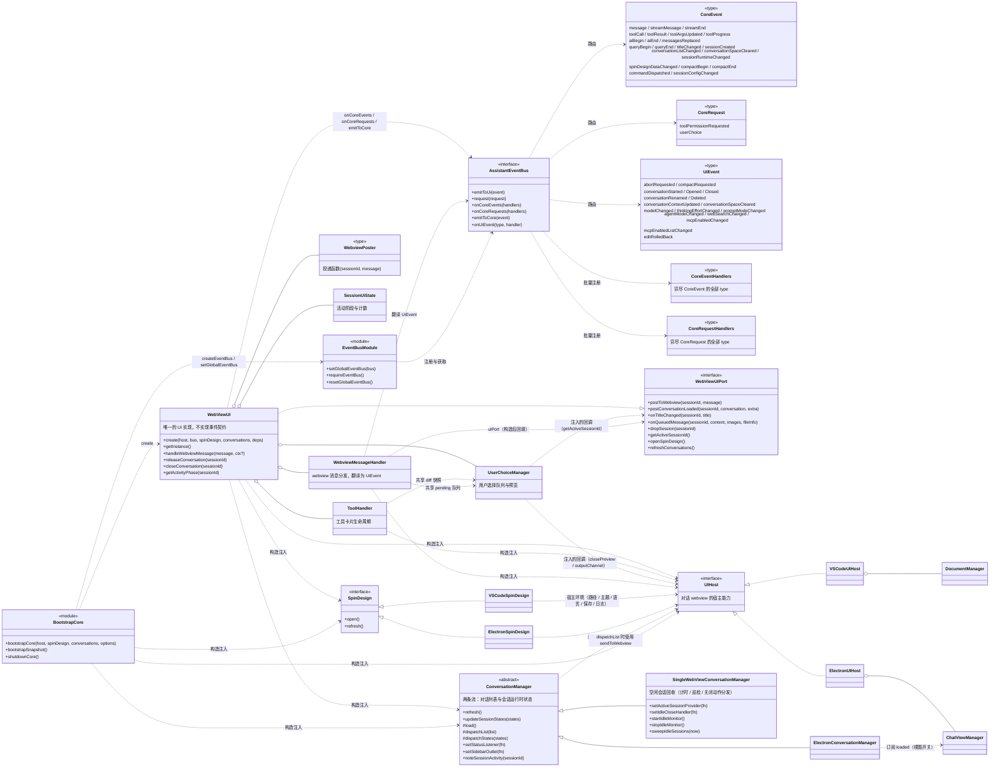
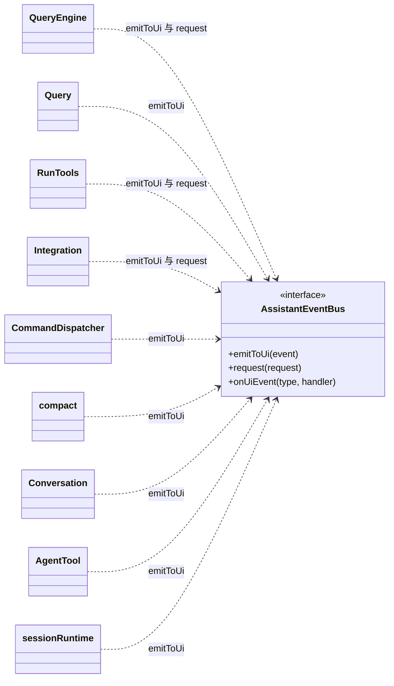

# 规格：架构类图

本文用两张类图描述事件契约与 UI 侧、core 侧与总线的静态结构（as-built），图注给出
逐条边界澄清。分层与模块职责见 [overview.md](overview.md)，事件词汇表见
[events.md](events.md)，宿主契约成员见 [contracts.md](contracts.md)。

## 1. 事件契约与 UI 侧

## 2. core 侧与总线的交互

## 3. 图注说明

1. **core 与 UI 之间不存在直接引用。** core 仅 import `AssistantEventBus` 与事件类型；
   `WebViewUI` 不实现任何事件契约，在构造时通过 `onCoreEvents` / `onCoreRequests`
   一次性注册处理器，需要通知 core 时调用 `emitToCore`。
2. `CoreEvent` / `CoreRequest` / `UiEvent` 是纯数据类型，不包含行为，
   因此 core 与 UI 对它们的依赖不构成耦合。
3. 架构中不设 `WebViewEventBus` / `WebViewNotifier` / `AssistantNotifier` / `AssistantController`。
   总线本身即路由，`WebViewUI` 直接订阅；渲染与控制均在 `WebViewUI` 内实现，
   「需要处理哪些事件」由 `CoreEventHandlers` 映射类型在编译期强制穷尽。
4. `SessionUiState` / `ToolHandler` / `UserChoiceManager` / `WebviewMessageHandler` /
   `WebviewPoster` 均由 `WebViewUI` 创建并持有。
5. 三个共享子模块（`ToolHandler` / `UserChoiceManager` / `WebviewMessageHandler`）
   只依赖 `UIHost`（宿主能力）与若干回推回调；`WebviewMessageHandler` 另有一个构造后回填的
   窄端口 `uiPort`（`WebViewUiPort` 的子集，见[contracts.md](contracts.md)）。
   其中 `WebviewMessageHandler` 还负责将 webview 协议消息翻译为 `UiEvent` 并发送至总线。
6. `WebViewUI ..> UIHost` 为构造注入（依赖关系），`VSCodeUIHost` / `ElectronUIHost` 为对应实现。
7. `SpinDesign` 是**第二个契约**，与 `UIHost` 平行。Spin 设计器是独立面板 / 窗口，
   具有独立的生命周期与消息协议，与对话 webview 不共享状态。
   其实现反向依赖 `UIHost` 以获取宿主环境（工作区路径 / 主题 / 语言 / 保存文件 / 日志）。
8. `ConversationManager` 是**第三个契约**，采用抽象类而非接口：`load()` 在两个宿主上一致，
   仅 `dispatch*()` 不同，因此由模板方法将共享部分固定在基类。
   它同样反向依赖 `UIHost`（分发时使用 `sendToWebview`）。
   它分发**两条独立的流**：对话列表（磁盘元数据）与会话运行时状态（`idle` / `waiting`）。
   两条流各自拥有独立的事件、分发方法与消费者，不合并为单一带标记列表。
   空闲会话回收（计时、巡检、关闭动作分发）只在 VS Code 的实现里（Electron 每个对话一个
   独立视图，自动关闭等于关掉用户的窗口），core 不参与计时。
9. `MCPHost` **不是第四个宿主契约**。它仅有一个 core 侧单例，负责
   「会话生命周期 → MCP 引用」的映射，驱动信号全部来自 core，而非宿主视图生命周期。
