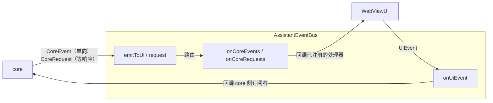

# 规格：AssistantEventBus 与事件词汇表

本文描述 core 与 UI 之间唯一的耦合点 `AssistantEventBus`：总线契约、四组事件词汇表的
完整清单（载荷 / 触发点 / 处理方 / wire message）、两侧订阅方式、命名约定、bootstrap
顺序与边界语义（as-built）。分层背景见 [overview.md](overview.md)，宿主契约见
[contracts.md](contracts.md)，`sessionRuntime` 深潜见
[docs/core/session-runtime.md](../core/session-runtime.md)。

## 目录

| 节 | 标题 |
| --- | --- |
| 1 | [总线契约](#1-总线契约) |
| 2 | [事件词汇表](#2-事件词汇表) |
| 3 | [两侧订阅](#3-两侧订阅) |
| 4 | [命名约定](#4-命名约定) |
| 5 | [全局注册与 bootstrap 顺序](#5-全局注册与-bootstrap-顺序) |
| 6 | [边界语义](#6-边界语义) |
| 7 | [新增事件时的检查清单](#7-新增事件时的检查清单) |

## 1. 总线契约

位置：类型在 `src/shared/AssistantEventBus.ts`（TS 侧唯一来源）；Core 侧的对应实现在 Core 进程（`core-rs/`），宿主侧实现是 `Client` 之下的帧通道总线（`src/host/standalone/StandaloneEventBus.ts`）。

core 与 UI **不互相引用**，只通过总线上的事件耦合。事件类型是两边唯一的公共词汇表。



**总线是 core 与 UI 之间唯一的边**：两边共享的只有**数据**（事件类型），不共享**行为**（方法签名 + 调用时序）。core 不 import UI 的契约类型，也不需要知道「谁在处理」；UI 可以被替换，也可以只订阅自己关心的事件。

`CoreEvent` 是一个判别联合，**不按「渲染 / 控制」分组**——事件是纯数据，分组只会多一层
没有语义的包装；「谁来处理」由订阅方（`WebViewUI`）在 `onCoreEvents` 里决定，
`WebViewUI` 不实现任何「处理器契约」接口（第 3 节）。

| 方法 | 调用方 | 语义 |
| --- | --- | --- |
| `emitToUi(event)` | core | 发布单向事件 |
| `request(request)` | core | 发起请求并等待响应（返回 Promise） |
| `onCoreEvents(handlers)` | UI | 一次性注册**全部** core 事件处理器（返回 `Unsubscribe`） |
| `onCoreRequests(handlers)` | UI | 一次性注册**全部** core 请求处理器 |
| `emitToCore(event)` | UI | 发布单向事件 |
| `onUiEvent(type, handler)` | core | 逐个订阅自己关心的 UI 事件（返回 `Unsubscribe`） |
| `requestCore(request)` | UI | 向 core 发起 `UiRequest` 并等待应答（返回 Promise） |
| `onUiRequests(handlers)` | core | 一次性注册**全部** `UiRequest` 处理器 |

发布（`emit*`）与订阅（`on*`）刻意分成两组，让「谁在发、谁在收」在类型层面可见。

**穷尽检查靠映射类型**：

```ts src=src/shared/AssistantEventBus.ts
export type CoreEventHandlers = {
  readonly [K in CoreEvent['type']]: (event: Extract<CoreEvent, { type: K }>) => void;
};
export type CoreRequestHandlers = {
  readonly [K in CoreRequest['type']]: (
    request: Extract<CoreRequest, { type: K }>,
  ) => Promise<CoreRequestResultMap[K]>;
};
```

新增一个 `CoreEvent` 却没在 `onCoreEvents` 的表里补 handler，会**编译报错**。UI 侧不设
处理器契约接口，`CoreEventHandlers` 映射类型就是「UI 不漏接事件」的保障。

**实现**：宿主侧是 `src/host/standalone/StandaloneEventBus.ts`（帧通道适配：就绪前排队、
连接态重放、`CoreRequest` 应答）与 `src/host/Client.ts`（按 `sessionId` / 工作区路由的总线
路由器）；Core 侧在 `core-rs/src/bus.rs`。路由不含任何「事件 → 方法」的映射逻辑，
只做一件事：把事件交给注册过的处理器。

## 2. 事件词汇表

四组词汇表，共 76 个事件：

| 词汇表 | 方向 | 语义 | 数量 | 处理方 |
| --- | --- | --- | --- | --- |
| `CoreEvent` | core → UI | 单向事实通知 | 32 | `WebViewUI`（`onCoreEvents` 映射表） |
| `CoreRequest` | core → UI | 请求-响应（core 等 UI 返回结果） | 4 | `WebViewUI`（`onCoreRequests` 映射表） |
| `UiEvent` | UI → core | 单向，报告用户动作与宿主环境 | 26 | Core 进程的 `dispatch_ui_event` 分派 |
| `UiRequest` | UI → core | 请求-响应（UI 等 Core 返回结果；宿主索取 core 事实的通道） | 14 | Core 的应答（`dispatch_ui_request`）+ 宿主侧统一入口（[docs/core/standalone-core-boundaries.md 第 2 节](../core/standalone-core-boundaries.md#2-宿主侧的-core-事实读取)） |

`UiRequest` 的成员与宿主侧统一入口（`coreFacts`）见 [docs/core/standalone-core-boundaries.md 第 2 节](../core/standalone-core-boundaries.md#2-宿主侧的-core-事实读取)。
汇总数量由 `src/test/docsLint.test.ts` 对照类型联合校验，不手写维护。

**两条独立的流**（[layering.md](layering.md) 规则 8）：

| | `conversationListChanged` | `sessionRuntimeChanged` |
| --- | --- | --- |
| 内容 | 磁盘元数据（title / messageCount / createdAt…） | 运行时根事实（idle / waiting / queryRunning / compacting / pendingCompact / backgroundRunning / subAgentRunning） |
| owner | 磁盘（`history`） | core 的 `sessionRuntime`（[docs/core/session-runtime.md](../core/session-runtime.md)） |
| 变化频率 | 低（落盘 / 改名 / 删除 / 新建） | 高（查询开始结束、等用户、用户响应） |
| 消费者 | webview 子对话树、Electron 原生侧栏 | VS Code webview 对话树流水灯、Electron 侧栏流水灯、系统托盘状态点、两端的 abort 按钮 |

两者**不合并为一条流**：把 `idle` / `waiting` 贴到磁盘列表上一起推送，会让列表接口失真（磁盘元数据里混着运行时状态），且每次状态变化都要重读一遍盘。各自只在自己变化时推。

`sessionRuntimeChanged` 推**全量**（所有已知会话的状态）而不是增量：会话数量是几十的量级，
全量让消费者不必自己维护状态表，也不会因为丢一条增量而永久错位。

`CoreRequest` 的结果类型由 `CoreRequestResultMap` 约束（`toolPermissionRequested → PermissionResult`、
`userChoice → UserChoiceResult`（`kind: 'permission'` 带 `index` / `reply`，`kind: 'question'` 带 `answers`）、`crossWorkspaceAgentRequested → { sessionId } / { local: true } / { error }`、`crossWorkspaceTransferRequested → { files, bytes, skippedSymlinks, sourceWorkspaceId, destWorkspaceId } / { error }`）；`request<T>()` 的泛型签名据此把请求类型与结果类型一一对应，
调用点不需要手动收窄。

`SessionRuntimeState` 只放 core 能提供的**根事实**（`sessionId` / `idle` / `waiting` /
`queryRunning` / `compacting` / `pendingCompact` / `backgroundRunning` / `subAgentRunning` / `parentSessionId`）；`idle` 是由其余
来源合并出的派生字段（`pendingCompact` 不参与），颜色 / 可点性等表现由消费者推导（[principles.md 第 8 节](principles.md#8-契约只写现状派生字段从根字段推导)）。宿主自己的界面
状态（如 Electron 的「视图已打开」）由宿主自己维护，不混进来。

本节以下是逐事件的**完整清单**：每个事件的载荷、触发点、处理方，以及最终转成的wire message（若该事件会产生 webview 协议消息）。命名规则见第 4 节。

### 2.1 CoreEvent（core → UI，单向）

`CoreEvent` 是单一判别联合，不按渲染 / 控制再分组；「处理方」列是该事件在 `WebViewUI` 里
对应的 handler（第 3 节的两张映射表之一）。

| # | `type` | 载荷 | core 侧触发点 | 处理方 | 转成的 wire message |
| --- | --- | --- | --- | --- | --- |
| 0 | `coreReady` | 无 | `main.rs` 的 `hostEnvironmentProvided` 处理器（`apply_from_host_environment` 应用完配置快照后；每次重推快照都再发一次） | `markCoreReady`（映射表内联闩锁，`host/coreReadiness.ts`） | 无（不投递到 webview） |
| 1 | `message` | `sessionId`, `data: MessageData`（`once: true` 即一次性通知——core 记进 `meta.json` 的 `onceMessage`（一个对话至多一条，重开对话时恢复到时间线末位）、不写 `<sid>.jsonl` 与 LLM 上下文、新节点追加前移除，渲染规则见 [docs/hosts/webview-ui.md 第 11 节](../hosts/webview-ui.md#11-消息区视图行为)；LLM 失败回显 / `*User Interrupted*` / 压缩排队提示带此标记，宿主失联提示只当次显示不记 meta） | `engine.rs`（用户消息进上下文 / 轮次回执 / LLM 失败回显 / 中断与压缩排队通知）、`commands.rs`（命令输出）、`main.rs`（回滚结果的 system 消息）、`spin.rs` / `spin_host.rs`（spin 消息落盘）；宿主失联提示在 `bootstrapCore.ts`（`markConnectionSessionsFailed`） | `onMessage` | `addMessage` |
| 2 | `streamMessage` | `sessionId`, `data: StreamMessageData` | `engine.rs` | `onStreamMessage` | `streamMessage` |
| 3 | `streamEnd` | `sessionId`, `data: StreamEndData` | `engine.rs` | `onStreamEnd` | `streamEnd` |
| 4 | `toolCall` | `sessionId`, `toolUseId`, `toolName` | `engine.rs` | `onToolCall` | `updateToolStatus`（`running`） |
| 5 | `toolResult` | `sessionId`, `toolUseId`, `toolName`, `output`, `status` | `engine.rs`（`emit_tool_outcome`） | `onToolResult`（webview 渲染 + 宿主旁路转发 `UIHost.onToolResult`，specs/030 FR-001） | `updateToolStatus`（Edit 失败时追加 `updateToolArgs`） |
| 6 | `toolArgsUpdated` | `sessionId`, `toolUseId`, `args` | `engine.rs`（流式 tool input 累积） | `onToolArgsUpdated` | `updateToolArgs` |
| 7 | `toolProgress` | `sessionId`, `toolUseId`, `progress: ToolProgressData` | `engine.rs` | `onToolProgress` | `toolProgress` |
| 8 | `aiBegin` | `sessionId` | `engine.rs`（每轮 LLM 调用开始） | `onAIBegin` | `aiBegin` + `showThinkingAnimation` |
| 9 | `aiEnd` | `sessionId` | `engine.rs`（每轮 LLM 调用结束） | `onAIEnd` | `aiEnd` + `showThinkingAnimation` + `balance_update` |
| 10 | `messagesReplaced` | `sessionId`, `messages: readonly MessageData[]` | `replay.rs`（压缩后重建） | `onMessagesReplaced` | `messagesReplaced`（整批替换消息列表；宿主 `expandCompact` 也投递同一条 wire message） |
| 11 | `queryBegin` | `sessionId` | `engine.rs`（主查询与子代理轮次） | `onQueryBegin` | `queryBegin` + `showThinkingAnimation` |
| 12 | `queryEnd` | `sessionId` | 同上 | `onQueryEnd` | `queryEnd` + `showThinkingAnimation` |
| 13 | `titleChanged` | `sessionId`, `title` | `engine.rs`（`update_conversation_title`：重命名与 spin 改名）；新会话以空标题建档，不发本事件 | `onTitleChanged` | `setTitle` |
| 14 | `sessionCreated` | `sessionId` | Core 不发本事件（词汇表成员保留，宿主 handler 作新视图兜底） | `onSessionCreated` | `initSessionState` |
| 15 | `conversationListChanged` | 无 | `engine.rs`（消息落盘 / 子代理创建与结束 / 改名 / 删除）、`main.rs`（空间清空完成后）、`spin_host.rs`（spin 消息落盘） | `onConversationListChanged` → `ConversationManager.refresh()` | `conversationsData`（VS Code）；Electron 另推原生侧栏 |
| 16 | `sessionRuntimeChanged` | `states: readonly SessionRuntimeState[]` | Core 的会话运行时状态（`engine.rs` 的 `emit_runtime`，[docs/core/session-runtime.md](../core/session-runtime.md)） | `onSessionRuntimeChanged` → `ConversationManager.updateSessionStates()` | VS Code：webview 对话树流水灯（`sessionRuntimeStates`）；Electron：侧栏流水灯 + 托盘状态点 + 未读完成呼吸 + 系统睡眠阻断 |
| 17 | `spinDesignDataChanged` | 无 | `spin.rs`、`spin_host.rs` | `onSpinDesignDataChanged` | `SpinDesign.refresh()` |
| 18 | `workModeChanged` | `sessionId`, `workMode`（`'normal'` / `'spin'`） | `engine.rs`（`set_work_mode` 唯一写入点：`spin_host.rs` 进入 spin 时写 `spin`；spin 单向，不写回 `normal`；meta.json 落盘 `workMode`） | `onWorkModeChanged` | `setWorkMode` |
| 19 | `compactBegin` | `sessionId` | `compact.rs`（压缩流程见 [docs/features/compaction.md](../features/compaction.md)） | `onCompactBegin` | `compressProgress`（`status: 'start'`） |
| 20 | `compactEnd` | `sessionId`, `result` | `compact.rs`（`complete` 与 `error`） | `onCompactEnd` | `compressProgress`（`status: 'complete'` / `'error'`） |
| 21 | `commandDispatched` | `sessionId`, `commandName`, `args` | `commands.rs`（命令在引擎消费循环的轮次边界解析时就地执行） | `onCommandSend` | `/spin`：打开设计器；同时清除该会话的排队项（内置命令不进入上下文、不补发用户气泡） |
| 22 | `sessionConfigChanged` | `sessionId`, `change` | `engine.rs`（前五个配置 UiEvent 写完 meta.json 后广播；`change.key` 用 `thinkingEffort`，落盘字段仍是 `thinkingMode`）；`main.rs`（MCP 差量同步完成的 sink 回调，让 UI 拿到最终运行时状态） | `onSessionConfigChanged` | `setModel` / `setThinkingMode` / `setPromptMode` / `setAgentMode` / `setWebSearch` / `setMcpServers` |
| 23 | `highlightLanguagesUsed` | `languages: readonly string[]` | `engine.rs`（消息落盘时扫描**本条消息**用到的围栏代码块语言；core 不去重，同一种语言会重复上报，去重与上限由宿主承担） | `onHighlightLanguagesUsed` | 写 settings.json 的 `highlightLanguages` 字段（经 `UIHost.updateSettingsJson`，见[contracts.md 第 1 节](contracts.md#1-uihost对话-webview-的宿主能力)） |
| 24 | `log` | `message`（已格式化的整行） | `bus.rs`（每写一行日志）、`main.rs`（就绪前 UiEvent 与快照应用失败的诊断行） | `log` | 写 UI 自己的日志出口（VS Code 是 OutputChannel，Electron 是 console） |
| 25 | `notice` | `sessionId`, `key`, `params`, `level` | `commands.rs`、`spin.rs`、`spin_host.rs`（瞬时状态提示：键 + 参数） | `onNotice` | `notice`（webview 用翻译表渲染成瞬时提示，不进消息流） |
| 26 | `conversationSpaceCleared` | `dirName`（对话空间目录名）, `result`（`complete` 带删除统计 / `error` 带原因） | `main.rs`（`conversationSpaceCleared` UiEvent 清空完成 / 失败后的执行回执） | `onConversationSpaceCleared` | `conversationSpaceCleared`（`complete`）/ `conversationSpacesError`（`error`）——设置面板解除「删除中」的唯一信号 |
| 27 | `workspaceFileChanged` | `watchId`, `path`, `kind`（`changed` / `deleted` / `error`）, `mtimeMs`, `size`, `error`（无错误为 `null`） | `file_watch.rs`（notify + 50ms 去抖；文件目标监听父目录并按 basename 过滤，目录目标监听目录本身；按目标最终状态判定 changed / deleted，watcher 错误报 error） | `onWorkspaceFileChanged`（转交宿主，不投递 webview） | 无（不投递到 webview） |
| 28 | `crossWorkspaceAgentReplyRequested` | `sessionId`（发起方会话）, `fromSessionId`, `content` | `engine.rs`（目标工作区 Core 的 `deliver_agent_reply`：跨工作区子代理调用 Reply 工具，目标会话不在本进程） | `onCrossWorkspaceAgentReplyRequested`（转成 `UiEvent.agentReplyReceived`，按会话路由回发起方 Connection） | 无（跨 Core 转发，不投递 webview） |
| 29 | `crossWorkspaceAgentAbortRequested` | `sessionId`（远程子代理会话 id） | `engine.rs`（`abort_session_scope`：对登记为远程的子代理发中止请求） | `onCrossWorkspaceAgentAbortRequested`（按 link 表找到目标 Connection 下发 `UiEvent.abortRequested`） | 无（跨 Core 转发） |
| 30 | `crossWorkspaceAgentEnded` | `sessionId`（发起方会话）, `subSessionId` | `engine.rs`（`run_sub_agent` 收尾：跨工作区子代理结束 / 中止 / 失败） | `onCrossWorkspaceAgentEnded`（转成 `UiEvent.crossWorkspaceAgentCompleted`） | 无（跨 Core 转发） |
| 31 | `todosChanged` | `sessionId`, `todos: readonly TodoEntry[]` | `engine.rs`（`emit_tool_outcome`：TodoWrite 成功后推送全量清单） | `onTodosChanged` | `sessionTodos`（空数组即该会话没有 Todo，按钮不渲染） |

> 第 1–10 项是渲染类 handler，第 11–31 项是控制面与事实通知 handler——这条界线只是 `WebViewUI` 内部的分区，不是事件类型的分组。
>
> 各表的 `#` 列是**表内序号**（2.1 自 0 起，2.2 / 2.3 自 1 起）；跨表指名一律用事件名，不用行号。
> 父子会话的展示事实读 `conversationsData` / `sessionRuntimeStates` 的 `parentSessionId`（[docs/core/session-runtime.md](../core/session-runtime.md)）。

### 2.2 CoreRequest（core → UI，请求-响应）

处理方：`WebViewUI`。响应通过 `request()` 返回的 Promise 回传，**不占用 `UiEvent`**
（所以没有 `userChoiceResponded`）。

| # | `type` | 载荷 | core 侧触发点 | 处理方 | 结果类型 |
| --- | --- | --- | --- | --- | --- |
| 1 | `toolPermissionRequested` | `sessionId`, `toolUseId`, `toolName`, `permResult`, `displayArgs`, `agentMode` | `engine.rs`（工具执行前，权限规则已按 agentMode 加工完） | `requestToolPermission` | `PermissionResult`（Edit / Write 的 `beforeContent` / `afterContent` 等展示字段在 auto / risk 自动放行后仍保留；`agentMode` 供 UI 判断是否打开宿主侧 diff，见[docs/architecture/host-ui-modules.md 第 2 节](host-ui-modules.md#2-toolhandler)） |
| 2 | `userChoice` | `sessionId`, `options: UserChoiceOptions`（`kind: 'permission'` 带 `toolName` / `message` / `choices`；`kind: 'question'` 带 `questions`） | `engine.rs` 的 `waiting_request`（权限确认需要用户选择时、`AskUserQuestion` 提问时） | `requestUserChoice` | `UserChoiceResult`（`{ kind: 'permission'; index; reply }` / `{ kind: 'question'; answers }`） |
| 3 | `crossWorkspaceAgentRequested` | `sessionId`（发起方会话）, `targetWorkspaceId`, `role`, `prompt`, `description`, `agentMode`, `thinkingEffort`, `model`, `provider`, `webSearch`, `mcpServers`（后六项 = 发起方会话生效值，specs/024 FR-004 继承链；提示词模式不携带——跨工作区会话恒 normal，specs/025 FR-005） | `engine.rs` 的 `spawn_remote_agent`（`Agent` 带 `target` 时阻塞等宿主应答） | `requestCrossWorkspaceAgent`（解析目标工作区身份 → 目标 Connection 下发 `UiEvent.remoteSubAgentStarted`） | `{ sessionId }` / `{ local: true }` / `{ error }` |
| 4 | `crossWorkspaceTransferRequested` | `sessionId`（发起方会话）, `sourcePath`, `targetPath`, `sourceTarget: string \| null`, `destTarget: string \| null`（null = 该端缺省，即发起会话所属工作区；契约成员必选，specs/028 FR-002） | `engine.rs` 的 `transfer_hook`（`Transfer` 工具执行时阻塞等宿主应答，等待期间切片轮询取消标记，specs/028 FR-007） | `requestCrossWorkspaceTransfer`（两端经 `resolveTransferEnds` 解析守卫 → 本地 fs / 传输专用 SshClient 执行 → abort 中转时先取消活跃传输） | `{ files, bytes, skippedSymlinks, sourceWorkspaceId, destWorkspaceId }` / `{ error }` |

结果类型的映射写在 `CoreRequestResultMap`（第 2 节），保证 handler 返回类型与请求一一对应。
超时口径见第 6 节。

**没有 uiDynamicInfo 这类请求**：宿主当前工作目录不经过总线——它是宿主侧的环境事实，
由 `WorkspaceProvider.getWorkspacePath()` 提供，消费方是宿主自己的界面（对话列表、
Spin 设计器）。core 不感知「当前工作目录是谁」，因此没有对应的事件，也没有对应的请求。

工作目录是**对话的属性**：Core 进程持有一份会话工作目录表（`core-rs/src/config.rs` 的
`set_session_workspace` / `session_workspace`），登记时机为宿主在会话首次被 Core 解析目录
之前提供（新建 / 加载对话，见[docs/hosts/host-bootstrap.md 第 2 节](../hosts/host-bootstrap.md#2-启动期状态写入入口与读取器)）、加载对话读到元数据 `project` 后校正、子对话继承父对话。
`project_root(sessionId)` 只按会话解析，未登记时报错。Core 里需要工作目录的地方
（history / mcp / tools / spin / prompt）都按会话解析，不读单一全局值；
工具侧一律以工具执行上下文里的 `cwd` 为基准展开相对路径，不需要总线参与。

### 2.3 UiEvent（UI → core，单向）

「UI 侧触发点」列是发起该事件的位置：多数是 webview 协议消息名（由 `WebviewMessageHandler`解析后翻译成事件），少数由宿主代码直接发起（`WebViewUI` / `extension.ts` / `electron/main.ts`）。

| # | `type` | 载荷 | UI 侧触发点 | core 侧消费方 |
| --- | --- | --- | --- | --- |
| 1 | `abortRequested` | `sessionId` | `abort` 消息（webview 的 abort 按钮由 `sessionRuntimeStates` 的根事实推导，见[docs/hosts/webview-ui.md 第 8 节](../hosts/webview-ui.md#8-abort-按钮读-core-的-sessionruntime不由这里判定)与 [docs/features/abort-button.md](../features/abort-button.md)） | `Core::on_abort`（按该会话运行时事实决定中止范围：spin 模式递归中止子代理与后台任务并让 SpinLoop 收尾，spin 单向、恢复态 spin 为空操作；常规会话前台有工作只中止前台，前台空闲则中止后台 Bash + 递归子代理。范围判定幂等） |
| 2 | `compactRequested` | `sessionId` | `requestCompress` | Core 的手动压缩入口（空闲立即执行；非空闲登记「待压缩」，当前轮次结束后执行） |
| 3 | `conversationStarted` | `sessionId` | `startNewConversation`（handler 先登记会话工作目录，再发事件） | Core 的 `start_conversation`（预创建引擎 + MCP 引用 + 缓存该会话工作目录的环境事实） |
| 4 | `conversationOpened` | `sessionId` | `loadConversation` 与 `startNewConversation`（handler 都先登记会话工作目录，再发事件；新会话也登记为「已打开」，供 Core 重启后重放） | Core 的 `on_conversation_opened`（载入历史 + MCP 引用） |
| 5 | `conversationClosed` | `sessionId` | `WebViewUI.releaseConversation`（关闭按钮 / 侧栏关闭 / VS Code 空闲回收 / Electron 视图销毁序列 `ChatViewManager.closeConversation`；临时 `new-` key 不发，[docs/hosts/webview-ui.md 第 1 节](../hosts/webview-ui.md#1-类定义与接线)） | Core 的 `on_conversation_closed`（卸内存 + 拒绝该会话挂起的 user choice；磁盘不动） |
| 6 | `conversationRenamed` | `sessionId`, `title` | `renameConversation`、智能命名、Electron 侧栏 | Core 的 `update_conversation_title`（meta.json 缺失时建档）→ `titleChanged` + `conversationListChanged` |
| 7 | `conversationDeleted` | `sessionId` | `deleteConversation`、Electron 侧栏 | Core 的 `on_conversation_deleted`（**递归删除整棵子树**：自身 + 所有层级的子孙对话）→ `conversationListChanged` |
| 8 | `conversationContextUpdated` | `sessionId`, `changes` | `updateConversationContext` 消息、`extension.ts`（编辑器上下文） | Core 的 `on_conversation_context_updated`（合并语义） |
| 9 | `conversationSpaceCleared` | `dirName`（**对话空间目录名**，不是会话 id）, `mode`（`clear` 清内容保留空间目录 / `remove` 整目录删除——workspace 已不存在时用） | `clearConversationSpace`（单行「清除历史」= clear；「移除」与无效目录批量清理 = remove） | `main.rs` 的空间清空执行（按 `mode` 两种深度）→ `conversationSpaceCleared`（回执，判别联合：`complete` / `error`）+ `conversationListChanged`；多连接宿主按**当前活动连接**路由（与空间统计同源），不走会话路由 |
| 10 | `modelChanged` | `sessionId`, `ref`（`ModelRef` = provider + model） | `setModel`（wire 是扁平的 `model` / `provider`，handler 入口组装成 `ModelRef`；provider 为空即非法，记录日志并忽略） | `Core::on_session_config_changed`（key=`model`）+ 写 meta.json（**保持扁平字段** `model` / `provider`）→ `sessionConfigChanged` |
| 11 | `thinkingEffortChanged` | `sessionId`, `mode` | `setThinkingMode` | `Core::on_session_config_changed`（key=`thinkingEffort`）+ 写 meta.json（字段名仍是 `thinkingMode`）→ `sessionConfigChanged` |
| 12 | `promptModeChanged` | `sessionId`, `mode` | `setPromptMode` | `Core::on_session_config_changed`（key=`promptMode`）+ 写 meta.json → `sessionConfigChanged` |
| 13 | `agentModeChanged` | `sessionId`, `mode` | `setAgentMode` | `Core::on_session_config_changed`（key=`agentMode`）+ 写 meta.json → `sessionConfigChanged` |
| 14 | `webSearchChanged` | `sessionId`, `enabled` | `setWebSearch` | `Core::on_session_config_changed`（key=`webSearch`）+ 写 meta.json → `sessionConfigChanged` |
| 15 | `mcpEnabledChanged` | `sessionId`, `name`, `enabled` | `setMcpEnabled` | `mcp_config::set_session_mcp_enabled` + `mcp::on_session_enabled_changed` → `sessionConfigChanged`（差量同步完成后） |
| 16 | `mcpEnabledListChanged` | `sessionId`, `names`（**完整启用列表**，去重、保留顺序） | `setMcpEnabledList`（设置面板「应用到当前对话」）；宿主保存默认配置时直接发（写盘前先把当前对话钉在它当前的列表上） | `mcp_config::write_session_enabled` + `mcp::on_session_enabled_changed` → `sessionConfigChanged`（差量同步完成后）；与 `mcpEnabledChanged` 是同一条事实的两个粒度 |
| 17 | `editRolledBack` | `sessionId`, `toolUseId`, `direction`, `filePath?` | `rollbackEdit` | `rollback.rs` 的 `rollback_edit`（`filePath` 作为 `input.file_path` 缺失时的兜底路径） |
| 18 | `hostEnvironmentProvided` | `extensionPath`, `logToConsole`, `configDirName`, `settings`, `mcpServers`, `crossWorkspaceAgent`（宿主是否支持跨工作区代理）, `crossWorkspaceTransfer`（宿主是否支持跨工作区文件传输；只作用于 `Transfer` 执行，工具定义与提示词恒定注入，specs/028 FR-005） | `bootstrapCore`（每个 Connection 建立时推送一次；此后每次配置写盘由 `SettingsStore` 订阅重推整份快照给所有 Connection） | `main.rs` 的 `on_host_environment` → `settings.rs` 的 `apply_from_host_environment` → `CoreEvent.coreReady` |
| 19 | `userMessageSubmitted` | `sessionId`, `content`, `uuid`, `images?`, `filePath?`, `fileSelectedLines?`, `fileHidden?`, `agentMode?`, `thinkingMode?`, `model?`, `webSearch?`, `workspacePath?`, `deferEcho?` | `sendMessage`（handler 组装载荷：wire 的 `selectedLines` 翻译成 `fileSelectedLines`；`uuid` 由宿主生成并回带；`workspacePath` 兜底 Core 重启恢复，完整链路见 [docs/features/user-message-pipeline.md](../features/user-message-pipeline.md)） | `Core::on_user_message` → 入队 / 落盘 / 命令解析 / 轮次消费 |
| 20 | `userChoicePendingChanged` | `sessionId`, `pending: boolean` | `UserChoiceManager`（webview 弹出选择、用户应答、`dropSession` 释放视图时） | `Core::on_user_choice_pending` → 会话运行时状态的 `waiting` 来源（[docs/core/session-runtime.md](../core/session-runtime.md)） |
| 21 | `sessionWorkspaceAssigned` | `sessionId`, `workspacePath: string \| null` | `WebviewMessageHandler.ensureSessionWorkspace`（会话首次被 core 解析目录之前）、`electron/main.ts` 的 `registerCoreSessionWorkspace`（多工作目录宿主按来源视图登记） | `config.rs` 的 `set_session_workspace`（`null` / 空串清除登记） |
| 22 | `queuedMessageDiscarded` | `sessionId`, `uuid` | `discardQueuedMessage`（webview 排队项的「编辑 / 删除」，[docs/features/user-message-pipeline.md FR-003](../features/user-message-pipeline.md#fr-003排队状态与消息归属一致)） | `Core::on_queued_message_discarded`——按 `uuid` 丢弃引擎里尚未消费的同一消息，不置 abort 标记（不打断正在运行的查询） |
| 23 | `bashBackgroundRequested` | `sessionId`, `toolUseId` | `backgroundBashTool`（Bash 卡片「转后台」按钮，[docs/features/background-bash.md](../features/background-bash.md)） | `Core::on_bash_background_requested`——按 `toolUseId` 触发该次前台执行转入后台，结果照常进上下文但暂停下一轮 LLM 请求；没有匹配的前台执行时幂等忽略 |
| 24 | `remoteSubAgentStarted` | `sessionId`, `workspacePath`, `role`, `prompt`, `description`, `originWorkspaceId`, `originSessionId`, `agentMode`, `thinkingEffort`, `model`, `provider`, `webSearch`, `mcpServers`（后六项 = 发起方会话生效值，目标 Core 全量应用不按角色裁剪，specs/024 FR-004 / specs/025 FR-005；提示词模式不携带——目标会话恒 normal，specs/025 FR-005） | `WebViewUI.requestCrossWorkspaceAgent`（宿主直接下发到目标 Connection，不按会话路由——该会话在目标 Core 里尚不存在） | `Core::start_remote_sub_agent`（建顶层普通会话 + 写 `creator` meta + 组装 SystemPrompt + 起后台消费循环，specs/025 FR-001/FR-002/FR-006） |
| 25 | `agentReplyReceived` | `sessionId`（发起方会话）, `fromSessionId`, `content` | `WebViewUI`（把目标 Core 的 `CoreEvent.crossWorkspaceAgentReplyRequested` 翻译成本事件） | `Core::on_agent_reply_received` → 普通 agent 消息入队（与本地子代理 Reply 同口径） |
| 26 | `crossWorkspaceAgentCompleted` | `sessionId`（发起方会话）, `subSessionId` | `WebViewUI`（把目标 Core 的 `CoreEvent.crossWorkspaceAgentEnded` 翻译成本事件） | `Core::on_cross_workspace_agent_completed`（注销远程登记 + 释放并发槽位 + 刷新运行时快照） |

**`changes` 数组而不是可选字段**：`history.updateConversationContext` 是**部分合并**语义
（未列出的字段保持原值），用数组而不是一组可选字段，是为了同时满足「一次可带多个字段」
（如 `currentFile` + `selectedLines`）和「不用 `?`」。

**`conversationStarted` 与 `conversationOpened` 的区别**

| | `conversationStarted` | `conversationOpened` |
| --- | --- | --- |
| 时机 | 用户点「新建对话」，会话还没有任何内容 | 用户点开一个已有会话 |
| 磁盘状态 | meta.json / .jsonl 都不存在（第一条消息时由落盘创建；显式改名 / spin 改名同样建档） | 已存在，需要从磁盘加载 |
| core 侧动作 | 预创建引擎（MCP 引用随 `start_conversation` 建立） | 加载会话、恢复引擎、建立 MCP 引用（`on_conversation_opened`） |
| UI 侧动作 | 设空标题、查余额、下发 settings.json 默认配置、必要时弹 LLM 配置引导 | 渲染消息、恢复输入草稿与 session 状态 |

`conversationStarted` 与 `conversationOpened` 都由 `handleStartNewConversation` /
`handleLoadConversation` 发 `emitUiEvent` 走总线，Core 据此建立引擎 / 载入历史并建立
MCP 引用；两条事件都在发出前先登记会话工作目录（新会话也登记为「已打开」，供 Core
重启后重放）。

**仍然留在 `WebviewMessageHandler`（不是 UiEvent）的消息**

| 类别 | 消息 | 为什么不是 UiEvent |
| --- | --- | --- |
| 纯宿主操作 | `openFile` / `openMermaidPreview` / `openSpinDesign` / `openUrl` / `showVirtualDocument` / `requestToolMeta` / `debugLog` | 只操作宿主，不涉及 core 业务 |
| 无副作用查询 | `requestModels` / `fetchProviderModels` / `detectProviderModelApiTypes` / `requestLLMConfig` / `requestSettingsDefaults` / `requestMcpServers` / `requestSkills` / `requestWorkspaces` / `requestConversationSpaces` / `requestSessionRuntimeStates` / `requestSmartNaming` | 只读，不改变 core 状态；core 事实经 `coreFacts` 走同名 `UiRequest` 索取，配置类事实读宿主自己的 `SettingsStore`。其中 `requestMcpServers` / `requestSkills` 是**按会话**解析的（project skills / MCP 启用列表跟会话的工作目录走）：会话归属取 `trackedActiveSessionId`——多视图宿主必须由宿主在活动视图变化时同步（见 [docs/architecture/host-ui-modules.md 第 3 节](host-ui-modules.md#3-webviewmessagehandler)的 `setActiveSessionId`），否则会取到别的标签页的工作目录；`requestSkills` / `requestSessionRuntimeStates` 的回包按 `ctx.sender` 定向投递 |
| 环境查询 | `requestTheme` / `requestContextLimit` | 只读宿主环境并回包，不涉及 core 状态；按 `ctx.sender` 定向投递（`sender` 为 `null` 走默认路由，见[docs/architecture/host-ui-modules.md 第 3 节](host-ui-modules.md#3-webviewmessagehandler)） |
| 列表查询 | `getConversations` | 走 `WebViewUiPort.refreshConversations()` → `ConversationManager.refresh()`（唯一产出 `conversationsData` 的地方，见[contracts.md 第 4 节](contracts.md#4-对话相关数据conversationmanager)） |
| 请求响应 | `respondUserChoice` | 走 `CoreRequest.userChoice` 的 Promise 回传 |
| 纯显示操作 | `expandCompact` | 只读归档文件 + 重放消息到 webview，不改任何 core 状态（LLM 仍只看压缩后的消息） |

## 3. 两侧订阅

### 3.1 UI 侧订阅：WebViewUI

`WebViewUI` 不 `implements` 任何事件契约，构造时用两张映射表把处理器一次性注册到总线：

```ts
// src/host/WebViewUI.ts
bus.onCoreEvents(this.buildCoreEventHandlers());
bus.onCoreRequests(this.buildCoreRequestHandlers());
```

（两张表的内容见第 2.1 / 2.2 节。）

**为什么用映射表而不是逐个 `onCoreEvent('xxx', ...)`**

| | 映射表（`onCoreEvents`） | 逐个订阅 |
| --- | --- | --- |
| 漏订阅 | **编译报错**（映射类型要求穷尽 `CoreEvent['type']`） | 静默漏掉，运行期才发现 |
| 阅读 | 一张表看全 UI 处理哪些事件 | 散在构造函数里 |
| 新增事件 | 改 `CoreEvent` 联合后，这里立刻报错提醒补 handler | 无提醒 |

**架构中不设 `WebViewNotifier` / `WebViewController` / `AssistantNotifier` / `AssistantController`**：
这类接口的职责是给「事件 switch」提供明确的调用目标。总线本身即路由，处理器就是映射表里的
匿名函数，签名由映射类型保证；再加一层「接口 → 实现」只是多余的间接。渲染与控制都在
`WebViewUI` 内，按注释分区即可（[class-diagrams.md 第 3 节](class-diagrams.md#3-图注说明)）。

### 3.2 core 侧 UiEvent 分发：dispatch_ui_event

core 侧**没有处理器契约**，与 UI 侧同理：消费方是 Core 进程内分散的模块（engine /
history / config / mcp / compact …）。`UiEvent` 经帧通道进入 Core 进程后，由
`core-rs/src/main.rs` 的 `dispatch_ui_event` 按 `type` 分派到对应模块的处理函数：

```rust
// core-rs/src/main.rs（示意）
fn dispatch_ui_event(core: &Arc<Core>, bus: &engine::SharedBus, event: Value) {
    // 就绪门禁：hostEnvironmentProvided 之外的 UiEvent 在配置快照到达前记 log 拒绝
    // …按 event type 逐个分派到 Core 的处理方法…
}
```

要点：

- **就绪门禁在分发入口**：`hostEnvironmentProvided` 之外的 `UiEvent` 在配置快照到达前
  记 log 拒绝（[core-ui-separation.md 第 7 节](core-ui-separation.md#7-core-就绪)）。
- 事件 handler 内部只调用对应模块自己的函数（`on_user_message` /
  `on_conversation_closed` / `set_session_workspace` …），保持模块内聚。
- **不做成映射表穷尽检查**：UI 侧漏订阅会直接功能断链（必须穷尽），core 侧没有消费方
  的 `UiEvent` 记日志丢弃。各事件的实际消费方以第 2.3 节的「core 侧消费方」列为准。

## 4. 命名约定

事件 `type`、`WebViewUI` 的 handler 方法名，以及三个契约（`UIHost` / `SpinDesign` /
`ConversationManager`）的方法名，都按下面两类判断：

| 前缀 | 语义 | 判据 | 例子 |
| --- | --- | --- | --- |
| `on*` | **事实通知**：状态由别处拥有，UI 只是投影 | 值存在外部 source of truth（meta.json / 引擎状态 / 队列 / 磁盘数据） | `onMessage`、`onSessionCreated`、`onCompactBegin`、`onTitleChanged`、`onConversationListChanged`、`onSpinDesignDataChanged` |
| 动词开头 | **命令**：UI 自己拥有该状态，调用方要求它改变 | 状态只存在于 UI 内部 | `setThinkingAnimation`、`openFile`、`showDiff`、`open` / `refresh`（`SpinDesign`）、`refresh` / `updateSessionStates` / `dispatchList` / `dispatchStates`（`ConversationManager`） |

边界判定示例：

- `onTitleChanged`：标题持久化在 `meta.json`，UI 只负责显示 → 事实通知。
- `onConversationListChanged`：对话列表数据在磁盘上，「立即还是节流、推给哪些视图」是 UI 的
  表现策略，不该由 core 选择 → 事实通知。
- `setThinkingAnimation`：thinking 动画是否显示只存在于 webview 内部，调用方只是要求切换 → 命令。
- 三个契约上的 `refresh` 是命令式命名——那是 `WebViewUI` 要求宿主刷新自己持有的界面表示，
  属于宿主侧命令，与 `CoreEvent` 的事实通知不冲突。

**事件命名**（`type` 字段）：

- `CoreEvent` / `CoreRequest`：与 `WebViewUI` 的 handler 方法同名去 `on` 前缀
  （`onTitleChanged` ↔ `{ type: 'titleChanged' }`）。
- `UiEvent`：**过去式**，描述用户已经做完的动作（`modelChanged` = 用户改了模型），
  不是命令（不叫 `setModel`）。
- 全小写驼峰，不带 `on` 前缀。
- **wire protocol 命名不受此约定约束**：协议消息名描述「接收方要做什么」，因此
  `titleChanged` 事件最终仍发 `{ type: 'setTitle' }`；`thinkingEffort` 事件落盘字段仍是
  `thinkingMode`。改协议名要同时动 `webviewMessages.ts` / handler / webview，收益为零，不做。

## 5. 全局注册与 bootstrap 顺序

```ts
setGlobalEventBus(bus);   // 注册全局总线；重复注册抛错（接线错误在启动期暴露）
requireEventBus();        // 取全局总线；未注册时抛错，不用 ?. 静默跳过
resetGlobalEventBus();    // 测试用：清空全局总线
```

两个宿主的启动接线由**共享骨架**执行（`src/host/bootstrapCore.ts` 的 `bootstrapCore`），
宿主只提供自身差异（locale / 日志出口 / 资源根目录），因此顺序只有一份。宿主 locale 只
服务宿主进程内的原生 UI（`src/host/i18n.ts`），不进总线（[core-ui-separation.md 第 4.8 节](core-ui-separation.md#48-文本语言)）：

```
1.  SettingsStore.loadSync()：读宿主自己的 settings.json / mcp.json
2.  创建 Client 并注册全局总线：setGlobalEventBus(client)（Client 是宿主侧路由器）
3.  SettingsStore.subscribe(() => client.emitToCore(hostEnvironmentProvided))
    - 配置写盘后重推整份快照；Client 推给所有 Connection
4.  WebViewUI.create(host, client, spinDesign, conversations, { log, createUserChoiceManager })
    - 处理器注册在 Client 上；Connection 建立时把同一份表注册到自己的总线
5.  按 WorkspaceProvider 打开 Connection：client.openWorkspace(ref)
    - 连接建立即推送 hostEnvironmentProvided（扩展路径 / 日志出口开关 /
      configDirName / 配置快照 / MCP 服务器表）
    - core 收到后写配置快照并发 CoreEvent.coreReady；Connection 就绪并冲刷排队事件
6.  host.onWorkspaceChanged → client.openWorkspace / closeWorkspace / activateWorkspace
```

顺序约束：

- 第 1–2 步在任何总线消费方被使用之前完成；
- 第 4 步必须在 Connection 建立之前完成：Connection 建立时（第 5 步）要把处理器表
  注册到自己的总线，晚于连接会丢首批 `CoreEvent`；
- 第 5 步的就绪门禁在 Client 侧：未收到 `coreReady` 前不发出任何 `UiEvent`（`UiRequest`
  同样挂起）；Core 侧就绪前收到 `UiEvent` 记 log 拒绝（第 6 节）；
- 第 6 步的订阅在打开 Connection 之后注册：宿主在启动后新开 / 关闭工作区时同步建立 /
  销毁 Connection。

宿主环境差异（扩展路径 / 日志出口开关 / 配置目录名 / 配置快照 / MCP 服务器表）经总线传递，
core 侧没有对应的直接注入入口；宿主 locale 只在宿主进程内使用，core 不感知语言。
会话的工作目录是对话的属性：宿主在会话首次被 core 解析目录之前经
`UiEvent.sessionWorkspaceAssigned` 登记（[docs/hosts/host-bootstrap.md 第 2 节](../hosts/host-bootstrap.md#2-启动期状态写入入口与读取器)），Client 同时据此建立
`sessionId → Connection` 路由。

`UiEvent` 的消费全部在 Core 进程内，分发入口是 `dispatch_ui_event`（第 3.2 节）。
接线项归属、注入点与读取器、启动自检与退出路径见
[docs/hosts/host-bootstrap.md 第 1–6 节](../hosts/host-bootstrap.md#1-宿主接线)。

## 6. 边界语义

「接线缺失即暴露」在几个边界场景的口径：

| 场景 | 语义 | 说明 |
| --- | --- | --- |
| `emitToUi` 时 `onCoreEvents` 尚未注册 | **抛错** | bootstrap 顺序错误（`WebViewUI.create` 未在 core 首次发事件前完成），启动期暴露 |
| `emitToCore` 发出非 `hostEnvironmentProvided` 的事件而配置快照未就绪 | **记 log 拒绝** | Client 的就绪门禁：未收到 `coreReady` 前挂起不发（[core-ui-separation.md 第 7 节](core-ui-separation.md#7-core-就绪)）；Core 进程侧对就绪前到达的 `UiEvent` 记 log 丢弃 |
| `emitToCore` / `onUiEvent` 对某 type 尚无 core 订阅者 | **静默丢弃** | core 侧是分散分发，允许某动作暂无消费方；这类操作不产生需要补的历史（会话内容都在磁盘上） |
| `request()` 时 `onCoreRequests` 尚未注册，或该 type 无 handler | **立即 reject** | 与 `emitToUi` 同类：接线缺失在启动期暴露 |
| `request()` 的 handler 已注册但响应丢失（UI reload、pending 未恢复） | **永久挂起** | 总线不内置计时器；调用点自行决定兜底（当前两个请求都不设超时，见下） |

**请求超时约定**：`request()` 本身不实现超时（总线保持纯路由），**当前两个请求都不设超时**：

- `toolPermissionRequested`：不设超时——权限确认的耗时取决于用户（可能正在看 diff），
  没有合理的上界；设短了会把「正在看 diff 的用户」误杀。只有请求本身失败
  （无订阅者 / 处理器异常）才按 `deny` 兜底——那是调用链坏了，不是用户还在犹豫。
- `userChoice`：靠 `UserChoiceQueue` 的 pending 补偿（webview 重建后重新弹出），不额外加超时；
  会话关闭时拒绝该会话的 pending，避免等待方永久挂起——Core 进程不持有宿主队列，由宿主
  `UserChoiceManager.dropSession` 补这一刀。

## 7. 新增事件时的检查清单

1. **定方向**：core 要通知 UI（`CoreEvent`）还是要结果（`CoreRequest`）？还是 UI 要驱动 core（`UiEvent`）？
2. **定名字**：`CoreEvent` / `CoreRequest` 用 handler 方法名去掉 `on`；`UiEvent` 用过去式（第 4 节）。
3. **定载荷**：字段必填，可选语义用 `null` 或判别联合（如 `compactEnd.result`、`sessionConfigChanged.change`），不用 `?`。
4. **改代码**：
   - `src/shared/AssistantEventBus.ts` 的三组联合类型；`UiRequest` 还要登记结果映射；
   - `WebViewUI` 的 `onCoreEvents` / `onCoreRequests` 映射表（**漏写会编译报错**）；
   - `UiEvent` 还要两步：Core 进程的分发分支（`dispatch_ui_event`，第 3.2 节）
     + `WebviewMessageHandler` 里「协议消息 → 事件」的翻译；
   - `UiRequest` 还要两步：Core 的应答（`dispatch_ui_request`）+ 宿主侧统一入口 `coreFacts`。
5. **更新第 2 节的表格**（含「core 侧触发点」列——它是依赖评审的依据）。
