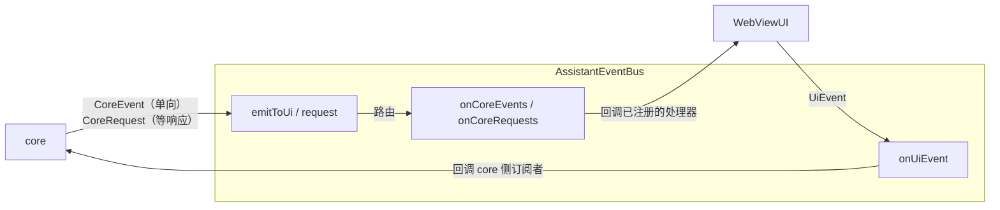

# 规格：AssistantEventBus 与事件词汇表

本文描述 core 与 UI 之间唯一的耦合点 `AssistantEventBus`：总线契约、四组事件词汇表的
完整清单（载荷 / 触发点 / 处理方 / wire message）、两侧订阅方式、命名约定、bootstrap
顺序与边界语义（as-built）。分层背景见 [overview.md](overview.md)，宿主契约见
[contracts.md](contracts.md)，`sessionRuntime` 深潜见
[docs/core/session-runtime.md](../core/session-runtime.md)。

## 目录

| 节 | 标题 |
| --- | --- |
| 1 | [总线契约](#1-总线契约) |
| 2 | [事件词汇表](#2-事件词汇表) |
| 3 | [两侧订阅](#3-两侧订阅) |
| 4 | [命名约定](#4-命名约定) |
| 5 | [全局注册与 bootstrap 顺序](#5-全局注册与-bootstrap-顺序) |
| 6 | [边界语义](#6-边界语义) |
| 7 | [新增事件时的检查清单](#7-新增事件时的检查清单) |

## 1. 总线契约

位置：类型在 `src/core/AssistantEventBus.ts`，实现在 `src/host/EventBus.ts`。

core 与 UI **不互相引用**，只通过总线上的事件耦合。事件类型是两边唯一的公共词汇表。



**总线是 core 与 UI 之间唯一的边**：两边共享的只有**数据**（事件类型），不共享**行为**
（方法签名 + 调用时序）。core 不 import UI 的契约类型，也不需要知道「谁在处理」；
UI 可以被替换，也可以只订阅自己关心的事件。

`CoreEvent` 是一个判别联合，**不按「渲染 / 控制」分组**——事件是纯数据，分组只会多一层
没有语义的包装；「谁来处理」由订阅方（`WebViewUI`）在 `onCoreEvents` 里决定，
`WebViewUI` 不实现任何「处理器契约」接口（第 3 节）。

| 方法 | 调用方 | 语义 |
| --- | --- | --- |
| `emitToUi(event)` | core | 发布单向事件 |
| `request(request)` | core | 发起请求并等待响应（返回 Promise） |
| `onCoreEvents(handlers)` | UI | 一次性注册**全部** core 事件处理器（返回 `Unsubscribe`） |
| `onCoreRequests(handlers)` | UI | 一次性注册**全部** core 请求处理器 |
| `emitToCore(event)` | UI | 发布单向事件 |
| `onUiEvent(type, handler)` | core | 逐个订阅自己关心的 UI 事件（返回 `Unsubscribe`） |
| `requestCore(request)` | UI | 向 core 发起 `UiRequest` 并等待应答（返回 Promise） |
| `onUiRequests(handlers)` | core | 一次性注册**全部** `UiRequest` 处理器 |

发布（`emit*`）与订阅（`on*`）刻意分成两组，让「谁在发、谁在收」在类型层面可见。

**穷尽检查靠映射类型**：

```ts src=src/core/AssistantEventBus.ts
export type CoreEventHandlers = {
  readonly [K in CoreEvent['type']]: (event: Extract<CoreEvent, { type: K }>) => void;
};
export type CoreRequestHandlers = {
  readonly [K in CoreRequest['type']]: (
    request: Extract<CoreRequest, { type: K }>,
  ) => Promise<CoreRequestResultMap[K]>;
};
```

新增一个 `CoreEvent` 却没在 `onCoreEvents` 的表里补 handler，会**编译报错**。UI 侧不设
处理器契约接口，`CoreEventHandlers` 映射类型就是「UI 不漏接事件」的保障。

**实现**：`src/host/EventBus.ts` 的 `createEventBus()`。纯内存路由（core 事件 / 请求各一份
处理器表，UiEvent 用 `Map<type, Set<handler>>` 支持多订阅者），无宿主依赖，不含任何
「事件 → 方法」的映射逻辑。它只做一件事：把事件交给注册过的处理器。

## 2. 事件词汇表

四组词汇表，共 60 个事件：

| 词汇表 | 方向 | 语义 | 数量 | 处理方 |
| --- | --- | --- | --- | --- |
| `CoreEvent` | core → UI | 单向事实通知 | 26 | `WebViewUI`（`onCoreEvents` 映射表） |
| `CoreRequest` | core → UI | 请求-响应（core 等 UI 返回结果） | 2 | `WebViewUI`（`onCoreRequests` 映射表） |
| `UiEvent` | UI → core | 单向，报告用户动作与宿主环境 | 23 | core 侧订阅者（`initializeCoreEvents`） |
| `UiRequest` | UI → core | 请求-响应（UI 等 Core 返回结果；宿主索取 core 事实的通道） | 9 | 两套 Core 的应答 + 宿主侧统一入口（[docs/core/standalone-core.md 第 10 节](../core/standalone-core.md#10-宿主侧的-core-事实读取)） |

`UiRequest` 的成员、两侧应答与宿主侧统一入口（`coreFacts`）见
[docs/core/standalone-core.md 第 10 节](../core/standalone-core.md#10-宿主侧的-core-事实读取)。
汇总数量由 `src/test/docsLint.test.ts` 对照类型联合校验，不手写维护。

**两条独立的流**（[layering.md](layering.md) 规则 8）：

| | `conversationListChanged` | `sessionRuntimeChanged` |
| --- | --- | --- |
| 内容 | 磁盘元数据（title / messageCount / createdAt…） | 运行时根事实（idle / waiting / queryRunning / compacting / backgroundRunning / subAgentRunning） |
| owner | 磁盘（`history`） | core 的 `sessionRuntime`（[docs/core/session-runtime.md](../core/session-runtime.md)） |
| 变化频率 | 低（落盘 / 改名 / 删除 / 新建） | 高（查询开始结束、等用户、用户响应） |
| 消费者 | webview 子对话树、Electron 原生侧栏 | VS Code webview 对话树流水灯、Electron 侧栏流水灯、系统托盘状态点、两端的 abort 按钮 |

两者**不合并为一条流**：把 `idle` / `waiting` 贴到磁盘列表上一起推送，会让列表接口失真
（磁盘元数据里混着运行时状态），且每次状态变化都要重读一遍盘。各自只在自己变化时推。

`sessionRuntimeChanged` 推**全量**（所有已知会话的状态）而不是增量：会话数量是几十的量级，
全量让消费者不必自己维护状态表，也不会因为丢一条增量而永久错位。

`CoreRequest` 的结果类型由 `CoreRequestResultMap` 约束（`toolPermissionRequested → PermissionResult`、
`userChoice → { index; reply? }`）；`request<T>()` 的泛型签名据此把请求类型与结果类型一一对应，
调用点不需要手动收窄。

`SessionRuntimeState` 只放 core 能提供的**根事实**（`sessionId` / `idle` / `waiting` /
`queryRunning` / `compacting` / `backgroundRunning` / `subAgentRunning` / `parentSessionId`）；`idle` 是由其余
来源合并出的派生字段，颜色 / 可点性等表现由消费者推导（[principles.md 第 8 节](principles.md#8-契约只写现状派生字段从根字段推导)）。宿主自己的界面
状态（如 Electron 的「视图已打开」）由宿主自己维护，不混进来。

本节以下是逐事件的**完整清单**：每个事件的载荷、触发点、处理方，以及最终转成的
wire message（若该事件会产生 webview 协议消息）。命名规则见第 4 节。

### 2.1 CoreEvent（core → UI，单向）

`CoreEvent` 是单一判别联合，不按渲染 / 控制再分组；「处理方」列是该事件在 `WebViewUI` 里
对应的 handler（第 3 节的两张映射表之一）。

| # | `type` | 载荷 | core 侧触发点 | 处理方 | 转成的 wire message |
| --- | --- | --- | --- | --- | --- |
| 0 | `coreReady` | 无 | `initializeCoreEvents` 的 `hostEnvironmentProvided` 处理器（应用完配置快照后；每次重推快照都再发一次） | `markCoreReady`（映射表内联闩锁，`host/coreReadiness.ts`） | 无（不投递到 webview） |
| 1 | `message` | `sessionId`, `data: MessageData` | `Integration`（用户消息进上下文 / 命令回执）、`Query`、`QueryEngine`、`CommandDispatcher`（命令输出）、`history/rollback` | `onMessage` | `addMessage` |
| 2 | `streamMessage` | `sessionId`, `data: StreamMessageData` | `Query` | `onStreamMessage` | `streamMessage` |
| 3 | `streamEnd` | `sessionId`, `data: StreamEndData` | `Query` | `onStreamEnd` | `streamEnd` |
| 4 | `toolCall` | `sessionId`, `toolUseId`, `toolName` | `tools/RunTools` | `onToolCall` | `updateToolStatus`（`running`） |
| 5 | `toolResult` | `sessionId`, `toolUseId`, `toolName`, `output`, `status` | `tools/RunTools`、`Query` | `onToolResult` | `updateToolStatus`（Edit 失败时追加 `updateToolArgs`） |
| 6 | `toolArgsUpdated` | `sessionId`, `toolUseId`, `args` | `Query`（流式 tool input 累积） | `onToolArgsUpdated` | `updateToolArgs` |
| 7 | `toolProgress` | `sessionId`, `toolUseId`, `progress: ToolProgressData` | `tools/RunTools` | `onToolProgress` | `toolProgress` |
| 8 | `aiBegin` | `sessionId` | `Query`（每轮 LLM 调用开始） | `onAIBegin` | `aiBegin` + `showThinkingAnimation` |
| 9 | `aiEnd` | `sessionId` | `Query`（每轮 LLM 调用结束） | `onAIEnd` | `aiEnd` + `showThinkingAnimation` + `balanceUpdate` |
| 10 | `messagesReplaced` | `sessionId`, `messages: readonly MessageData[]` | `utils/replayMessages`（压缩后重建） | `onMessagesReplaced` | `messagesReplaced`（整批替换消息列表；宿主 `expandCompact` 也投递同一条 wire message） |
| 11 | `queryBegin` | `sessionId` | `QueryEngine`、`tools/agent/AgentTool`（子代理轮次） | `onQueryBegin` | `queryBegin` + `showThinkingAnimation` |
| 12 | `queryEnd` | `sessionId` | 同上 | `onQueryEnd` | `queryEnd` + `showThinkingAnimation` |
| 13 | `titleChanged` | `sessionId`, `title` | `initializeCoreEvents`（重命名）、`skills/bundled/spin`（spin 改名）；新会话以空标题建档，不发本事件 | `onTitleChanged` | `setTitle` |
| 14 | `sessionCreated` | `sessionId` | `QueryEngine`（Embedded：新会话与子代理会话创建时；Standalone Core 不发本事件） | `onSessionCreated` | `initSessionState` |
| 15 | `conversationListChanged` | 无 | `history/Conversation`（消息落盘 / 删除对话）、`tools/agent/AgentTool`（子代理创建 / 结束）、`QueryEngine`（spin 消息落盘）、`initializeCoreEvents`（改名 / 删除 / 空间清空）、`skills/bundled/spin`（spin 改名） | `onConversationListChanged` → `ConversationManager.refresh()` | `conversationsData`（VS Code）；Electron 另推原生侧栏 |
| 16 | `sessionRuntimeChanged` | `states: readonly SessionRuntimeState[]` | core 的 `sessionRuntime`（[docs/core/session-runtime.md](../core/session-runtime.md)） | `onSessionRuntimeChanged` → `ConversationManager.updateSessionStates()` | VS Code：webview 对话树流水灯（`sessionRuntimeStates`）；Electron：侧栏流水灯 + 托盘状态点 + 未读完成呼吸 + 系统睡眠阻断 |
| 17 | `spinDesignDataChanged` | 无 | `skills/bundled/spin`、`spin/Loop` | `onSpinDesignDataChanged` | `SpinDesign.refresh()` |
| 18 | `compactBegin` | `sessionId` | `compact/compact`（压缩流程见 [docs/features/compaction.md](../features/compaction.md)） | `onCompactBegin` | `compressProgress`（`status: 'start'`） |
| 19 | `compactEnd` | `sessionId`, `result` | `compact/compact`（`complete`）、`Integration` / `QueryEngine`（`error`） | `onCompactEnd` | `compressProgress`（`status: 'complete'` / `'error'`） |
| 20 | `commandDispatched` | `sessionId`, `commandName`, `args` | `CommandDispatcher`（命令在引擎消费循环的轮次边界解析时就地执行） | `onCommandSend` | `/spin`：打开设计器；同时清除该会话的排队项（内置命令不进入上下文、不补发用户气泡） |
| 21 | `sessionConfigChanged` | `sessionId`, `change` | `initializeCoreEvents`（前五个配置 UiEvent 写完 meta.json 后广播；`change.key` 用 `thinkingEffort`，落盘字段仍是 `thinkingMode`）；`mcp/MCPHost`（`mcpEnabledChanged` 的差量同步、以及会话首次打开的 `acquire` 连接 / 断开完成后广播，让 UI 拿到最终运行时状态） | `onSessionConfigChanged` | `setModel` / `setThinkingMode` / `setPromptMode` / `setAgentMode` / `setWebSearch` / `setMcpServers` |
| 22 | `highlightLanguagesUsed` | `languages: readonly string[]` | `history/Conversation`（消息落盘时扫描**本条消息**用到的围栏代码块语言；core 不去重，同一种语言会重复上报，去重与上限由宿主承担） | `onHighlightLanguagesUsed` | 写 settings.json 的 `highlightLanguages` 字段（经 `UIHost.updateSettingsJson`，见[contracts.md 第 1 节](contracts.md#1-uihost对话-webview-的宿主能力)） |
| 23 | `log` | `message`（已格式化的整行） | `Logger`（每写一行日志） | `log` | 写 UI 自己的日志出口（VS Code 是 OutputChannel，Electron 是 console） |
| 24 | `notice` | `sessionId`, `key`, `params`, `level` | `skills/bundled/spin`、`spin/Loop`（瞬时状态提示：键 + 参数） | `onNotice` | `notice`（webview 用翻译表渲染成瞬时提示，不进消息流） |
| 25 | `conversationSpaceCleared` | `dirName`（对话空间目录名）, `result`（`complete` 带删除统计 / `error` 带原因） | `initializeCoreEvents`（`conversationSpaceCleared` UiEvent 清空完成 / 失败后的执行回执） | `onConversationSpaceCleared` | `conversationSpaceCleared`（`complete`）/ `conversationSpacesError`（`error`）——设置面板解除「删除中」的唯一信号 |

> 第 1–10 项是渲染类 handler，第 11–24 项是控制面与事实通知 handler——这条界线只是 `WebViewUI` 内部的
> 分区，不是事件类型的分组。
>
> 各表的 `#` 列是**表内序号**（2.1 自 0 起，2.2 / 2.3 自 1 起）；跨表指名一律用事件名，不用行号。
> 父子会话的展示事实读 `conversationsData` / `sessionRuntimeStates` 的 `parentSessionId`（[docs/core/session-runtime.md](../core/session-runtime.md)）。

### 2.2 CoreRequest（core → UI，请求-响应）

处理方：`WebViewUI`。响应通过 `request()` 返回的 Promise 回传，**不占用 `UiEvent`**
（所以没有 `userChoiceResponded`）。

| # | `type` | 载荷 | core 侧触发点 | 处理方 | 结果类型 |
| --- | --- | --- | --- | --- | --- |
| 1 | `toolPermissionRequested` | `sessionId`, `toolUseId`, `toolName`, `permResult`, `displayArgs`, `agentMode` | `tools/RunTools`（工具执行前，权限规则已按 agentMode 加工完） | `requestToolPermission` | `PermissionResult`（Edit / Write 的 `beforeContent` / `afterContent` 等展示字段在 auto / risk 自动放行后仍保留；`agentMode` 供 UI 判断是否打开宿主侧 diff，见[contracts.md 第 7 节](contracts.md#7-toolhandler)） |
| 2 | `userChoice` | `sessionId`, `options: UserChoiceOptions` | `Integration`（权限确认需要用户选择时） | `requestUserChoice` | `{ index: number; reply?: string }` |

结果类型的映射写在 `CoreRequestResultMap`（第 2 节），保证 handler 返回类型与请求一一对应。
超时口径见第 6 节。

**没有 uiDynamicInfo 这类请求**：宿主当前工作目录不经过总线——它是宿主侧的环境事实，
由 `WorkspaceProvider.getWorkspacePath()` 提供，消费方是宿主自己的界面（对话列表、
Spin 设计器）。core 不感知「当前工作目录是谁」，因此没有对应的事件，也没有对应的请求。

工作目录是**对话的属性**：core 持有一份会话工作目录表（`Config.setSessionWorkspace` /
`getSessionWorkspace`），登记时机为宿主在会话首次被 core 解析目录之前提供（新建 / 加载
对话，见[docs/hosts/host-matrix.md 第 7 节](../hosts/host-matrix.md#7-启动期状态写入入口与读取器)）、加载对话读到元数据 `project` 后校正、子对话继承父对话。
`getProjectRoot(sessionId)` 只按会话解析，未登记时抛错；`hasProjectRoot(sessionId)`
供「没有工作目录时降级」的调用点做前置守卫。core 里需要工作目录的地方
（history / mcp / tools / spin / prompt）都按会话解析，不读单一全局值；
工具侧一律以 `ToolUseContext.cwd`（引擎配置里的 `cwd`）为基准展开相对路径，
不需要总线参与。

### 2.3 UiEvent（UI → core，单向）

「UI 侧触发点」列是发起该事件的位置：多数是 webview 协议消息名（由 `WebviewMessageHandler`
解析后翻译成事件），少数由宿主代码直接发起（`WebViewUI` / `extension.ts` / `electron/main.ts`）。

| # | `type` | 载荷 | UI 侧触发点 | core 侧消费方 |
| --- | --- | --- | --- | --- |
| 1 | `abortRequested` | `sessionId` | `abort` 消息（webview 的 abort 按钮由 `sessionRuntimeStates` 的根事实推导，见[docs/hosts/webview-ui.md 第 8 节](../hosts/webview-ui.md#8-abort-按钮读-core-的-sessionruntime不由这里判定)与 [docs/features/abort-button.md](../features/abort-button.md)） | `Integration.abortCurrentQuery`（按该会话运行时事实分两阶段：前台有工作只中止前台；前台空闲则中止后台 Bash + 递归子代理。两阶段都幂等） |
| 2 | `compactRequested` | `sessionId` | `requestCompress` | `Integration.requestCompact` |
| 3 | `conversationStarted` | `sessionId` | `startNewConversation`（handler 先登记会话工作目录，再发事件） | `Integration.createEngine`（预创建引擎 + MCP 引用 + 预热该会话工作目录的系统信息） |
| 4 | `conversationOpened` | `sessionId` | `loadConversation` 与 `startNewConversation`（handler 都先登记会话工作目录，再发事件；新会话也登记为「已打开」，供 Standalone 重启后重放） | Standalone：Core 的 `on_conversation_opened`（载入历史 + MCP 引用）；Embedded：无订阅者（宿主直接调 `restoreConversationEngine`） |
| 5 | `conversationClosed` | `sessionId` | `WebViewUI.releaseConversation`（关闭按钮 / 侧栏关闭 / VS Code 空闲回收 / Electron 视图销毁序列 `ChatViewManager.closeConversation`；临时 `new-` key 不发，[docs/hosts/webview-ui.md 第 1 节](../hosts/webview-ui.md#1-类定义与接线)） | `sessionResources.releaseSessionResources`（卸内存 + 拒绝该会话挂起的 user choice；磁盘不动） |
| 6 | `conversationRenamed` | `sessionId`, `title` | `renameConversation`、智能命名、Electron 侧栏 | `history.updateConversationMetadataTitle`（meta.json 缺失时建档）→ `titleChanged` + `conversationListChanged` |
| 7 | `conversationDeleted` | `sessionId` | `deleteConversation`、Electron 侧栏 | `history.deleteConversation`（**递归删除整棵子树**：自身 + 所有层级的子孙对话）→ `conversationListChanged` |
| 8 | `conversationContextUpdated` | `sessionId`, `changes` | `updateConversationContext` 消息、`extension.ts`（编辑器上下文） | `history.updateConversationContext`（合并语义） |
| 9 | `conversationSpaceCleared` | `dirName`（**对话空间目录名**，不是会话 id）, `mode`（`clear` 清内容保留空间目录 / `remove` 整目录删除——workspace 已不存在时用） | `clearConversationSpace`（单行「清除历史」= clear；「移除」与无效目录批量清理 = remove） | `history/ConversationSpace.clearConversationSpace` / `removeConversationSpace` → `conversationSpaceCleared`（回执，判别联合：`complete` / `error`）+ `conversationListChanged`；多连接宿主按**当前活动连接**路由（与空间统计同源），不走会话路由 |
| 10 | `modelChanged` | `sessionId`, `ref`（`ModelRef` = provider + model） | `setModel`（wire 是扁平的 `model` / `provider`，handler 入口组装成 `ModelRef`；provider 为空即非法，记录日志并忽略） | `setSessionModel` + 写 meta.json（**保持扁平字段** `model` / `provider`）→ `sessionConfigChanged` |
| 11 | `thinkingEffortChanged` | `sessionId`, `mode` | `setThinkingMode` | `setSessionThinkingMode` + 写 meta.json（字段名仍是 `thinkingMode`）→ `sessionConfigChanged` |
| 12 | `promptModeChanged` | `sessionId`, `mode` | `setPromptMode` | `setSessionPromptPreset` + 写 meta.json → `sessionConfigChanged` |
| 13 | `agentModeChanged` | `sessionId`, `mode` | `setAgentMode` | `setSessionAgentMode` + 写 meta.json → `sessionConfigChanged` |
| 14 | `webSearchChanged` | `sessionId`, `enabled` | `setWebSearch` | `QueryEngine.updateWebSearch` + 写 meta.json → `sessionConfigChanged` |
| 15 | `mcpEnabledChanged` | `sessionId`, `name`, `enabled` | `setMcpEnabled` | `mcp/Config.setSessionMcpEnabled` + `Manager.syncSession` → `sessionConfigChanged`（差量同步完成后） |
| 16 | `mcpEnabledListChanged` | `sessionId`, `names`（**完整启用列表**，去重、保留顺序） | `setMcpEnabledList`（设置面板「应用到当前对话」）；宿主保存默认配置时直接发（写盘前先把当前对话钉在它当前的列表上） | `mcp/Config.setSessionMcpEnabledList` + `Manager.syncSession` → `sessionConfigChanged`（差量同步完成后）；与 `mcpEnabledChanged` 是同一条事实的两个粒度 |
| 17 | `editRolledBack` | `sessionId`, `toolUseId`, `direction`, `filePath?` | `rollbackEdit` | `history/rollback.rollbackEdit`（`filePath` 作为 `input.file_path` 缺失时的兜底路径） |
| 18 | `hostEnvironmentProvided` | `extensionPath`, `logToConsole`, `configDirName`, `settings`, `mcpServers` | `bootstrapCore`（每个 Connection 建立时推送一次；此后每次配置写盘由 `SettingsStore` 订阅重推整份快照给所有 Connection） | `initializeCoreEvents` 的 `registerHostEnvironmentUiEvents` → `setExtensionPath` / `setLogToConsole` / `applySettingsSnapshot` → `CoreEvent.coreReady` |
| 19 | `userMessageSubmitted` | `sessionId`, `content`, `uuid`, `images?`, `filePath?`, `fileSelectedLines?`, `fileHidden?`, `agentMode?`, `thinkingMode?`, `model?`, `webSearch?`, `workspacePath?`, `deferEcho?` | `sendMessage`（handler 组装载荷：wire 的 `selectedLines` 翻译成 `fileSelectedLines`；`uuid` 由宿主生成并回带；`workspacePath` 兜底 Standalone 重启恢复，完整链路见 [docs/features/user-message-pipeline.md](../features/user-message-pipeline.md)） | `Integration.submitUserMessage` → 入队 / 落盘 / 命令解析 / 轮次消费 |
| 20 | `userChoicePendingChanged` | `sessionId`, `pending: boolean` | `UserChoiceManager`（webview 弹出选择、用户应答、`dropSession` 释放视图时） | `initializeCoreEvents` 的 `registerUserChoiceUiEvents` → `markSessionWaiting`（`sessionRuntime` 的 `waiting` 来源，供 `isSessionIdle` 判定） |
| 21 | `sessionWorkspaceAssigned` | `sessionId`, `workspacePath: string \| null` | `WebviewMessageHandler.ensureSessionWorkspace`（会话首次被 core 解析目录之前）、`electron/main.ts` 的 `registerCoreSessionWorkspace`（多工作目录宿主按来源视图登记） | `initializeCoreEvents` 的 `registerSessionWorkspaceUiEvents` → `setSessionWorkspace` / `clearSessionWorkspace`（Standalone 下同一处理器在 Core 进程内） |
| 22 | `queuedMessageDiscarded` | `sessionId`, `uuid` | `discardQueuedMessage`（webview 排队项的「编辑 / 删除」，[docs/features/user-message-pipeline.md FR-003](../features/user-message-pipeline.md#fr-003排队状态与消息归属一致)） | `QueryEngine.discardPendingUserMessage`（Standalone：`engine.rs` 的 `on_queued_message_discarded`）——按 `uuid` 丢弃引擎里尚未消费的同一消息，不置 abort 标记（不打断正在运行的查询） |
| 23 | `bashBackgroundRequested` | `sessionId`, `toolUseId` | `backgroundBashTool`（Bash 卡片「转后台」按钮，[docs/features/background-bash.md](../features/background-bash.md)） | `QueryEngine.requestBashBackground`（Standalone：`engine.rs` 的 `on_bash_background_requested`）——按 `toolUseId` 触发该次前台执行转入后台，结果照常进上下文但暂停下一轮 LLM 请求；没有匹配的前台执行时幂等忽略 |

**`changes` 数组而不是可选字段**：`history.updateConversationContext` 是**部分合并**语义
（未列出的字段保持原值），用数组而不是一组可选字段，是为了同时满足「一次可带多个字段」
（如 `currentFile` + `selectedLines`）和「不用 `?`」。

**`conversationStarted` 与 `conversationOpened` 的区别**

| | `conversationStarted` | `conversationOpened` |
| --- | --- | --- |
| 时机 | 用户点「新建对话」，会话还没有任何内容 | 用户点开一个已有会话 |
| 磁盘状态 | meta.json / .jsonl 都不存在（第一条消息时由 `appendMessage` 创建；显式改名 / spin 改名同样建档） | 已存在，需要从磁盘加载 |
| core 侧动作 | 预创建引擎（MCP 引用由 `createEngine` 建立） | 加载会话、恢复引擎（`restoreConversationEngine`）、建立 MCP 引用 |
| UI 侧动作 | 设空标题、查余额、下发 settings.json 默认配置、必要时弹 LLM 配置引导 | 渲染消息、恢复输入草稿与 session 状态 |

`conversationStarted` 已经走总线：`handleStartNewConversation` → `emitUiEvent`，由 core 的
订阅调 `Integration.createEngine`。`conversationOpened` 由 `handleLoadConversation` 与
`handleStartNewConversation` 发出：Standalone 下 Core 据此载入历史并建立 MCP 引用；Embedded
下宿主在发完事件后直接调 `restoreConversationEngine`，core 侧没有对应订阅。

**仍然留在 `WebviewMessageHandler`（不是 UiEvent）的消息**

| 类别 | 消息 | 为什么不是 UiEvent |
| --- | --- | --- |
| 纯宿主操作 | `openFile` / `openMermaidPreview` / `openSpinDesign` / `openUrl` / `showVirtualDocument` / `requestToolMeta` / `debugLog` | 只操作宿主，不涉及 core 业务 |
| 无副作用查询 | `requestModels` / `fetchProviderModels` / `detectProviderModelApiTypes` / `requestLLMConfig` / `requestSettingsDefaults` / `requestMcpServers` / `requestSkills` / `requestConversationSpaces` / `requestSessionRuntimeStates` / `requestSmartNaming` | 只读，不改变 core 状态；经 `coreFacts` 取数（Embedded 直读 / Standalone 走 `UiRequest`）。其中 `requestMcpServers` / `requestSkills` 是**按会话**解析的（project skills / MCP 启用列表跟会话的工作目录走）：会话归属取 `trackedActiveSessionId`——多视图宿主必须由宿主在活动视图变化时同步（见 [contracts.md 第 8 节](contracts.md#8-webviewmessagehandler)的 `setActiveSessionId`），否则会取到别的标签页的工作目录；`requestSkills` / `requestSessionRuntimeStates` 的回包按 `ctx.sender` 定向投递 |
| 环境查询 | `requestTheme` / `requestContextLimit` | 只读宿主环境并回包，不涉及 core 状态；按 `ctx.sender` 定向投递（`sender` 为 `null` 走默认路由，见[contracts.md 第 8 节](contracts.md#8-webviewmessagehandler)） |
| 列表查询 | `getConversations` | 走 `WebViewUiPort.refreshConversations()` → `ConversationManager.refresh()`（唯一产出 `conversationsData` 的地方，见[contracts.md 第 4 节](contracts.md#4-对话相关数据conversationmanager)） |
| 请求响应 | `respondUserChoice` | 走 `CoreRequest.userChoice` 的 Promise 回传 |
| 纯显示操作 | `expandCompact` | 只读归档文件 + 重放消息到 webview，不改任何 core 状态（LLM 仍只看压缩后的消息） |

## 3. 两侧订阅

### 3.1 UI 侧订阅：WebViewUI

`WebViewUI` 不 `implements` 任何事件契约，构造时用两张映射表把处理器一次性注册到总线：

```ts
// src/host/WebViewUI.ts
bus.onCoreEvents(this.buildCoreEventHandlers());
bus.onCoreRequests(this.buildCoreRequestHandlers());
```

（两张表的内容见第 2.1 / 2.2 节。）

**为什么用映射表而不是逐个 `onCoreEvent('xxx', ...)`**

| | 映射表（`onCoreEvents`） | 逐个订阅 |
| --- | --- | --- |
| 漏订阅 | **编译报错**（映射类型要求穷尽 `CoreEvent['type']`） | 静默漏掉，运行期才发现 |
| 阅读 | 一张表看全 UI 处理哪些事件 | 散在构造函数里 |
| 新增事件 | 改 `CoreEvent` 联合后，这里立刻报错提醒补 handler | 无提醒 |

**架构中不设 `WebViewNotifier` / `WebViewController` / `AssistantNotifier` / `AssistantController`**：
这类接口的职责是给「事件 switch」提供明确的调用目标。总线本身即路由，处理器就是映射表里的
匿名函数，签名由映射类型保证；再加一层「接口 → 实现」只是多余的间接。渲染与控制都在
`WebViewUI` 内，按注释分区即可（[class-diagrams.md 第 3 节](class-diagrams.md#3-图注说明)）。

### 3.2 core 侧 UiEvent 订阅：initializeCoreEvents

core 侧**没有处理器契约**，与 UI 侧同理：消费方是分散的模块（`Integration` / `history` /
`sessionResources` / `mcp`），各自用 `onUiEvent(type, handler)` 订阅自己关心的少数几个事件。

唯一注册入口是 `src/core/initializeCoreEvents.ts`，按 core 模块分注册函数：

```ts src=src/core/initializeCoreEvents.ts
export async function initializeCoreEvents(bus: AssistantEventBus): Promise<void> {
  registerHostEnvironmentUiEvents(bus);        // hostEnvironmentProvided（同步注册）
  registerSessionWorkspaceUiEvents(bus);       // sessionWorkspaceAssigned（同步注册）
  registerUserChoiceUiEvents(bus);             // userChoicePendingChanged（同步注册）
  await Promise.all([ // 四组并行就位；返回的 Promise resolve 即「订阅全部就位」，调用方 await 它作就绪门禁
    registerIntegrationUiEvents(bus),          // 消息 / 压缩 / 配置 / 会话生命周期
    registerHistoryUiEvents(bus),              // 重命名 / 删除 / 上下文 / 空间
    registerSessionResourcesUiEvents(bus), registerMcpUiEvents(bus),  // 会话资源释放 / MCP 差量同步
  ]);
}
```

要点：

- **前三个注册函数同步执行**：`hostEnvironmentProvided` 由调用方紧接着发出，`sessionWorkspaceAssigned` /
  `userChoicePendingChanged` 由宿主在任意时刻发出；异步注册会让事件在处理器就位前被总线静默丢弃。
- 事件 handler 内部**不直接持有跨模块状态**：只调用对应模块自己的导出函数
  （`abortCurrentQuery` / `updateConversationContext` / `releaseSessionResources` …），
  保持与直接函数调用相同的内聚度。
- **不做成映射表穷尽检查**：UI 侧漏订阅会直接功能断链（必须穷尽），core 侧漏订阅是允许的
  ——某个动作可以没有 core 消费方（如 `conversationOpened`）。各事件的实际消费方以第 2.3 节
  的「core 侧消费方」列为准。

## 4. 命名约定

事件 `type`、`WebViewUI` 的 handler 方法名，以及三个契约（`UIHost` / `SpinDesign` /
`ConversationManager`）的方法名，都按下面两类判断：

| 前缀 | 语义 | 判据 | 例子 |
| --- | --- | --- | --- |
| `on*` | **事实通知**：状态由别处拥有，UI 只是投影 | 值存在外部 source of truth（meta.json / 引擎状态 / 队列 / 磁盘数据） | `onMessage`、`onSessionCreated`、`onCompactBegin`、`onTitleChanged`、`onConversationListChanged`、`onSpinDesignDataChanged` |
| 动词开头 | **命令**：UI 自己拥有该状态，调用方要求它改变 | 状态只存在于 UI 内部 | `setThinkingAnimation`、`openFile`、`showDiff`、`open` / `refresh`（`SpinDesign`）、`refresh` / `updateSessionStates` / `dispatchList` / `dispatchStates`（`ConversationManager`） |

边界判定示例：

- `onTitleChanged`：标题持久化在 `meta.json`，UI 只负责显示 → 事实通知。
- `onConversationListChanged`：对话列表数据在磁盘上，「立即还是节流、推给哪些视图」是 UI 的
  表现策略，不该由 core 选择 → 事实通知。
- `setThinkingAnimation`：thinking 动画是否显示只存在于 webview 内部，调用方只是要求切换 → 命令。
- 三个契约上的 `refresh` 是命令式命名——那是 `WebViewUI` 要求宿主刷新自己持有的界面表示，
  属于宿主侧命令，与 `CoreEvent` 的事实通知不冲突。

**事件命名**（`type` 字段）：

- `CoreEvent` / `CoreRequest`：与 `WebViewUI` 的 handler 方法同名去 `on` 前缀
  （`onTitleChanged` ↔ `{ type: 'titleChanged' }`）。
- `UiEvent`：**过去式**，描述用户已经做完的动作（`modelChanged` = 用户改了模型），
  不是命令（不叫 `setModel`）。
- 全小写驼峰，不带 `on` 前缀。
- **wire protocol 命名不受此约定约束**：协议消息名描述「接收方要做什么」，因此
  `titleChanged` 事件最终仍发 `{ type: 'setTitle' }`；`thinkingEffort` 事件落盘字段仍是
  `thinkingMode`。改协议名要同时动 `webviewMessages.ts` / handler / webview，收益为零，不做。

## 5. 全局注册与 bootstrap 顺序

```ts
setGlobalEventBus(bus);   // 注册全局总线；重复注册抛错（接线错误在启动期暴露）
requireEventBus();        // 取全局总线；未注册时抛错，不用 ?. 静默跳过
resetGlobalEventBus();    // 测试用：清空全局总线
```

两个宿主的启动接线由**共享骨架**执行（`src/host/bootstrapCore.ts` 的 `bootstrapCore`），
宿主只提供自身差异（locale / 日志出口 / 资源根目录），因此顺序只有一份。宿主 locale 只
服务宿主进程内的原生 UI（`src/host/i18n.ts`），不进总线（[core-ui-separation.md 第 4.8 节](core-ui-separation.md#48-文本语言)）：

```
1.  SettingsStore.loadSync()：读宿主自己的 settings.json / mcp.json
2.  创建 Client：
    - embedded：createEventBus() → setGlobalEventBus(bus) → initializeCoreEvents(bus)
      （第 2 步必须同步注册「宿主环境」事件的处理器）
    - standalone：setGlobalEventBus(client)（Client 是宿主侧路由器）
3.  SettingsStore.subscribe(() => client.emitToCore(hostEnvironmentProvided))
    - 配置写盘后重推整份快照；Client 推给所有 Connection
4.  WebViewUI.create(host, client, spinDesign, conversations, { log, createUserChoiceManager })
    - 处理器注册在 Client 上；Connection 建立时把同一份表注册到自己的总线
5.  按 WorkspaceProvider 打开 Connection：client.openWorkspace(ref)
    - 连接建立即推送 hostEnvironmentProvided（扩展路径 / 日志出口开关 /
      configDirName / 配置快照 / MCP 服务器表）
    - core 收到后写配置快照并发 CoreEvent.coreReady；Connection 就绪并冲刷排队事件
6.  host.onWorkspaceChanged → client.openWorkspace / closeWorkspace / activateWorkspace
7.  ensureConfigDirs() / getMCPHost().prune()（embedded，异步，失败记日志）
```

顺序约束：

- 第 1–2 步在任何 core 模块被使用之前完成；Embedded 的 `initializeCoreEvents` 必须**同步**
  注册第 5 步要发的 `hostEnvironmentProvided`：异步注册会让事件在处理器就位前到达，
  被总线按「暂无订阅者」静默丢弃；
- 第 4 步必须在 core 第一次 `emitToUi` 之前完成，否则总线抛错（第 6 节）；Connection
  建立（第 5 步）时处理器表必须已登记；
- 第 5 步的就绪门禁在 Client 侧：未收到 `coreReady` 前不发出任何 `UiEvent`（`UiRequest`
  同样挂起）；Embedded 本地总线对应地做硬断言（第 6 节）；
- 第 6 步的订阅在打开 Connection 之后注册：宿主在启动后新开 / 关闭工作区时同步建立 /
  销毁 Connection；
- 第 7 步是 Embedded 的收尾，不阻塞启动，失败只记日志。

宿主环境差异（扩展路径 / 日志出口开关 / 配置目录名 / 配置快照 / MCP 服务器表）经总线传递，
core 侧没有对应的直接注入入口；宿主 locale 只在宿主进程内使用，core 不感知语言。
会话的工作目录是对话的属性：宿主在会话首次被 core 解析目录之前经
`UiEvent.sessionWorkspaceAssigned` 登记（[docs/hosts/host-matrix.md 第 7 节](../hosts/host-matrix.md#7-启动期状态写入入口与读取器)），Client 同时据此建立
`sessionId → Connection` 路由。

core 模块随 bundle 加载，**模块顶层不能订阅**（加载时总线还不存在）；订阅统一收敛到
`initializeCoreEvents`（第 3 节）。接线项归属、注入点与读取器、启动自检与退出路径见
[docs/hosts/host-matrix.md 第 6–10 节](../hosts/host-matrix.md#6-宿主接线)。

## 6. 边界语义

「接线缺失即暴露」在几个边界场景的口径：

| 场景 | 语义 | 说明 |
| --- | --- | --- |
| `emitToUi` 时 `onCoreEvents` 尚未注册 | **抛错** | bootstrap 顺序错误（`WebViewUI.create` 未在 core 首次发事件前完成），启动期暴露 |
| `emitToCore` 发出非 `hostEnvironmentProvided` 的事件而配置快照未就绪 | **抛错** | Embedded 本地总线的就绪门禁：配置快照就是 core 的就绪判据（[core-ui-separation.md 第 7 节](core-ui-separation.md#7-core-就绪)）；Standalone 下由 `Client` 挂起到 `coreReady` |
| `emitToCore` / `onUiEvent` 对某 type 尚无 core 订阅者 | **静默丢弃** | core 侧是分散订阅，允许某动作暂无消费方；这类操作不产生需要补的历史（会话内容都在磁盘上） |
| `request()` 时 `onCoreRequests` 尚未注册，或该 type 无 handler | **立即 reject** | 与 `emitToUi` 同类：接线缺失在启动期暴露 |
| `request()` 的 handler 已注册但响应丢失（UI reload、pending 未恢复） | **永久挂起** | 总线不内置计时器；调用点自行决定兜底（当前两个请求都不设超时，见下） |

**请求超时约定**：`request()` 本身不实现超时（总线保持纯路由），**当前两个请求都不设超时**：

- `toolPermissionRequested`：不设超时——权限确认的耗时取决于用户（可能正在看 diff），
  没有合理的上界；设短了会把「正在看 diff 的用户」误杀。只有请求本身失败
  （无订阅者 / 处理器异常）才按 `deny` 兜底——那是调用链坏了，不是用户还在犹豫。
- `userChoice`：靠 `UserChoiceQueue` 的 pending 补偿（webview 重建后重新弹出），不额外加超时；
  会话关闭时拒绝该会话的 pending，避免等待方永久挂起——Embedded 由 `releaseSessionResources`
  调 `userChoiceQueue.rejectPending`，Standalone 的 Core 进程不持有宿主队列，由宿主
  `UserChoiceManager.dropSession` 补同一刀。

## 7. 新增事件时的检查清单

1. **定方向**：core 要通知 UI（`CoreEvent`）还是要结果（`CoreRequest`）？还是 UI 要驱动 core（`UiEvent`）？
2. **定名字**：`CoreEvent` / `CoreRequest` 用 handler 方法名去掉 `on`；`UiEvent` 用过去式（第 4 节）。
3. **定载荷**：字段必填，可选语义用 `null` 或判别联合（如 `compactEnd.result`、`sessionConfigChanged.change`），不用 `?`。
4. **改代码**：
   - `src/core/AssistantEventBus.ts` 的三组联合类型；`UiRequest` 还要登记结果映射；
   - `WebViewUI` 的 `onCoreEvents` / `onCoreRequests` 映射表（**漏写会编译报错**）；
   - `UiEvent` 还要两步：core 侧订阅（`initializeCoreEvents` 对应模块的注册函数，第 3 节）
     + `WebviewMessageHandler` 里「协议消息 → 事件」的翻译；
   - `UiRequest` 还要两步：两套 Core 的应答（Embedded 的 `coreFacts` 分支 / Rust 的
     `dispatch_ui_request`）+ 宿主侧统一入口 `coreFacts`。
5. **更新第 2 节的表格**（含「core 侧触发点」列——它是依赖评审的依据）。
