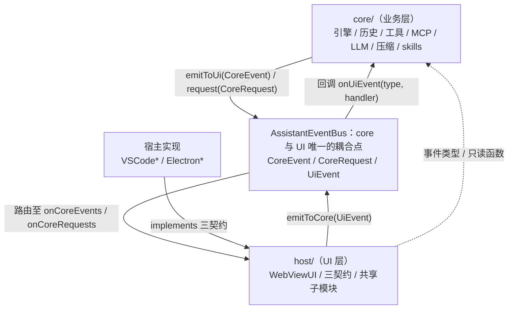

# 规格：架构总览

本文描述当前代码的整体架构（as-built）：core 与 UI 经 `AssistantEventBus` 单边耦合的
三层结构，以及各模块的职责与依赖。本文只回答「应该是什么样」，不写计划与演进过程。

交叉引用：依赖规则见 [layering.md](layering.md)、事件词汇表见 [events.md](events.md)、
类图见 [class-diagrams.md](class-diagrams.md)、宿主契约见 [contracts.md](contracts.md)、
目录布局见 [repo-map.md](repo-map.md)；全部文档的索引见
[docs/README.md](../README.md)。

## 1. 架构概述

core 与 UI 之间不存在直接引用，二者仅通过 `AssistantEventBus` 上的事件耦合。

`WebViewUI` 是唯一的 UI 实现，它不实现任何事件契约，只订阅总线并发送事件。
所有宿主差异收敛在三个契约上：

| 契约 | 职责范围 |
| --- | --- |
| `UIHost` | 对话 webview 的宿主能力 |
| `SpinDesign` | Spin 设计器（独立面板 / 窗口） |
| `ConversationManager` | 对话列表与会话运行时状态（空闲会话回收在 VS Code 实现里） |

## 2. 分层结构

以模块为单位组织：三个分层模块（core / host / 宿主实现）加一个横跨 core 与 UI 的事件契约。
依赖方向单向：`宿主实现 → host/ → core/`，core 与 UI 之间唯一的边是 `AssistantEventBus`
（依赖规则逐条见 [layering.md](layering.md)）。

#### 模块一览

| 模块 | 位置 | 职责 | 依赖 | 被依赖 |
| --- | --- | --- | --- | --- |
| core（业务层） | `src/core/` | 引擎（`QueryEngine` / `Query` / `RunTools`）、历史（`history/`）、工具（`tools/`）、MCP（`mcp/`）、LLM 配置（`llm/`）、压缩（`compact/`）、skills、prompt、spin、会话运行时（`sessionRuntime.ts`）、命令分发（`CommandDispatcher.ts`） | `AssistantEventBus` 的事件类型与 `requireEventBus()` | host/、宿主实现（只读函数与类型） |
| AssistantEventBus（事件契约） | 类型在 `src/core/AssistantEventBus.ts`，实现在 `src/host/EventBus.ts` | core 与 UI 之间唯一的耦合点；事件词汇表 `CoreEvent` / `CoreRequest` / `UiEvent` / `UiRequest`；全局注册（`setGlobalEventBus` / `requireEventBus` / `resetGlobalEventBus`） | 无（纯接口 + 纯数据类型） | core、host、宿主实现 |
| host（UI 层） | `src/host/`，禁止 import `vscode` / `electron` | `WebViewUI`（唯一 UI 实现）；三契约 `UIHost` / `SpinDesign` / `ConversationManager`；连接模型 `Client` / `Connection` 与总线实现；共享子模块（`ui/toolHandler.ts` / `ui/userChoice.ts` / `ui/webviewMessageHandler.ts`）；`SessionUiState` | core 的事件类型与只读函数 | 宿主实现（implements 三契约） |
| 宿主实现 | `src/VSCode*.ts`、`electron/*.ts`、`tui-rs/` | 三契约的 VS Code / Electron 两端实现（`VSCodeUIHost` / `ElectronUIHost`、`VSCodeSpinDesign` / `ElectronSpinDesign`、`SingleWebViewConversationManager` / `ElectronConversationManager`），bootstrap 接线（`extension.ts` / `electron/main.ts` 调用共享骨架 `host/bootstrapCore.ts`）；TUI 是独立 Rust 宿主（`tui-rs/`），直连 Standalone Core 帧通道、不走 `host/`，core 帧 ↔ 渲染动作的翻译见 [docs/hosts/tui.md 第 5 节](../hosts/tui.md#5-译层映射hostrs--ts-宿主行为) | host/（三契约、WebViewUI 与 bootstrap 骨架）、core 只读函数、宿主 API（TUI 侧无宿主 API，直接面向帧协议） | —（顶层） |

#### 模块要点

- **core**：不依赖 UI、宿主与渲染。对外只做两件事——通过 `requireEventBus().emitToUi(...)`
  发单向事件、通过 `request(...)` 发请求-响应；对 `UiEvent` 是分散订阅
  （`bus.onUiEvent(type, handler)`，唯一注册入口为 `initializeCoreEvents.ts`）。
- **host/WebViewUI**：唯一的 UI 实现，不实现任何事件契约。构造时经 `Client` 一次性
  注册处理器（映射类型强制穷尽检查；每个 Connection 建立时把同一份表注册到自己的
  总线），需要通知 core 时调用 `emitToCore(UiEvent)`（Client 按 `sessionId` 路由）；
  持有 `SessionUiState` / `ToolHandler` / `UserChoiceManager` / `WebviewMessageHandler`，
  构造注入 `host` / `spinDesign` / `conversations` 三个契约。
- **host/Client / Connection**：连接模型（[docs/core/client-connection.md](../core/client-connection.md)）。Client 是宿主级
  唯一实例（工作区 / 会话路由、配置快照推送、就绪门禁）；Connection 是宿主与一个 Core
  的一对一连接（总线、就绪状态、会话集合）。`standalone` 下每个打开的工作区一个
  Connection、一个 Core 进程（经 daemon channel）；`embedded` 恒一个。
- **三契约**：按 UI surface 划分——`UIHost` 服务对话 webview、`SpinDesign` 服务
  Spin 设计器、`ConversationManager` 服务对话列表与会话运行时状态；
  全部由宿主实现层提供，`WebViewUI` 只认契约不认实现。
- **宿主实现**：唯一允许 import `vscode` / `electron` 的层；同时负责 bootstrap 接线：
  共享骨架 `host/bootstrapCore.ts`（Client 与全局总线 → `WebViewUI.create` →
  按工作区打开 Connection → 历史 / 会话队列 / 等待用户读取器）+
  各自的宿主专属接线（[docs/hosts/host-bootstrap.md 第 1 节](../hosts/host-bootstrap.md#1-宿主接线)）。
