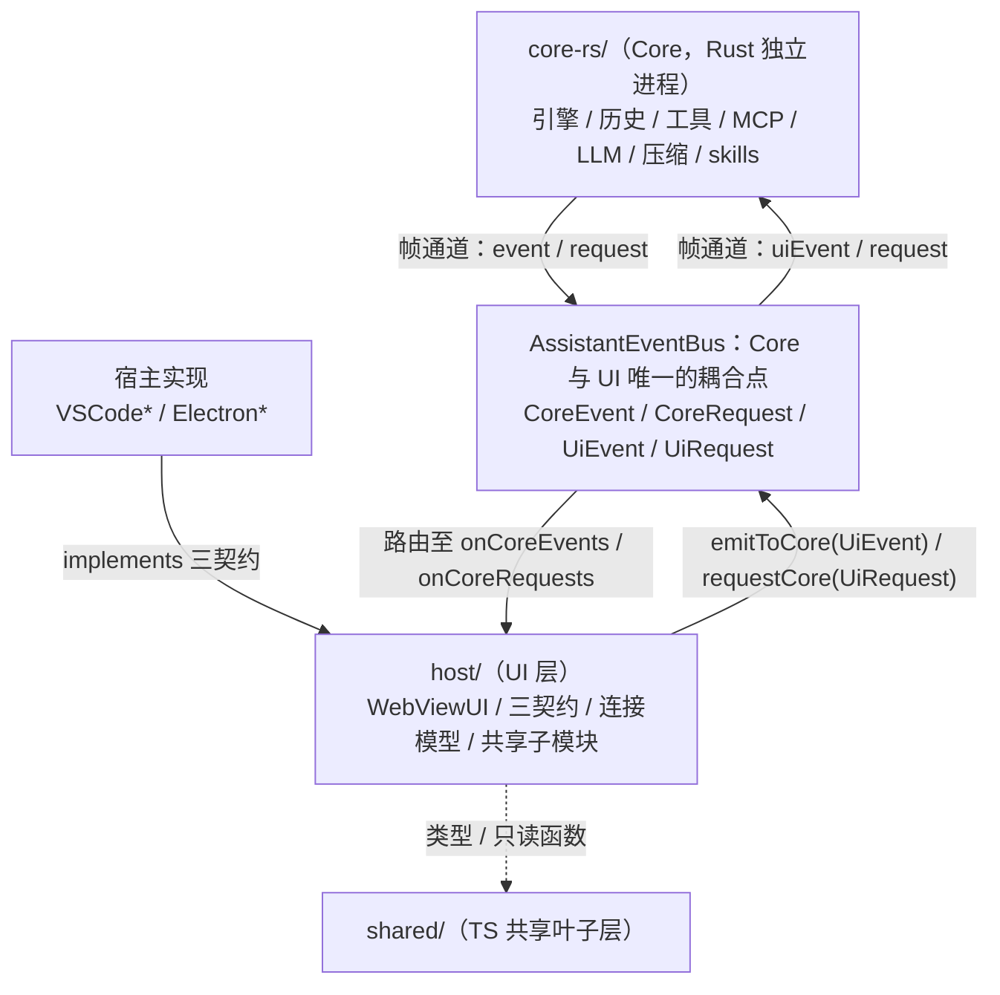

# 规格：架构总览

本文描述当前代码的整体架构（as-built）：Core（Rust 独立进程）与 UI 经
`AssistantEventBus` 单边耦合的分层结构，以及各模块的职责与依赖。本文只回答
「应该是什么样」，不写计划与演进过程。

交叉引用：依赖规则见 [layering.md](layering.md)、事件词汇表见 [events.md](events.md)、
类图见 [class-diagrams.md](class-diagrams.md)、宿主契约见 [contracts.md](contracts.md)、
目录布局见 [repo-map.md](repo-map.md)；全部文档的索引见
[docs/README.md](../README.md)。

## 1. 架构概述

core 与 UI 之间不存在直接引用，二者仅通过 `AssistantEventBus` 上的事件耦合。Core 是
Rust 实现的独立进程（`core-rs/`），UI 侧（宿主与 webview）全是 TypeScript。

`WebViewUI` 是唯一的 UI 实现，它不实现任何事件契约，只订阅总线并发送事件。
所有宿主差异收敛在三个契约上：

| 契约 | 职责范围 |
| --- | --- |
| `UIHost` | 对话 webview 的宿主能力 |
| `SpinDesign` | Spin 设计器（独立面板 / 窗口） |
| `ConversationManager` | 对话列表与会话运行时状态（空闲会话回收在 VS Code 实现里） |

## 2. 分层结构

以模块为单位组织：三个 TS 分层（`src/shared/` / `src/host/` / 宿主实现）加 Core
（Rust 独立进程）。依赖方向单向：`宿主实现 → host/ → shared/`；Core 与 UI 之间唯一的
边是 `AssistantEventBus` 上的帧通道（依赖规则逐条见 [layering.md](layering.md)）。

#### 模块一览

| 模块 | 位置 | 职责 | 依赖 | 被依赖 |
| --- | --- | --- | --- | --- |
| Core（Rust） | `core-rs/` | core 侧全部职责：引擎（`engine.rs`）、历史（`history.rs`）、工具（`tools.rs`）、MCP（`mcp.rs`）、LLM 客户端（`llm.rs` / `responses.rs`）、压缩（`compact.rs`）、skills（`skills.rs`）、命令分发（`commands.rs`） | 帧协议（`frame.rs`）；不 import TS 侧任何代码 | 宿主经帧通道消费 |
| AssistantEventBus（事件契约） | `src/shared/AssistantEventBus.ts` | Core 与 UI 之间唯一的耦合点；事件词汇表 `CoreEvent` / `CoreRequest` / `UiEvent` / `UiRequest`；全局注册（`setGlobalEventBus` / `requireEventBus` / `resetGlobalEventBus`） | 无（纯接口 + 纯数据类型） | shared、host、宿主实现 |
| shared（TS 共享叶子层） | `src/shared/` | 总线契约、共享类型（`types.ts` / `webviewTypes.ts` / `settingsSnapshot.ts` 配置默认值唯一来源）、会话落盘格式读写库（`history/`，与 Core 共用同一格式）、纯工具（`utils/`）、Spin 设计器纯逻辑（`spin/`） | 无（不 import host 与宿主 API） | host、宿主实现、webview |
| host（UI 层） | `src/host/`，禁止 import `vscode` / `electron` | `WebViewUI`（唯一 UI 实现）；三契约 `UIHost` / `SpinDesign` / `ConversationManager`；连接模型 `Client` / `Connection` 与帧通道总线实现（`standalone/`）；共享子模块（`ui/toolHandler.ts` / `ui/userChoice.ts` / `ui/webviewMessageHandler.ts`）；`SessionUiState` | shared 的类型与只读函数 | 宿主实现（implements 三契约） |
| 宿主实现 | `src/VSCode*.ts`、`electron/*.ts`、`tui-rs/` | 三契约的 VS Code / Electron 两端实现（`VSCodeUIHost` / `ElectronUIHost`、`VSCodeSpinDesign` / `ElectronSpinDesign`、`SingleWebViewConversationManager` / `ElectronConversationManager`），bootstrap 接线（`extension.ts` / `electron/main.ts` 调用共享骨架 `host/bootstrapCore.ts`）；TUI 是独立 Rust 宿主（`tui-rs/`），直连 Core 帧通道、不走 `host/`，core 帧 ↔ 渲染动作的翻译见 [docs/hosts/tui.md 第 5 节](../hosts/tui.md#5-译层映射hostrs--ts-宿主行为)；PyCharm 插件是独立 Kotlin 宿主（`pycharm-plugin/`），同款直连，见 [docs/hosts/pycharm-plugin.md](../hosts/pycharm-plugin.md) | host/（三契约、WebViewUI 与 bootstrap 骨架）、shared 只读函数、宿主 API（TUI 侧无宿主 API，直接面向帧协议） | —（顶层） |

#### 模块要点

- **Core（core-rs/）**：不依赖 UI、宿主与渲染，也不 import TS 侧任何代码。对外只做两
  件事——把 `CoreEvent` / `CoreRequest` 写为帧通道上的帧、消费 `UiEvent` / `UiRequest`；
  `UiEvent` 的分发入口是 `main.rs` 的 `dispatch_ui_event`（逐事件分派到对应模块）。
- **host/WebViewUI**：唯一的 UI 实现，不实现任何事件契约。构造时经 `Client` 一次性
  注册处理器（映射类型强制穷尽检查；每个 Connection 建立时把同一份表注册到自己的
  总线），需要通知 core 时调用 `emitToCore(UiEvent)`（Client 按 `sessionId` 路由）；
  持有 `SessionUiState` / `ToolHandler` / `UserChoiceManager` / `WebviewMessageHandler`，
  构造注入 `host` / `spinDesign` / `conversations` 三个契约。
- **host/Client / Connection**：连接模型（[docs/core/client-connection.md](../core/client-connection.md)）。Client 是宿主级
  唯一实例（工作区 / 会话路由、配置快照推送、就绪门禁）；Connection 是宿主与一个 Core
  的一对一连接（总线、就绪状态、会话集合）。每个打开的工作区一个 Connection、一个
  Core 进程（本机 `stdio` 直起或经 daemon channel）。
- **三契约**：按 UI surface 划分——`UIHost` 服务对话 webview、`SpinDesign` 服务
  Spin 设计器、`ConversationManager` 服务对话列表与会话运行时状态；
  全部由宿主实现层提供，`WebViewUI` 只认契约不认实现。
- **宿主实现**：唯一允许 import `vscode` / `electron` 的层；同时负责 bootstrap 接线：
  共享骨架 `host/bootstrapCore.ts`（Client 与全局总线 → `WebViewUI.create` →
  按工作区打开 Connection → 工作区变化订阅）+
  各自的宿主专属接线（[docs/hosts/host-bootstrap.md 第 1 节](../hosts/host-bootstrap.md#1-宿主接线)）。
